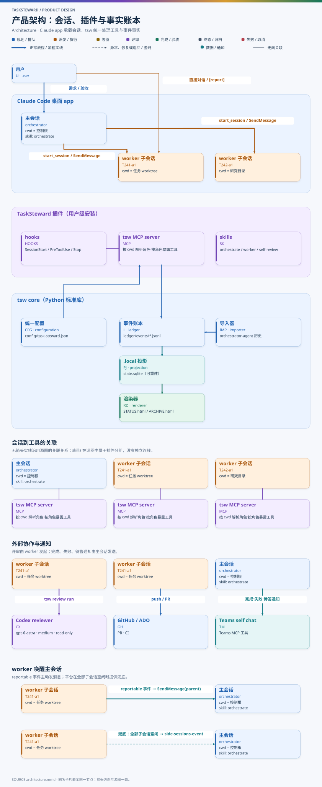
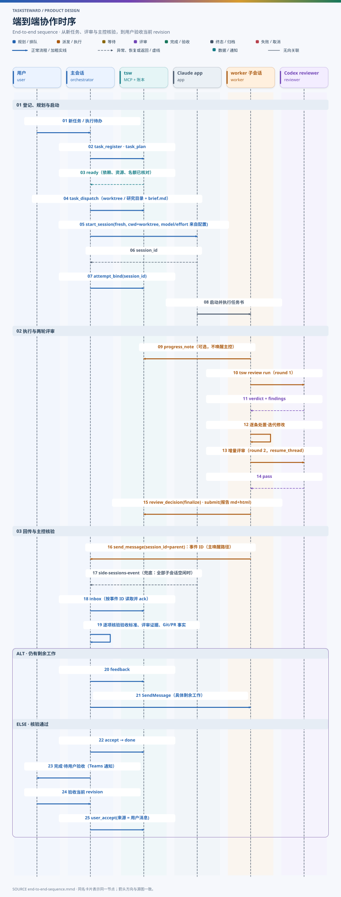

# DN001 总体架构：TaskSteward 任务编排器（默认宿主 Claude Code）

- 状态：设计草案（T233 r3）
- 日期：2026-11-05
- 相关：[DN002 任务状态机](DN002-task-state-machine.md) · [DN003 统一配置](DN003-unified-config.md) · [DN004 worker 自评审](DN004-worker-self-review.md) · [DN005 历史导入与 resume](DN005-history-import-and-resume.md) · [DN006 插件层](DN006-plugin-layer.md) · [DN007 账本与上下文检索](DN007-ledger-and-context.md)

## 1. 背景

上一代实现 **orchestrator-agent** 由 Codex 或 Copilot 主会话按 skill 约定调度，Python 账本只记账和设门禁，不调用模型。约定大量写在 `AGENTS.md` 和 skill 里，执行靠模型自觉；平台差异分散在两份平台参考里。

本设计保留它的领域模型（仓库配置、研究 / 设计 / 开发三类任务、worktree、集成、PR 与产出登记、用户验收、归档），并做三点改变：

- 状态推进由程序门禁、事件驱动和幂等命令保证，不依赖模型自觉；
- 会话管理交给宿主自身的会话能力，规则执行交给宿主的强制机制；
- 宿主相关的部分经插件层接入（DN006），默认宿主是 Claude Code 桌面 app。

## 2. 目标与非目标

**目标**

1. 主会话（orchestrator）是 Claude Code app 中的一个会话；每个任务的 worker 是它启动的**关联子会话**（sub session），用户可在侧栏直接与 worker 对话。
2. worker 完成任务后，自己调用 Codex（`gpt-6-astra`，推理强度 `medium`，只读沙箱）评审成果，并自行决定是否迭代；之后由主会话验收，最后交用户人工验收。
3. 所有参数（各角色模型、effort、权限模式、评审器、并发、仓库、通知、策略）放在**一个统一配置**中，见 DN003。
4. 可以导入 orchestrator-agent 的全部历史。pending 与待用户验收的任务可凭任务书和已有交付报告 resume；已归档、已验收的任务只读，见 DN005。
5. 状态由账本事件驱动，任务状态机见 DN002。
6. 调度层插件化，支持不同用户配置（例如没有 Codex 或没有 Claude Code），见 DN006。
7. worker 提问、评审预算用完、阻断项延后请求先由主会话在授权边界内综合判断，确需人类时经插件式渠道请求（in-session、Teams、remote-hub Portal），见 DN006 §8。
8. 运行数据放在与产品 repo 分离的数据目录，备份该目录即可，见 §8 与 DN006 §9。

**非目标**

- 不为某个宿主写专用核心逻辑；宿主差异只出现在 DN006 的插件实现中。
- 不提供“Astra 对照版”（面向用户成品由另一模型独立出一版再比较）。该功能删除，导入的历史对照目录只作证据保留。
- 不默认对可执行文件做哈希，也不在设计中引入可执行文件哈希校验（用户 2026-10-30 全局约定）。
- 本文是产品设计，不授权实现运行代码；实现另立开发任务。

## 3. 术语

| 术语 | 含义 |
| --- | --- |
| 数据目录（`TSW_HOME`，原称控制根） | 存放用户配置、TODO、任务书、账本、runs 的目录，与产品 repo 分离；主会话的 cwd（DN006 §9） |
| 产品仓库 | 本仓库 `task-steward`：插件、tsw core、MCP server、hooks、文档 |
| tsw | TaskSteward 的核心库与 CLI（Python 3.10+ 标准库） |
| 主会话 / orchestrator | 在数据目录打开的 Claude app 会话，持有调度租约 |
| worker 子会话 | 主会话用 `start_session` 启动的关联会话，一个 attempt 一个 |
| attempt | 一次执行尝试 `Txxx-aN`，绑定一个子会话和一个执行目录 |
| 执行目录 | 设计 / 开发任务的独立 worktree，或研究任务的工作目录 `work/Txxx/aN/`；设计 / 开发任务另以 `work/Txxx/aN/` 作为草稿可写根（DN006 §9.4） |
| reportable 事件 | 需要主会话处理的事件：提交、提问、评审受阻、明确停止、`[report]` 回传 |

## 4. 总体架构



图源：[diagrams/architecture.mmd](diagrams/architecture.mmd)

| 组件 | 位置 | 职责 |
| --- | --- | --- |
| 主会话 | Claude app，cwd = 数据目录 | 理解需求、规划依赖、派发、核验、验收、与用户沟通；所有状态变更都经 tsw 工具 |
| worker 子会话 | Claude app，cwd = 执行目录 | 调查、实现、验证、写报告、调用 Codex 自评审并决定迭代、提交 |
| tsw MCP server | 插件提供，stdio | 按会话角色暴露工具（§7），所有写操作都经它进入账本 |
| hooks | 插件提供 | 角色识别、写入范围与危险命令拦截、主会话结束前的待办检查（§7.3） |
| skills | 插件提供 | `orchestrate`（主会话流程）、`worker`（执行协议）、`self-review`（评审处置规范） |
| tsw core | 产品仓库 Python 包 | 账本、配置、门禁、渲染、导入、插件加载（评审器等插件见 DN006） |
| 事件账本 | 数据目录 `ledger/` | 唯一事实来源，JSONL 追加写，带序号和前序摘要链 |
| 投影与检索索引 | 数据目录 `cache/state.sqlite`、`cache/context.sqlite` | 可随时由账本重建的状态投影与任务卡片 / 全文索引（DN007） |
| 渲染器 | tsw core | 每次事件提交后生成 STATUS.html / ARCHIVE.html，模型不写页面 |
| Codex reviewer | 本机 `codex` CLI | worker 调用的一次性只读评审线程 |

## 5. 角色与职责

| 事项 | 用户 | 主会话 | worker 子会话 | Codex reviewer |
| --- | --- | --- | --- | --- |
| 提出 / 修改需求 | 负责 | 记录任务书与 revision | 只在 `[report]` 时回传用户新要求 | — |
| 规划、依赖、并发 | 可指定约束 | 负责 | — | — |
| 准备执行目录、派发 | — | 负责 | — | — |
| 实现与验证 | 可在子会话直接指导 | 不代做 | 负责 | — |
| 成果评审 | — | 复核评审证据 | 发起、逐条处置、决定迭代 | 给出结构化意见 |
| 技术验收（done） | — | 负责，逐项核验 | 提供证据 | — |
| 人工验收（accepted） | 负责 | 记录真实来源 | — | — |
| 归档 | 可指定 | 执行并核实会话处置 | — | — |

## 6. 会话模型

### 6.1 主会话

主会话是在数据目录打开的普通 Claude app 会话，加载数据目录的 `CLAUDE.md` 和插件 skill `orchestrate`。用户要求执行、继续、恢复或调整待办时，主会话按 skill 流程工作。普通仓库维护、解释问题不会开始执行真实待办。

### 6.2 worker 子会话的创建

主会话在派发（DN002 T07）准备好执行目录和任务书后，按 R-ATTEMPT（DN002 §5.5）决定续用原子会话还是新建。新建时调用 app 的 `start_session`，参数全部来自统一配置的 `roles.worker`，不继承主会话：

| start_session 参数 | 取值 | 说明 |
| --- | --- | --- |
| `initiation` | `user_asked` | 用户已要求执行该任务 |
| `context` | `fresh` | 不 fork 主会话的长上下文；任务所需背景全部在 brief 里 |
| `cwd` | 执行目录（worktree 或研究目录） | worktree 由 tsw 创建，不让 app 另建 |
| `use_worktree` | `false` | 在已有目录中工作；app 归档会话时不会删除该目录（假设 A7） |
| `name` | `txxx-aN-gK` | K 为创建代次（DN002 §5.4），每次请求创建加 1；用于对账，在 linked 会话中唯一 |
| `model` / `effort` | `roles.worker.model` / `roles.worker.effort` | 如实记录请求值；实际值以 `get_session` 回执为准 |
| `permission_mode` | `roles.worker.permission_mode` | 不能高于主会话自身模式（平台限制） |
| `prompt` | worker 启动指令 | 指向 `runs/Txxx/aN/brief.md`，说明工具、评审与回传协议 |
| `background` | 任务目标摘要（≥80 字） | 平台对 fresh 会话的要求 |

先写 `attempt.start_requested` 事件，再调用工具。结果未知时按会话名对账（`list_sessions {linked:true}`），不再次创建（DN002 §6 `starting` 阶段）。

### 6.3 平台约束与派发策略

以下约束来自 2026-11-05 Claude app 会话工具的定义，实现前须以 PoC 实测（§12）：

1. 由其他会话的消息或自动事件触发的 turn 中，app 会拒绝启动新会话，只能生成提案卡片。唯一例外：紧接在用户本人 turn 之后的 `side-sessions-event` 链。
2. 只有当主会话启动的子会话**全部**不在工作、且主会话空闲时，app 才用 `side-sessions-event` 唤醒主会话，并只引用子会话最新回复的前 400 字。
3. 连续多次被 side-sessions-event 唤醒而用户没有发消息后，后续通知会等到用户的下一个 turn。
4. 子会话的权限模式不能高于主会话。

因此派发与唤醒策略为：

- **派发窗口**：用户 turn 内，或紧随其后的 side-sessions-event 链中，主会话直接 `start_session`。其他 turn 中，ready 任务改为生成提案卡片（attempt `proposed`），用户点击即启动；同时在 STATUS 页显示“待启动”。不得把多个独立 CLI 进程伪装成子会话。
- **唤醒**：worker 产生 reportable 事件时，必须同时调用 tsw 工具落账**并**用 `SendMessage` 向父会话发送一行带事件 ID 的短消息（主唤醒路径，见 §9 时序第 16 步）。这样即使其他 worker 仍在工作，主会话也能被唤醒。side-sessions-event 只在全部子会话空闲时到达，作为兜底。
- **处理范围**：被唤醒后，主会话只读取 `inbox` 中未处理的 reportable 事件（按事件 ID 去重并 ack）。普通进度、无回传的 idle、interactive 超时都不触发查询、催办或改账本（沿用用户 2026-10-13 的约定）。

### 6.4 调度租约

同一时间只有一个主会话持有调度租约。SessionStart hook 把 Claude 会话 ID 交给 tsw：

- 租约空闲或已过期时自动领取；
- 仍有效时只读运行，拒绝派发类工具；
- 用户确认原主会话已停止后，用 `controller_takeover` 接管，并逐项处理该主会话启动的子会话。

**子会话只受启动它的主会话控制。** 接管后，新主会话不能向旧主会话的子会话发消息：先核实其停止，再以新 attempt 接手同一执行目录（DN002 §5.5）。

### 6.5 用户直接与 worker 对话

用户在子会话里直接对话时，worker 默认原地答复：不回传主会话，不改 revision，不写 result 报告。只有用户消息带 `[report]` 时，worker 才：

1. 调用 `report_back` 落账（任务 ID、用户决定、已做动作、影响范围）；
2. 再 `SendMessage` 通知父会话。

原地答复不放宽可写范围、账本与远端交付约束。改动已验收产物时，worker 须告诉用户“尚未回传、尚未重新验收”。

### 6.6 子代理的使用边界

Claude Code 的 `Agent` 子代理（in-process subagent）**不作为业务 worker**：用户不能直接对话，生命周期依附父会话，不能被交接。worker 可以在自己的任务内使用子代理做并行调查或局部审查，但不能启动会话、调度其他 worker 或与其他 worker 对话。

## 7. 工具面

### 7.1 角色解析

tsw MCP server 由用户级插件安装，每个会话启动一个进程。角色由 cwd 解析（假设 A3）：

- cwd 等于数据目录 → orchestrator；
- cwd 等于某个已登记 attempt 的执行目录 → 该 attempt 的 worker；
- 其他 → 只暴露 `whoami` 和只读帮助。

hooks 同时拿到 `session_id` 和 `cwd`，与 attempt 绑定交叉校验：会话 ID 不匹配时拒绝写工具。不在 prompt 中放 token 或 capability 文件路径。

### 7.2 按角色的 MCP 工具

| 工具 | orchestrator | worker | 说明 |
| --- | --- | --- | --- |
| `whoami` | ✓ | ✓ | 角色、任务、attempt、可写路径 |
| `task_read` / `context_catalog` / `context_read` / `context_search` / `context_decisions` / `context_task` | ✓ | 只限该 attempt 的授权读取集合（DN007 §7.2） | 任务卡片、原文、全文片段、用户决定、本任务过程 |
| `task_register` / `task_update` / `task_plan` | ✓ | — | T01–T06 |
| `task_dispatch` / `attempt_bind` / `attempt_reconcile` | ✓ | — | T07–T10、T15 |
| `inbox` / `inbox_ack` | ✓ | — | 未处理 reportable 事件 |
| `feedback` / `pause` / `resume` / `request_input` / `resolve_input` | ✓ | `pause` 仅自身 | T02、T12、T14、T17、T19–T21 |
| `integrate` / `integration_withdraw` | ✓ | — | `verifying` 内部的集成事件 |
| `accept` / `user_accept` / `user_reject` / `archive` / `cancel` | ✓ | — | T18、T22–T26；`user_*` 必须附用户消息来源 |
| `pr_link` / `output_link` | ✓ | 登记草稿，主控核验 | PR 与产出登记 |
| `progress_note` | ✓ | ✓ | 不唤醒主会话 |
| `question` | — | ✓ | T11 |
| `review_run` / `review_triage` / `review_decide` | — | ✓ | DN004 |
| `submit` | — | ✓ | T13，执行 G-SUBMIT 检查 |
| `report_back` | — | ✓ | `[report]` 回传 |
| `attention` | ✓ | — | 只读自检：缺证、过期问题、已停未收口 |
| `operations_pending` / `operation_receipt` | ✓ | — | 委托操作的领取与回执（DN006 §4） |
| `input_triage` / `input_escalate` | ✓ | — | 主会话判断：回答、追加评审轮次、认定意见不成立、批准延后或交给人类（DN006 §8） |
| `input_response` | 渠道回调 | — | 人类渠道写回答复，核实后生效 |

每个写工具都带 `command_id`（幂等）和 `expected_version`（乐观锁）。同一 ID 内容不同则拒绝。CLI `tsw <tool>` 与 MCP 共用同一实现，供人工排查使用。

### 7.3 hooks

| hook | 角色 | 行为 |
| --- | --- | --- |
| SessionStart | 全部 | 由 cwd 与 session_id 识别角色；主会话尝试领取租约，并注入未读 inbox 数与 attention 摘要；worker 注入任务 ID、brief 路径、可写路径和评审规则 |
| PreToolUse（Edit / Write / NotebookEdit / Bash） | worker | 拒绝写出可写路径；拒绝未获交付授权的 `git push` 与 PR 操作；拒绝对可执行文件求哈希的命令（除非账本有用户批准记录）；拒绝直接修改 `ledger/`、`STATUS.html` |
| PreToolUse | orchestrator | 拒绝直接编辑 `ledger/`、生成视图和投影；拒绝在派发窗口外重复 `start_session` 同名 attempt |
| UserPromptSubmit | worker | 检测 `[report]`，注入回传协议提示 |
| Stop | orchestrator | 运行只读 `attention`；有未处理 reportable 事件时阻止一次结束（`stop_hook_active` 防循环） |
| Stop | worker | 记录 `worker.turn_ended` 观察事件（不改状态）；若处于 `reviewing` 且评审进程仍在运行，提示不要结束 |

hooks 是强制边界；skill 和 CLAUDE.md 只写流程与判断准则，不再承载可以机械检查的规则。

## 8. 数据与存储

存储分层（事件账本 / 投影 / 检索索引）、读写路径、检查点与重建，以及主会话如何检索历史任务信息，见 [DN007](DN007-ledger-and-context.md)。

### 8.1 数据目录布局

运行数据全部放在数据目录（`TSW_HOME`），不提交到产品 repo；产品 repo 只有代码、插件、schema、模板和文档。数据目录的定位、备份与恢复见 DN006 §9。下文出现的“控制根”均指数据目录。

```text
<TSW_HOME>/
  tsw-home.json                  数据目录版本与产品兼容版本
  CLAUDE.md / AGENTS.md          主会话常驻规则（由宿主集成 P1 生成，精简；流程在 skill）
  config/task-steward.json        统一配置（DN003）
  config/prompts/                用户覆盖的角色指令、评审模板（可选）
  todo/TODO.md, todo/Txxx.md     任务索引与任务书（用户意图）
  ledger/events/YYYY-MM.jsonl    活动分段；封存后为 .jsonl.gz，原字节不改
  ledger/imported/orchestrator-agent/   导入的原始事件卷与 manifest（DN005）
  runs/Txxx/aN/                  brief、报告（md + html）、评审证据、验收记录
  outbox/                        通知与人类渠道请求的持久队列
  legacy/                        导入的旧系统只读成果（DN005）
  work/                          worker 草稿与研究缓存（不直接写 runs/）
  views/STATUS.html, ARCHIVE.html  生成视图
  cache/                         投影 state.sqlite、会话登记等可重建缓存（备份可排除）
  locks/                         调度租约与写锁（备份排除）
```

### 8.2 事件格式

```json
{
  "schema": 1,
  "sequence": 1024,
  "time": "2026-11-05T02:41:00Z",
  "type": "worker.submitted",
  "task_id": "T241",
  "revision": 2,
  "attempt": "a1",
  "actor": {"role": "worker", "session_id": "local_…"},
  "command_id": "T241-a1-submit-3",
  "data": {"head": "4f1c…", "report": "runs/T241/a1/result.html", "reviews": ["r1", "r2"]},
  "prev": "<前一条事件规范 JSON 的 SHA-256>",
  "checksum": "<本条事件规范 JSON 的 SHA-256>"
}
```

- 摘要链只覆盖账本 JSON 文本，用于检测截断和篡改，不涉及可执行文件。
- 分段按月或按 16 MiB 封存。
- 投影损坏时用 `tsw ledger rebuild` 流式重放。
- 日常命令只读投影和活动分段。

### 8.3 runs 目录

```text
runs/Txxx/aN/
  brief.md / brief.json          任务书快照（revision、执行目录、可写路径、依赖成果）
  result.md / result.html        worker 交付报告（在 work/ 起草，submit 时由 tsw 导入；html 由 tsw render 生成）
  review/rK-request.md           第 K 轮评审包
  review/rK.json                 Codex 结构化意见
  review/rK-decision.json        worker 逐条处置与 iterate / finalize / escalate 决定
  review.md / review.html        主会话技术验收结论（逐项）
  user-acceptance.json           用户验收来源（会话、消息引用、原话、revision）
```

## 9. 端到端流程



图源：[diagrams/end-to-end-sequence.mmd](diagrams/end-to-end-sequence.mmd)

## 10. 与 orchestrator-agent 的对比

| 方面 | orchestrator-agent | 本设计 |
| --- | --- | --- |
| 编排者 | Codex / Copilot 主会话 + Python 账本 | 宿主中的主会话 + tsw 程序门禁 |
| worker | 原生子代理或独立会话（4 种通道） | 会话适配器承载的关联子会话（默认 Claude app） |
| 工具调用 | shell 调 `python -m orchestrator` | 按角色的 MCP 工具，身份由 cwd + hook 校验 |
| 规则执行 | 主要靠 AGENTS.md / skill 文本 | 程序门禁 + 宿主强制机制 + 精简 skill |
| 唤醒 | 平台通知、inbox 监听 | 仅 reportable 事件（SendMessage + 兜底事件） |
| 评审 | 主控 / worker 选用 Astra reviewer；另有 Astra 对照版 | worker 调用配置指定的只读评审器（默认 Codex Astra），自主迭代；无对照版 |
| 状态存储 | JSONL 事件 + 检查点 | JSONL 事件 + 可重建 SQLite 投影与检索索引 |
| 并发 | `max_workers` | `scheduling.max_workers` 门禁 |

## 11. 关键决策

| 编号 | 决策 | 理由 |
| --- | --- | --- |
| D1 | worker 使用 app 关联子会话，不用 Agent 子代理 | 用户可直接对话；生命周期独立，可停、可续、可交接；每个任务专属 |
| D2 | JSONL 事件为唯一事实，SQLite 只作投影 | 便于 Git 同步和审计，可与导入的历史卷并存；投影可丢弃 |
| D3 | 工具面采用 MCP，角色由 cwd + hook 解析 | 去掉 prompt 中的 token 和 shell 审批开销；参数有类型；按角色隔离 |
| D4 | 可机械检查的规则由 hooks 强制 | 减少常驻规则文本，避免模型遗忘；worktree 成为实际写入边界 |
| D5 | worktree 由 tsw 创建，子会话以 `cwd` + `use_worktree:false` 打开 | 保留证据目录；app 归档会话不删除执行现场 |
| D6 | 删除 Astra 对照版，新增 worker 自评审 | 用户 2026-11-05 指定；评审意见由执行者处置，减少主控往返 |
| D7 | 只处理 reportable 事件 | 沿用用户 2026-10-13 的协调约定，控制 token 成本 |
| D8 | 统一配置单文件，本机 overlay 只允许路径类字段 | 所有参数一处可见；机器相关路径不进入共享配置 |
| D9 | 产品 repo 与数据目录分离；数据目录可选作为用户自己的私有 Git 仓库 | 多用户共用同一产品 repo 而不交叉提交运行信息；备份数据目录即可持久化 |
| D10 | 历史以“原卷字节保存 + 每任务导入事件”方式导入 | 历史可审计、不改写；只读与可 resume 分类明确 |
| D11 | 宿主相关能力经插件层接入，宿主工具只能由模型调用时用“委托操作 + 回执” | 不与单一宿主绑定；沿用旧系统通知队列已验证的 claim/receipt 模式 |
| D12 | worker 提问、评审预算用完、延后请求先由主会话在授权边界内综合判断，确需人类再经渠道请求 | 减少打断用户；判断不按硬分类，唯一硬边界是不越过已有授权；决定留痕并汇总给用户核对 |
| D13 | 评审器复用会话适配器的 oneshot 能力，由 `roles.reviewer.session` 单独选择 | 插件类型更少；评审可以与主会话、worker 使用不同宿主 |
| D14 | 历史检索以任务卡片为单位分层读取，用户决定与偏好结构化积累 | 主会话在上下文预算内找到依据；替代把用户约定写成常驻长文本 |

## 12. 待 PoC 验证的假设

| 编号 | 假设 | 不成立时的回退 |
| --- | --- | --- |
| A1 | `start_session` 可用 `cwd` 打开 tsw 创建的 worktree（`use_worktree:false`），且 model / effort / permission_mode 生效 | 用 `use_worktree:true` 由 app 创建 worktree，再由 tsw 接管登记（类似 adopt），并关闭归档时的目录清理 |
| A2 | 自动事件 turn 拒绝启动会话的边界与 §6.3 一致，提案卡片可由用户点击启动 | 派发只在用户 turn 进行；STATUS 页和 Teams 提示“有 N 个任务待启动” |
| A3 | 用户级插件的 MCP server 在子会话中以子会话 cwd 启动 | 由 SessionStart hook 写 `.local/sessions/<id>.json`，工具调用时带 `session_id` 参数，由 hook 交叉校验 |
| A4 | 子会话可用 `SendMessage` 发给父会话（`parent`），主会话忙时排队 | 仅依赖 side-sessions-event + inbox；主会话每个用户 turn 先读 inbox |
| A5 | hooks 在子会话中生效，可拿到 `session_id` 与 `cwd` | 在 MCP 工具层做同样的检查，并把写入范围放进 worker 的权限 deny 规则 |
| A6 | 本机 `codex`（当前 0.163.0）的 app-server 一次性线程可用 `gpt-6-astra` / `medium` / read-only | 回退 `codex exec`；仍不可用时经 DN002 T11 进入 `waiting_user` 由用户决定，不跳过评审 |
| A7 | `archive_session` 不删除 `use_worktree:false` 会话的目录 | 验收后不归档会话，只记录逻辑退役 |
| A8 | `get_session` 能返回子会话实际 model / effort / 权限模式 | 只记录请求值，标“实际值未知” |

## 13. 文档索引

| 文档 | 内容 |
| --- | --- |
| [DN001 总体架构](DN001-architecture.md) | 本文 |
| [DN002 任务状态机](DN002-task-state-machine.md) | 按主控视角划分的单张任务状态机（含 worker 内部评审子状态）与导入映射；迁移表、守卫、不变量 |
| [DN003 统一配置](DN003-unified-config.md) | `config/task-steward.json` 结构、字段、校验与生效规则 |
| [DN004 worker 自评审](DN004-worker-self-review.md) | Codex Astra 评审调用、意见处置、迭代决策与证据 |
| [DN005 历史导入与 resume](DN005-history-import-and-resume.md) | orchestrator-agent 历史导入、分类、resume 资料包与切换 |
| [DN006 插件层](DN006-plugin-layer.md) | 宿主集成、会话适配器（含一次性评审）、人类渠道、存储后端四类插件的职责与接口；委托操作；主会话判断；数据目录；组合示例 |
| [DN007 账本与上下文检索](DN007-ledger-and-context.md) | 三层存储（事件账本、投影、检索索引）、写读路径与重建；任务卡片、检索工具、用户决定与偏好；主会话与 worker 的历史读取方式 |
