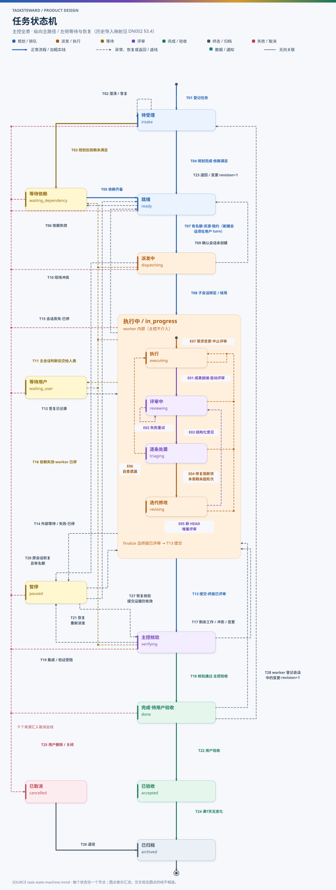

# DN002 任务状态机

- 状态：设计草案（T233 r5，已按 PoC 结果修订）
- 日期：2026-11-05
- 相关：[DN001 总体架构](DN001-architecture.md) · [DN003 统一配置](DN003-unified-config.md) · [DN004 worker 自评审](DN004-worker-self-review.md) · [DN005 历史导入与 resume](DN005-history-import-and-resume.md) · [DN006 插件层](DN006-plugin-layer.md)

本文定义 TaskSteward 的任务状态、迁移、触发者、守卫条件和副作用。状态只能通过账本事件改变：每次迁移对应一条带 `sequence` 的事件，投影和状态页由事件归约得到，模型和页面都不能直接改状态。

## 1. 状态划分原则

**从主会话（orchestrator）的角度划分状态**：两个状态之间只有在必须等待“别的事情”发生时才分开。别的事情包括用户澄清或决定、前序任务完成、名额或资源释放、平台创建会话、worker 执行、外部条件恢复。主会话自己立刻就能完成的步骤（规划、准备 worktree、生成任务书、核验）不单独成为状态，而是作为迁移的副作用。

按此原则，相对第 1 版合并了以下状态：

| 第 1 版状态 | 本版 | 理由 |
| --- | --- | --- |
| `pending`（登记未规划） | `intake` 待受理 | 登记到规划之间唯一需要等的是用户澄清，因此只保留一个“待受理”状态：有待澄清问题就停在这里，否则主会话直接规划离开 |
| `preparing` + `dispatching` | `dispatching` 派发中 | 准备执行目录和任务书是主会话的即时动作；真正需要等的是平台创建会话、任务书送达或对账 |
| `submitted` + `integrating` + `conflict` | `verifying` 主控核验 | 都由主会话持有：核验、集成、组合验证。冲突需要 worker 解决时回到 `in_progress`（T17），不另设冲突状态 |
| `failed` | `paused`（类别 `failure`） | 失败与暂停都是“worker 已停、名额释放、等条件恢复”，处理方式相同；页面用类别标签区分 |
| attempt 状态机（独立图） | attempt 阶段属性（§6） | 会话预启动、创建、对账、停止、丢失都已体现为任务迁移的守卫和副作用，不再单独成图 |

保留分开的状态，以及它们各自在等待什么：

| 状态 | 在等什么 |
| --- | --- |
| `intake` | 用户澄清（或主会话尚未受理导入、退回的任务） |
| `waiting_dependency` | 前序任务完成 |
| `ready` | 名额、资源、调度租约或派发窗口 |
| `dispatching` | 平台创建子会话或任务书送达待命会话 |
| `in_progress` | worker 执行（内部含自评审） |
| `waiting_user` | 用户回答 worker 的问题；worker 会话保持，名额保持 |
| `paused` | 外部条件、用户 park、失败原因排除、导入交接；worker 已停，名额释放 |
| `verifying` | 主会话核验与集成（含等待 CI、PR 合并等外部事实）；worker 已自行合并的开发任务为合并后核对（§3.5） |
| `done` | 用户人工验收 |
| `accepted` | 7 天无变化后归档 |
| `cancelled` / `archived` | 退役 / 终态 |

## 2. 状态定义

| 状态 | 中文标签 | 含义 | 占用名额 | 终态 | 可 resume |
| --- | --- | --- | --- | --- | --- |
| `intake` | 待受理 | 已登记（新建、导入未规划、退回或需求变更后），等待主会话受理；有待澄清问题时停留 | 否 | 否 | 是 |
| `waiting_dependency` | 等待依赖 | 已规划，至少一个依赖未满足 | 否 | 否 | 是 |
| `ready` | 就绪 | 依赖满足，等待名额、资源、租约或派发窗口 | 否 | 否 | 是 |
| `dispatching` | 派发中 | 执行目录与任务书已就绪，正在创建或续用 worker 子会话 | 是 | 否 | 是 |
| `in_progress` | 执行中 | worker 持有任务；内部子状态见 §3.3 | 是 | 否 | 是 |
| `waiting_user` | 等待用户 | worker 提问或评审受阻，等待用户答复；子会话保持 | 是 | 否 | 是 |
| `paused` | 暂停 | worker 已停；带 owner / next_action / resume_condition / 类别 | 否 | 否 | 是 |
| `verifying` | 主控核验 | worker 已提交终版与评审证据，主会话核验、集成、组合验证；worker 已合并时为合并后核对 | 是 | 否 | 是 |
| `done` | 完成·待用户验收 | 主会话已技术验收，等待用户人工验收 | 否 | 否 | 是（仅验收或退回） |
| `accepted` | 已验收 | 用户已验收当前 revision；只读 | 否 | 否 | 否 |
| `cancelled` | 已取消 | 用户删除或关闭；只读 | 否 | 否（可归档） | 否 |
| `archived` | 已归档 | 退役，禁止复用其 agent 和会话 | 否 | 是 | 否 |

`paused` 的类别：`external`（外部依赖）、`user_park`（用户明确搁置）、`failure`（已核实失败）、`workdir_conflict`（现场冲突待决定）、`integration_blocked`（集成或验证受阻）、`import_handover`（导入的活动任务待核实旧 worker 停止）。

## 3. 状态机

### 3.1 状态图

全部状态与迁移（含取消、依赖失效，以及执行中的 worker 内部子状态）都在同一张图中。历史导入只是一次性的入口映射，不画在图里，见 §3.4 与 DN005 的导入分类图。

图源：[diagrams/task-state-machine.mmd](diagrams/task-state-machine.mmd)。同一图源的 Mermaid 自动布局版本见[附录 A](#附录-a自动布局版本)。

### 3.2 迁移表

“触发者”：O = 主会话，W = worker 子会话，U = 用户（必须有真实来源），S = tsw 系统规则（sync、依赖传播、定时检查），P = 平台事实观察。

| ID | 从 | 到 | 事件 | 触发者 | 守卫条件 | 副作用 |
| --- | --- | --- | --- | --- | --- | --- |
| T01 | （新建） | intake | `task.registered` | O | 任务书含仓库、类型、目标、验收；ID 未使用过 | 写入 `todo/Txxx.md` 与 TODO 索引，`revision=1` |
| T02 | intake | intake | `input.requested` / `input.resolved` | O / U | 目标、范围或验收有疑问，需要用户取舍 | 记录问题与答复来源；答复后主会话继续受理 |
| T03 | intake | waiting_dependency | `task.planned` | O | G-PLAN；无未答问题；至少一个依赖不满足 G-DEP | 记录依赖与规划理由 |
| T04 | intake | ready | `task.planned` | O | G-PLAN；无未答问题；全部依赖满足 G-DEP | 同上 |
| T05 | waiting_dependency | ready | `dependency.satisfied` | S / O | 全部依赖满足 G-DEP。若某依赖的当前 revision 晚于本任务绑定的 revision，须先由主会话记录 `dependency.rebound`（采用的新 revision、需要重新验证的范围），再判定 | 重绑定写入任务书背景；重新验证范围随下次 brief 下发 |
| T06 | ready | waiting_dependency | `dependency.invalidated` | S | 任一依赖不再满足 G-DEP | 无 |
| T07 | ready | dispatching | `task.dispatch_started` | O | G-LEASE、G-SLOT、G-RES、G-DEP；按 R-ATTEMPT 需要新建会话时还须满足 G-WINDOW（续用或投递给待命会话不需要） | 原子占用名额与资源；创建或复用执行目录，生成 `brief.md`（绑定 revision）；按 R-ATTEMPT 选择投递给待命会话、续用原会话或新建；G-WINDOW 不满足且无可用会话时不迁移，任务保持 `ready` 并标记“待启动” |
| T08 | dispatching | in_progress | `attempt.bound` / `attempt.brief_delivered` / `attempt.continued` | O / P | 新建：会话已创建且任务书已送达；待命会话：任务书已送达；续用：消息已送达原会话；G-ONE-ATTEMPT | 写入绑定，开启新的提交周期 |
| T09 | dispatching | ready | `attempt.dispatch_abandoned` | O | 有证据确认会话未创建（`attempt.not_created`）；`starting` 阶段结果未知时不能走 T09，须先对账 | 当前创建代次标为失效；attempt 回到 `planned`（同一编号，未产生过会话）；释放名额与资源，保留执行目录 |
| T10 | dispatching | paused | `task.paused` | O | 执行目录冲突（分支已存在且内容不明等）需要用户决定 | 类别 `workdir_conflict`；释放名额，保留现场 |
| T11 | in_progress | waiting_user | `input.escalated` | W / O | worker 在本会话直接问用户（`ask_user`，DN006 §8.1a：任务内的提问、评审预算用完、阻断项延后请求、评审器不可用）；或主会话对跨任务事项判断后决定交给人类，或 `input.triage=human_direct` 时直接交给人类 | worker 提问：问题留在 worker 会话，记录转交时间，不进入主会话 inbox；主会话交给人类：生成 InputRequest（含主会话的分析），按 `input.channels` 投递人类渠道 |
| T12 | waiting_user | in_progress | `input.resolved` | U / O | 第一个生效的答复：任一人类渠道中通过核实的用户答复（worker 会话中由 hook 记录、worker 引用的原话，主会话消息、Teams 回复、Portal 提交）；或问题已转交主会话（`input.handed_off`，DN006 §8.1b）且不属于保留事项时，主会话在授权边界内代答（`handoff_resolve`，不满足 G-USER）。超时不是答复；转交前主会话不能代答 | 等待期间 revision 未变：回到离开时的子状态，周期不变；revision 已变：进入 `executing`，旧评审失效，开启新周期 |
| T13 | in_progress | verifying | `worker.submitted` | W | G-SUBMIT（含 §3.5 的合并要求） | 冻结提交 HEAD、报告路径、评审证据与合并记录；worker 同时用 `mcp__ccd_session_mgmt__send_message(session_id="parent")` 唤醒主会话 |
| T14 | in_progress | paused | `task.paused` | O / W | G-PAUSE；worker 已停（外部等待、用户 park，或已核实失败且后台命令已停） | 释放名额；资源占用不释放 |
| T15 | in_progress | ready | `attempt.lost` | O / P | 子会话不存在或已归档，且核实执行目录没有继续写入 | 原 attempt 记为 `replaced`；释放名额；再次派发时新建 attempt 复用现场 |
| T16 | dispatching、in_progress、waiting_user、verifying | waiting_dependency | `dependency.invalidated` | S / O | 任一依赖不再满足 G-DEP；执行中的 worker 已收到通知并停止；从 `dispatching` 离开时须先收口派发：`starting` 先对账（已创建则按 `live` 停止，未创建则回到 `planned`）；`standby` 的待命会话保留，供依赖恢复后投递 | 释放名额；撤回进行中的集成；核实 worker 已停后释放本任务的独占资源（`resource.released`，下次 T07 重新占用），停止事实未知时保留占用并生成待用户决定的输入请求；原 attempt 保留供 R-ATTEMPT 续用 |
| T17 | verifying | in_progress | `orchestrator.feedback` / `task.requirement_changed` | O / U | 主会话列出具体剩余工作（worker 已合并时，修复以新的 PR 进行）；或集成冲突需要 worker 解决；或用户实质修改需求（revision+1，撤回提交） | SendMessage 给同一 worker；开启新的提交周期；需求变更时旧评审失效 |
| T18 | verifying | done | `task.accepted` | O | G-ACCEPT | 写入 `review.md` / `review.html`（worker 已合并时含“合并后核对”）、登记 PR 与产出、记录集成提交；释放名额与资源；通知用户 |
| T19 | verifying | paused | `task.paused` | O | 集成或组合验证受阻（CI 环境故障、外部审批未到等），G-PAUSE | 类别 `integration_blocked` 或 `failure`，`resume_target=verifying`；冻结的提交证据保留；释放名额，集成占用保留或撤回并记录 |
| T20 | paused | in_progress | `task.resumed` | O | resume_condition 已满足；`resume_target` 不是 `verifying`，或其提交证据已失效；原子会话可用且可控；G-SLOT、G-RES、G-DEP（与名额占用在同一事件中原子完成） | 重新占用名额，SendMessage 继续；开启新的提交周期 |
| T21 | paused | ready | `task.resumed` | O | resume_condition 已满足；`resume_target` 不是 `verifying`（或其提交证据已失效）；原会话不可用、导入交接已核实，或名额不足需要排队 | 下次派发按 R-ATTEMPT 处理 |
| T27 | paused | verifying | `task.resumed` | O | `resume_target=verifying`；resume_condition 已满足；冻结的提交证据仍有效（revision 与依赖绑定未变）；G-SLOT、G-RES、G-DEP | 重新占用名额，主会话继续核验与集成；不重新提交、不重新评审 |
| T22 | done | accepted | `task.user_accepted` | U | G-USER；revision 与当前一致；没有未解决的 `stale` 标记（已有来源记录 `dependency.stale_cleared`）；没有待答输入请求 | 记录 `accepted_at` 与用户原话 |
| T23 | done | intake | `task.user_rejected` / `task.requirement_changed` | U | G-USER（退回、选择重新验证 stale 成果）或用户实质修改需求 | `revision+1`，旧主控验收失效；下游传播 `dependency.invalidated`；原 attempt 保留供 R-ATTEMPT 续用 |
| T24 | accepted | archived | `task.archived` | S | 已验收且连续 7×24 小时无业务变化；无活动 worker（没有创建结果未知的 `starting` attempt；验收后保留的会话不算活动，归档后按配置处置）、无待答输入 | 退役；按配置处置子会话（须有工具回执） |
| T25 | intake、waiting_dependency、ready、dispatching、in_progress、waiting_user、paused、verifying、done | cancelled | `task.cancelled` | U | 用户删除或关闭；活动 worker 已停；进行中的集成已撤回 | 释放名额；资源停止事实未知时保留占用 |
| T26 | cancelled | archived | `task.archived` | S / U | 用户指定归档或保留期满 | 退役 |

### 3.3 执行中的 worker 内部子状态

`in_progress` 内部的子状态由 worker 推进，主会话不介入，只通过 G-SUBMIT 复核结果。自评审流程见 [DN004](DN004-worker-self-review.md)。

| ID | 从 | 到 | 事件 | 守卫 / 说明 |
| --- | --- | --- | --- | --- |
| E01 | executing | reviewing | `review.started` | 成果已提交到 Git（代码 / 设计）或报告草稿已写入（研究）；本周期轮次 < 本周期预算（否则交主会话判断）；按 R-ROUND 递增计数 |
| E02 | reviewing | reviewing | `review.failed` | 调用失败或超时，本轮重试次数 < `review.retry_limit`；超限时记录 `review.unavailable` 交主会话判断（可改用 `fallback_session`、稍后重试或经 T11 交给人类，不能跳过评审） |
| E03 | reviewing | triaging | `review.completed` | 评审器返回符合 schema 的 JSON（verdict + findings） |
| E04 | triaging | revising | `review.decision=iterate` | 有需修复的阻断项，且本周期轮次 < 本周期预算；预算用完时交主会话判断，主会话追加轮次后同样经 E04 继续 |
| E05 | revising | reviewing | `review.started` | 新 HEAD 已提交；本周期轮次 < 本周期预算；按 R-ROUND 递增计数；增量评审（同一评审线程续用，范围为上轮 HEAD..新 HEAD） |
| E06 | triaging | executing | `worker.self_check_failed` | 自查发现遗漏（验收项未完成、报告缺失），或定稿后 HEAD 有变化需要补审；不开启新周期 |
| E07 | executing、reviewing、triaging、revising | executing | `task.requirement_changed` | 主会话转达新 revision；进行中的评审中止，旧评审对新 revision 失效；开启新提交周期 |

`triaging` 中 worker 决定 `finalize`（每个阻断项都已按 G-SUBMIT 处置，且终版 HEAD 已评审）后，直接经 T13 离开 `in_progress`。定稿后若 HEAD 又有变化（例如修正报告链接），需对差异再评审一轮，经 E06 → E01，同样受本周期预算限制。阻断项需要延后、或修复超出本任务范围时，worker 不能自行 defer，而是记录 `review.defer_requested` 交主会话判断：主会话可以批准延后（列入已知问题）、要求继续修复，或交给人类。

**R-ROUND（评审计数）**：每条 `review.started` 事件在同一事件中原子地把轮次编号设为该 attempt 上一轮编号 + 1（首轮为 1），并把本周期轮次计数 + 1；E02 重试只增加本轮重试计数，不增加轮次。

**评审预算**：所有新评审轮次（E01、E05）都先检查本周期轮次 < 本周期有效预算。有效预算 = `max_rounds` + 主会话追加 + 用户追加，两种追加分别记账：

- 主会话追加：`review.budget_extended`（`source=orchestrator`），同一周期累计不超过 `orchestrator_extension_limit`；
- 用户追加：`review.budget_extended`（`source=user`，附 `VerifiedSource`），由用户在交给人类的请求中批准，每次写明追加轮数，没有累计上限；它通过 T12 返回，周期与轮次编号都不重置。

预算用完仍有阻断项时，worker 记录 `review.budget_exhausted`，并在自己的会话中问用户（§3.3a，DN006 §8.1a）：用户可以追加轮次、认定意见不成立、批准延后或调整方向；超时无回复时转交主会话，主会话可在授权边界内代为决定（追加轮次受 `orchestrator_extension_limit` 限制）。等待期间任务为 `waiting_user`、名额保持。主会话选择“调整方向”时不增加预算：worker 按新方向修改后，下一轮评审仍须满足预算守卫，预算不足时须另有追加决定。

**提交周期**：每次经 T08、T17、T20 进入 `in_progress`，或发生 E07、或 T12 返回时 revision 已变化，开启新周期，到 T13 提交结束；revision 未变的 T12 与 E06 不开启新周期。`max_rounds` 按周期计算；轮次编号在整个 attempt 内单调递增、唯一，便于引用评审文件。

### 3.3a 主会话判断

任务内需要用户决定的事——提问、评审预算用完（`review.budget_exhausted`）、阻断项延后请求（`review.defer_requested`）、评审器不可用（`review.unavailable`）——worker 在自己的会话里直接问用户（`ask_user`），经 T11 进入 `waiting_user`；用户在 worker 会话中的答复经 T12 返回（DN006 §8.1a）。`input.in_session_timeout_minutes` 内用户没有回复时，问题转交主会话（`input.handed_off`，状态不变）；主会话可以在授权边界内代答（经 T12 返回）、转达给用户或继续等待（DN006 §8.1b）。答复之后到达的答复记为 `input.late_response`，不改变状态（DN006 §8.1c）。

跨任务的事（`worker.question`：独占资源冲突、依赖调整、改动其他任务的范围）时，任务保持 `in_progress`，由主会话判断（DN006 §8.2–§8.4）。主会话在授权边界内自行处理时记录相应决定（回答、调整方向等），附理由与依据，任务状态不变；只有决定交给人类时才记录 `input.escalated` 并经 T11 进入 `waiting_user`。判断是主会话的即时工作，按 §1 的原则不单独成为状态。

### 3.4 导入映射（不在状态图中）

从 orchestrator-agent 导入的任务不经过 T01，而是由导入事件直接落到下表的状态，按 **I01 → I02 → I03 → I04 → I05 → I06 的顺序判定，先命中先生效**，各规则互斥。分类流程图与细节见 [DN005](DN005-history-import-and-resume.md)。

| ID | 来源记录 | 进入状态 | 可 resume |
| --- | --- | --- | --- |
| I01 | 有 retirement 或 archived 标记（不论原 status） | archived（只读，保留原 status 与退役模式） | 否 |
| I02 | 未退役，`cancelled` | cancelled（只读） | 否 |
| I03 | 未退役，`done`，有有效用户验收 | accepted（只读） | 否 |
| I04 | 未退役，`done`，无有效用户验收 | done | 是：直接用户验收，或退回后基于已有报告继续 |
| I05 | 未退役，`pending` / `ready` | intake | 是：主会话重新受理与规划 |
| I06 | 未退役，`paused` 或任何活动状态（starting / running / waiting_user / review / integrating / conflict / failed） | paused（原暂停保留原类别；活动状态为 `import_handover`，原 failed 为 `failure`） | 是：`import_handover` 须先核实旧 worker 已停 |

### 3.5 开发任务的合并

用户 2026-11-06 决定：开发任务默认由 worker 自己开 PR、自己合并，除非任务书或仓库 `AGENTS.md` 另有说明；合并在主会话技术验收之前，主会话的核验改为合并后核对。

| 项目 | 规则 |
| --- | --- |
| 授权 | 仓库配置 `repositories.<id>.delivery.merge` 为 `true`（DN003 §3.4，权限类键，默认关闭），且任务类型为 `code`。任务书的“交付”一行写明合并方式 |
| 合并时机 | 在 `in_progress` 内：自评审定稿（`finalize`）→ 推送、开 PR → 仓库门禁与 CI 通过、仓库要求的评审完成且意见都已回复并解决、仓库规定须用户确认的改动已取得用户确认（worker 在自己的会话中问用户，DN006 §8.1a）→ 合并 → T13 提交。不新增状态 |
| HEAD | 合并的 PR head 必须等于最后一轮自评审的 HEAD（即提交 HEAD）；为同步主分支而改变 HEAD 时，先经 E06 补审增量 |
| 另有说明 | 任务书或仓库规则要求由他人合并时，worker 不合并，提交时用 `merge_skipped` 写明原因，由主会话按原流程合并（必要时 `integrate`） |
| 未授权 | 仓库没有 `delivery.merge`、或任务不是开发任务时，worker 不能合并（hooks 拒绝合并命令），提交也不能带合并记录 |
| 合并目标 | 授权的仓库必须写明 `repository`（`owner/name`）；hooks 只放行明确指向本任务仓库（含 host）的合并：`gh pr merge` 带 `-R HOST/OWNER/NAME` 或该仓库 host 上的 PR 链接，或带 `--hostname HOST` 的 REST 合并接口 `repos/<owner>/<name>/pulls/<n>/merge`；不指明仓库或 host、由当前目录、gh 默认远端或 `GH_HOST` 等环境决定目标的合并不放行。无法确认为本仓库的目标（合并的短选项、其他 host、`GH_REPO` / `GH_HOST`）与 GraphQL 合并一律拒绝。`repository` / `host` 本身是权限类键（DN003 §7.2） |
| 合并后核对 | 主会话在 `verifying` 中核对：PR 已合并、合并提交与提交 HEAD 对应、`main` 上该合并提交的 CI 结果，并在 `task_accept` 中写明（G-ACCEPT）。发现问题时经 T17 交回同一 worker，以新的 PR 修复；已合并的改动不由状态机撤销，需要撤销时由 worker 开 revert PR |

## 4. 守卫条件

| 守卫 | 定义 |
| --- | --- |
| G-PLAN | 任务书字段完整；类型为 研究 / 设计 / 代码 之一；仓库 ID 在配置中存在 |
| G-DEP | 每个依赖都满足：(1) 状态为 `done`、`accepted`，或 `archived` 且退役前为 `done` / `accepted`（非取消归档）；(2) 被依赖的 revision 等于该任务的当前 revision，且其完成证据属于这个 revision（归档不会让旧 revision 重新有效）；(3) 没有未解决的 `stale` 标记。`cancelled` 与取消归档的任务永远不满足。在 T04、T05、T07、T20 和 G-ACCEPT 中复核 |
| G-LEASE | 当前主会话持有调度租约（DN001 §6.4） |
| G-SLOT | 占用名额的任务数（`dispatching` + `in_progress` + `waiting_user` + `verifying`）< `scheduling.max_workers`；检查与占用在同一事件中原子完成 |
| G-RES | 任务声明的独占资源没有**其他任务**未释放的占用记录；本任务自己保留的占用可直接续用（幂等，不重复建立）。占用在首次 T07 建立，只在释放事件时解除（T18 完成、取消后核实停止、`resource.released`）；暂停、失败、停止事实未知、退役保留的占用都继续有效 |
| G-WINDOW | 当前 turn 允许在任务目录创建会话：用户本人消息所在的 turn（DN001 §6.3）。只在会话适配器声明 `dispatch_window=true` 时适用（DN006 §7.3），只约束“创建”，不约束“投递任务书”与续用 |
| G-ONE-ATTEMPT | 该任务没有其他处于 `standby` / `starting` / `live` / `stopped` 阶段的 attempt |
| G-PAUSE | 记录了 owner、next_action、resume_condition 和类别 |
| G-SUBMIT | 以下均针对当前 revision 与当前提交周期：报告的 md 与 html 都存在；本周期至少完成一轮由 `roles.reviewer.session` 指定的只读评审器（默认 Codex `gpt-6-astra` / `medium`）给出的评审；最后一轮评审的 HEAD 等于提交 HEAD；最后的评审决定为 `finalize`；仓库授权 worker 合并的开发任务（§3.5）已合并 PR 且合并的 head 等于提交 HEAD，或以 `merge_skipped` 写明由他人合并的原因；未授权时不能带合并记录；每个阻断项都已处置：`fix`（已验证：worker 记录了验证说明，或本周期之后又完成了一轮增量评审）、有据 `reject`、主会话认定不成立（`review.finding_overruled`），或经主会话 / 用户批准延后（`review.defer_approved`，且列入报告“已知问题”）；工作树干净或差异已说明。评审为必经环节，不能由配置或主会话关闭 |
| G-ACCEPT | 当前 revision；验收要求逐项为“已完成 / 用户明确替代”，并附证据；评审证据通过 G-SUBMIT 复核；G-DEP 复核通过；PR 与产出已登记；Git 状态与提交 SHA 已核对；需要集成的仓库已完成集成与组合验证；worker 已合并时，该 PR 已由主会话核验登记，并写明合并后核对（`main` 上合并提交的 CI 等，§3.5）；无待答输入 |
| G-USER | 来源是统一的 `VerifiedSource`（DN006 §8.5）：渠道、已核实的用户身份、消息引用、用户原话、所答请求（可空）、决定对象（任务、revision、决定类别）。主会话消息、子会话消息、Teams 回复、Portal 提交都可以满足，只要身份核实为用户本人且决定对象与当前 revision 一致；主会话代答、worker 回执、主控自评与超时都不满足 |

## 5. 跨状态规则

### 5.1 需求变更

用户实质修改任务需求时记录 `task.requirement_changed`，`revision+1`。在不同状态下的处理如下：

| 当前状态 | 处理 |
| --- | --- |
| `intake` / `waiting_dependency` / `ready` / `paused` / `waiting_user` | 状态不变，任务书 revision 更新；必要时主会话重新规划依赖（记录 `dependency.rebound`，可能经 T06 / T05）；恢复执行时 worker 读取新 brief；`paused` 且 `resume_target=verifying` 时提交证据失效，只能经 T21 / T20 恢复 |
| `dispatching` | 状态不变，brief 在绑定前更新到新 revision |
| `in_progress` | 状态不变，子状态回到 `executing`（E07），旧评审失效，开启新周期 |
| `verifying` | 撤回提交，回到 `in_progress`（T17） |
| `done` | 回到 `intake`（T23） |
| `accepted` / `cancelled` / `archived` | 不接受修改；新建关联任务（新 ID），引用原成果 |

### 5.2 依赖失效

上游 revision 增加（T23）或上游被取消（T25）时，系统对每个下游任务记录 `dependency.invalidated`：

- `ready` → `waiting_dependency`（T06）；
- `dispatching` / `in_progress` / `waiting_user` / `verifying` → `waiting_dependency`（T16），worker 先停止；
- `intake` / `paused` / `waiting_dependency`：状态不变，恢复或规划时由 G-DEP 拦截；
- `done`：标记 `stale`，并生成待用户决定的输入请求，不自动迁移。用户选择“保持”时记录 `dependency.stale_cleared`（附用户来源，说明为何旧成果仍然有效，并记下当时已确认的依赖问题；之后只有上游再变化才重新标记）；选择“重新验证”时经 T23 回到 `intake`（revision+1）。未解决的 `stale` 使该任务不满足 G-DEP，因此失效会继续向它的下游传播；
- `accepted` 及只读任务：不受影响。

### 5.3 恢复分支选择

`resume` 命令只产生一条迁移，按以下顺序选择第一个满足的分支：

1. `resume_target=verifying` 且冻结的提交证据仍有效 → T27（回到 `verifying`，不打扰 worker）；
2. 原子会话可用且可控，且有名额 → T20（回到 `in_progress`）；
3. 其他情况 → T21（回到 `ready`，按 R-ATTEMPT 重新派发）。

因此 T20、T21、T27 的守卫互斥。

### 5.4 迟到的会话创建

每次请求创建会话（`attempt.start_requested`）都把该 attempt 的**创建代次** `gen` 加 1，会话名为 `txxx-aN-gK`（K = 当次代次），并把该代次记为**有效**。代次一旦被放弃就记为**失效**：T09（确认未创建）或预启动确认未创建（§5.6）时，在同一事件中把当前代次标为失效（`attempt.not_created` 携带代次号）。绑定（T08）只接受当前代次且仍有效的会话。平台出现任何**失效代次**（包括刚放弃、尚未重试的当前代次）或更早代次的同 attempt 会话时，主会话记录 `attempt.late_session`，立即停止该会话，不绑定、不发送任务书；当前有效代次的合法会话与任务状态都不受影响。

### 5.5 R-ATTEMPT：重新派发时的 attempt 规则

任务从 `ready` 再次派发（T07）时：

| 原 attempt 情况 | 处理 |
| --- | --- |
| 没有原 attempt | 新建 attempt `a1` |
| `planned`（从未产生会话） | 沿用同一 attempt 编号，创建代次 +1 后重新请求创建 |
| `standby`，会话存在且由**当前主会话**创建（可控） | 先把执行目录更新到最新基线（尚无改动，可快进或重建），再投递任务书（`attempt.brief_delivered`），不调用 `start_session` |
| `standby`，但会话已不存在，或由旧主会话创建（接管后不可控） | 不投递；核实会话已停止（或已不存在）后记为 `replaced`；任务保持 `ready` 并标记“待启动”，在下一次用户 turn 中重新预启动或直接新建 |
| `starting` | 不能派发、也不能再次预启动：先按会话名对账；派发中的创建经 T09 回到 `planned`，预启动中的创建按 §5.6 收口 |
| `live` 或 `stopped`，执行目录有效，且由**当前主会话**启动（可控） | 续用原 attempt 与原子会话：`stopped` 先经平台恢复为 `live`，再发送带新 brief 的消息（`attempt.continued`），不调用 `start_session` |
| `live` 或 `stopped`，但由旧主会话启动（接管后不可控，DN001 §6.4） | 不发消息；核实旧会话已停止、执行目录无新写入后记为 `replaced`，新建 attempt `aN+1` 复用同一执行目录 |
| `replaced` / `closed`，或导入的旧 Codex / Copilot worker | 新建 attempt `aN+1` 复用同一执行目录（导入交接须已有停止证据） |

因此 G-ONE-ATTEMPT 始终成立，同一任务不会同时有两个 worker 写同一现场。

### 5.6 预启动

在用户本人消息所在的 turn 中（满足 G-WINDOW），主会话可以为已规划的任务预启动 worker 会话。预启动只改变 attempt 阶段，**任务状态始终不变**（仍为 `ready` 或 `waiting_dependency`），不占用名额与资源。

**入口检查**（与 `attempt.start_requested` 在同一事件中原子完成）：

- 任务处于 `ready`，或是按依赖顺序排在前面的 `waiting_dependency`；
- 满足 G-ONE-ATTEMPT：该任务没有处于 `standby` / `starting` / `live` / `stopped` 的 attempt（已有可控的待命或可续用会话就跳过；有旧主会话的会话则先按 R-ATTEMPT 核实停止并替换）；
- 预启动额度：处于 `standby` 的会话与预启动中处于 `starting` 的请求合计不超过 `scheduling.prestart.max_standby`。

**过程与收口**：

| 情况 | 处理 | attempt 阶段 |
| --- | --- | --- |
| 开始 | 准备执行目录（worktree 基于当前基线）；记录 `attempt.start_requested`（创建代次 +1）；以**待命说明**创建会话（只介绍角色、工具与回传协议，要求等待任务书） | `planned` → `starting` |
| 创建成功 | 记录 `attempt.prestarted` | `starting` → `standby` |
| 确认未创建 | 记录 `attempt.not_created`，当前代次失效（§5.4）；释放预启动额度；下一次用户 turn 可以重试 | `starting` → `planned` |
| 结果未知 | 按当前代次的会话名对账，绝不再次创建；对账前该任务不能派发，也不能再次预启动 | 保持 `starting` |
| 迟到会话 | 失效代次的会话按 §5.4 停止，不影响任务状态 | — |
| 任务被取消（T25） | `starting` 先对账；可控的 `standby` 会话按 `sessions.archive_on_archive` 处置后为 `closed`；会话已不存在或由旧主会话创建时核实停止后为 `replaced` | `closed` 或 `replaced` |
| 会话丢失或被用户归档 | `get_session` 不存在 / archived 时记为 `replaced`；下一次用户 turn 重新预启动 | `replaced` |

派发时（T07）按 R-ATTEMPT 给待命会话投递任务书；投递前把执行目录更新到最新基线（例如前序任务已合并的结果）。任务书在投递时才生成，因此需求变更不影响待命会话；依赖失效也不影响待命会话。新目录的信任确认在预启动所在的用户 turn 中完成。

## 6. attempt 阶段（属性）

attempt 是一次执行尝试 `Txxx-aN`，绑定一个子会话和一个执行目录。它的阶段是任务状态的属性，不另成状态机：

| 阶段 | 含义 | 出现在任务状态 | 进入方式 |
| --- | --- | --- | --- |
| `planned` | 已生成 attempt，尚未请求创建会话（或确认当前代次未创建会话后回退至此） | dispatching、ready、waiting_dependency | T07 新建；预启动开始；T09 回退 |
| `standby` | 预启动的会话已创建并以待命说明启动，尚未投递任务书；不占用名额 | waiting_dependency、ready | 预启动（§5.6） |
| `starting` | 已落账 `attempt.start_requested`（创建代次 +1）并调用 `start_session`；结果未知时按当前代次的会话名对账（`list_sessions {linked:true}`），绝不再次创建 | dispatching；预启动时为 ready、waiting_dependency | 调用工具前 |
| `live` | 子会话存在且绑定；平台事实 working / idle / awaiting_input 只作观察，不改变任务状态 | in_progress、waiting_user、verifying（续用时也可在 ready、waiting_dependency 中保持） | T08、`attempt.continued` |
| `stopped` | 子会话被停止但仍存在；可控时可续用 | paused、ready、waiting_dependency | `stop_session` 或用户停止 |
| `replaced` | 已核实停止或已不存在，由新 attempt 接手同一执行目录；也用于待命会话丢失、取消时会话已不存在或不可控 | — | R-ATTEMPT、T15、§5.6（丢失；T25 取消时会话不可控或已不存在） |
| `closed` | 任务验收、归档或取消后按配置处置会话（须有工具回执）；取消时可控的待命会话按 `sessions.archive_on_archive` 处置后进入此阶段 | done、accepted、archived、cancelled | T18 之后、T24、T25（§5.6） |

## 7. 事件类型

所有事件写入 `ledger/events/` 的 JSONL 分段，格式见 [DN001 §8](DN001-architecture.md)。

| 分类 | 事件 |
| --- | --- |
| 任务 | `task.registered` `task.planned` `task.dispatch_started` `task.paused` `task.resumed` `task.requirement_changed` `task.accepted` `task.user_accepted` `task.user_rejected` `task.cancelled` `task.archived` `task.note` |
| 依赖 / 资源 | `dependency.satisfied` `dependency.invalidated` `dependency.rebound` `dependency.stale_cleared` `resource.released` |
| attempt | `attempt.start_requested` `attempt.reconciling` `attempt.not_created` `attempt.prestarted` `attempt.brief_delivered` `attempt.late_session` `attempt.bound` `attempt.continued` `attempt.stopped` `attempt.lost` `attempt.replaced` `attempt.closed` `attempt.dispatch_abandoned` |
| worker | `worker.progress` `worker.question` `worker.submitted` `worker.self_check_failed` `worker.turn_ended` |
| 评审 | `review.started` `review.failed` `review.unavailable` `review.completed` `review.triaged` `review.decision` `review.budget_exhausted` `review.budget_extended` `review.defer_requested` `review.defer_approved` `review.finding_overruled` |
| 主控 / 输入 | `orchestrator.feedback` `orchestrator.decision` `input.requested` `input.escalated` `input.resolved` `input.late_response` `input.session_message`（worker 会话中的用户消息，hook 记录） `input.handed_off` `input.relayed`（DN006 §8.1） `orchestrator.inbox_acked` `controller.lease_acquired` `controller.lease_released` `controller.lease_taken_over` |
| 上下文 / 偏好（DN007） | `task.summary_recorded` `context.read` `user.preference_recorded` `user.preference_candidate` `user.preference_confirmed` |
| 集成 / 产出 | `integration.started` `integration.conflict` `integration.completed` `integration.withdrawn` `output.registered` `pr.registered` |
| 导入 | `import.started` `import.task_imported` `import.completed` `task.renumbered`（导入前给编号冲突的已结束本地任务改号，DN005 §4.4） |
| 通知 | `notify.enqueued` `notify.sent` `notify.receipt` |
| 配置 / 维护 | `config.changed`（DN003 §7） `maintenance.performed`（DN006 §9.7）；不属于任何任务，不改变任务状态 |

集成事件只记录 `verifying` 内部的进展，不改变任务状态；冲突交给 worker 时经 T17。

## 8. 不变量

1. 状态只能由事件归约改变；投影、STATUS.html 和任何模型输出都不能直接写状态。
2. 每个任务至多一个处于 `standby` / `starting` / `live` / `stopped` 的 attempt；每个 attempt 只绑定一个子会话，子会话不跨任务复用。
3. 进入 `verifying` 必须满足 G-SUBMIT。评审器不可用时由主会话判断（改用回退评审器、稍后重试或交给人类），任何情况下都不能跳过评审。需求变更会把 `verifying` 撤回到 `in_progress`（T17），因此不存在“已提交但评审已失效”的状态。
4. `done` 必有主会话写的 `review.md` 与逐项验收结论；`accepted` 必有 G-USER 来源。
5. `accepted` 只能迁移到 `archived`；`archived` 不可变；只读导入的任务不能产生 attempt。
6. revision 增加时，旧 revision 的评审与主控验收全部失效，并向下游传播 `dependency.invalidated`（§5.2）。
7. worker 一轮结束、子会话 idle、平台通知、超时都不是完成、批准或答复。
8. 占用名额的状态恰为 `dispatching`、`in_progress`、`waiting_user`、`verifying`。
9. 不对可执行文件做哈希；交付物身份使用 Git 提交 SHA、PR 与报告内容摘要（非可执行文件）。

## 9. 异常与恢复

| 场景 | 检测 | 处理 |
| --- | --- | --- |
| `start_session` 结果未知 | 调用超时或主会话中断 | attempt `starting` 阶段按会话名对账，绝不盲目再次创建 |
| 自动 turn 中需要新建会话 | G-WINDOW 不满足、没有待命会话 | 不执行 T07，任务保持 `ready` 并标记“待启动”；用户下一次发消息时创建会话 |
| 待命会话丢失或被用户归档 | `get_session` 不存在 / archived | attempt 记为 `replaced`，下次在用户 turn 中重新预启动 |
| worker 子会话被归档或删除 | `get_session` 不存在 / archived | T15，再派发时新建 attempt 接手同一执行目录 |
| 评审器不可用 | 评审调用失败 | E02 重试；超限记录 `review.unavailable` 交主会话判断，不能跳过评审 |
| 评审预算用完 | 本周期轮次达到预算仍有阻断项 | `review.budget_exhausted` 交主会话判断（§3.3a） |
| 主会话重启或更换 | 新会话 SessionStart | 读取账本与 inbox 游标；租约过期后可领取，未过期须 `controller_takeover`，并逐项处理受影响的 attempt |
| 需求变更 | `task.requirement_changed` | 按 §5.1 |
| 上游退回或取消 | `dependency.invalidated` | 按 §5.2 |
| 恢复时名额已满 | G-SLOT 不满足 | 保持 `paused` 并标记 `resume_ready`，或 T21 进入 `ready` 排队 |
| 核验阶段只等外部条件（CI、审批） | `paused` 且 `resume_target=verifying` | 条件恢复后 T27 直接回到 `verifying`，不打扰 worker |
| 依赖失效时下游持有独占资源 | T16 | worker 核实停止后释放资源，避免上游重做被 G-RES 阻塞；停止事实未知时请用户决定 |
| 已核实失败 | 测试环境、凭据或外部服务故障，worker 已停 | T14 / T19 进入 `paused(failure)`；原因排除后 T20 / T21 |
| 导入任务的旧 worker 状态未知 | 导入时 worker 通道为 Codex / Copilot | I06 进入 `paused(import_handover)`；核实停止后 T21 |

## 附录 A：自动布局版本

下图由同一图源经 Mermaid 自动布局生成，用于核对连通性；阅读以 §3.1 为准。

