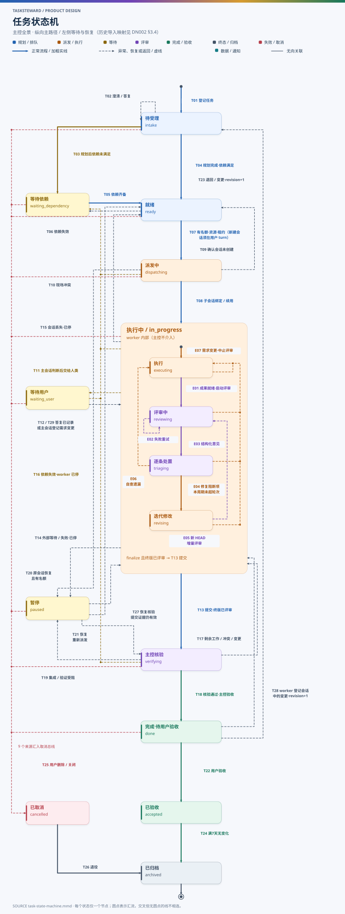

# DN002 任务状态机

- 状态：设计草案（T233 r5，已按 PoC 结果修订；T251 §5.6 开始时为仓库任务创建 worktree；T262 §5.1a worker 登记会话中的需求变更；T270 §5.7 follow-up；T276 §5.7 follow-up 的定义与边界；T272 §5.8 worker 会话的标题与验收后归档；T292 §5.1 等待用户时的需求变更不作废待答问题；T302 §5.8 待命标题改为前缀、任务归档后归档会话；T332 G-USER、G-CHANGE 经 workdeck 发到会话的消息；T344 §5.5 新 attempt 接手原执行目录；T363 §5.9 备用会话池）
- 日期：2026-11-05
- 相关：[DN001 总体架构](DN001-architecture.md) · [DN003 统一配置](DN003-unified-config.md) · [DN004 worker 自评审](DN004-worker-self-review.md) · [DN005 历史导入与 resume](DN005-history-import-and-resume.md) · [DN006 插件层](DN006-plugin-layer.md)

本文定义 TaskSteward 的任务状态、迁移、触发者、守卫条件和副作用。状态只能通过账本事件改变：每次迁移对应一条带 `sequence` 的事件，投影和状态页由事件归约得到，模型和页面都不能直接改状态。

## 1. 状态划分原则

**从主会话（orchestrator）的角度划分状态**：两个状态之间只有在必须等待“别的事情”发生时才分开。别的事情包括用户澄清或决定、前序任务完成、名额或资源释放、平台创建会话、worker 执行、外部条件恢复。主会话自己立刻就能完成的步骤（规划、准备 worktree、生成任务书、核验）不单独成为状态，而是作为迁移的副作用。

按此原则，相对第 1 版合并了以下状态：

| 第 1 版状态 | 本版 | 理由 |
| --- | --- | --- |
| `pending`（登记未规划） | `intake` 待受理 | 登记到规划之间唯一需要等的是用户澄清，因此只保留一个“待受理”状态：有待澄清问题就停在这里，否则主会话直接规划离开 |
| `preparing` + `dispatching` | `dispatching` 派发中 | 准备执行目录和任务书是主会话的即时动作；真正需要等的是平台创建会话、任务书送达或对账 |
| `submitted` + `integrating` + `conflict` | `verifying` 主控核验 | 都由主会话持有：核验、集成、组合验证。冲突需要 worker 解决时回到 `in_progress`（T17），不另设冲突状态 |
| `failed` | `paused`（类别 `failure`） | 失败与暂停都是“worker 已停、名额释放、等条件恢复”，处理方式相同；页面用类别标签区分 |
| attempt 状态机（独立图） | attempt 阶段属性（§6） | 会话预启动、创建、对账、停止、丢失都已体现为任务迁移的守卫和副作用，不再单独成图 |

保留分开的状态，以及它们各自在等待什么：

| 状态 | 在等什么 |
| --- | --- |
| `intake` | 用户澄清（或主会话尚未受理导入、退回的任务） |
| `waiting_dependency` | 前序任务完成 |
| `ready` | 名额、资源、调度租约或派发窗口 |
| `dispatching` | 平台创建子会话或任务书送达待命会话 |
| `in_progress` | worker 执行（内部含自评审） |
| `waiting_user` | 用户回答 worker 的问题；worker 会话保持，名额保持 |
| `paused` | 外部条件、用户 park、失败原因排除、导入交接；worker 已停，名额释放 |
| `verifying` | 主会话核验与集成（含等待 CI、PR 合并等外部事实）；worker 已自行合并的任务，主会话只核对 worker 附的合并与 CI 证据（§3.5） |
| `done` | 用户人工验收（用户在 worker 会话中追加要求时，worker 登记变更后经 T28 回到执行，§5.1a） |
| `accepted` | 7 天无变化后归档 |
| `cancelled` / `archived` | 退役 / 终态 |

## 2. 状态定义

| 状态 | 中文标签 | 含义 | 占用名额 | 终态 | 可 resume |
| --- | --- | --- | --- | --- | --- |
| `intake` | 待受理 | 已登记（新建、导入未规划、退回或需求变更后），等待主会话受理；有待澄清问题时停留 | 否 | 否 | 是 |
| `waiting_dependency` | 等待依赖 | 已规划，至少一个依赖未满足 | 否 | 否 | 是 |
| `ready` | 就绪 | 依赖满足，等待名额、资源、租约或派发窗口 | 否 | 否 | 是 |
| `dispatching` | 派发中 | 执行目录与任务书已就绪，正在创建或续用 worker 子会话 | 是 | 否 | 是 |
| `in_progress` | 执行中 | worker 持有任务；内部子状态见 §3.3 | 是 | 否 | 是 |
| `waiting_user` | 等待用户 | worker 提问或评审受阻，等待用户答复；子会话保持 | 是 | 否 | 是 |
| `paused` | 暂停 | worker 已停；带 owner / next_action / resume_condition / 类别 | 否 | 否 | 是 |
| `verifying` | 主控核验 | worker 已提交终版与评审证据，主会话核验、集成、组合验证；worker 已合并时只核对它附的合并、CI 与 live 证据 | 是 | 否 | 是 |
| `done` | 完成·待用户验收 | 主会话已技术验收，等待用户人工验收 | 否 | 否 | 是（仅验收或退回） |
| `accepted` | 已验收 | 用户已验收当前 revision；只读 | 否 | 否 | 否 |
| `cancelled` | 已取消 | 用户删除或关闭；只读 | 否 | 否（可归档） | 否 |
| `archived` | 已归档 | 退役，禁止复用其 agent 和会话 | 否 | 是 | 否 |

`paused` 的类别：`external`（外部依赖）、`user_park`（用户明确搁置）、`failure`（已核实失败）、`workdir_conflict`（现场冲突待决定）、`integration_blocked`（集成或验证受阻）、`import_handover`（导入的活动任务待核实旧 worker 停止）。

## 3. 状态机

### 3.1 状态图

全部状态与迁移（含取消、依赖失效，以及执行中的 worker 内部子状态）都在同一张图中。历史导入只是一次性的入口映射，不画在图里，见 §3.4 与 DN005 的导入分类图。

图源：[diagrams/task-state-machine.mmd](diagrams/task-state-machine.mmd)。同一图源的 Mermaid 自动布局版本见[附录 A](#附录-a自动布局版本)。

### 3.2 迁移表

“触发者”：O = 主会话，W = worker 子会话，U = 用户（必须有真实来源），S = tsw 系统规则（sync、依赖传播、定时检查），P = 平台事实观察。

| ID | 从 | 到 | 事件 | 触发者 | 守卫条件 | 副作用 |
| --- | --- | --- | --- | --- | --- | --- |
| T01 | （新建） | intake | `task.registered` | O | 任务书含仓库、类型、目标、验收；ID 未使用过 | 写入 `todo/Txxx.md` 与 TODO 索引，`revision=1` |
| T02 | intake | intake | `input.requested` / `input.resolved` | O / U | 目标、范围或验收有疑问，需要用户取舍 | 记录问题与答复来源；答复后主会话继续受理 |
| T03 | intake | waiting_dependency | `task.planned` | O | G-PLAN；无未答问题；至少一个依赖不满足 G-DEP | 记录依赖与规划理由 |
| T04 | intake | ready | `task.planned` | O | G-PLAN；无未答问题；全部依赖满足 G-DEP | 同上 |
| T05 | waiting_dependency | ready | `dependency.satisfied` | S / O | 全部依赖满足 G-DEP。若某依赖的当前 revision 晚于本任务绑定的 revision，须先由主会话记录 `dependency.rebound`（采用的新 revision、需要重新验证的范围），再判定 | 重绑定写入任务书背景；重新验证范围随下次 brief 下发 |
| T06 | ready | waiting_dependency | `dependency.invalidated` | S | 任一依赖不再满足 G-DEP | 无 |
| T07 | ready | dispatching | `task.dispatch_started` | O | G-LEASE、G-SLOT、G-RES、G-DEP；按 R-ATTEMPT 需要新建会话时还须满足 G-WINDOW（续用或投递给待命会话不需要） | 原子占用名额与资源；创建或复用执行目录，生成 `brief.md`（绑定 revision）；按 R-ATTEMPT 选择投递给待命会话、续用原会话或新建；G-WINDOW 不满足且无可用会话时不迁移，任务保持 `ready` 并标记“待启动” |
| T08 | dispatching | in_progress | `attempt.bound` / `attempt.brief_delivered` / `attempt.continued` | O / P | 新建：会话已创建且任务书已送达；待命会话：任务书已送达；续用：消息已送达原会话；G-ONE-ATTEMPT | 写入绑定，开启新的提交周期 |
| T09 | dispatching | ready | `attempt.dispatch_abandoned` | O | 有证据确认会话未创建（`attempt.not_created`）；`starting` 阶段结果未知时不能走 T09，须先对账；派给备用会话而认领在派发后失败时（还没有请求创建会话，attempt 仍为 `planned`，§5.9）同样经 T09 回到 `ready` | 当前创建代次标为失效；attempt 回到 `planned`（同一编号，未产生过会话）；释放名额与资源，保留执行目录 |
| T10 | dispatching | paused | `task.paused` | O | 执行目录冲突（分支已存在且内容不明等）需要用户决定 | 类别 `workdir_conflict`；释放名额，保留现场 |
| T11 | in_progress | waiting_user | `input.escalated` | W / O | worker 在本会话直接问用户（`ask_user`，DN006 §8.1a：任务内的提问、评审预算用完、阻断项延后请求、评审器不可用）；或主会话对跨任务事项判断后决定交给人类，或 `input.triage=human_direct` 时直接交给人类 | worker 提问：问题留在 worker 会话，记录转交时间，不进入主会话 inbox；主会话交给人类：生成 InputRequest（含主会话的分析），按 `input.channels` 投递人类渠道 |
| T12 | waiting_user | in_progress | `input.resolved` | U / O | 第一个生效的答复：任一人类渠道中通过核实的用户答复（worker 会话中由宿主集成记录、worker 引用的原话，主会话消息、Teams 回复、Portal 提交），请求仍为 `pending` 且绑定的 attempt 与代次与当前一致（等待期间登记了需求变更、revision 已变时问题仍然有效，§5.1）；或问题已转交主会话（`input.handed_off`，DN006 §8.1b）且不属于保留事项时，主会话在授权边界内代答（`handoff_resolve`，不满足 G-USER）。超时不是答复；转交前主会话不能代答 | 等待期间 revision 未变：回到离开时的子状态，周期不变；revision 已变（等待期间主会话登记了与问题无关的需求变更，§5.1）：进入 `executing`，旧评审失效，开启新周期 |
| T13 | in_progress | verifying | `worker.submitted` | W | G-SUBMIT（含 §3.5 的合并要求） | 冻结提交 HEAD、报告路径、评审证据与合并记录；worker 同时用宿主的父会话消息工具唤醒主会话（DN001 §6.3） |
| T14 | in_progress | paused | `task.paused` | O / W | G-PAUSE；worker 已停（外部等待、用户 park，或已核实失败且后台命令已停） | 释放名额；资源占用不释放 |
| T15 | in_progress | ready | `attempt.lost` | O / P | 子会话不存在或已归档，且核实执行目录没有继续写入 | 原 attempt 记为 `replaced`；释放名额；再次派发时新建 attempt 复用现场 |
| T16 | dispatching、in_progress、waiting_user、verifying | waiting_dependency | `dependency.invalidated` | S / O | 任一依赖不再满足 G-DEP；执行中的 worker 已收到通知并停止；从 `dispatching` 离开时须先收口派发：`starting` 先对账（已创建则按 `live` 停止，未创建则回到 `planned`）；`standby` 的待命会话保留，供依赖恢复后投递 | 释放名额；撤回进行中的集成；核实 worker 已停后释放本任务的独占资源（`resource.released`，下次 T07 重新占用），停止事实未知时保留占用并生成待用户决定的输入请求；原 attempt 保留供 R-ATTEMPT 续用 |
| T17 | verifying | in_progress | `orchestrator.feedback` / `task.requirement_changed` | O / U / W | 主会话列出具体剩余工作（worker 已合并时，修复以新的 PR 进行）；或集成冲突需要 worker 解决；或用户实质修改需求（revision+1，撤回提交）：在主会话等渠道提出时由主会话登记，在 worker 会话中提出时由 worker 登记（G-CHANGE，§5.1a） | 经会话适配器给同一 worker 发消息（`send`）；开启新的提交周期；需求变更时旧评审失效 |
| T18 | verifying | done | `task.accepted` | O | G-ACCEPT | 写入 `review.md` / `review.html`（worker 已合并时含“合并后核对”：worker 附的 CI 与 live 证据和主会话的核对结论）、登记 PR 与产出、记录集成提交；释放名额与资源；通知用户 |
| T19 | verifying | paused | `task.paused` | O | 集成或组合验证受阻（CI 环境故障、外部审批未到等），G-PAUSE | 类别 `integration_blocked` 或 `failure`，`resume_target=verifying`；冻结的提交证据保留；释放名额，集成占用保留或撤回并记录 |
| T20 | paused | in_progress | `task.resumed` | O | resume_condition 已满足；`resume_target` 不是 `verifying`，或其提交证据已失效；原子会话可用且可控；G-SLOT、G-RES、G-DEP（与名额占用在同一事件中原子完成） | 重新占用名额，经会话适配器发消息（`send`）继续；开启新的提交周期 |
| T21 | paused | ready | `task.resumed` | O | resume_condition 已满足；`resume_target` 不是 `verifying`（或其提交证据已失效）；原会话不可用、导入交接已核实，或名额不足需要排队 | 下次派发按 R-ATTEMPT 处理 |
| T27 | paused | verifying | `task.resumed` | O | `resume_target=verifying`；resume_condition 已满足；冻结的提交证据仍有效（revision 与依赖绑定未变）；G-SLOT、G-RES、G-DEP | 重新占用名额，主会话继续核验与集成；不重新提交、不重新评审 |
| T22 | done | accepted | `task.user_accepted` | U | G-USER；revision 与当前一致；没有未解决的 `stale` 标记（已有来源记录 `dependency.stale_cleared`）；没有待答输入请求 | 记录 `accepted_at` 与用户原话 |
| T23 | done | intake | `task.user_rejected` / `task.requirement_changed` | U / W | G-USER（退回、选择重新验证 stale 成果）或用户实质修改需求；worker 登记的变更（G-CHANGE）只在 T28 的 G-RES 或 G-DEP 不满足时经此迁移（§5.1a） | `revision+1`，旧主控验收失效；下游传播 `dependency.invalidated`；原 attempt 保留供 R-ATTEMPT 续用 |
| T28 | done | in_progress | `task.requirement_changed` | W | G-CHANGE（用户在该 worker 会话中输入、由宿主记录的消息，§5.1a）；当前 attempt 为调用者的 live 会话；G-RES、G-DEP（不满足时改经 T23）；不检查 G-SLOT | `revision+1`，写入用户原话、新目标与验收，重写任务卡片与本 attempt 的任务书；旧主控验收失效（清除完成时间与提交证据）；重新占用独占资源；开启新的提交周期；下游传播 `dependency.invalidated`（§5.2）；`task.requirement_changed` 进入主会话 inbox |
| T24 | accepted | archived | `task.archived` | S | 已验收且连续 7×24 小时无业务变化；无活动 worker（没有创建结果未知的 `starting` attempt；验收后保留的会话不算活动，归档后按配置处置）、无待答输入；没有 `open` 的 follow-up（§5.7） | 退役；按 `sessions.archive_on_archive` 归档保留的 worker 会话（主会话执行，须有工具回执，§5.8） |
| T25 | intake、waiting_dependency、ready、dispatching、in_progress、waiting_user、paused、verifying、done | cancelled | `task.cancelled` | U | 用户删除或关闭；活动 worker 已停；进行中的集成已撤回 | 释放名额；资源停止事实未知时保留占用 |
| T26 | cancelled | archived | `task.archived` | S / U | 用户指定归档或保留期满；没有 `open` 的 follow-up（§5.7） | 退役；按 `sessions.archive_on_archive` 归档保留的 worker 会话（同 T24） |

### 3.3 执行中的 worker 内部子状态

`in_progress` 内部的子状态由 worker 推进，主会话不介入，只通过 G-SUBMIT 复核结果。自评审流程见 [DN004](DN004-worker-self-review.md)。

| ID | 从 | 到 | 事件 | 守卫 / 说明 |
| --- | --- | --- | --- | --- |
| E01 | executing | reviewing | `review.started` | 成果已提交到 Git（代码 / 设计）或报告草稿已写入（研究）；本周期轮次 < 本周期预算（否则交主会话判断）；按 R-ROUND 递增计数 |
| E02 | reviewing | reviewing | `review.failed` | 调用失败或超时，本轮重试次数 < `review.retry_limit`；超限时记录 `review.unavailable` 交主会话判断（可改用 `fallback_session`、稍后重试或经 T11 交给人类，不能跳过评审） |
| E03 | reviewing | triaging | `review.completed` | 评审器返回符合 schema 的 JSON（verdict + findings） |
| E04 | triaging | revising | `review.decision=iterate` | 有需修复的阻断项，且本周期轮次 < 本周期预算；预算用完时交主会话判断，主会话追加轮次后同样经 E04 继续 |
| E05 | revising | reviewing | `review.started` | 新 HEAD 已提交；本周期轮次 < 本周期预算；按 R-ROUND 递增计数；增量评审（同一评审线程续用，范围为上轮 HEAD..新 HEAD） |
| E06 | triaging | executing | `worker.self_check_failed` | 自查发现遗漏（验收项未完成、报告缺失），或定稿后 HEAD 有变化需要补审；不开启新周期 |
| E07 | executing、reviewing、triaging、revising | executing | `task.requirement_changed` | 主会话转达新 revision，或 worker 登记用户在本会话中提出的变更（§5.1a）；进行中的评审中止，旧评审对新 revision 失效；开启新提交周期 |

`triaging` 中 worker 决定 `finalize`（每个阻断项都已按 G-SUBMIT 处置，且终版 HEAD 已评审）后，直接经 T13 离开 `in_progress`。用户关闭了自评审（DN004 §9）时，worker 从 `executing`（或关闭前已进入的 `triaging`、`revising`）直接经 T13 提交，不经过 E01–E06。定稿后若 HEAD 又有变化（例如修正报告链接），需对差异再评审一轮，经 E06 → E01，同样受本周期预算限制。阻断项需要延后、或修复超出本任务范围时，worker 不能自行 defer，而是记录 `review.defer_requested` 交主会话判断：主会话可以批准延后（列入已知问题）、要求继续修复，或交给人类。

**R-ROUND（评审计数）**：每条 `review.started` 事件在同一事件中原子地把轮次编号设为该 attempt 上一轮编号 + 1（首轮为 1），并把本周期轮次计数 + 1；E02 重试只增加本轮重试计数，不增加轮次。

**评审预算**：所有新评审轮次（E01、E05）都先检查本周期轮次 < 本周期有效预算。有效预算 = `max_rounds` + 主会话追加 + 用户追加，两种追加分别记账：

- 主会话追加：`review.budget_extended`（`source=orchestrator`），同一周期累计不超过 `orchestrator_extension_limit`；
- 用户追加：`review.budget_extended`（`source=user`，附 `VerifiedSource`），由用户在交给人类的请求中批准，每次写明追加轮数，没有累计上限；它通过 T12 返回，周期与轮次编号都不重置。

预算用完仍有阻断项时，worker 记录 `review.budget_exhausted`，并在自己的会话中问用户（§3.3a，DN006 §8.1a）：用户可以追加轮次、认定意见不成立、批准延后或调整方向；超时无回复时转交主会话，主会话可在授权边界内代为决定（追加轮次受 `orchestrator_extension_limit` 限制）。等待期间任务为 `waiting_user`、名额保持。主会话选择“调整方向”时不增加预算：worker 按新方向修改后，下一轮评审仍须满足预算守卫，预算不足时须另有追加决定。

**提交周期**：每次经 T08、T17、T20、T28 进入 `in_progress`，或发生 E07、或 T12 返回时 revision 已变化，开启新周期，到 T13 提交结束；revision 未变的 T12 与 E06 不开启新周期。`max_rounds` 按周期计算；轮次编号在整个 attempt 内单调递增、唯一，便于引用评审文件。

### 3.3a 主会话判断

任务内需要用户决定的事——提问、评审预算用完（`review.budget_exhausted`）、阻断项延后请求（`review.defer_requested`）、评审器不可用（`review.unavailable`）——worker 在自己的会话里直接问用户（`ask_user`），经 T11 进入 `waiting_user`；用户在 worker 会话中的答复经 T12 返回（DN006 §8.1a）。`input.in_session_timeout_minutes` 内用户没有回复时，问题转交主会话（`input.handed_off`，状态不变）；主会话可以在授权边界内代答（经 T12 返回）、转达给用户或继续等待（DN006 §8.1b）。答复之后到达的答复记为 `input.late_response`，不改变状态（DN006 §8.1c）。

跨任务的事（`worker.question`：独占资源冲突、依赖调整、改动其他任务的范围）时，任务保持 `in_progress`，由主会话判断（DN006 §8.2–§8.4）。主会话在授权边界内自行处理时记录相应决定（回答、调整方向等），附理由与依据，任务状态不变；只有决定交给人类时才记录 `input.escalated` 并经 T11 进入 `waiting_user`。判断是主会话的即时工作，按 §1 的原则不单独成为状态。

### 3.4 导入映射（不在状态图中）

从 orchestrator-agent 导入的任务不经过 T01，而是由导入事件直接落到下表的状态，按 **I01 → I02 → I03 → I04 → I05 → I06 的顺序判定，先命中先生效**，各规则互斥。分类流程图与细节见 [DN005](DN005-history-import-and-resume.md)。

| ID | 来源记录 | 进入状态 | 可 resume |
| --- | --- | --- | --- |
| I01 | 有 retirement 或 archived 标记（不论原 status） | archived（只读，保留原 status 与退役模式） | 否 |
| I02 | 未退役，`cancelled` | cancelled（只读） | 否 |
| I03 | 未退役，`done`，有有效用户验收 | accepted（只读） | 否 |
| I04 | 未退役，`done`，无有效用户验收 | done | 是：直接用户验收，或退回后基于已有报告继续 |
| I05 | 未退役，`pending` / `ready` | intake | 是：主会话重新受理与规划 |
| I06 | 未退役，`paused` 或任何活动状态（starting / running / waiting_user / review / integrating / conflict / failed） | paused（原暂停保留原类别；活动状态为 `import_handover`，原 failed 为 `failure`） | 是：`import_handover` 须先核实旧 worker 已停 |

### 3.5 worker 的合并与交付闭环

用户 2026-11-06 决定：任务默认由 worker 自己开 PR、自己合并，除非任务书或仓库 `AGENTS.md` 另有说明；合并在主会话技术验收之前。用户 2026-11-08 进一步决定（决定记录 [0003](../decisions/0003-worker-delivery-loop.md)）：合并授权按仓库判断，不按任务类型；交付闭环由 worker 走完——合并后等主分支上合并提交的 CI 通过、必要的 live 场景通过，才提交；主会话只核对 worker 附的证据，不替 worker 等待。

| 项目 | 规则 |
| --- | --- |
| 授权 | 仓库配置 `repositories.<id>.delivery.merge` 为 `true`（DN003 §3.4，权限类键，默认关闭）。不看任务类型：设计、文档、研究任务在已授权的仓库中同样由 worker 合并。任务书的“交付”一行写明合并方式 |
| 合并时机 | 在 `in_progress` 内：自评审定稿（`finalize`）→ 推送、开 PR → 仓库门禁与 CI 通过、仓库要求的评审完成且意见都已回复并解决、仓库规定须用户确认的改动已取得用户确认（worker 在自己的会话中问用户，DN006 §8.1a）→ 合并 → 主分支上合并提交的 CI 通过 →（需要时）合并后的 live → T13 提交。不新增状态 |
| 合并后的 CI | worker 等主分支上合并提交的 CI 完成。失败时在同一任务内修复（新的 PR，同样经评审与门禁后合并）或 revert，再等新的合并提交的 CI；不能带着未完成或失败的 CI 提交。提交的合并记录写明运行的提交、结论与链接 |
| live | 仓库规则要求的 live 场景在最终 head 上运行；只有在合并后的主分支上才能验证的（例如要更新插件或重新生成宿主文件才生效的改动）在合并后运行。worker 在合并记录中写明运行的场景与结果，或不需要、不能运行的原因 |
| HEAD | 合并的 PR head 必须等于最后一轮自评审的 HEAD（即提交 HEAD）；为同步主分支而改变 HEAD 时，先经 E06 补审增量 |
| 另有说明 | 任务书或仓库规则要求由他人合并时，worker 不合并，提交时用 `merge_skipped` 写明原因，由主会话按原流程合并（必要时 `integrate`） |
| 未授权 | 仓库没有 `delivery.merge` 时，worker 不能合并（宿主护栏拦下合并命令），提交也不能带合并记录 |
| 合并目标 | 授权的仓库必须写明 `repository`（`owner/name`）与 `host`（默认 `github.com`），二者是权限类键（DN003 §7.2）。合并必须连同 host 明确指向本任务仓库，不能由当前目录或环境决定目标；宿主上的护栏拦下不符合的合并（Claude Code 见 [CC008](claude-code/CC008-guardrails.md) CC-B7） |
| 合并后核对 | 主会话在 `verifying` 中只核对 worker 附的证据：PR 已合并、合并提交与提交 HEAD 对应、CI 运行链接指向合并提交且结论为通过、live 的结果或原因，并在 `task_accept` 中写明（G-ACCEPT）；主会话不再等待 CI。发现问题时经 T17 交回同一 worker，以新的 PR 修复；已合并的改动不由状态机撤销，需要撤销时由 worker 开 revert PR |

## 4. 守卫条件

| 守卫 | 定义 |
| --- | --- |
| G-PLAN | 任务书字段完整；类型为 研究 / 设计 / 代码 之一；仓库 ID 在配置中存在 |
| G-DEP | 每个依赖都满足：(1) 状态为 `done`、`accepted`，或 `archived` 且退役前为 `done` / `accepted`（非取消归档）；(2) 被依赖的 revision 等于该任务的当前 revision，且其完成证据属于这个 revision（归档不会让旧 revision 重新有效）；(3) 没有未解决的 `stale` 标记。`cancelled` 与取消归档的任务永远不满足。在 T04、T05、T07、T20 和 G-ACCEPT 中复核 |
| G-LEASE | 当前主会话持有调度租约（DN001 §6.4） |
| G-SLOT | 占用名额的任务数（`dispatching` + `in_progress` + `waiting_user` + `verifying`）< `scheduling.max_workers`；检查与占用在同一事件中原子完成 |
| G-RES | 任务声明的独占资源没有**其他任务**未释放的占用记录；本任务自己保留的占用可直接续用（幂等，不重复建立）。占用在首次 T07 建立，只在释放事件时解除（T18 完成、取消后核实停止、`resource.released`）；暂停、失败、停止事实未知、退役保留的占用都继续有效 |
| G-WINDOW | 当前 turn 允许在任务目录创建会话：会话适配器声明的创建时机限制（DN001 §6.3；Claude Code 为用户本人消息所在的 turn，CC001 §4）。只在会话适配器声明 `dispatch_window=true` 时适用（DN006 §7.3），只约束“创建”，不约束“投递任务书”与续用 |
| G-ONE-ATTEMPT | 该任务没有其他处于 `standby` / `starting` / `live` / `stopped` 阶段的 attempt |
| G-PAUSE | 记录了 owner、next_action、resume_condition 和类别 |
| G-SUBMIT | 以下均针对当前 revision 与当前提交周期：报告的 md 与 html 都存在；本周期至少完成一轮由 `roles.reviewer.session` 指定的只读评审器（默认 Codex `gpt-6-astra` / `medium`）给出的评审；最后一轮评审的 HEAD 等于提交 HEAD；最后的评审决定为 `finalize`；仓库授权 worker 合并的任务（§3.5，不看任务类型）已合并 PR，合并的 head 等于提交 HEAD，合并记录附主分支上合并提交的 CI 结果（运行的提交等于合并提交，结论为 `success`，带运行链接；未完成或失败时拒绝，并写明“等它完成”或“在本任务内修复或 revert”）与 live 说明（结果，或不需要、不能运行的原因），或以 `merge_skipped` 写明由他人合并的原因；未授权时不能带合并记录；每个阻断项都已处置：`fix`（已验证：worker 记录了验证说明，或本周期之后又完成了一轮增量评审）、有据 `reject`、主会话认定不成立（`review.finding_overruled`），或经主会话 / 用户批准延后（`review.defer_approved`，且列入报告“已知问题”）；工作树干净或差异已说明。评审默认为必经环节，主会话不能关闭；只有用户以配置关闭自评审（`review.self_review` 或该仓库的 `self_review` 为 `off`，DN004 §9）时，本条中关于评审的条件（评审轮次、最后评审 HEAD、`finalize`、阻断项处置）不检查，`worker.submitted` 记录评审模式与来源键 |
| G-ACCEPT | 当前 revision；验收要求逐项为“已完成 / 用户明确替代”，并附证据；评审证据通过 G-SUBMIT 复核；G-DEP 复核通过；PR 与产出已登记；Git 状态与提交 SHA 已核对；需要集成的仓库已完成集成与组合验证；worker 已合并时，该 PR 已由主会话核验登记，并写明对 worker 所附证据（合并提交、CI 链接、live）的核对（§3.5）；无待答输入 |
| G-CHANGE | worker 登记需求变更的来源（§5.1a）：调用者是任务当前 attempt 绑定的 live 会话；引用的每条消息都是宿主记录的 `input.session_message`，属于本任务、来自调用者自己的会话、记录于任务当前 revision；tsw 用记录的原文构造 `VerifiedSource`（渠道 `in-session`，决定对象 `[任务, revision, change]`）。用户经 workdeck 发到该会话的消息与在会话中输入的相同，同样被记录（DN006 §8.11）；宿主注入的其他消息不被记录，主会话的转述、worker 的推断都不满足 |
| G-USER | 来源是统一的 `VerifiedSource`（DN006 §8.5）：渠道、已核实的用户身份、消息引用、用户原话、所答请求（可空）、决定对象（任务、revision、决定类别）。主会话消息、子会话消息、Teams 回复、Portal 提交都可以满足，只要身份核实为用户本人且决定对象与当前 revision 一致；用户在会话外的直接操作（终端的 `tsw task accept` / `reject` / `cancel` 与 Dashboard 应用的按钮，渠道 `user-cli` / `status-app`，DN006 §8.10）也满足，这两个渠道只能由会话外的 tsw 命令记录；用户经 workdeck 门户发到会话的消息与用户在该会话中输入的话相同（DN006 §8.11、DN008 §9 第 7 条）：主会话中记渠道 `main-session` 并注 `via: workdeck`，worker 会话中由宿主照常记录；主会话代答、worker 回执、主控自评、超时，以及其他会话转述的“用户说”都不满足 |

## 5. 跨状态规则

### 5.1 需求变更

用户实质修改任务需求时记录 `task.requirement_changed`，`revision+1`。用户在主会话或其他渠道提出时由主会话登记（`task_update`，附用户来源）；在 worker 会话中提出时由 worker 自己登记（§5.1a）。主会话登记时在不同状态下的处理如下：

| 当前状态 | 处理 |
| --- | --- |
| `intake` / `waiting_dependency` / `ready` / `paused` | 状态不变，任务书 revision 更新；必要时主会话重新规划依赖（记录 `dependency.rebound`，可能经 T06 / T05）；恢复执行时 worker 读取新 brief；`paused` 且 `resume_target=verifying` 时提交证据失效，只能经 T21 / T20 恢复 |
| `dispatching` | 状态不变，brief 在绑定前更新到新 revision |
| `in_progress` | 状态不变，子状态回到 `executing`（E07），旧评审失效，开启新周期；brief 更新到新 revision，主会话通知 worker 重读 |
| `waiting_user` | 状态不变，待答问题不作废、继续等待用户；brief 更新到新 revision，主会话通知 worker 重读。变更本身就是对问题的回答时，主会话先登记答复再登记变更（见下文“等待用户时的变更”） |
| `verifying` | 撤回提交，回到 `in_progress`（T17） |
| `done` | 回到 `intake`（T23）；worker 登记时经 T28 回到 `in_progress`（§5.1a） |
| `accepted` / `cancelled` / `archived` | 不接受修改；新建关联任务（新 ID），引用原成果 |

**等待用户时的变更**（T292）：需求变更不等于回答了问题。任务在 `waiting_user` 时，主会话先判断用户的话是否回答了待答的问题，再按下表登记：

| 情形 | 处理 |
| --- | --- |
| 变更与待答问题无关 | `task_update` 只登记变更：revision+1、重写任务书，任务保持 `waiting_user`，问题不作废、继续等待用户（超时转交照常）。主会话告诉 worker 任务书已更新，worker 重读后继续等待。之后任一渠道的答复照常经 T12 生效；因 revision 已变，回到 `executing` 并开启新周期，worker 按新 revision 继续 |
| 变更本身就是对问题的回答 | 等同用户在主会话回答了问题：主会话先 `input_resolve` 登记答复（`user_source` 为用户在主会话的原话，渠道 `main-session`，经 T12 回到 `in_progress`），再 `task_update` 登记变更（E07，开启新周期），然后把答复与新任务书一并用消息告诉 worker。与 worker 侧“先 `user_answer` 再 `requirement_change`”（§5.1a）一致，不新增迁移 |
| 拿不准 | 主会话先问用户这句话是否是在回答 worker 的问题（附问题编号与正文），按用户的答复走上面两种之一；不替用户认定 |
| 随问题交出的评审事项 | 问题带着评审事项（预算用完、延后请求）时，跨 revision 的答复照常生效：追加的轮次计入答复开启的新周期；批准延后、认定不成立记在提问时的周期，对新 revision 的评审不再适用 |

判断依据：问题的正文与选项（主会话用 `context_task` 读本任务的输入请求，worker 会话中的问题在转交前也在其中）对照用户的话。用户的话直接回应了问题（确认、选择、否定或修改问题所问的方案）就是回答；只增加或修改与问题无关的目标、范围或验收就不是。

**反例（T285 a1）**：worker 问“设计可以确认吗”（Q-T285-1）后任务进入 `waiting_user`；用户在主会话中说“补图”，主会话只用 `task_update` 登记了需求变更（revision 3）。当时的规则把待答问题记为 `superseded`、任务仍停在 `waiting_user`：worker 完成新 revision 后 `review_run`、`self_check_failed`、`ask_user` 都被拒，只能由主会话用 `judge`（`decision: escalate`）按新 revision 重新提问（Q-T285-2）。“补图”是对“设计可以确认吗”的回答（不确认，要求补图），应当先 `input_resolve` 登记这个答复、任务回到执行中，再登记变更。

T292 之前的账本里，主会话在 `waiting_user` 登记的变更把待答问题记为 `superseded`；重放时保持原样。仍因此停在 `waiting_user`、没有待答请求的任务，由主会话按原办法 `judge`（`decision: escalate`）按新 revision 重新提问，用户答复后经 T12 进入新周期。

无论处于上表哪个状态，只要任务当前的 attempt 已有任务书（预启动、派发中、执行中或暂停中，attempt 不是 `replaced` / `closed`），需求变更都在同一事件中把这份任务书按新 revision 重写，并记下它的路径和要通知的会话（`standby` / `live` / `stopped` 的会话）。在预启动开始写任务书之前就已预启动、还没有任务书的待命会话，这时补写一份。主会话随后用消息告诉该会话重新读取。后来的决定或其他任务的结论影响到已登记、尚未完成的任务时，主会话立即按本节写回任务书（附用户来源），不依赖会话上下文保存这些信息。

### 5.1a worker 登记会话中的需求变更

用户 2026-11-11 决定（T262）：用户常在 worker 会话里直接给 worker 追加要求。只要任务还没有被用户验收（不是 `accepted`，也不是 `cancelled` / `archived`），worker 就凭用户在本会话中亲手输入的话自己登记需求变更（`requirement_change`），并在同一 attempt 内继续评审、提交；主会话从 inbox 得知变更与之后的提交，照常核验验收，不再需要它到 worker 会话中找出用户原话、退回任务再续用会话。

| 项目 | 规则 |
| --- | --- |
| 来源（G-CHANGE） | 只接受宿主记录的、用户在该 worker 会话中输入（或经 workdeck 发到该会话，DN006 §8.11）的消息（`input.session_message`，DN006 §8.1a 第 3 步；Claude Code 为 `UserPromptSubmit` hook，CC001 §6）。宿主不限于有待答问题时记录，任务处于 `accepted` / `cancelled` / `archived` 时不记。worker 引用一个或多个消息编号；每条都须属于本任务、来自调用者自己的会话（任务当前 attempt 绑定的 live 会话），并记录于任务当前 revision。tsw 用记录的原文构造 `VerifiedSource`（渠道 `in-session`，决定对象 `[任务, revision, change]`）；worker 对变更的概括另记为 `summary`，不作为来源 |
| 不是来源 | 宿主注入的消息（其他会话与主会话发来的消息、app 事件、定时任务）不被记录，因此无法引用；主会话的转述、worker 自己的推断、其他会话或更早 revision 下记录的消息都被拒绝。一条消息至多推动一次变更：变更后 revision+1，之前的消息不再属于当前 revision |
| `in_progress` | 状态不变，经 E07 回到 `executing`，开启新周期 |
| `verifying` | 撤回提交，经 T17 回到 `in_progress`，开启新周期 |
| `done`（未经用户验收） | 经 T28 回到 `in_progress`，开启新周期：主会话的技术验收失效（清除完成时间与提交证据；`review.md` 留作上一 revision 的记录，下次验收按新 revision 重写，上一次的结论保留在账本的 `task.accepted` 中）；重新占用任务声明的独占资源。G-RES 或 G-DEP 不满足时改经 T23 回到 `intake`：变更照样登记，worker 停下，由主会话重新规划后按 R-ATTEMPT 续用本会话 |
| `waiting_user` | 拒绝：先用 `user_answer` 登记答复（可以引用同一条消息），回到 `in_progress` 后再登记变更；与主会话登记“变更本身就是回答”时的顺序相同（§5.1） |
| `accepted` / `cancelled` / `archived` | 拒绝，提示由用户经主会话新建关联任务（新 ID），引用原成果 |
| 其他状态 | worker 没有绑定的 live 会话（暂停、待派发等），不能登记；由主会话按 §5.1 处理 |
| 同一事件中的副作用 | `revision+1`；写入用户原话、新目标与验收；按 §5.1 重写任务卡片与本 attempt 的任务书（同一路径，revision 更新；worker 就在本会话中，不需要再通知它重读）；待答输入请求（`done` 时的 stale 请求）记为 `superseded`；清除 `stale` 标记 |
| 名额 | T28 不检查 G-SLOT：worker 会话已经存在，用户正在其中工作；名额限制的是主会话的派发与恢复（T07、T20）。回到 `in_progress` 后照常计入占用，超过 `max_workers` 时主会话暂不派发新任务 |
| 依赖传播 | 命令提交后立即以系统身份运行一次系统规则（`sync`）：下游按 §5.2 处理（`ready` 经 T06 回到等待依赖，占用名额的下游列入 `needs_stop` 由主会话停止，`done` 的下游标记 `stale` 并请用户决定） |
| 评审周期与预算 | 每次变更开启新的提交周期：旧评审与 `finalize` 对新 revision 失效；本周期预算重新为 `max_rounds`，上一周期的追加不带入；轮次编号在 attempt 内继续递增。之后照常 `review_run`、`submit`（G-SUBMIT 针对新 revision 与新周期；已授权合并的仓库以新的 PR 合并） |
| 通知主会话 | worker 登记的 `task.requirement_changed` 是 reportable 事件（默认在 `scheduling.wake.reportable_events` 中），进入主会话 inbox，worker 按工具结果的 `wake` 唤醒持租主会话；主会话自己用 `task_update` 记录的变更不进入自己的 inbox。主会话只需核对、确认，不退回任务、不重新派发；worker 之后的 `worker.submitted` 照常进入 inbox，主会话按新 revision 核验验收（G-ACCEPT） |
| 并发与幂等 | 与其他写入一样在账本的提交锁内按当时的状态判定：主会话的 `task_accept` 先提交时变更经 T28；变更先提交时，`task_accept` 因状态已不是 `verifying` 被拒。可带 `expected_version`；同一 `command_id` 重复调用返回原结果 |
| 主会话的 `task_update` | 保留：用户在主会话或其他渠道提出的变更仍由主会话登记（§5.1）。worker 会话中的原话由 worker 登记，主会话不必再转录 |

### 5.2 依赖失效

上游 revision 增加（T23）或上游被取消（T25）时，系统对每个下游任务记录 `dependency.invalidated`：

- `ready` → `waiting_dependency`（T06）；
- `dispatching` / `in_progress` / `waiting_user` / `verifying` → `waiting_dependency`（T16），worker 先停止；
- `intake` / `paused` / `waiting_dependency`：状态不变，恢复或规划时由 G-DEP 拦截；
- `done`：标记 `stale`，并生成待用户决定的输入请求，不自动迁移。用户选择“保持”时记录 `dependency.stale_cleared`（附用户来源，说明为何旧成果仍然有效，并记下当时已确认的依赖问题；之后只有上游再变化才重新标记）；选择“重新验证”时经 T23 回到 `intake`（revision+1）。未解决的 `stale` 使该任务不满足 G-DEP，因此失效会继续向它的下游传播；
- `accepted` 及只读任务：不受影响。

### 5.3 恢复分支选择

`resume` 命令只产生一条迁移，按以下顺序选择第一个满足的分支：

1. `resume_target=verifying` 且冻结的提交证据仍有效 → T27（回到 `verifying`，不打扰 worker）；
2. 原子会话可用且可控，且有名额 → T20（回到 `in_progress`）；
3. 其他情况 → T21（回到 `ready`，按 R-ATTEMPT 重新派发）。

因此 T20、T21、T27 的守卫互斥。

### 5.4 迟到的会话创建

每次请求创建会话（`attempt.start_requested`）都把该 attempt 的**创建代次** `gen` 加 1，会话名为 `txxx-aN-gK`（K = 当次代次），并把该代次记为**有效**。代次一旦被放弃就记为**失效**：T09（确认未创建）或预启动确认未创建（§5.6）时，在同一事件中把当前代次标为失效（`attempt.not_created` 携带代次号）。绑定（T08）只接受当前代次且仍有效的会话。平台出现任何**失效代次**（包括刚放弃、尚未重试的当前代次）或更早代次的同 attempt 会话时，主会话记录 `attempt.late_session`，立即停止该会话，不绑定、不发送任务书；当前有效代次的合法会话与任务状态都不受影响。

### 5.5 R-ATTEMPT：重新派发时的 attempt 规则

任务从 `ready` 再次派发（T07）时：

| 原 attempt 情况 | 处理 |
| --- | --- |
| 没有原 attempt | 新建 attempt `a1` |
| `planned`（从未产生会话） | 沿用同一 attempt 编号，创建代次 +1 后重新请求创建 |
| `standby`，会话存在且由**当前主会话**创建（可控） | 先把执行目录更新到最新基线（尚无改动，可快进或重建），再投递任务书（`attempt.brief_delivered`），不再创建会话 |
| `standby`，但会话已不存在，或由旧主会话创建（接管后不可控） | 不投递；核实会话已停止（或已不存在）后记为 `replaced`；任务保持 `ready` 并标记“待启动”，在下一次用户 turn 中重新预启动或直接新建 |
| `starting` | 不能派发、也不能再次预启动：先按会话名对账；派发中的创建经 T09 回到 `planned`，预启动中的创建按 §5.6 收口 |
| `live` 或 `stopped`，执行目录有效，且由**当前主会话**启动（可控） | 续用原 attempt 与原子会话：`stopped` 先经平台恢复为 `live`，再发送带新 brief 的消息（`attempt.continued`），不再创建会话 |
| `live` 或 `stopped`，但由旧主会话启动（接管后不可控，DN001 §6.4） | 不发消息；核实旧会话已停止、执行目录无新写入后记为 `replaced`，新建 attempt `aN+1` 复用同一执行目录 |
| `replaced` / `closed`，或导入的旧 Codex / Copilot worker | 新建 attempt `aN+1` 复用同一执行目录（导入交接须已有停止证据） |

因此 G-ONE-ATTEMPT 始终成立，同一任务不会同时有两个 worker 写同一现场。

**接手执行目录**（T344）：新建 `aN+1` 时，执行目录缺省为原 attempt（`replaced` / `closed`）记录的执行目录；主会话派发或预启动时给出别的目录（`workdir`）时在那里开始，原目录保持原样。

- 接手的是原 attempt 的现场：执行目录中的文件、仓库任务的 worktree 与它当前的分支、未提交的改动都原样保留，tsw 不切换分支、不清理、不重建。宿主上的做法见 [CC006](claude-code/CC006-plugins.md) §8.3。
- 新 attempt 的任务书写明接手自哪个 attempt 和实际使用的分支，并提醒 worker 先了解现场（工作区状态与已有提交）再继续。
- 只接手本任务较早的 `replaced` / `closed` attempt 记录的目录。目录也被其他任务的 attempt 记录过时不按接手处理，按新目录对待（已有其他内容时拒绝）。
- 原会话进入 `replaced` / `closed` 之前已核实停止，所以接手不会让两个 worker 写同一现场。

### 5.6 预启动

在满足 G-WINDOW 的 turn 中，主会话可以为已规划的任务预启动 worker 会话。预启动只改变 attempt 阶段，**任务状态始终不变**（仍为 `ready` 或 `waiting_dependency`），不占用名额与资源。

**入口检查**（与 `attempt.start_requested` 在同一事件中原子完成）：

- 任务处于 `ready`，或是按依赖顺序排在前面的 `waiting_dependency`；
- 满足 G-ONE-ATTEMPT：该任务没有处于 `standby` / `starting` / `live` / `stopped` 的 attempt（已有可控的待命或可续用会话就跳过；有旧主会话的会话则先按 R-ATTEMPT 核实停止并替换）；
- 预启动额度：处于 `standby` 的会话与预启动中处于 `starting` 的请求合计不超过 `scheduling.prestart.max_standby`。

**何时预启动**：每个满足 G-WINDOW 的 turn（用户本人的 turn）结束前，主会话为满足入口检查的任务预启动，不限于用户要求执行任务的 turn。`attention` 的 `needs_prestart` 列出它们：

- `ready` 或 `waiting_dependency`，且当前 attempt 不在 `starting` / `standby` / `live` / `stopped`；
- `waiting_dependency` 的任务不会再就绪时不列：上游缺失或已取消，或者它等待的上游本身因此不会再就绪（沿依赖链传播；已完成、已验收或已确认保留的上游不传播）；
- 先列 `ready`，再按依赖顺序（上游在前、登记顺序次之）列 `waiting_dependency`，每项写出它还在等的上游；
- 个数不超过剩余的预启动额度；预启动关闭时为空。

宿主集成在用户 turn 结束前，列表非空时提醒一次（Claude Code 见 [CC008](claude-code/CC008-guardrails.md) 的 CC-S4、CC-S6）；在自动 turn 中不提醒，因为那时不能创建会话。用户明确要求先不开始的任务，主会话说明原因后不预启动。

**过程与收口**：

| 情况 | 处理 | attempt 阶段 |
| --- | --- | --- |
| 开始 | 准备执行目录（目录不存在时 `attempt_start` 创建空目录；仓库配置了本机检出时，在其中创建基于当前基线的仓库 worktree，作为会话目录，见 CC006 §8；创建失败则拒绝，不记录事件）；按当前 revision 生成任务书 `runs/<任务>/<attempt>/brief.md`（授权读取集合为任务本身与依赖），路径与 revision 记在 attempt 上；记录 `attempt.start_requested`（创建代次 +1）；以**待命说明**创建会话（只介绍角色、工具与回传协议，要求等待任务书） | `planned` → `starting` |
| 创建成功 | 记录 `attempt.prestarted` | `starting` → `standby` |
| 确认未创建 | 记录 `attempt.not_created`，当前代次失效（§5.4）；释放预启动额度；下一次用户 turn 可以重试 | `starting` → `planned` |
| 结果未知 | 按当前代次的会话名对账，绝不再次创建；对账前该任务不能派发，也不能再次预启动 | 保持 `starting` |
| 迟到会话 | 失效代次的会话按 §5.4 停止，不影响任务状态 | — |
| 任务被取消（T25） | `starting` 先对账；可控的 `standby` 会话按 `sessions.archive_on_archive` 处置后为 `closed`；会话已不存在或由旧主会话创建时核实停止后为 `replaced` | `closed` 或 `replaced` |
| 会话丢失或被用户归档 | 观察（`observe`）结果为不存在或已归档时记为 `replaced`；下一次满足 G-WINDOW 的 turn 重新预启动 | `replaced` |

派发时（T07）按 R-ATTEMPT 给待命会话投递任务书；投递前把执行目录更新到最新基线（例如前序任务已合并的结果）。任务书在预启动时按当前 revision 生成（见上表“开始”），待命会话可以先阅读，但不开始工作；派发（T07）时按最新 revision 重新生成再投递，因此需求变更不会让待命会话按旧版本执行；依赖失效也不影响待命会话。新目录的信任确认在预启动所在的用户 turn 中完成。

### 5.7 follow-up：任务之后要做的事

用户 2026-11-11 要求（T270）：每个任务可以带零到多条 follow-up，记录本任务不做、但之后可能要做的事，方便之后一键转成任务。起因是 T260：交付时还有 8 项没做，用户在 worker 会话里要求“记录在这个 task 的 follow up 里面”，但 worker 和主会话都没有对应的工具，最后只能把整份清单登记成一个关联任务（T269），8 项挤在一起，也没有和 T260 结构化关联。

**定义**（用户 2026-11-12，T276）：follow-up 是将来可能变成一个任务去执行的事。一般是执行任务时发现了需要解决的事，但它和本任务关系不大或受限于 context，适合以后开一个新任务来做，暂时优先级又不高，所以先停放；记录主要是为了防止忘记。请用户验收或检查本任务、本任务自身的待办步骤、等待评审或反馈的状态、没有发现具体问题的假设性想法都不是 follow-up（见下文“与其他记录的边界”）。

follow-up 不是任务状态：记录、修改、转为任务或驳回都不改变任务的状态、revision、提交或验收，也不进入状态图。

**字段**

| 字段 | 含义 |
| --- | --- |
| `follow_up_id` | `F-<任务>-<n>`，在任务内递增，不复用 |
| `title` / `detail` | 标题（一行）与说明（可多行：背景、已知信息、建议做法、外部反馈的位置） |
| `kind` | `remaining`（本任务未完成或延后的部分，包括批准延后的评审阻断项）、`out_of_scope`（执行中发现的、本任务范围之外的问题，T264 复盘 A12）或 `idea`（改进建议）；缺省为 `remaining` |
| `severity` | 可选：`high` / `medium` / `low`。范围外发现（尤其安全问题）必须给出 |
| `recheck_after` | 可选的复查日期：用户决定“暂不处理”时记下，条目保持 `open`，到期前不在 `attention` 中列出；决定附用户来源 |
| 来源 | 记录在哪个任务、哪个 revision，谁（`worker` 附 attempt 与会话、`orchestrator`）在何时（事件时间与账本序号）记录；出于用户原话时附来源：worker 引用 hook 在本会话记录的用户消息编号（`message_ids`），主会话引用 hook 为该任务记录的消息编号，或附用户在主会话中原话的 `user_source`（`target` 为 `[任务, revision, "follow_up"]`）。tsw 只用记录的原文构造来源，不采信转述 |
| `status` | `open`（待处理）、`converted`（已转为任务）、`dismissed`（已驳回）。后两者是终态：要重新考虑一条已驳回的事项时记一条新的 follow-up |
| `converted_to` | 转成的任务 ID（`converted` 时） |
| 处理记录 | 转为任务或驳回的时间、操作者与理由；用户决定的附用户原话 |

**事件**（不改变任务状态；递增源任务的 `version`，更新最近记录时间，但不算业务变化）：

| 事件 | 记录者 | 内容 |
| --- | --- | --- |
| `follow_up.recorded` | W / O | 一条或多条新的 follow-up（字段如上），同一事件中分配编号 |
| `follow_up.updated` | W / O | 修改 `open` 的 follow-up 的标题、说明、类别或严重度，或（主会话）记下用户“暂不处理”的决定与复查日期，附修改理由；用户决定的附用户来源 |
| `follow_up.converted` | O | 一条或多条 `open` 的 follow-up 转为任务：`converted_to`、方式（`new`：同一命令中登记的新任务；`existing`：并入已登记的任务）；可附用户来源 |
| `follow_up.dismissed` | O | 驳回一条或多条 `open` 的 follow-up，附理由；用户决定的附用户来源 |

**谁在什么时候可以记录与处理**

| 操作 | worker | 主会话 |
| --- | --- | --- |
| 记录（`follow_up_record`） | 自己是任务当前 attempt 绑定的 live 会话时（`in_progress`、`waiting_user`、`verifying`、`done`）：执行中随时、提交前、提交后到用户验收前都可以；用户在本会话中要求记录时引用 hook 记录的消息编号 | 除 `archived` 以外的任何状态，包括 `accepted` 与 `cancelled`（例如用户验收时说“这个记成 follow-up”）；需要用户原话时附来源 |
| 修改（`follow_up_update`） | 只改自己（同一任务的 worker）记录的、仍为 `open` 的条目，时机同上；不能设复查日期 | 任何 `open` 的条目，任务不是 `archived`；用户决定暂不处理时设复查日期并附用户来源 |
| 转为任务（`follow_up_convert`） | — | 持租时；先问用户（§“验收时”） |
| 驳回（`follow_up_dismiss`） | — | 持租时，附理由；用户决定的附用户原话 |

worker 在任务被用户验收之后不能再记录：hook 在 `accepted` / `cancelled` / `archived` 时不记录 worker 会话中的用户消息（§5.1a），此时由用户在主会话中提出，主会话记录。

**转为任务**：主会话用 `follow_up_convert` 把一条或多条 `open` 的 follow-up（可以来自不同任务）转成一个任务，二选一：

- 新任务：同一命令中登记新任务（T01，`task.registered` 记录 `follow_up_of`：来源任务与 follow-up 编号），然后每个来源任务一条 `follow_up.converted`。新任务的标题、仓库、类型、目标与验收可以给出；不给目标时由 follow-up 生成（“来自 Txxx 的 follow-up”加每条的编号、标题与说明），不给验收时每条 follow-up 生成一项“完成 F-…：标题”；只有一条时标题默认取它的标题。仓库与类型缺省取来源任务的（来源跨仓库时必须给出）。新任务照常 `intake`，由主会话规划；是否依赖来源任务由 `task_plan` 决定，不自动添加。
- 并入已有任务：目标任务须已登记且不是 `accepted` / `cancelled` / `archived`。只建立关联（目标任务的 `follow_up_of` 增加这些条目），不改目标任务的目标与验收；需要改时主会话另用 `task_update`（附用户来源）。

一条 follow-up 只能转一次；转成的任务之后被退回、取消或改号，follow-up 仍指向它（改号时跟随新编号）。

**驳回**：用户决定不做，或事项已在别处完成、被需求变更并入当前任务时，主会话 `follow_up_dismiss`，理由写明去向（例如“已并入 T270 revision 2”）。

**暂不处理**：用户决定先放着、以后再看时（例如 T258 发现的安全问题，T264 §2.9），主会话用 `follow_up_update` 记下用户原话与复查日期 `recheck_after`。条目保持 `open`，到期后重新出现在 `attention` 中，再问用户。

**防止变成垃圾桶**：只记录确实可能要做、并且能说清楚的事：每条都要有标题与说明，说明写到别人不读原报告也能接手的程度；不记录已经做完的事、本任务验收要求内的事（那些要在本任务完成）和泛泛的想法。主会话验收时逐条交给用户决定，`attention` 持续列出未决定或已到复查日期的条目，归档前必须处理完（见下）。

**与归档**：已验收任务的自动归档（T24）与已取消任务的归档（T26）要求没有 `open` 的 follow-up：归档的任务不可变（§8 第 5 条），所以 follow-up 先转为任务或驳回。等待用户决定期间任务留在看板上，`attention` 持续列出这些条目。

**与其他记录的边界**

| 记录 | 与 follow-up 的区别 |
| --- | --- |
| 需求变更（§5.1、§5.1a） | 用户要求在**本任务**里做的事是需求变更（revision+1）；明确放到以后、或另起任务的才是 follow-up。之后若用户决定把某条 follow-up 并入本任务，登记需求变更并驳回该条（理由写明并入的 revision） |
| 未决事项（输入请求、主会话判断） | 阻断当前任务、需要现在回答的问题。follow-up 不阻断任务，也不需要现在回答；它不影响 G-SUBMIT、G-ACCEPT 与 G-USER |
| 评审中批准延后的阻断项（`review.defer_approved`） | 延后本身由主会话判断记录；被延后的修复工作由 worker 另记一条 `remaining` 的 follow-up，说明中引用评审轮次与意见 |
| 范围外发现 | 执行中发现的、不属于本任务范围的问题（例如别的模块的缺陷、文档错误），worker 不在本任务中修复，记为 `out_of_scope` 的 follow-up；需要主会话现在决定的跨任务事项（资源冲突、改动其他任务的范围）仍用 `question` |
| 产出（`output.registered`、`pr.registered`） | 已交付的成果。follow-up 是还没做的事，不是产出 |
| `task.note` 与进展记录（`worker.progress`） | 自由文本，没有编号与状态，不能转为任务；follow-up 是有编号、有状态、能转为任务的结构化记录 |
| worker 报告中的后续事项 | 报告给人读，follow-up 是权威清单：报告中符合上面定义的后续事项都要记成 follow-up，报告引用其编号（`F-…`），不再另外维护一份清单文件。没有验证或不能运行的项目与已知限制写进报告的“验证与限制”，不是 follow-up |
| 本任务自己的事 | 请用户验收或检查本任务、本任务自身的待办步骤（验收要求内的事、合并后等 CI 与 live 验证）、等待评审或反馈的状态，都在本任务内完成或等待，不记成 follow-up；没有发现具体问题的假设性想法也不记 |

**验收时**：主会话核验提交时读取任务的 follow-up（`task_read`），技术验收（T18）后告诉用户任务完成，同时列出 `open` 的 follow-up，问用户哪些转成任务、哪些驳回、哪些先保留；用户的决定按上文登记。用户暂不决定的条目保持 `open`。

**展示**：`task_read` 返回任务的 `follow_ups`（全部条目）与 `follow_up_of`（本任务由哪些 follow-up 转来）；`attention` 的 `follow_ups` 列出 `open` 且没有复查日期或已到复查日期的条目（编号、任务、类别、严重度、标题）；Dashboard 页面的卡片显示 `open` 条目数，单任务视图列出全部条目、状态与转成的任务（DN006 §8.10）。

### 5.8 worker 会话的标题与归档

用户 2026-11-11 要求（T272）：任务验收后，对应 worker 会话的标题加上“[已验收]”前缀，验收来自主会话、终端命令（`user-cli`）还是 STATUS 应用（`status-app`）都要处理；用户手动改过标题的会话不自动改名（“我手工改名的你就不能自动改了”）。2026-11-12 用户决定：由主会话执行；同一机制顺带做取消的任务加“[已取消]”前缀、派发给待命会话时去掉待命标记，以及 `sessions.archive_on_accept` 的验收后归档。

用户 2026-11-18 要求（T302）：“（待命）等状态也放前面。。另外archived task也自动archive session”。待命标记与“[已验收]”一样作为前缀（“[待命] <基准>”），便于在侧栏按前缀辨认；任务归档（含 T24 自动归档）后，按 `sessions.archive_on_archive` 归档它保留的 worker 会话。

会话标题只能由宿主中的会话调用会话工具修改（Claude Code 见 [CC006 §9](claude-code/CC006-plugins.md)），终端命令与 STATUS 应用不在会话中，所以由 tsw 从账本算出“哪些会话的标题或归档还没跟上任务状态”，由主会话执行并记录回执。标题与归档不是任务状态：不改变任务状态与 revision，不进入状态图，也不算业务变化（不推迟自动归档，T24）。

**基准标题与 tsw 记下的标题**

- `attempt_start` 接受主会话给的简短标题 `session_title`（不给时为“<任务> <任务标题>”，截到 50 个字符），作为这个 attempt 的**基准标题**，并返回创建会话时要用的标题：预启动为“`sessions.title_on_standby` <基准>”（默认“[待命] <基准>”），派发为“<基准>”。二者记在 `attempt.start_requested` 上。主会话创建会话时原样使用；实际用了别的标题时，`attempt_reconcile` 带回实际的标题。
- **tsw 记下的标题**是 tsw 最近一次让会话使用的标题：创建时的标题，之后每次改名成功（或核实已是应有标题）后更新。
- 本版本之前创建的 attempt 没有基准标题：不自动改名，也不列入待处置；是否一次性补加由用户决定（T272 报告）。

**应有的标题**（由任务状态与 attempt 阶段算出）

| 情形 | 应有的标题 |
| --- | --- |
| attempt 处于 `standby` | “`sessions.title_on_standby` <基准>”（默认“[待命] <基准>”） |
| 任务为 `accepted` | “`sessions.title_on_accept` <基准>”（默认“[已验收] <基准>”） |
| 任务为 `cancelled` | “`sessions.title_on_cancel` <基准>”（默认“[已取消] <基准>”） |
| 其他 | “<基准>”（因此投递给待命会话后要去掉“[待命]”前缀） |

三种状态标记都是前缀，与基准标题之间隔一个空格；前缀配置为空字符串时，对应情形的应有标题就是“<基准>”。只处理会话可能还在的 attempt：阶段为 `standby`、`live` 或 `stopped`，有会话引用；任务已验收或已取消时也包括 `closed` 的 attempt（例如 `sessions.archive_on_archive` 为 `false` 时，取消前关闭的待命会话留在宿主中，同样加“[已取消]”前缀；会话已归档时读取结果会说明，记为 `missing`）。`replaced` 的会话不再处理。任务已归档（`archived`）时不再改标题，只按下文“任务归档后归档”处理。

**用户改过的标题**：宿主不告诉 tsw 标题是不是用户设定的（Claude app 只在改名时弹出确认，T272 实测），所以执行前先读取会话当前的标题，与 tsw 记下的标题比较：

| 当前标题 | 处理 | 结果（`outcome`） |
| --- | --- | --- |
| 等于应有的标题 | 不改名，tsw 记下的标题更新为它 | `already` |
| 等于 tsw 记下的标题，或等于 tsw 上一次让主会话改成的标题（检查返回改名时记为 `asked`；改名成功但回执没有记下时，会话显示的就是它） | 改名为应有的标题 | 先记 `asked`；改名成功为 `renamed`，工具报错为 `failed` |
| 其他（包括看起来像 tsw 会起、但 tsw 从没让主会话改成的标题，例如用户自己加的“[已取消]”） | 认定用户（或 tsw 之外的人）改过：不改名，也不尝试（不弹确认）；这个 attempt 之后不再自动改名 | `user_title`（附当时的标题） |
| 会话不存在或已归档 | 不改名；这个 attempt 之后不再处理标题与归档（还应归档的，同时记 `attempt.closed`，附原因） | `missing` |

**会话的归档**：tsw 在三个时机归档 worker 会话，都由主会话调用宿主工具执行：

| 时机 | 配置（默认） | 哪些会话 |
| --- | --- | --- |
| 任务验收后（`accepted`） | `sessions.archive_on_accept`（`false`） | 阶段为 `standby` / `live` / `stopped` 的 attempt 的会话，标题处理完（任何结果）之后 |
| 任务取消时（T25） | `sessions.archive_on_archive`（`true`） | 可控的待命会话，在取消前处置（§5.6）；执行中的会话按 T25 先停止，取消后加“[已取消]”前缀并保留 |
| 任务归档后（T24 自动归档、T26） | `sessions.archive_on_archive`（`true`） | 归档时仍保留的会话：阶段为 `standby` / `live` / `stopped` 的 attempt 的会话（验收后保留以便回看的、取消时停止后保留的）；不再改标题 |

成功记 `attempt.closed`（工具回执，附 `disposition: archived` 与所依据的配置 `via`），失败（例如宿主拒绝归档正在工作或显示在屏幕上的会话）记 `attempt.session_updated`（`action: archive`，`outcome: failed`），会话不存在或已归档时同样记 `attempt.closed`（附原因）。验收后归档失败过的会话，任务归档后仍标为 `failed`（不改变投影的归约规则，旧投影不需要重建），主会话可以再执行一次。用户改过标题不影响归档：归档是用户自己打开（或保持默认）的配置。`sessions.archive_on_accept` 为 `false` 时，验收后的会话留在侧栏供用户回看，直到任务归档（`policies.auto_archive_days`，默认 7 天无业务变化）才归档。

**已归档任务的会话回执**：已归档的任务不可变（§8 第 5 条），指的是任务状态、revision、目标、产出与决定。会话处置的回执（`attempt.session_updated`、`attempt.closed`）不属于这些：它们只记录宿主中会话的去向，不改变任务状态与 revision，也不算业务变化，所以任务归档之后仍可记录。T24 由 tsw 在会话之外执行，会话只能在归档之后由主会话处置；先处置会话、再归档任务的做法见附录 C。

**事件**：`attempt.session_updated`（主会话，经工具记录），`action` 为 `title` 或 `archive`，`outcome` 如上（另有 `asked`：检查返回改名时记下要改成的标题，当时读到的标题既已认定是 tsw 的，也成为 tsw 记下的标题），附应有的标题、当时读到的标题、原因（`standby`、`dispatch`、`accepted`、`cancelled`；归档另有 `archived`）与工具结果原文。它不改变任务状态与 attempt 阶段；`title` 的 `renamed` / `already` 更新 tsw 记下的标题，`user_title` 与 `missing` 让这个 attempt 不再处理。

**待处置清单与幂等**：`attention` 的 `sessions` 列出应有的标题与 tsw 记下的标题不同（且没有 `user_title`、`missing`，同一应有标题没有记过 `failed`），或应当归档还没有回执（同样没有记过 `failed`）的 attempt：任务、attempt、会话、动作、应有的标题与原因（归档项另有所依据的配置 `via`）；记过 `failed` 的单独标明，不再提醒，主会话可以再执行一次。清单从账本算出，所以验收来自哪个渠道都一样。重复执行是安全的：每次先读当前标题，已是应有标题的只记 `already`。改名成功之后、记录回执之前任务状态变了（例如用户这时在终端验收），回执照样记下刚改成的标题（须是记为 `asked` 的那个；原因记为 `superseded`），清单随后列出新的应有标题；用户改过标题之后不再接受改名回执。

**谁执行、何时执行**：主会话（持有调度租约时）按 `attention` 的 `sessions` 逐项执行，改名与归档都不需要用户 turn（不创建会话）：

- 在主会话中验收（`user_accept`）、取消（`task_cancel`）、归档（`task_archive`）或投递任务书（`attempt_deliver`）后，同一轮执行；
- 终端命令与 STATUS 应用的验收与取消、tsw 的自动归档（T24）：例行表的默认例行项 `session-scan` 发现新的待处置项后转给主会话（DN006 §8.9.4a），主会话被唤醒后执行；
- 兜底：清单中有待处置项时，主会话的 Stop hook 在任何一轮结束前提醒一次（Claude Code 见 CC008 的 CC-S4），例行会话不在时也能在主会话的下一轮处理。

所以终端命令与 STATUS 应用的验收、自动归档在一个例行间隔内、或主会话的下一轮被处理。

**已有会话（T302 之前创建）**：规则对已记下标题的会话同样适用，不另做迁移步骤：

- 待命会话：tsw 记下的标题是旧格式“<基准>（待命）”，应有的标题变为“[待命] <基准>”，按上文的比较规则改名（会话还用着 tsw 记下的标题才改，用户改过的不动）；派发时直接从旧格式改为“<基准>”。
- 已归档任务的会话：更新后 `attention` 的 `sessions` 列出已归档任务仍保留的会话（`sessions.archive_on_archive` 为 `true` 时），主会话逐个归档；可能一次出现较多项，按清单逐个处理即可，宿主拒绝的记 `failed`。
- tsw 没记下标题的会话（T272 之前创建）仍不处理。

### 5.9 备用会话池（T363）

用户 2026-11-26 要求（T363）：“tsw准备空session备用，dashboard可以起新session，workdeck进来的对话如果要起新session就用这些备用session，平时app里对话不用”；目标工作流是“workdeck可以创建session，可以跟session对话，全程不需要我登录devbox”（M-T360-9）。

起因：Claude 桌面 app 只在用户亲手输入的一轮中允许 `start_session`（G-WINDOW，CC001 §4），由 workdeck 消息开始的一轮里 `start_session` 被拒绝（T360 E-C4），所以用户只在手机上经 workdeck 与主会话对话时，需要新会话的任务停在“待启动”（§9）。预启动（§5.6）只为已登记的任务备好会话。**备用会话**不绑定任务：在用户亲手输入的一轮中预先建好，在自己的空目录中等待；之后在不能新建会话的场合被认领，移到任务的目录当 worker，或作为用户的新对话。

**备用会话与待命会话**

| | 待命会话（§5.6） | 备用会话（本节） |
| --- | --- | --- |
| 绑定 | 建时绑定一个任务的 attempt | 不绑定，认领时才决定用途 |
| 会话目录 | 该 attempt 的执行目录或仓库 worktree | 等待时为自己的空目录 `spares/S<n>`；派给任务时由它自己建好任务的 worktree 或执行目录，再移过去 |
| 补充 | 用户的 turn 中，为 `needs_prestart` 中的任务 | 用户的 turn 中，补到 `scheduling.spare.count` 个 |
| 使用 | 派发时投递任务书 | 不能新建会话的一轮中派发任务；Dashboard「新建会话」；用户在 workdeck 中直接给它发消息 |
| 标题 | `[待命] <基准>` | `[备用] S<n>` |

**目录：在空目录中等待，认领时移过去**

- 等待：每个备用会话建在数据目录下自己的空目录 `spares/S<n>/` 中（`spare_start` 创建）。一个会话一个目录：app 不移动与另一个会话共用目录的会话（T360 静态分析）。`spares/` 在已信任的数据目录之下、不是 git 仓库，建会话时不弹信任确认（CC001 §3）。
- 移动：app 的 `change_directory` 能把已有的会话移到另一个目录。移过去后，那个目录的项目设置（权限规则、hooks）、项目 MCP、项目 skill 与 `CLAUDE.md`、`CLAUDE.local.md` 都从新目录读取，与在那里新建的会话相同（T363 实测，CC001 §3.1）。在非用户的一轮中，auto 模式只放行移到**本会话自己**用 `git worktree add` 或 `mkdir` 建出的目录，移到别人建的目录被拒（T363 实测；T360 E-C3）。所以派给任务时，由备用会话自己建任务的 worktree（仓库任务，`<执行目录>/<仓库 id>`）或会话目录（其他任务：执行目录下以它的编号命名的子目录 `<执行目录>/S<n>`；执行目录本身在派发时已由 tsw 建好，不是会话建的），再移过去；tsw 给出要运行的命令与路径，不预先建这个目录。不需要改用户设置。
- 生效时机：移动在这一轮结束、会话空闲（没有排队的消息）之后才生效，紧跟着排队的消息仍在原目录运行（T363 实测）。所以派给任务分两轮：第一轮建目录、移动并通知主会话；第二轮由主会话的“开始”消息开始，这时会话已在任务目录中，与新建的 worker 会话没有区别。
- 执行目录照旧：执行目录（`work/<任务>/<attempt>`）、worktree 的分支与基线、任务书、报告草稿与可写路径都与新建会话时相同（CC006 §8.3）。
- 不能用备用会话的情形：要进入的目录已经存在（接手原 attempt 的执行目录，§5.5；或主会话给出的 `workdir` 已存在），会话不能移到不是它自己建的目录（拒绝，`spare_dir_exists`）。这时任务留在“待启动”，等用户的 turn 新建会话，或主会话给出新的执行目录（不接手原现场）。
- 作为对话时不移动：会话留在自己的空目录中；用户要它在某个仓库中工作时，它同样可以自己建 worktree 再移过去。

其他做法（建在执行目录的根、按仓库预建、加允许规则、计划任务启动器）见附录 E。

**认领后的身份与可写路径**

| 阶段 | `whoami` 的角色 | 可写路径 | hooks |
| --- | --- | --- | --- |
| 建立中 | `none`，`pending: true`，`pending_role: spare` | 无 | 不注入 |
| 未认领 | `spare`（附编号） | 无：编辑类工具与命令被拒绝，只能 `whoami` 与只读 | SessionStart 提示“备用会话，等第一条消息” |
| 派给任务 | `worker`（该 attempt） | 与新建会话的 worker 相同：执行目录（含 worktree）与 `work/<任务>/<attempt>` | 照常。tsw 的 MCP server 不随移动重启，它的目录仍是 `spares/S<n>`（T363 实测）：身份按会话 ID 识别，不受影响；目录一致性（`cwd_consistent`）对这样的 attempt 也接受它的备用目录。移动之前的第一轮里会话还在备用目录，写入照样只限可写路径 |
| 用户的对话 | `none`（附编号与 `claimed_as: chat`） | tsw 不限制，与用户自己打开的、不属于 tsw 的会话相同 | 不记录消息，不按角色注入 |

一个备用会话只认领一次：派给任务后按 attempt 的规则（§5.5、§5.8）走到底；作为对话之后就是用户的普通会话，tsw 不再派它做任务，也不归档它。

**主会话的子会话**（用户 2026-11-26 确认设计时的条件：“确认这个会话被使用以后，可以正常的成为（或者本来就是）orchestrator的子会话就可以”，M-T363-6）：备用会话由主会话在用户的 turn 中用 `start_session` 建立，本来就是主会话的子会话：在它的 `list_sessions {linked: true}` 中，侧栏挂在它名下。派给任务后与新建的 worker 完全相同（唤醒主会话、续用、停止、改名与归档）；作为对话时也仍是它的子会话，它结束一轮时宿主给主会话的通知不需要处理（主会话按会话 ID 认出它是对话，不回复、不转达）。与 worker 一样，主会话交接（DN001 §6.4）后它们仍挂在原主会话名下，由新的持租主会话按会话 ID 联系。

**补充：只在用户亲手输入的一轮**

- 池的目标大小 `scheduling.spare.count`（默认 2）。`scheduling.spare.enabled`（默认 `true`）为 `false` 时不补充，可用的备用会话随即退役（见下文“过期与回收”）。
- `attention` 的 `spares` 给出：目标大小、可用的备用会话（编号、会话、建立时间、是否在运行）、要补充的个数（`needs`）与要退役的会话（`retire`）。
- 每个用户的 turn 结束前，主会话在预启动之后补到目标大小：`spare_start`（`user_turn: true`）创建空目录 `spares/S<n>`，记录 `spare.start_requested`（编号 `S<n>` 递增，会话名 `spare-s<n>`，目录，标题，prompt），再 `start_session`（`roles.worker` 的模型、强度与权限模式，`cwd` 为该目录，`use_worktree: false`，`name` 与 `title` 用返回值），之后 `spare_reconcile`（`created` 与会话 ID，或 `not_created`）。结果未知时按会话名对账，不再次创建（与 §5.4 相同）。主会话的 Stop hook 在用户的 turn 结束前 `needs` 不为 0 时提醒一次（与 `needs_prestart` 合在同一条提示里）；非用户的一轮不提醒；刚安装、还没有任何任务有会话、池也从没有过会话时不提醒（不为还没用上 tsw 的用户建会话）。
- 备用会话的 prompt 由 tsw 生成：它是 TaskSteward 的备用会话 S<n>；现在只回复“备用会话就绪”，然后结束这一轮；之后的第一条消息决定用途：主会话发来的、以 `[TaskSteward 派发]` 开头的消息派它做任务，照消息做；其他消息就是用户要和它对话：先用 `set_session_title` 把本会话的标题改成这条消息的简短概括（至多 30 字），再照常回答（会话给自己改标题已实测可行）。worker 说明不放进备用会话的 prompt（会话可能永远不当 worker）；派发后 worker 的 hook 发现会话没有附上说明，照常提示完整重读副本（CC001 §6）。

**何时使用：只在不能新建会话的一轮与 Dashboard**

| 场合 | 需要新会话时 |
| --- | --- |
| 用户在 app 中亲手输入开始的一轮（满足 G-WINDOW） | 照旧 `start_session` 新建，**不用备用会话**：`attempt_start` 带 `spare` 而 `user_turn` 为 `true` 时拒绝（`spare_in_user_turn`） |
| workdeck 消息、其他会话的消息、app 唤醒、例行会话转来的事项开始的一轮 | 有待命会话先用待命会话（§5.6）；否则认领一个备用会话；都没有时任务留在“待启动”，回复中告诉用户备用会话已用完，在 app 中说一句话才能补充 |
| Dashboard「新建会话」（会话之外，渠道 `status-app`） | 认领一个备用会话作为用户的新对话 |
| 用户在 workdeck 门户（或 app 侧栏）中直接给一个未认领的备用会话发消息 | 这个会话成为用户的对话（hook 记录认领） |

派给任务（主会话，在任何一轮都可以：不创建会话，所以不受 G-WINDOW 约束）：

1. `task_dispatch` 带 `spare: true`（T07）：不受 G-WINDOW 约束，但要有可用的备用会话（在运行、没有过期；没有时拒绝 `no_spare`，不记录事件，任务留在“待启动”）。
2. `attempt_start`（`purpose: dispatch`，`user_turn: false`，`spare: "auto"` 或指定编号）：tsw 选一个可用的备用会话（在运行的、最新建立的优先），核对要进入的目录还不存在，按 CC006 §8.3 算出 worktree 的路径、分支与基线（先 `git fetch`；不建 worktree，也不建执行目录），写任务书，在同一批事件中记录 `attempt.start_requested`（带 `spare`、会话名为该会话的会话名、要由会话建的目录与命令）与 `spare.claimed`（`as: task`，任务与 attempt）。返回该会话的 ID、认领消息与基准标题。派发之后才发现不能认领时（这期间被 Dashboard 认领、过期、宿主已不运行它，或要进入的目录已存在），不拒绝，而是记录 `attempt.dispatch_abandoned`（T09，附原因）：任务回到 `ready`、释放名额与资源、列入“待启动”，结果写明 `abandoned` 与原因，不会停在 `dispatching`。
3. 主会话 `attempt_reconcile`（`outcome: created`，`session_ref` 为该会话，`brief_delivered: true`）完成绑定（T08），再用 `SendMessage` 发认领消息（tsw 生成，原样发送）：“[TaskSteward 派发] 你是任务 <任务> 的 worker（attempt <attempt>）。这一轮只做三步：① 运行 `git -C <检出> worktree add <路径> -b <分支> <基线>`（其他任务为 `mkdir -p <执行目录>`）；② 调用 `change_directory` 移到 <路径>；③ 调用 tsw 的 `spare_moved`，按返回的 `wake` 给主会话发消息，然后结束这一轮。下一条消息开始时你已在任务目录中：先完整阅读 <数据目录>/roles/worker.md，再调用 whoami，按任务书 runs/<任务>/<attempt>/brief.md 执行。”先绑定再发消息，所以会话收到消息时 `whoami` 已是 worker。
4. `spare_moved`（worker）核对目录已建好（仓库任务：是所配置仓库的 worktree、在给定的分支上），记录 `spare.moved`（事件带开始消息），返回唤醒主会话的 `wake`；第 ① 或 ② 步失败或被拒时带 `outcome: failed` 与原文，同样唤醒主会话。`spare.moved` 不论配置都进入主会话的 inbox，主会话发完开始消息（或处理完失败）后 `inbox_ack`：没有主会话持有租约、唤醒没有发出时，接手的主会话也能从 inbox 处理。同一 `command_id` 的重试（`spare_start`、带 `spare` 的 `attempt_start`、`spare_moved`）从事件中返回原来的创建参数、认领消息与开始消息。
5. 主会话收到后发“开始”消息：“[TaskSteward] 开始：按任务书 runs/<任务>/<attempt>/brief.md 执行。”。这时会话已空闲、移动已生效。万一消息在移动生效之前到达（会话目录仍是备用目录），worker 的 UserPromptSubmit hook 提示“目录还没移过去：直接结束这一轮，再调用 `spare_moved`”，主会话收到后再发一次。
6. 失败：第 ①、② 步失败或会话已不在（发送失败）时，主会话按 §9“worker 子会话被归档或删除”处理（`attempt_update` 记 `lost`，T15）；已建出的 worktree 留在执行目录中，之后的 attempt 按 §5.5 接手（由用户的 turn 新建会话）。绑定之前发现会话已不在时，`attempt_reconcile`（`not_created`）同时记 `spare.lost`。
7. 标题：`attempt.start_requested` 记下的创建时标题是备用会话的标题 `[备用] S<n>`，应有的标题是基准标题，§5.8 的 `attention.sessions` 随即列出改名，主会话同一轮执行（用户改过备用会话标题的照旧不动）。

作为用户的对话（Dashboard「新建会话」，界面见 DN006 §8.10）：

1. Dashboard 记录 `spare.claimed`（`as: chat`，渠道 `status-app`，来源为用户在页面上确认的首条消息原文），选会话的规则与上面相同。
2. 再把首条消息原样写进该会话的 inbox（与 Dashboard 答复问题相同的写法，发送者 `tsw-dashboard`，CC001 §6.1）。写入还没开始就失败（会话不在运行）时记 `spare.lost`，换下一个，直到可用的都试过；写入开始后出错时结果未知，不重试，页面显示“结果未知”与会话链接。
3. 会话按 prompt 改标题、回答。页面给出会话链接（带 `data-workdeck-session`），在 workdeck 门户中点开即可接着对话。

用户直接发消息（workdeck 门户或 app 侧栏）：未认领的备用会话的 UserPromptSubmit hook 遇到其他会话转来的消息之外的消息（不带 `<cross-session-message>` 包装，也不是建立时的 prompt）时，记录 `spare.claimed`（`as: chat`，`via: direct`，不记原文），之后这个会话就是用户的对话。

**过期、回收与归档**

- 退役（`attention.spares.retire`）：可用的备用会话不在运行（宿主的会话登记中找不到它，例如 app 重启过，CC001 §5），或建立已超过 `scheduling.spare.max_age_hours`（默认 24：长时间空闲后能否投递只验证过约 30 分钟，T360；产品更新后旧会话仍运行旧版本的 tsw MCP），或超出目标大小、池已关闭。主会话在任何一轮归档它们（`archive_session` 不需要用户的 turn，§5.8），记 `spare.closed`（附工具回执）；下一个用户的 turn 再补充。
- 宿主拒绝归档（例如会话正显示在屏幕上）时记 `spare.closed` 的失败回执（`outcome: failed`），不再提醒，之后不再认领它。
- 退役后它的空目录 `spares/S<n>` 由 `spare_close` 删除（目录不空时保留并在结果中说明）；派给任务的会话移走后，空目录同样删除。
- 未认领的备用会话被用户在侧栏归档或删除：退役检查发现它不在运行，归档时宿主报告不存在，记 `spare.closed`（原因 `missing`）。
- 派给任务的会话按 attempt 的规则改名与归档（§5.8）；作为对话的会话由用户自己处置，tsw 不改名（会话自己按首条消息改）、不归档。

**显示**

- `attention.spares`：见上文；Stop hook 的提醒见上文“补充”。
- Dashboard：页头「新建会话」按钮带可用数，对话框列出池的状态（DN006 §8.10）。静态 `views/STATUS.html` 没有这个按钮。
- workdeck 的会话标签（DN006 §8.10“会话标签端点”）：未认领的备用会话为 `spare S<n>`，作为对话的为 `chat S<n>`；派给任务的按 worker 标注。

**事件**（不属于任何任务，不改变任务状态，与例行会话的事件一样记在账本中）：`spare.start_requested`、`spare.created`、`spare.not_created`、`spare.claimed`（`as: task | chat`，任务与 attempt，或来源）、`spare.moved`（派给任务的会话已移到任务目录，或移动失败）、`spare.lost`、`spare.closed`。派给任务时任务一侧照常是 `attempt.start_requested`（带 `spare`）与 `attempt.bound`。

**与 T362、F-T360-2 的关系**

- T362（workdeck 为 GitHub Copilot 新建会话）走 Copilot 的“经创建者会话”路线（T360 §3.1）：Copilot app 允许由消息开始的一轮建会话，不需要备用池，与本节互不影响。
- F-T360-2（workdeck 门户自己的“新建会话”，含 Claude Code）：同一台机器上 Claude Code 的备用池只有这一个，由 tsw 维护。workdeck 以后为 Claude Code 实现 create 帧时复用本池：经插件代理调用 Dashboard 的 `POST /api/sessions/new`（准入与 Dashboard 的按钮相同），不另建第二个池。在那之前，用户在 workdeck 中打开 TaskSteward Dashboard 插件点「新建会话」，或在会话列表中直接给标着 `spare` 的会话发消息。

## 6. attempt 阶段（属性）

attempt 是一次执行尝试 `Txxx-aN`，绑定一个子会话和一个执行目录。它的阶段是任务状态的属性，不另成状态机：

| 阶段 | 含义 | 出现在任务状态 | 进入方式 |
| --- | --- | --- | --- |
| `planned` | 已生成 attempt，尚未请求创建会话（或确认当前代次未创建会话后回退至此） | dispatching、ready、waiting_dependency | T07 新建；预启动开始；T09 回退 |
| `standby` | 预启动的会话已创建并以待命说明启动，尚未投递任务书；不占用名额 | waiting_dependency、ready | 预启动（§5.6） |
| `starting` | 已落账 `attempt.start_requested`（创建代次 +1）并调用会话适配器的创建动作（`create`）；结果未知时按当前代次的会话名对账（`find`），绝不再次创建 | dispatching；预启动时为 ready、waiting_dependency | 调用工具前 |
| `live` | 子会话存在且绑定；平台事实 working / idle / awaiting_input 只作观察，不改变任务状态 | in_progress、waiting_user、verifying、done（验收后会话处置前）（续用时也可在 ready、waiting_dependency、intake 中保持） | T08、`attempt.continued` |
| `stopped` | 子会话被停止但仍存在；可控时可续用 | paused、ready、waiting_dependency | 会话适配器的 `stop` 或用户停止 |
| `replaced` | 已核实停止或已不存在，由新 attempt 接手同一执行目录；也用于待命会话丢失、取消时会话已不存在或不可控 | — | R-ATTEMPT、T15、§5.6（丢失；T25 取消时会话不可控或已不存在） |
| `closed` | 任务验收、归档或取消后按配置处置会话（须有工具回执）：验收后按 `sessions.archive_on_accept` 归档，任务归档后按 `sessions.archive_on_archive` 归档（§5.8），取消时可控的待命会话按 `sessions.archive_on_archive` 处置后进入此阶段 | done、accepted、archived、cancelled | T22 之后（§5.8）、T24、T25（§5.6） |

## 7. 事件类型

所有事件写入 `ledger/events/` 的 JSONL 分段，格式见 [DN001 §8](DN001-architecture.md)。

| 分类 | 事件 |
| --- | --- |
| 任务 | `task.registered` `task.planned` `task.dispatch_started` `task.paused` `task.resumed` `task.requirement_changed` `task.accepted` `task.user_accepted` `task.user_rejected` `task.cancelled` `task.archived` `task.note` |
| 依赖 / 资源 | `dependency.satisfied` `dependency.invalidated` `dependency.rebound` `dependency.stale_cleared` `resource.released` |
| attempt | `attempt.start_requested` `attempt.reconciling` `attempt.not_created` `attempt.prestarted` `attempt.brief_delivered` `attempt.late_session` `attempt.bound` `attempt.continued` `attempt.stopped` `attempt.lost` `attempt.replaced` `attempt.closed` `attempt.dispatch_abandoned` `attempt.session_updated`（会话的标题与归档回执，§5.8；不改变任务状态与 attempt 阶段） |
| worker | `worker.progress` `worker.question` `worker.submitted` `worker.self_check_failed` `worker.turn_ended` |
| 评审 | `review.started` `review.failed` `review.unavailable` `review.completed` `review.triaged` `review.decision` `review.budget_exhausted` `review.budget_extended` `review.defer_requested` `review.defer_approved` `review.finding_overruled` |
| 主控 / 输入 | `orchestrator.feedback` `orchestrator.decision` `input.requested` `input.escalated` `input.resolved` `input.late_response` `input.session_message`（worker 会话中的用户消息，hook 记录） `input.session_message_via`（这条消息经由 workdeck，一轮结束时 hook 从宿主记录读出，DN006 §8.11） `input.handed_off` `input.relayed`（DN006 §8.1） `orchestrator.inbox_acked` `controller.lease_acquired` `controller.lease_released` `controller.lease_taken_over` `controller.lease_stood_down`（让出或被接管的会话不在会话开始时自动领回，DN001 §6.4） |
| 上下文 / 偏好（DN007） | `task.summary_recorded` `context.read` `user.preference_recorded` `user.preference_revoked`（DN007 §6.2） `user.preference_candidate` `user.preference_candidate_dismissed` `task.preference_scanned`（任务结束时搜集偏好候选，DN007 §6.3；不改变任务状态） |
| 集成 / 产出 | `integration.started` `integration.conflict` `integration.completed` `integration.withdrawn` `output.registered` `pr.registered` |
| follow-up（§5.7） | `follow_up.recorded` `follow_up.updated` `follow_up.converted` `follow_up.dismissed`；不改变任务状态 |
| 导入 | `import.started` `import.task_imported` `import.completed` `task.renumbered`（导入前给编号冲突的已结束本地任务改号，DN005 §4.4） |
| 通知 | `notify.enqueued` `notify.sent` `notify.receipt` |
| 备用会话（§5.9） | `spare.start_requested` `spare.created` `spare.not_created` `spare.claimed` `spare.moved` `spare.lost` `spare.closed`；不属于任何任务，不改变任务状态 |
| 配置 / 维护 | `config.changed`（DN003 §7） `maintenance.performed`（DN006 §9.7）；不属于任何任务，不改变任务状态 |

集成事件只记录 `verifying` 内部的进展，不改变任务状态；冲突交给 worker 时经 T17。

## 8. 不变量

1. 状态只能由事件归约改变；投影、STATUS.html 和任何模型输出都不能直接写状态。
2. 每个任务至多一个处于 `standby` / `starting` / `live` / `stopped` 的 attempt；每个 attempt 只绑定一个子会话，子会话不跨任务复用。
3. 进入 `verifying` 必须满足 G-SUBMIT。评审器不可用时由主会话判断（改用回退评审器、稍后重试或交给人类），不能跳过评审；只有用户以配置关闭的自评审（DN004 §9）不做评审。需求变更会把 `verifying` 撤回到 `in_progress`（T17），因此不存在“已提交但评审已失效”的状态。
4. `done` 必有主会话写的 `review.md` 与逐项验收结论；`accepted` 必有 G-USER 来源。
5. `accepted` 只能迁移到 `archived`；`archived` 不可变（会话处置的回执除外，它们不改变任务状态与 revision，§5.8）；只读导入的任务不能产生 attempt。
6. revision 增加时，旧 revision 的评审与主控验收全部失效，并向下游传播 `dependency.invalidated`（§5.2）。
7. worker 一轮结束、子会话 idle、平台通知、超时都不是完成、批准或答复。
8. 占用名额的状态恰为 `dispatching`、`in_progress`、`waiting_user`、`verifying`。
9. 不对可执行文件做哈希；交付物身份使用 Git 提交 SHA、PR 与报告内容摘要（非可执行文件）。

## 9. 异常与恢复

| 场景 | 检测 | 处理 |
| --- | --- | --- |
| 创建会话（`create`）结果未知 | 调用超时或主会话中断 | attempt `starting` 阶段按会话名对账，绝不盲目再次创建 |
| 自动 turn 中需要新建会话 | G-WINDOW 不满足、没有待命会话 | 有可用的备用会话时认领它派发（§5.9）；没有时不执行 T07，任务保持 `ready` 并标记“待启动”；用户下一次发消息时创建会话 |
| 待命会话丢失或被用户归档 | `observe` 结果为不存在或已归档 | attempt 记为 `replaced`，下次在满足 G-WINDOW 的 turn 中重新预启动 |
| worker 子会话被归档或删除 | `observe` 结果为不存在或已归档 | T15，再派发时新建 attempt 接手同一执行目录 |
| 评审器不可用 | 评审调用失败 | E02 重试；超限记录 `review.unavailable` 交主会话判断，不能跳过评审 |
| 评审预算用完 | 本周期轮次达到预算仍有阻断项 | `review.budget_exhausted` 交主会话判断（§3.3a） |
| 主会话重启或更换 | 新会话启动 | 读取账本与 inbox 游标；原主会话能让出时由它让出（交接，DN001 §6.4），新会话直接领取，原主会话的 worker 照常运行、唤醒新主会话；租约过期后可领取；未过期且原主会话不能让出时须 `controller_takeover`，并逐项处理受影响的 attempt |
| 需求变更 | `task.requirement_changed` | 按 §5.1 |
| 上游退回或取消 | `dependency.invalidated` | 按 §5.2 |
| 恢复时名额已满 | G-SLOT 不满足 | 保持 `paused` 并标记 `resume_ready`，或 T21 进入 `ready` 排队 |
| 核验阶段只等外部条件（CI、审批） | `paused` 且 `resume_target=verifying` | 条件恢复后 T27 直接回到 `verifying`，不打扰 worker |
| 依赖失效时下游持有独占资源 | T16 | worker 核实停止后释放资源，避免上游重做被 G-RES 阻塞；停止事实未知时请用户决定 |
| 已核实失败 | 测试环境、凭据或外部服务故障，worker 已停 | T14 / T19 进入 `paused(failure)`；原因排除后 T20 / T21 |
| 导入任务的旧 worker 状态未知 | 导入时 worker 通道为 Codex / Copilot | I06 进入 `paused(import_handover)`；核实停止后 T21 |

## 附录 A：自动布局版本

下图由同一图源经 Mermaid 自动布局生成，用于核对连通性；阅读以 §3.1 为准。

## 附录 B：等待用户时需求变更的备选方案（T292，存档）

§5.1 的“等待用户时的变更”采用方案 D：需求变更不作废待答问题，变更本身就是回答时由主会话先登记答复。用户 2026-11-17 否定了最初提出的方案 C，理由（原话）：“我觉得这不是问题，如果问题和revision更新无关，那么问题仍然应当等待用户，如果任务书更新本身就是回答问题的结果，那么应当相当于我在主会话回答了问题，应由主会话转达给worker并unblock不是吗？”

| 方案 | 内容 | 未采用的原因 |
| --- | --- | --- |
| A | 变更仍作废待答问题、任务停在 `waiting_user`；放宽 worker 工具，在 `waiting_user` 且没有待答请求时也允许 `ask_user`、`review_run`、`self_check_failed`、`submit` | 状态与实际不符（worker 在执行，状态却是等用户）；每个 worker 工具都要多一种状态判断 |
| B | 同 A，另加主会话的显式恢复工具，把没有待答请求的 `waiting_user` 任务送回 `in_progress` | 多一步人工操作，漏做时仍会卡住 |
| C | 新增迁移 T29（`waiting_user` → `in_progress`，`task.requirement_changed`）：变更作废全部待答问题，同一事件回到执行并开启新周期，worker 按需重新提问 | 与问题无关的变更不应作废问题；变更本身就是回答时，应作为用户的答复登记并转告 worker，而不是把问题作废后再问 |
| D（采用） | 变更不作废待答问题；与问题无关时继续等待，是回答时先 `input_resolve` 再 `task_update`；不新增迁移 | — |

## 附录 C：任务归档后归档会话的备选方案（T302，存档）

§5.8 采用方案 A：任务先归档，会话随后由主会话归档，回执记在已归档的任务上。

| 方案 | 内容 | 未采用的原因 |
| --- | --- | --- |
| A（采用） | 任务按 T24 / T26 照常归档；`attention` 的 `sessions` 随后列出它保留的会话，主会话归档并记回执；§8 第 5 条写明会话回执不属于“不可变”的内容 | — |
| B | 任务到达自动归档期限时先列出待归档的会话，会话归档（或确认不存在）之后才记 T24 | 自动归档依赖主会话与宿主：主会话不在、或宿主拒绝归档显示在屏幕上的会话时，任务一直停在 `accepted`；T26 也要同样处理，规则更多 |

## 附录 D：新 attempt 执行目录缺省值的备选方案（T344，存档）

§5.5“接手执行目录”采用方案 A：缺省接手原 attempt 的执行目录。

| 方案 | 内容 | 未采用的原因 |
| --- | --- | --- |
| A（采用） | 不给 `workdir` 时接手原 `replaced` / `closed` attempt 的执行目录，给出时用给出的目录 | — |
| B | 不给 `workdir` 时用新目录 `work/<任务>/<attempt>`，主会话给出原目录时才接手（T338 起到 T344 之前的实现） | 与本节“复用同一执行目录”的规则不一致；主会话漏给时原现场被丢下，未提交的改动留在旧目录 |

## 附录 E：备用会话目录的备选方案（T363，存档）

§5.9 采用方案 A：备用会话在自己的空目录中等待，派给任务时自己建好任务目录再 `change_directory` 过去（用户 2026-11-26：“备用的时候在一个空的不用的folder下面，被assign taskid和repo以后再改”，T363 实测后采用）。

| 方案 | 内容 | 未采用的原因 |
| --- | --- | --- |
| A（采用） | 在自己的空目录中等待；认领时会话自己 `git worktree add` / `mkdir` 出任务目录，再 `change_directory` 过去 | — |
| B | 建在执行目录的根 `work/`，认领后 worker `cd` 到 worktree 工作，不移动（T363 设计初稿） | 会话目录不是 worktree：仓库的项目设置（hooks、权限规则）、`.mcp.json` 与项目插件不生效；方案 A 实测能移动后不再需要 |
| C | 按仓库预建：补充时为常用仓库各建一个 worktree 作为“槽”，会话建在槽中；认领时在槽中切到任务分支 | 要事先知道哪些仓库会用到、各备几个；执行目录不再是 `work/<任务>/<attempt>`，与接手原执行目录（§5.5）冲突；不是仓库任务与用户的对话还要另一种槽 |
| D | 移到 tsw 建好的目录，由用户在设置中给 `change_directory` 加允许规则 | 要改用户的权限设置（会话不能代改）；没有规则时被拒（T363 实测，T360 E-C3）。方案 A 不需要任何设置 |
| E | 不备会话，用计划任务启动器在需要时新建（T334） | 用户 2026-11-22 决定不采用（CC001 §7.1）：会话只能在建启动器时的目录中工作，不在普通会话列表中 |
