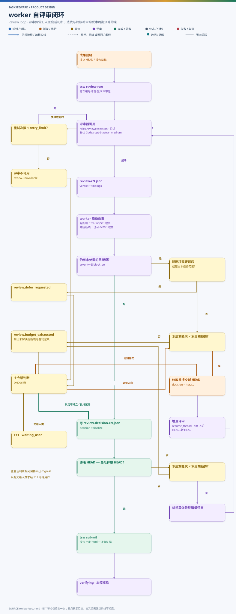

# DN004 worker 自评审：评审与迭代决策

- 状态：设计草案（T233 r5，已按 PoC 结果修订；T325 修订评审器实现与可关闭的自评审，待用户确认）
- 日期：2026-11-05
- 相关：[DN002 任务状态机 §3.3](DN002-task-state-machine.md) · [DN003 统一配置](DN003-unified-config.md) · 实现：[CX004 Codex 评审器](codex/CX004-reviewer.md) · [CC004 Claude Code 评审器](claude-code/CC004-reviewer.md) · [CP004 Copilot CLI 评审器](copilot/CP004-reviewer.md)

## 1. 目标与变化

worker 完成任务成果后，**由 worker 自己**启动配置的只读评审器（默认 Codex `gpt-6-astra`，推理强度 `medium`，只读沙箱）评审，逐条处置意见，并自行决定迭代还是定稿。定稿后提交给主会话验收，最后交用户人工验收。

与 orchestrator-agent 相比：

| 项 | orchestrator-agent | 本设计 |
| --- | --- | --- |
| Astra 对照版（另一模型独立出一版成品再比较） | 默认用于面向用户的图、报告正文和 HTML | **删除** |
| 代码审查 reviewer | worker 或主控按需启动 | 默认所有任务类型**必经**的自评审环节；只有用户能在配置中全局或按仓库关闭（§9），主会话与 worker 都不能为某个任务跳过 |
| 是否迭代 | 主控根据审查反馈决定 | worker 决定；主控在验收时复核其处置理由 |
| 证据 | 审查意见写在报告里 | 每轮请求、结构化结果、逐条处置分别落盘并进入账本 |

## 2. 流程



图源：[diagrams/review-loop.mmd](diagrams/review-loop.mmd)

1. **成果就绪**：代码 / 设计任务已在 worktree 提交；研究任务的报告草稿已写入 `work/Txxx/aN/`。
2. **生成评审包**：worker 调用 `review_run`，tsw 按任务类型渲染 `review/rK-request.md`，内容包括：
   - 任务书当前 revision 的目标与验收要求（原文）；
   - 评审范围：代码 / 设计为 `base..HEAD` 的 diff 和变更文件列表，研究为报告与证据目录；
   - 已执行的验证命令及其结果摘要；
   - 适用的目标仓库约定文件路径（reviewer 自行只读查阅）；
   - 输出 schema 与严重级别定义；
   - 增量轮次另含上轮意见、worker 的处置，以及上轮 HEAD..新 HEAD 的 diff；
   - 评审器不能运行命令时（§3.1），本轮范围的完整 diff 写入 `review/rK-diff.patch`，请求中给出路径。
3. **调用评审器**（§3）：同步方式由 tsw 启动一次性只读线程，等待完成并读回最终消息；子代理方式由 worker 按 `review_run` 返回的指示启动只读评审子代理，再把子代理的最终消息交回 `review_run`。
4. **结构化结果**：解析为 `review/rK.json`；不满足 schema 时视为该轮失败（E02 重试）。
5. **逐条处置**（`review_triage`）：阻断项（`review.block_on` 中的级别）只能标为 `fix` 或 `reject`；非阻断项还可以标为 `defer`。`reject` 和 `defer` 必须写理由。阻断项确需延后时，worker 不能自行 defer，而是提交 `review.defer_requested` 交主会话判断。
6. **决定**（`review_decide`）：
   - `iterate`：存在需修复的阻断项，且本周期轮次 < 本周期有效预算（`max_rounds` + 主会话追加 + 用户追加，见 DN002 §3.3）。修改并提交新 HEAD 后进入下一轮增量评审。
   - `finalize`：每个阻断项都已按 G-SUBMIT 处置：`fix` 且已验证、有据 `reject`、主会话认定不成立（`review.finding_overruled`），或经主会话 / 用户批准延后（`review.defer_approved`，列入报告“已知问题”）。
   - `escalate`：本提交周期预算用完仍有阻断项（`review.budget_exhausted`）、阻断项需要延后（`review.defer_requested`），或评审器不可用（`review.unavailable`）。worker 随即在自己的会话中问用户（`ask_user`，DN006 §8.1a），由用户决定追加轮次、认定意见不成立、批准延后或调整方向；任务进入 `waiting_user`。超时无回复时转交主会话，主会话可在授权边界内代为决定（DN006 §8.1b）。
7. **终版一致性**：`finalize` 时如果当前 HEAD 晚于最后评审的 HEAD（例如定稿后改了报告链接），必须对差异再做一轮增量评审；这一轮同样计入本周期预算，预算耗尽时 `escalate`。
8. **提交**：调用 `submit`，tsw 执行 G-SUBMIT（DN002 §4）。

## 3. 评审器调用

评审器不是单独的插件类型，而是由 `roles.reviewer.session` 选用一个能做评审的会话适配器（`oneshot`、`read_only_enforced`，调用方式见下，DN006 §7.4），可以与主会话、worker 使用的适配器不同。评审包渲染、输出 schema 校验、轮次计数与增量范围属于 tsw 核心。评审器有两种调用方式：

- **同步（`direct`）**：`review_run` 启动评审进程，等它结束并读回最终消息，一次调用完成一轮。
- **worker 子代理（`worker_agent`）**：评审器是 worker 所在宿主的只读子代理，只有 worker 的模型能启动它。`review_run` 开轮（`review_start`）、写好评审请求后立即返回启动指示（子代理类型、模型、effort、描述与提示）；worker 用宿主的子代理工具原样启动，子代理结束后，worker 带上 `round` 与 `result`（子代理最终消息的原文）再调用一次 `review_run`，tsw 按与同步方式相同的规则解析、校验并记录 `review_complete` 或 `review_fail`。

两种方式的输出契约（§4）、处置规则（§5）、失败与重试（E02）相同。

### 3.1 评审器实现

| 会话适配器 | 方式 | 只读的强制方式 | 增量轮次 | 实现文档 |
| --- | --- | --- | --- | --- |
| `codex-app-server`（默认） | 同步：Codex App Server 一次性线程 | `sandbox=read-only` | 续用线程，只审增量 | [CX004 §2](codex/CX004-reviewer.md) |
| `codex-exec`（回退，尚未实现） | 同步：`codex exec` | `--sandbox read-only` | 每轮全量并附上轮意见 | [CX004 §3](codex/CX004-reviewer.md) |
| `claude-subagent` | worker 子代理：插件提供的子代理 `task-steward:reviewer` | 子代理定义只开放 `Read`、`Grep`、`Glob` | 每轮新子代理：全量范围，附上轮意见、处置与增量 diff | [CC004](claude-code/CC004-reviewer.md) |
| `copilot-cli` | 同步：`copilot -p` 非交互 | 只开放 `view`、`grep`、`glob`，拒绝 `write`、`shell`、`memory`、`url` | 续用会话（`--resume`），只审增量 | [CP004](copilot/CP004-reviewer.md) |

所有实现共同的规则：

- 使用配置指定的模型与 effort。同步方式下模型不可用、effort 不支持，或评审器实际使用的模型与请求不一致（包括宿主或管理策略换了模型）时判为本轮失败，**不回退到其他模型**。子代理方式由宿主按请求选择模型，tsw 拿不到子代理实际使用的模型，只记录请求的模型（CC004 §4）。
- 默认评审器与回退都失败时记录 `review.unavailable` 交主会话判断（可稍后重试或交给人类），**不能跳过评审**（自评审关闭的情形见 §9），**也不能改用配置以外的评审器**：worker 自己启动的其他子代理（通用子代理、Explore 等）不是 `claude-subagent`，不能代替配置的评审器。
- 不能运行命令的评审器（`claude-subagent`、`copilot-cli`）由 tsw 把本轮范围的完整 diff 写入 `review/rK-diff.patch`，请求中给出路径。评审器只读查阅执行目录、报告草稿与评审包，不运行测试；测试与验证结果以 worker 在 `notes` 中写明的为准，评审器把无法核实的事项列入 `unverified`。

### 3.2 v1 实现范围

- `review_run`（MCP，worker）与 `tsw review run`（命令行）是同一实现。开轮之前先检查能检查的：调用者是 live 且目录一致的 worker；自评审未关闭（§9）；同步评审器的命令存在；Git 执行目录中 `head`、`base` 必须是真实提交（只把解析出的提交 ID 交给 git，选项形式的输入直接拒绝）；没有给 `base` 时取 `repositories.<repo>.base_ref`、`origin/HEAD`、`main` 等与 HEAD 的分叉点，取不到就要求显式指定。同一 attempt 同时只运行一轮（`locks/` 中的文件锁）。
- 开轮（`review_start`）后渲染 `runs/Txxx/aN/review/rK-request.md`（需要时连同 `rK-diff.patch`），调用评审器，结果写入 `rK.json`、调用信息写入 `rK-run.json`（范围、线程或子代理 ID、模型、effort、是否续用），然后记录 `review_complete`。评审器报错、启动失败、超时、输出不是 JSON、不满足契约，或 `reviewed_head` 与本轮 HEAD 不一致（Git 缩写须解析为同一提交，非 Git 成果标识须完全相同）时，保存原始输出 `rK-raw.txt` 并记录 `review_fail`；开轮后的任何异常都以失败收尾。任务处于 `reviewing`（E02）时再次调用即在同一轮、按落账的 `head` 与 `base` 重试；落账的范围同样要是执行目录中的完整提交（轮次可能是直接用 `review_start` 开的），否则不调用评审器、记录失败。
- 子代理方式：第一次调用开轮并返回启动指示（结果中 `status` 为 `awaiting_agent`），这时任务停在 `reviewing`。第二次调用带 `round`（必须是本周期正在进行的一轮）与 `result`；子代理没有交回结果（报错、被中断、宿主找不到子代理类型）时改带 `error`，记录 `review_fail`。在 `reviewing` 中不带 `result` 与 `error` 再调用，即 E02 重试：按落账的范围重写请求，再次给出启动指示。子代理在 worker 的 turn 内运行，worker 在交回结果或失败之前不结束 turn（Stop hook 提示，§8）。
- 每轮请求都带当前 revision 的目标与验收原文；需求变更（E07）开启新周期后不续用旧线程，按新需求完整评审。
- 默认评审器 `codex-app-server` 的进程与线程管理见 [CX004 §4](codex/CX004-reviewer.md)，`copilot-cli` 见 [CP004](copilot/CP004-reviewer.md)。
- `codex-exec` 与 `claude-headless`（附录 A）尚未实现：配置为评审会话时 `review_run` 返回 `UNSUPPORTED`，不落账新的一轮。

### 3.3 只读与隔离

- reviewer 只读，不能修改 worktree，不能 push，不能访问凭据目录。只读由会话适配器用宿主机制强制（沙箱、工具白名单），不靠提示。
- 评审包和结果由 tsw 写入该 attempt 的 `runs/Txxx/aN/review/`（worker 不直接写 `runs/`，见 DN006 §9.4）。
- 一次性线程与评审子代理不进入调度、不绑定任务、不占用 `max_workers` 名额。每个 attempt 的 reviewer 线程只服务于该 attempt，不跨任务复用。
- 子代理方式的独立性：子代理有自己的上下文，只看到评审请求与它自己读到的文件，不继承 worker 的对话；但它与 worker 在同一宿主，配置应选与 worker 不同的模型（相同时配置校验警告）。结果经 worker 转交给 `review_run`，与 worker 直接调用 `review_complete` 的信任边界相同：tsw 校验结构与 HEAD，不能证明结果出自子代理；`rK-run.json` 记录 worker 报告的子代理 ID，供主会话在 G-ACCEPT 复核时对照宿主的子代理记录。

## 4. 输出契约

`config/schemas/review-result.schema.json` 约定评审器必须只输出如下 JSON：

```json
{
  "verdict": "changes_requested",
  "summary": "一段话总结",
  "reviewed_head": "4f1c2ab",
  "findings": [
    {
      "id": "F1",
      "severity": "high",
      "category": "correctness",
      "location": {"path": "src/ledger.py", "line": 120},
      "claim": "分卷封存后未清除 pending 标记，重启时会重复封存。",
      "evidence": "ledger.py:118-124 先写 manifest 后清 pending，二者之间崩溃即重入。",
      "suggestion": "调整提交顺序或在恢复时按卷字节比对去重。",
      "acceptance_item": "验收第 3 条：中断后可恢复且不重复"
    }
  ],
  "unverified": ["未能运行集成测试：缺少云端测试凭据"]
}
```

| 字段 | 约束 |
| --- | --- |
| `verdict` | `pass` / `changes_requested` / `blocked`（无法评审，例如缺材料） |
| `severity` | `critical` / `high` / `medium` / `low` / `info` |
| `category` | `correctness` `security` `requirement` `test` `docs` `maintainability` `performance` |
| `evidence` | 必须指向可核实的位置或命令输出；没有证据的推测只能是 `info` |
| `acceptance_item` | 能对应到验收要求时填写，便于主控逐项核对 |

## 5. worker 处置规范

worker 不盲信评审意见，处置时先核实：

1. 评论的前提是否符合受支持的契约；
2. 实际入口与触发条件是否可达；
3. 影响是什么；
4. 哪些是事实证据，哪些是假设。

在此基础上权衡最小修复与复杂度、I/O 和维护成本。可以有据拒绝，但仅靠人工构造的测试或理论交错，不能当作生产问题；没有现网复现，也不能否定已证明可达的问题。

处置记录 `review/rK-decision.json`：

```json
{
  "round": 1,
  "cycle": 1,
  "reviewed_head": "4f1c2ab",
  "items": [
    {"finding": "F1", "action": "fix", "commit": "9a0d3e1", "verification": "test_ledger_recover_after_seal 通过"},
    {"finding": "F2", "action": "reject", "reason": "该入口仅在 --debug 下可达，生产配置禁止；见 config.py:44"},
    {"finding": "F3", "action": "defer", "reason": "性能优化，超出本任务验收范围", "follow_up": "建议新建任务"}
  ],
  "decision": "iterate",
  "next_head": "9a0d3e1"
}
```

决策规则：

| 情况 | 决定 |
| --- | --- |
| `verdict=pass`，或每个阻断项都已按 G-SUBMIT 处置（修复并验证、有据拒绝、主会话认定不成立、获批延后） | `finalize` |
| 有阻断项需要修复，本周期轮次 < 本周期有效预算 | `iterate` |
| 有阻断项需要修复，本提交周期预算已用完 | `escalate`：提交 `review.budget_exhausted`，列出未解决项、各轮记录与 worker 的建议，在本会话中问用户（超时转交主会话） |
| 阻断项需要延后（超出本任务范围或依赖外部） | `escalate`：提交 `review.defer_requested`，由主会话批准延后（列入已知问题）、要求继续修复或交给人类 |
| `verdict=blocked` 因缺材料 | 该轮不算有效评审（不满足 G-SUBMIT，也不能确认修复）；补齐材料后经 E06 以新的一轮重跑（计入本周期预算）；缺的材料自己拿不到时在本会话中问用户（`ask_user`） |
| 非阻断项 | worker 自行决定修复或 defer，不影响 finalize |

### 5.1 预算用完后由用户（或转交后的主会话）决定

worker 提交 `review.budget_exhausted` 时附上：未解决的阻断项与各轮处置记录、每轮评审 HEAD、worker 认为最合理的下一步，并在本会话中把这些写给用户。用户（或超时转交后的主会话，按 DN006 §8.2 的方式）常见的决定：

| 情况 | 典型决定 |
| --- | --- |
| 剩余问题清楚、每轮都在收敛 | 追加 1–2 轮（`review.budget_extended`） |
| 评审器反复提同一条意见，worker 的反驳有据 | 核实后认定意见不成立（`review.finding_overruled`），理由写入报告 |
| 问题真实但超出本任务范围 | 批准延后（`review.defer_approved`），列入已知问题，并建议新建任务 |
| 修复方向错误、来回修改不收敛 | 给出新的修复思路或收窄范围（`orchestrator.feedback`） |
| 需要改变验收标准、扩大范围，或主会话没有把握 | 转交后的主会话不代答，转达给用户或继续等待 |

主会话或用户的决定由 tsw 记入事件，并在 worker 的当前处置记录（`review/rK-decision.json`）中引用对应的决定 ID：追加轮次后 worker 继续 `iterate`；认定不成立或批准延后后，对应阻断项的处置记为 `overruled` / `deferred_approved`，worker 可以 `finalize`。

同一提交周期内主会话累计追加的轮次不超过 `review.orchestrator_extension_limit`（默认 3）；再需要追加只能交给人类。主会话的每个决定都记入 `DecisionRecord`，出现在主控验收报告与决定摘要中。

## 6. 主会话的复核

主会话在 G-ACCEPT 中复核评审，但不重新评审：

- 每轮请求、结果、处置文件齐全，且 `reviewed_head` 与提交历史一致；
- 最后一轮的 HEAD 等于提交 HEAD；
- 每条 `reject` / `defer` 的理由是否站得住，以及本任务中主会话自己作出的评审相关决定（追加轮次、认定不成立、批准延后）在验收时是否仍然成立。理由不足时走 T17，给出具体剩余工作；
- 评审覆盖了任务类型要求的范围（代码含测试与 diff，研究含结论与证据）。

主会话认为需要独立的二次审查时，可以要求 worker 用 `fresh` 线程再跑一轮全量评审，结果同样记入证据。

## 7. 报告中的呈现

worker 的 `result.md` / `result.html` 增加“自评审”一节：

- 轮次数和每轮的 verdict；
- 阻断项的处置一览（fix / reject / defer 及理由）；
- 最终评审 HEAD；
- 未能验证的事项。

只引用评审文件，不粘贴完整原文。

## 8. 成本与时间

- 每轮评审是一次 `medium` 推理的一次性线程。增量轮次复用线程，只审 diff，成本通常明显低于首轮。
- 每个提交周期最坏情况的调用次数为“本周期有效预算 × (`retry_limit` + 1)”。默认配置下，不经任何追加时为 3 轮 × 最多 3 次尝试；主会话追加受 `orchestrator_extension_limit` 限制，用户追加由用户逐次批准。主控退回（T17）或需求变更会开启新周期，轮次编号继续递增。
- 评审等待期间 worker 子会话保持工作（Stop hook 提示不要结束 turn），不会触发主会话唤醒。

## 9. 关闭自评审

用户可以选择不做自评审（T325；用户原话见 T308 会话 M-T308-9：“提供一个不自评审的选项”）。这改变了此前“评审必经、不可由配置关闭”的决定（DN002 G-SUBMIT、DN003 §3.1），所以只能由用户以配置做出：

- **配置**：`review.self_review`（`required` 默认 / `off`）对所有任务生效；`repositories.<id>.self_review` 对该仓库的任务覆盖全局值。两者都是权限类键（DN003 §7.2），改动要附用户原话。主会话与 worker 都不能为某个任务临时关闭自评审。
- **取值时机**：按任务所属仓库，在每次 `review_run`、`review_start` 与 `submit` 时读取当时的配置。任务书写明“自评审：关闭（来源键）”或“自评审：开启”。
- **关闭时**：`review_run` 与 `review_start` 以 `self_review_off` 拒绝；worker 在 `executing`（或关闭前已进入的 `triaging`）中直接 `submit`（T13）。G-SUBMIT 不检查评审条件（评审轮次、最后评审 HEAD、`finalize`、阻断项处置），其他条件照常：报告 md 与 html、合并与主分支 CI、live 说明、工作树。`worker.submitted` 记录 `review: {"mode": "off", "source": <生效的键>}`。
- **关闭前已有的轮次**：照常留在证据中、写进报告，但不再约束提交；正在进行的一轮（`reviewing`）要先以完成或失败结束。
- **重新开启**：改回 `required` 后，尚未提交的任务按评审必经的规则提交（本周期没有有效评审时先 `review_run`）；已提交的任务不受影响。
- **报告与验收**：报告的“自评审”一节写“未做（配置关闭，来源键）”。主会话在 G-ACCEPT 中核对提交记录的模式与来源，不要求评审证据。
- **仓库自己的规则不变**：仓库要求的评审（例如 PR 须经独立评审才能合并）不因关闭 tsw 自评审而失效，worker 照仓库规则执行，tsw 不替仓库判断。
- **安装**：`tsw setup` 的评审器问题另有一个选项 `none`（不做自评审），选择它即写入 `review.self_review: "off"`（DN009 §6）。

## 附录 A：备选方案存档

| 事项 | 采用 | 备选与不采用的原因 |
| --- | --- | --- |
| 没有 Codex 时的 Claude 评审器（§3.1，T325） | `claude-subagent`：worker 用 Agent 工具启动插件提供的只读子代理 | `claude-headless`：tsw 以 `claude -p` 启动独立进程（PoC 2026-11-05 可行，调用约定存档于 [CC004 附录 A](claude-code/CC004-reviewer.md)）。要清除继承的宿主环境变量、另行认证，并加载用户级 hooks；用户在 T308 会话中选择用子代理（M-T308-10：“claude 自己的reviewer用subagent做就可以了，不用专门用claude headless或者cli”）。`claude-headless` 仍保留在适配器目录中，未实现 |
| 子代理结果的取回（§3.2，T325） | worker 把子代理最终消息原文交回 `review_run` | 插件的 SubagentStop hook 从子代理记录中直接取结果：不经 worker 转交，但宿主可能以交接工具送回报告（这时 hook 的 `last_assistant_message` 只有收尾文字），要解析宿主内部的子代理记录格式；而 worker 本来就能直接调用 `review_complete`，hook 不提高信任边界 |
| 关闭自评审的粒度（§9，T325） | 全局与按仓库的配置，权限类键 | 按任务（主会话受理时指定）：主会话能自行关闭评审，越过用户的授权；“可选评审”（不要求评审，但做了的轮次仍约束提交）：规则更复杂，用户只要求了不做自评审的选项 |
