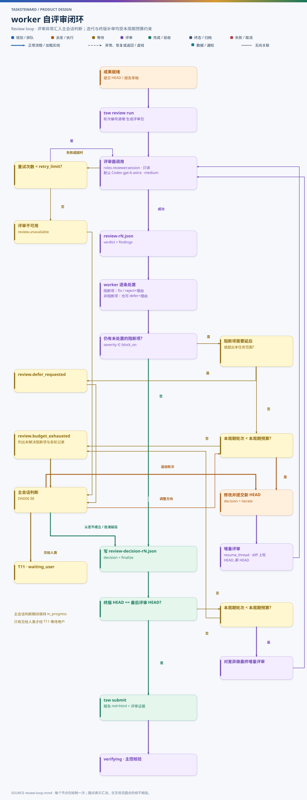

# DN004 worker 自评审：Codex Astra 评审与迭代决策

- 状态：设计草案（T233 r5，已按 PoC 结果修订）
- 日期：2026-11-05
- 相关：[DN002 任务状态机 §3.3](DN002-task-state-machine.md) · [DN003 统一配置](DN003-unified-config.md)

## 1. 目标与变化

worker 完成任务成果后，**由 worker 自己**启动 Codex（`gpt-6-astra`，推理强度 `medium`，只读沙箱）评审，逐条处置意见，并自行决定迭代还是定稿。定稿后提交给主会话验收，最后交用户人工验收。

与 orchestrator-agent 相比：

| 项 | orchestrator-agent | 本设计 |
| --- | --- | --- |
| Astra 对照版（另一模型独立出一版成品再比较） | 默认用于面向用户的图、报告正文和 HTML | **删除** |
| 代码审查 reviewer | worker 或主控按需启动 | 所有任务类型**必经**的自评审环节（不可由配置关闭） |
| 是否迭代 | 主控根据审查反馈决定 | worker 决定；主控在验收时复核其处置理由 |
| 证据 | 审查意见写在报告里 | 每轮请求、结构化结果、逐条处置分别落盘并进入账本 |

## 2. 流程



图源：[diagrams/review-loop.mmd](diagrams/review-loop.mmd)

1. **成果就绪**：代码 / 设计任务已在 worktree 提交；研究任务的报告草稿已写入 `work/Txxx/aN/`。
2. **生成评审包**：worker 调用 `review_run`，tsw 按任务类型渲染 `review/rK-request.md`，内容包括：
   - 任务书当前 revision 的目标与验收要求（原文）；
   - 评审范围：代码 / 设计为 `base..HEAD` 的 diff 和变更文件列表，研究为报告与证据目录；
   - 已执行的验证命令及其结果摘要；
   - 适用的目标仓库约定文件路径（reviewer 自行只读查阅）；
   - 输出 schema 与严重级别定义；
   - 增量轮次另含上轮意见、worker 的处置，以及上轮 HEAD..新 HEAD 的 diff。
3. **调用 Codex**：tsw 启动一次性只读线程（§3），等待完成并读回最终消息。
4. **结构化结果**：解析为 `review/rK.json`；不满足 schema 时视为该轮失败（E02 重试）。
5. **逐条处置**（`review_triage`）：阻断项（`review.block_on` 中的级别）只能标为 `fix` 或 `reject`；非阻断项还可以标为 `defer`。`reject` 和 `defer` 必须写理由。阻断项确需延后时，worker 不能自行 defer，而是提交 `review.defer_requested` 交主会话判断。
6. **决定**（`review_decide`）：
   - `iterate`：存在需修复的阻断项，且本周期轮次 < 本周期有效预算（`max_rounds` + 主会话追加 + 用户追加，见 DN002 §3.3）。修改并提交新 HEAD 后进入下一轮增量评审。
   - `finalize`：每个阻断项都已按 G-SUBMIT 处置：`fix` 且已验证、有据 `reject`、主会话认定不成立（`review.finding_overruled`），或经主会话 / 用户批准延后（`review.defer_approved`，列入报告“已知问题”）。
   - `escalate`：本提交周期预算用完仍有阻断项（`review.budget_exhausted`）、阻断项需要延后（`review.defer_requested`），或评审器不可用（`review.unavailable`）。交主会话判断（DN006 §8.3），由主会话决定追加轮次、认定意见不成立、批准延后、调整方向或交给人类；任务保持 `in_progress`，只有交给人类时才进入 `waiting_user`。
7. **终版一致性**：`finalize` 时如果当前 HEAD 晚于最后评审的 HEAD（例如定稿后改了报告链接），必须对差异再做一轮增量评审；这一轮同样计入本周期预算，预算耗尽时 `escalate`。
8. **提交**：调用 `submit`，tsw 执行 G-SUBMIT（DN002 §4）。

## 3. 评审器调用

评审器不是单独的插件类型，而是由 `roles.reviewer.session` 选用一个具备 `oneshot`、`direct`、`read_only_enforced` 能力的会话适配器（DN006 §7.4），可以与主会话、worker 使用的适配器不同。评审包渲染、输出 schema 校验、轮次计数与增量范围属于 tsw 核心。下文描述默认的 `codex-app-server` 与回退 `codex-exec`；没有 Codex 的配置可改用 `claude-headless` 等实现，评审输出契约（§4）与处置规则（§5）不变。

### 3.1 主路径：App Server 一次性线程

沿用 orchestrator-agent `agent oneshot` 已验证的方式，移植为 tsw 的 reviewer 适配器：

1. 在本机临时启动私有 `codex app-server --listen ws://127.0.0.1:<随机端口>`，结束后结束整个进程树。
2. `thread/start`：`model = roles.reviewer.model`（`gpt-6-astra`），`model_reasoning_effort = roles.reviewer.effort`（`medium`），`sandbox = read-only`，`cwd` = 执行目录，`model_context_window = roles.reviewer.context_window`，`allowProviderModelFallback = false`。
3. `turn/start` 发送评审包；等待 `turn/completed`，超时（`timeout_seconds`）则中断并记为失败。
4. 读回 finalMessage，解析 JSON。
5. 首轮保留线程（keep thread），线程 ID 记入 `review.started`。后续轮次用 `resume_thread` 续用同一线程做增量评审；最后一轮结束后归档线程。

模型不可用、effort 不支持或返回的模型与请求不一致时，直接判为本轮失败，**不回退到其他模型**。

### 3.2 回退：`codex exec`

App Server 无法启动时，用 `codex exec` 非交互执行同一评审包（指定模型、effort、`--sandbox read-only`），输出同样按 schema 解析。回退本身记录在 `review.completed.data.transport` 中。回退也失败时记录 `review.unavailable` 交主会话判断（可稍后重试或交给人类）：**不能跳过评审，也不能改用 Claude 子代理冒充 Codex 评审**。

### 3.3 无 Codex 时：`claude-headless`

用 Claude Code 命令行一次性评审（PoC 2026-11-05 实测的调用约定）：

- **清除继承的宿主环境变量**：tsw 在桌面 app 的会话里运行，进程继承了 `CLAUDE_*` / `ANTHROPIC_*` 等宿主变量，命令行会因此以为认证由宿主提供而报“未登录”。启动评审进程前删除这些变量，让命令行读取用户设置中的认证或网关配置。
- **严格只读**：`--allowedTools Read,Grep,Glob`，`--disallowedTools Write,Edit,Bash,NotebookEdit,ExitPlanMode,Agent,Workflow,Skill`（子代理与工作流工具可能间接写入，也要禁用），`--permission-mode dontAsk`。不使用 plan 模式：它不写目标文件，但会把计划文件写入用户目录。
- **设置来源**：`--setting-sources user`，以便读取用户的认证或网关配置；这也会加载用户级 hooks，评审结果只以 JSON 输出为准，hooks 的报错不影响评审。
- **显式模型**：总是传 `--model roles.reviewer.model`，不依赖用户的默认模型。
- **输出与续用**：`--output-format json`，从 `result` 字段解析评审 JSON；增量评审用 `--resume <session_id>` 续用同一会话。

### 3.4 只读与隔离

- reviewer 线程只读，不能修改 worktree，不能 push，不能访问凭据目录。
- 评审包和结果由 tsw 写入该 attempt 的 `runs/Txxx/aN/review/`（worker 不直接写 `runs/`，见 DN006 §9.4）。
- 一次性线程不进入调度、不绑定任务、不占用 `max_workers` 名额。每个 attempt 的 reviewer 线程只服务于该 attempt，不跨任务复用。

## 4. 输出契约

`config/schemas/review-result.schema.json` 约定 Codex 必须只输出如下 JSON：

```json
{
  "verdict": "changes_requested",
  "summary": "一段话总结",
  "reviewed_head": "4f1c2ab",
  "findings": [
    {
      "id": "F1",
      "severity": "high",
      "category": "correctness",
      "location": {"path": "src/ledger.py", "line": 120},
      "claim": "分卷封存后未清除 pending 标记，重启时会重复封存。",
      "evidence": "ledger.py:118-124 先写 manifest 后清 pending，二者之间崩溃即重入。",
      "suggestion": "调整提交顺序或在恢复时按卷字节比对去重。",
      "acceptance_item": "验收第 3 条：中断后可恢复且不重复"
    }
  ],
  "unverified": ["未能运行集成测试：缺少云端测试凭据"]
}
```

| 字段 | 约束 |
| --- | --- |
| `verdict` | `pass` / `changes_requested` / `blocked`（无法评审，例如缺材料） |
| `severity` | `critical` / `high` / `medium` / `low` / `info` |
| `category` | `correctness` `security` `requirement` `test` `docs` `maintainability` `performance` |
| `evidence` | 必须指向可核实的位置或命令输出；没有证据的推测只能是 `info` |
| `acceptance_item` | 能对应到验收要求时填写，便于主控逐项核对 |

## 5. worker 处置规范

worker 不盲信评审意见，处置时先核实：

1. 评论的前提是否符合受支持的契约；
2. 实际入口与触发条件是否可达；
3. 影响是什么；
4. 哪些是事实证据，哪些是假设。

在此基础上权衡最小修复与复杂度、I/O 和维护成本。可以有据拒绝，但仅靠人工构造的测试或理论交错，不能当作生产问题；没有现网复现，也不能否定已证明可达的问题。

处置记录 `review/rK-decision.json`：

```json
{
  "round": 1,
  "cycle": 1,
  "reviewed_head": "4f1c2ab",
  "items": [
    {"finding": "F1", "action": "fix", "commit": "9a0d3e1", "verification": "test_ledger_recover_after_seal 通过"},
    {"finding": "F2", "action": "reject", "reason": "该入口仅在 --debug 下可达，生产配置禁止；见 config.py:44"},
    {"finding": "F3", "action": "defer", "reason": "性能优化，超出本任务验收范围", "follow_up": "建议新建任务"}
  ],
  "decision": "iterate",
  "next_head": "9a0d3e1"
}
```

决策规则：

| 情况 | 决定 |
| --- | --- |
| `verdict=pass`，或每个阻断项都已按 G-SUBMIT 处置（修复并验证、有据拒绝、主会话认定不成立、获批延后） | `finalize` |
| 有阻断项需要修复，本周期轮次 < 本周期有效预算 | `iterate` |
| 有阻断项需要修复，本提交周期预算已用完 | `escalate`：提交 `review.budget_exhausted`，列出未解决项、各轮记录与 worker 的建议，交主会话判断 |
| 阻断项需要延后（超出本任务范围或依赖外部） | `escalate`：提交 `review.defer_requested`，由主会话批准延后（列入已知问题）、要求继续修复或交给人类 |
| `verdict=blocked` 因缺材料 | 补齐材料后重跑本轮；缺的材料自己拿不到时以 `worker.question` 交主会话判断 |
| 非阻断项 | worker 自行决定修复或 defer，不影响 finalize |

### 5.1 预算用完后由主会话判断

worker 提交 `review.budget_exhausted` 时附上：未解决的阻断项与各轮处置记录、每轮评审 HEAD、worker 认为最合理的下一步。主会话按 DN006 §8.2 的方式判断，常见做法：

| 情况 | 主会话的典型决定 |
| --- | --- |
| 剩余问题清楚、每轮都在收敛 | 追加 1–2 轮（`review.budget_extended`） |
| 评审器反复提同一条意见，worker 的反驳有据 | 核实后认定意见不成立（`review.finding_overruled`），理由写入报告 |
| 问题真实但超出本任务范围 | 批准延后（`review.defer_approved`），列入已知问题，并建议新建任务 |
| 修复方向错误、来回修改不收敛 | 给出新的修复思路或收窄范围（`orchestrator.feedback`） |
| 需要改变验收标准、扩大范围，或主会话没有把握 | 交给人类（T11） |

主会话或用户的决定由 tsw 记入事件，并在 worker 的当前处置记录（`review/rK-decision.json`）中引用对应的决定 ID：追加轮次后 worker 继续 `iterate`；认定不成立或批准延后后，对应阻断项的处置记为 `overruled` / `deferred_approved`，worker 可以 `finalize`。

同一提交周期内主会话累计追加的轮次不超过 `review.orchestrator_extension_limit`（默认 3）；再需要追加只能交给人类。主会话的每个决定都记入 `DecisionRecord`，出现在主控验收报告与决定摘要中。

## 6. 主会话的复核

主会话在 G-ACCEPT 中复核评审，但不重新评审：

- 每轮请求、结果、处置文件齐全，且 `reviewed_head` 与提交历史一致；
- 最后一轮的 HEAD 等于提交 HEAD；
- 每条 `reject` / `defer` 的理由是否站得住，以及本任务中主会话自己作出的评审相关决定（追加轮次、认定不成立、批准延后）在验收时是否仍然成立。理由不足时走 T17，给出具体剩余工作；
- 评审覆盖了任务类型要求的范围（代码含测试与 diff，研究含结论与证据）。

主会话认为需要独立的二次审查时，可以要求 worker 用 `fresh` 线程再跑一轮全量评审，结果同样记入证据。

## 7. 报告中的呈现

worker 的 `result.md` / `result.html` 增加“自评审”一节：

- 轮次数和每轮的 verdict；
- 阻断项的处置一览（fix / reject / defer 及理由）；
- 最终评审 HEAD；
- 未能验证的事项。

只引用评审文件，不粘贴完整原文。

## 8. 成本与时间

- 每轮评审是一次 `medium` 推理的一次性线程。增量轮次复用线程，只审 diff，成本通常明显低于首轮。
- 每个提交周期最坏情况的调用次数为“本周期有效预算 × (`retry_limit` + 1)”。默认配置下，不经任何追加时为 3 轮 × 最多 3 次尝试；主会话追加受 `orchestrator_extension_limit` 限制，用户追加由用户逐次批准。主控退回（T17）或需求变更会开启新周期，轮次编号继续递增。
- 评审等待期间 worker 子会话保持工作（Stop hook 提示不要结束 turn），不会触发主会话唤醒。
