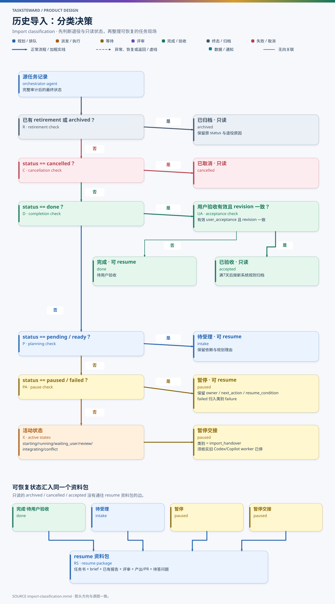

# DN005 历史导入与 resume

- 状态：设计草案（T233 r3）
- 日期：2026-11-05
- 相关：[DN002 任务状态机 §3.4](DN002-task-state-machine.md) · [DN003 统一配置](DN003-unified-config.md)

## 1. 目标

1. orchestrator-agent 的**全部历史记录**都能导入：任务书、完整事件账本、runs 成果、PR 与产出登记、用户验收与归档记录。
2. **pending** 和**待用户验收**的任务（以及暂停、执行中的任务）导入后可以 resume：凭任务书和已有交付报告，由新的 worker 子会话在原执行目录继续。
3. **已归档**和**已验收**的任务只读导入，不支持 resume；需要后续工作时新建关联任务，可引用其成果。
4. 导入不改写原历史，可重复执行（幂等），可审计。

## 2. 来源与现状（2026-11-05 快照）

| 来源 | 内容 | 规模 |
| --- | --- | --- |
| `runtime/events.jsonl` + `runtime/events-<start>-<end>.jsonl.gz` | 唯一执行事实（V1 完整快照事件与 V2 增量事件） | 活动卷约 15 MB，封存卷 193 个 |
| `TODO.md` + `todo/Txxx.md` | 任务索引与用户意图 | 234 个文件 |
| `runs/Txxx/aN/` | brief、报告、评审、验收、证据 | 219 个任务目录 |
| `config/repositories.json`、`config/accounts.json`、`.agents/skills/orchestrate-tasks/references/repositories.md` | 仓库、账号、缩写 | — |
| `config/model-settings.json` | 旧角色模型参数 | 不导入为新角色参数，仅存档 |
| `runtime/state.json`、`STATUS.html`、`ARCHIVE.html` | 生成视图 | 不作为导入来源，只用于核对 |

账本中共 232 个任务，按 DN002 §3.4 的规则分类如下：

| 分类 | 条件 | 数量 | 导入后状态 |
| --- | --- | --- | --- |
| 已归档（含已验收归档、未验收归档、取消归档） | 有 retirement | 184 | archived · 只读 |
| 已验收未归档 | `done` + 有效用户验收 | 34 | accepted · 只读 |
| 待用户验收 | `done`，无用户验收，未退役 | 10 | done · 可 resume |
| 暂停 | `paused` | 3 | paused · 可 resume |
| 待规划 | `pending` | 1 | intake · 可 resume |
| 执行中 / 失败等活动状态 | — | 0 | paused(import_handover) · 可 resume |

当前可 resume 的 14 个任务按旧状态分布如下（任务明细只保留在私有控制仓库中）：

| 旧状态 | 数量 | 任务类型 | 导入后 |
| --- | --- | --- | --- |
| done（待用户验收） | 10 | 设计 1、研究 4、代码 5 | done，可直接用户验收或退回后继续 |
| paused | 3 | 代码 3 | paused，满足恢复条件后重新派发 |
| pending | 1 | 代码 1 | intake，由主会话重新受理 |

实际导入时以切换当刻的完整审计结果为准，上表只是设计时的快照。T233（本设计任务）在旧账本中标记为暂停，切换后按同样规则导入。

## 3. 分类规则

图源：[diagrams/import-classification.mmd](diagrams/import-classification.mmd)

规则按顺序匹配，先命中先生效：

1. 有 `retirement` 或 `archived` → **archived**（只读）。保留原 `status`、退役原因（含 `explicit-user-closure` 等取消归档模式）、`retained_resources`。仍被保留的资源在新系统中写为未释放的占用记录，继续参与 G-RES 互斥，直到有释放证据。
2. `status=cancelled` → **cancelled**（只读）。
3. `status=done` 且有有效 `user_acceptance`（revision 与 definition hash 一致）→ **accepted**（只读）。按新系统的 T24 规则在满 7 天无业务变化后归档，计时沿用原 `last_activity`。用户对它提出新要求时新建关联任务，不会回到 intake。
4. `status=done` 且无有效用户验收 → **done**（可 resume，待用户验收）。
5. `status ∈ {pending, ready}` → **intake**（可 resume）。保留依赖与 `plan_reason`，由主会话重新受理与规划。
6. `status ∈ {paused, failed}` → **paused**（可 resume）。保留原 owner、next_action、resume_condition、等待类别和待答 `input_request`；原 `failed` 归入 paused，类别 `failure`。
7. 其他活动状态（starting / running / waiting_user / review / integrating / conflict）→ **paused**，类别 `import_handover`，owner = 主会话，next_action = “核实旧 worker 已停止并交接”，resume_condition = “有旧 worker 停止证据或用户确认”。

用户验收的“有效”沿用旧规则：revision、definition hash、产出 generation 一致。不一致时按第 4 条处理，并在导入报告中列出差异。

## 4. 导入过程

### 4.1 前置条件

1. 旧系统停止调度：Codex / Copilot 主会话不再运行派发类命令；旧租约已过期或已释放。导入在导入时刻按快照中的租约判断 `released` / `expired` / `active`，记入 `import.started` 事件的 `source_lease`；租约仍有效时拒绝导入（`source_lease_active`），演练（`--dry-run`）只报告。
2. 在隔离副本上对旧账本运行只读全审计（`python -m orchestrator ledger audit`），确认没有缺卷、间隙或冲突。
3. 备份旧控制根：全部事件卷、TODO / todo、config、runs 的 Git 提交 SHA，以及 `.local` 中的通知 outbox 与受管 inbox 数据库（用 SQLite backup API）。

### 4.2 步骤

| 步骤 | 动作 | 产物 |
| --- | --- | --- |
| 1 | 在旧控制根运行 `python -m orchestrator export-snapshot --output <控制根之外的空目录>`：用旧系统自己的 reader 只读重放全部事件（不写检查点），写出每个任务的最终状态、旧系统自己的生命周期判断（phase、用户验收是否有效、活动时间）、事件卷清单（字节数、序号范围、账本文本摘要）与需要复制的文件清单。`tsw import orchestrator-agent --snapshot <目录>` 只读这个快照与原文件，不解析旧账本格式；导入前核对事件卷仍与快照一致，不一致则拒绝 | 快照副本 `legacy/orchestrator-agent/import/snapshot.json` |
| 2 | **按原字节**复制全部事件卷到数据目录的 `ledger/imported/orchestrator-agent/`，写 manifest：文件名、字节数、序号范围、内容摘要（账本文本，非可执行文件） | 原始历史永久保留，可再次审计 |
| 3 | 复制 `TODO.md`、`todo/*.md` 到数据目录 `todo/`，保持 ID 与内容；新任务 ID 从最大导入 ID + 1 开始 | 用户意图延续 |
| 4 | 仓库、账号、缩写配置原样复制到 `legacy/orchestrator-agent/config/`，不自动并入统一配置（统一配置是用户编辑的文件）；需要时按 DN003 §3.4 手工转换，导入报告列出这一项；`model-settings.json` 不转换 | 原配置存档 |
| 5 | 按 §3 分类，为每个任务写一条 `import.task_imported` 事件，含原状态、新状态、`resumable`、来源事件序号、原 revision、定义摘要、采用的关键词与项目映射（来自旧 `metadata/task-keywords`，原记录复制到 `legacy/orchestrator-agent/metadata/`，见 DN007 §8）、原 attempt 列表（worker 通道、句柄、执行目录、分支、base commit）、PR、产出、用户验收 / 拒绝记录、业务时间 | 新账本中的任务 |
| 6 | runs 处理：只读任务的成果**复制**到数据目录 `legacy/orchestrator-agent/runs/`（只读），引用写为 `legacy://orchestrator-agent/runs/...`，在数据目录内解析；可 resume 任务把 `runs/Txxx/` 复制到数据目录 `runs/`，新 attempt 从 `aN+1` 开始 | 备份数据目录即包含全部历史成果；可 resume 任务的成果可被新 worker 读写 |
| 7 | 写 `import.completed`：任务计数、各分类数、冲突、只有任务书而旧账本未登记的任务、无法解析的成果引用、校验结果 | 导入报告 `legacy/orchestrator-agent/import/report.md` + `.html` |

### 4.3 时间与身份

- 导入事件的 `time` 是实际导入时间；任务的 `last_activity`、`done_at`、`accepted_at`、`archived_at` 保留原值（统一转换为本系统的 UTC 秒级 `Z` 格式），投影不会因导入事件刷新 `last_activity`。原 attempt 数延续为新任务的 attempt 计数，resume 时新 attempt 从 `aN+1` 开始。
- 原 worker 句柄（`codex-native:…`、`copilot-session:…`）只作历史记录。新系统无法控制这些会话，导入后不会向它们发消息。

### 4.4 幂等与增量

- 每条导入事件的 `command_id` = `import:orchestrator-agent:<task_id>:<来源末端序号>`。重复执行时，相同命令被识别为已应用，不产生新事件。
- 切换前允许多次增量导入：较新的快照重新导入导入后没有在新系统中产生任何事件的任务（以投影中任务版本仍为导入时的 1 判断）；已有新事件的任务不再被覆盖，与数据目录中非导入的同 ID 任务也不覆盖，冲突列入导入报告，由用户决定。
- 数据目录在导入前已有自己的任务、编号与导入任务冲突时，不覆盖，列为冲突。已结束的本地任务（`done` / `accepted` / `archived` / `cancelled`，且没有未结束的 attempt）可以在导入时改号：`tsw import orchestrator-agent --snapshot <目录> --renumber-local T001=T238`。改号写一条 `task.renumbered` 事件（`command_id` = `renumber:<旧>:<新>`），把该任务的投影行（含其他任务对它的依赖与资源占用）、任务书 `todo/<旧>.md`（标题行中的编号同步改）与成果 `runs/<旧>/` 移到新编号；之前的事件保留旧编号，不改写；任务的业务时间不变。新编号必须排在全部导入编号之后且未被占用。仍在执行的本地任务不能改号：先导入其余任务，等它结束后再用同一快照运行一次导入并加上改号，其他任务不产生新事件。
- 快照的导出命令以 `python -B` 运行，避免在旧控制根写字节码缓存；导出在重放前记录事件卷的字节数与摘要，重放后再比对，期间账本有任何追加都拒绝。
- 正式切换后，旧控制根改为只读（在其 TODO 说明中注明，并保留旧账本供审计）。

## 5. resume

### 5.1 resume 资料包

对可 resume 的任务，`task_dispatch` 生成新 attempt 的 `brief.md` 时，额外包含一个 resume 资料包（附在任务书之后，资料以数据目录内的路径给出）：

| 内容 | 来源 |
| --- | --- |
| 任务书当前 revision 全文 | `todo/Txxx.md` |
| 上一个 attempt 的 brief | `runs/Txxx/aN/brief.json` |
| 已有交付报告 | `worker_report`（如 `runs/Txxx/aN/result.html`）及其 md 来源（如有） |
| 主控验收结论与最近反馈 | `review_report`、`last_feedback` |
| PR 与产出登记 | `pull_requests`、`outputs`（含交付状态与核实时间） |
| 暂停与待答问题 | pause 字段、`input_request`、用户决定回执 |
| 执行现场 | worktree 路径、分支、base commit、候选提交 / 集成提交 |
| 依赖成果 | 已完成依赖任务的报告链接 |

worker 的第一步是**对账**，然后才继续工作：

1. 核对 worktree 是否存在，分支与提交是否与记录一致，有无未提交改动；
2. 核对 PR 当前状态（open / merged / closed）与 CI；
3. 对照报告列出“已完成 / 未完成”项。

对账发现与记录不符时，先 `progress_note` 记录差异；影响范围需要用户决定时，用 `question` 提问。

### 5.2 各状态的 resume 方式

| 导入状态 | resume 方式 |
| --- | --- |
| intake | 主会话重新受理与规划（T02–T04），之后正常派发；有旧执行目录则复用 |
| paused（原暂停或 failure） | resume_condition 满足后 T21 → ready → 新 attempt 在原执行目录继续 |
| paused（import_handover） | 先核实旧 worker 已停止（旧平台会话状态或执行目录无新写入），记录证据，再 T21 |
| done（待用户验收） | 不重新执行。用户可直接验收（T22）；也可退回（T23）→ 新 revision → intake，以已有报告为基础继续 |

旧任务没有 Codex 自评审证据。为了让 resume 后的提交满足 G-SUBMIT，新 attempt 在提交前必须对自己的改动做自评审：

- 有新提交：评审范围是“导入时的 HEAD..新 HEAD”，并附导入时的报告作为背景。
- 没有新代码提交（例如只更新报告）：对更新后的报告做一轮评审。

### 5.3 不支持 resume 的任务

archived、accepted、cancelled 的只读任务：

- 拒绝 `task_dispatch`、`resume`、`feedback`、`attempt_bind`；
- 可以作为 context 读取；作为新任务依赖时按 G-DEP 判定：`accepted`，以及退役前为 `done` / `accepted` 的归档任务，在被依赖的 revision 与其完成证据一致时满足依赖；`cancelled` 和取消归档的任务不满足；
- 用户要求基于它们继续工作时，主会话新建关联任务（新 ID），任务书中注明来源任务与可复用成果，不复用旧会话或 worker。

## 6. 验证清单

导入完成后，以下检查全部通过才算切换成功，结果写入导入报告：

1. 任务总数与旧审计结果一致；各分类数一致。
2. 导入的事件卷字节与原卷一致（逐卷比对）；原控制根的事件卷未被改动。
3. 每个只读任务的 `legacy://` 引用都能在数据目录内解析到存在的文件；原控制仓库中本就缺失的列出并标注。
4. 可 resume 任务的执行目录存在性、分支、提交与记录一致；不一致的列出。
5. 新系统的 STATUS.html 中，各任务的业务时间、PR 链接、产出、用户验收标签与旧 STATUS 一致。
6. 重复执行导入不产生新事件。
7. 随机抽取至少 3 个可 resume 任务做 resume 演练（只到对账步骤，不改业务仓库），确认资料包完整。

## 7. 回退

导入只在新数据目录产生事件，不改旧控制仓库。切换前发现问题时，删除新数据目录的导入结果重新导入即可。切换后若需回退到旧系统：

1. 停止新主会话；
2. 把新系统中产生的业务事实（新任务、验收、PR）整理为旧系统可识别的记录；
3. 由用户确认后，在旧系统中补登记。

不自动反向同步。
