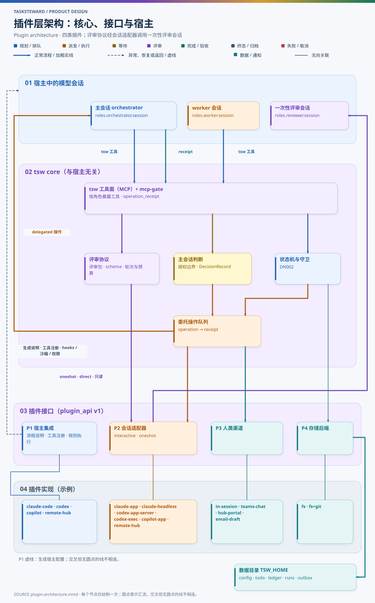
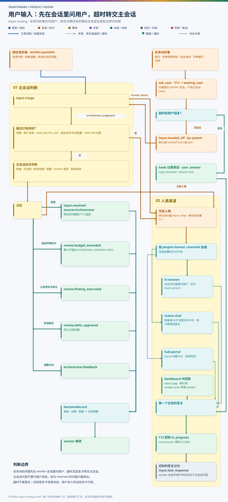

# DN006 插件层：宿主集成、会话、人类渠道与数据存储

- 状态：设计草案（T233 r5，已按 PoC 结果修订；T243 增加 §8.9 例行会话，重写 §8.7；T250 例行会话启动后从主会话名下分离；T251 §9.1 仓库任务的 worktree 在执行目录下；T256 §8.1b 问题流程三步，§8.6 worker 提问不受 human_channels 控制、human_channels 决定主会话交给用户的方式与渠道命名，§8.7 Teams 卡片用富文本；T276 §6.2 worker 说明的单一来源与数据目录 roles/；T272 §8.9.4a 默认例行项 session-scan；T279 §6.3 claude-code 生成的 skill 清单，§8.1a 每一轮结束都 `wrap_up`；T282 §9.7 主会话自我更新：主会话可以运行 `host render`；T283 §9.8 按改动决定步骤的自我更新、§9.9 运行版本的记录、§8.10 Dashboard 常驻服务；T293 §8.9.5 读过正文、判定不转出的消息记在缓存中，之后不再读正文；T305 分发与安装移到 DN009：§6.2 宿主集成增加安装操作、§8.10 与 §9.7 安装脚本的会话例外、§9.1 安装脚本管理的检出、§9.8 `install` 与 `host_rules` 改为重跑安装；T309 §8.10 workdeck 插件 manifest 与会话链接的 `data-workdeck-session`；T332 §8.11 经 workdeck 发到会话的消息按用户本人的话处理，§8.5 `VerifiedSource.via`，§9.7 自我更新的确认；T334 §8.11 第 7 条运行中注入已在 Claude Code 上实测；T338 §8.11 一轮结束时从宿主记录读出 workdeck 来源：worker 会话的消息注明经由，workdeck 开始的一轮不提醒预启动；T343 §8.11 第 2 条以 hook 记录为准、宿主误拦按规则放行，第 4 条按开始这一轮的消息来源判断用户的 turn；T353 §8.10 看板的页面布局：窄屏页头、计数卡一行且只留状态、筛选面板、任务流工具栏一行、随页面展开的任务流区域与拖拽平移；T355 §8.10 添加到主屏幕：manifest、图标与访问权限；T357 §8.10 在 Dashboard 中回答问题：答复作为用户的消息投递到 worker 会话，`ask_user` 的选项）
- 日期：2026-11-05
- 相关：[DN001 总体架构](DN001-architecture.md) · [DN002 任务状态机](DN002-task-state-machine.md) · [DN003 统一配置](DN003-unified-config.md) · [DN004 worker 自评审](DN004-worker-self-review.md) · [DN005 历史导入与 resume](DN005-history-import-and-resume.md) · [DN008 校验原则](DN008-guardrails.md) · [DN009 分发与安装](DN009-distribution-and-install.md) · 实现：[CC006 Claude Code 插件](claude-code/CC006-plugins.md)

## 1. 目标

用户 2026-11-05 提出的要求：

1. **不与 Claude 强绑定**：调度层插件化。没有 Claude Code 的用户可以用 Codex 或 GitHub Copilot 执行，没有 Codex 的用户可以换评审器；不同用户配置由不同的插件组合支持。
2. **主会话帮助响应 worker 的问题**：主会话自主判断能否自己处理，确需人类时，通过插件式渠道请求人类响应，例如发 Teams chat 后轮询回复，将来经 remote-hub web portal 响应。判断不按硬分类，由主会话在一定范围内自主决定。
3. **评审达到轮次上限后由主会话介入**：与 worker 提问走同一套判断流程，由主会话决定是否继续。
4. **评审器复用会话适配器**：评审单独配置用哪个会话适配器，可以与主会话、worker 不同。
5. **运行数据与产品 repo 分立**：用户 enlist 产品 repo，但不 check in ledger 和任务运行信息；运行数据放在指定的数据目录，备份该目录即可保证持久性。

本文确定插件类型、职责、接口和组合示例。核心逻辑（账本、状态机、守卫、评审协议、主会话判断规则、导入、渲染、经 tsw 工具的权限检查）不进入插件，所有宿主共用。

## 2. 插件类型一览

| 编号 | 插件类型 | 一句话作用 | 什么时候起作用 |
| --- | --- | --- | --- |
| P1 | 宿主集成（host integration） | 让某个宿主里的模型“知道流程、拿得到工具、越不过规则” | 安装与配置变更时生成文件；运行时由宿主自己执行 |
| P2 | 会话适配器（session） | 创建、续用、停止、观察会话；承载 worker，也承载一次性评审 | 派发、续用、评审时 |
| P3 | 人类渠道（human channel） | 把需要人类的请求送到人面前，并把核实过的答复取回 | 主会话决定交给人类时 |
| P4 | 存储后端（storage） | 数据目录的读写、加锁、备份 | 每次写账本或产物时 |

宿主相关的设计元素按上面四类插件归属；默认宿主 Claude Code 的对应关系见 [CC006 §1](claude-code/CC006-plugins.md)。

不变的部分：状态集合与迁移（DN002）、守卫语义、评审必经与提交周期（DN004）、导入规则（DN005）、事件格式。DN002 中只有 G-WINDOW 与预启动（attempt `standby`）依赖宿主能力：会话适配器声明 `dispatch_window=false` 时 G-WINDOW 永远满足，声明 `prestart=false` 时不做预启动。

## 3. 分层



图源：[diagrams/plugin-architecture.mmd](diagrams/plugin-architecture.mmd)

| 层 | 内容 | 是否随宿主变化 |
| --- | --- | --- |
| 核心 tsw core | 账本、状态机与守卫、评审协议、主会话判断规则、委托操作队列、导入、渲染、配置校验、经 tsw 工具的权限检查（`mcp-gate`）、插件加载 | 否 |
| 插件接口 | §6–§9 定义的 Protocol、能力声明、操作与回执格式 | 否（带版本号） |
| 插件实现 | Claude、Codex、Copilot、remote-hub、Teams 等具体实现 | 是 |
| 宿主中的模型会话 | 主会话、worker 会话、一次性评审会话 | 是 |

## 4. 两种执行方式：直接调用与委托操作

有些宿主的会话工具**只有该宿主中的模型能调用**（例如 Claude app 的 `start_session`、Copilot app 的 `create_session`、只在会话里可用的 Teams MCP 工具），tsw 进程无法直接调用。因此插件动作分两类：

| 方式 | 适用 | 流程 |
| --- | --- | --- |
| **direct** | 有可编程接口的宿主或渠道：Codex App Server（JSON-RPC）、`codex exec`、`claude -p`、远程会话中枢的 REST API、带独立凭据的 Graph 调用 | tsw 直接调用，结果写入账本 |
| **delegated** | 只有模型能调用的工具 | tsw 先落账一条待执行操作并交给主会话；主会话用宿主工具执行，再调用 `operation_receipt` 回填结果；tsw 校验后推进状态 |

这一模式沿用 orchestrator-agent 通知队列已验证的“claim → 主会话执行工具 → receipt”做法：产品只生成中性操作，主会话按当前宿主调用对应工具。

委托操作的示例（Claude app 宿主派发 worker）见 [CC006 §5](claude-code/CC006-plugins.md)。

约定：

- 操作先落账再交给模型执行；同一 `operation_id` 只执行一次，重复回执幂等。
- 结果未知时回执 `outcome: unknown`，tsw 按 `on_unknown` 对账（例如按会话名查找），绝不让模型盲目重试。
- 回执只记录工具真实返回的内容。主会话不能编造回执；tsw 能校验的字段（如会话名、消息 ID 格式）都会校验。

### 4.1 会话启动的两个阶段

多数宿主的“启动 worker”由两步组成：创建会话，再投递首条指令（brief）。两步分别落账、分别回执：

| 阶段 | 事件 | 完成证据 | 结果未知时 |
| --- | --- | --- | --- |
| 创建 | `attempt.session_created` | 会话引用（session / thread ID），且会话名或关联标记等于 `txxx-aN-gK` | 按会话名（或插件声明的关联标记）对账；找到则补记创建；确认没有则把本代次标为失效（DN002 §5.4），下一次派发用新代次 |
| 投递 brief | `attempt.brief_delivered` | 首条消息或首个 turn 被宿主接受的回执 | 重新投递同一 brief；brief 带 `operation_id`，worker 指令规定重复 brief 只确认不重做 |

T08（`attempt.bound`）要求两个阶段都有完成证据：**会话存在不等于启动完成**。

关联标记：承载 worker 的会话适配器**必须**声明一种“只凭代次就能找回会话”的方式（能力 `find_by_name` 或 `correlation_tag`），这是 `interactive` 能力的准入条件。Claude app 与 Copilot app 用会话名。Codex App Server 的线程名可以写入，但 PoC 发现未归档线程不能及时按名称或目录列出（B7），所以 `codex-app-server` 暂不承载 worker。因此创建结果未知时总能对账，并按 DN002 的 T09 / attempt 阶段规则收口。

预启动（DN002 §5.6）是同一个两阶段流程的提前执行：在用户 turn 中只完成“创建”（以待命说明启动会话），“投递 brief”推迟到派发时，可以在任何 turn 中进行。brief 在预启动时就按当前 revision 写出，需求变更时随之重写，派发时再按最新 revision 生成后投递（DN002 §5.1、§5.6）：任务的决定落在任务书里，不依赖主会话的上下文。

会话适配器声明 `dispatch_window`（只有用户本人的 turn 能创建会话）时，宿主集成为预启动提供三项防错护栏（DN008），各宿主的做法见实现文档（Claude Code：[CC001 §6](claude-code/CC001-sessions-and-hooks.md)、[CC008 §4](claude-code/CC008-guardrails.md)）：

1. **列出**：`attention` 的 `needs_prestart` 列出还没有会话的 `ready` 与等待依赖任务，不超过剩余的待命名额（DN002 §5.6）；
2. **提醒**：宿主集成在一轮开始时记下这一轮是不是用户本人的 turn（注入的其他会话消息、app 事件、定时提示都不是），用户 turn 结束时 `needs_prestart` 非空就提醒一次；其他 turn 不提醒，因为那时不能创建会话；
3. **准备目录**：`attempt_start` 在请求创建会话前创建执行目录（预启动与派发都是），宿主创建会话时目录一定存在。

## 5. 公共约定

### 5.1 插件清单

```json
{
  "name": "tsw-claude",
  "plugin_api": 1,
  "provides": ["host_integration:claude-code", "session:claude-app", "session:claude-headless"],
  "requires": {"executables": ["claude"]},
  "config_schema": "schema/claude.schema.json",
  "entry": "tsw_plugins.claude:register"
}
```

一个插件包可以提供多种插件类型的实现。

### 5.2 通用规则

- **版本**：`plugin_api` 为整数，不兼容变更加 1；核心拒绝加载版本不匹配的插件。
- **能力声明**：每个实现都返回能力声明，核心据此选择流程，**不按宿主名分支**。
- **幂等**：所有写操作带 `operation_id` 或 `command_id`，重复调用不产生重复副作用。
- **错误码**：统一为 `UNAVAILABLE`（可重试）、`REJECTED`（明确拒绝）、`UNKNOWN`（结果不明，需对账）、`UNSUPPORTED`（能力不支持）、`AUTH`（凭据问题）、`QUIESCED`（数据目录静止中）。接口伪代码中的 `Result[...]` 在 Python 实现中表示为：成功直接返回值，失败抛出携带以上错误码的 `TswError`。
- **秘密**：插件只按名称引用凭据（系统凭据库或数据目录外的认证目录），不把秘密写入配置、账本或操作记录。
- **一致性测试**：每类插件都有一套基于假实现（fake）的一致性测试，覆盖幂等、结果未知对账和错误码；新插件必须通过对应的测试套件。

## 6. P1 宿主集成（host integration）

### 6.1 它解决什么问题

主会话和 worker 都是某个宿主（Claude Code、Codex、Copilot）里的模型会话。要让它们按这套流程工作，宿主里必须先有三样东西，而每个宿主放这三样东西的方式都不同：

1. **流程说明**：主会话该怎么规划、派发、验收；worker 该怎么执行、自评审、提交。Claude 读 skill 与 `CLAUDE.md`，Codex 读 `AGENTS.md` 与 agent 定义，Copilot 读 `.github/agents`。
2. **工具注册**：把 tsw 的 MCP 工具面挂进宿主。三个宿主都支持 MCP，但注册方式不同（`.mcp.json`、`codex mcp add`、Copilot 的 MCP 配置）。
3. **规则执行**：把“只能写自己的执行目录”“未授权不能 push”“不能直接改账本”等规则交给宿主自己的强制机制。Claude 用 hooks，Codex 用沙箱可写根和命令审批，Copilot 用权限模式和工具白名单。这样规则不靠模型自觉。

P1 就是负责为某个宿主**生成**这三样东西的插件。它在安装和配置变更时运行，生成文件后，运行时由宿主自己读取和执行；P1 自己不参与每一步调度。

没有 P1：模型不知道流程，也调不到 tsw 工具。没有 P1 的规则执行部分：越界写入只能事后在 G-ACCEPT 中发现。

`mcp-gate`（tsw 工具自身检查调用者角色、写入范围与授权）对所有宿主都一样，属于核心，不是插件。

### 6.2 接口

```python
class HostIntegration(Protocol):
    name: str
    def capabilities(self) -> HostCaps: ...          # enforcement: enforced | advisory，覆盖的动作类型
    def render_instructions(self, roles: RoleSources, config: EffectiveConfig) -> list[GeneratedFile]: ...
    def render_tools(self, mcp: McpServerSpec) -> list[GeneratedFile]: ...
    def render_guards(self, policy: Policy, role: Role, scope: WritableScope) -> list[GeneratedFile]: ...
    def install_hint(self, data_dir: Path) -> str: ...   # 给手工安装者的说明，与 tsw setup plan 同源
    def install_plugin(self, checkout: Path) -> PluginReport: ...   # 把检出注册为插件来源并安装（DN009 §3）
    def apply_user_settings(self, home: Path, rules: list[str], backup: Path) -> SettingsReport: ...  # DN009 §7
    def remove(self, record: InstallRecord) -> RemoveReport: ...  # 卸载插件与自己加入的用户设置（DN009 §10）
    def update_plugin(self) -> PluginReport: ...          # 让宿主运行的插件与产品一致（幂等），报告前后状态
```

`tsw host render` 依次调用 `render_*` 与 `update_plugin`：产品更新后用户只运行这一个命令。各宿主让插件跟上产品的做法不同（Claude Code 要运行它自己的插件更新命令，见 CC006 §2），所以由宿主集成包装（用户 2026-11-09 决定）。`update_plugin` 只更新已安装的插件，不替用户安装，也不改宿主的设置。安装、改指插件来源与写宿主用户设置由安装脚本 `tsw setup` 经 `install_plugin`、`apply_user_settings`、`remove` 完成，在用户确认的安装流程中进行（DN009）。

**角色说明的单一来源**（T276，按用户 2026-11-12 给定的设计）：每类会话的流程说明只有一份来源，避免几份说明各自漂移。worker 的通用说明的来源是产品仓库的 `plugin/roles/worker.md`；以前写在宿主会话开始提示里的另一份精简规则已删除。

- **生成**：`tsw host render` 把它复制到数据目录的 `roles/worker.md`（只由 tsw 写入，会话写入被 hooks 拒绝，§9.4；不备份，恢复后重新 render）。`tsw init` 为还没有这份副本的数据目录写入一次；之后保持一致是 `host render` 的事。
- **使用**（用户 2026-11-12 澄清：“task prompt”指创建会话时的提示语，任务书是提示语引导它去读的实际任务）：主会话创建 worker 会话（派发时新建、预启动待命）时传给会话适配器的 prompt，开头是数据目录副本的全文，后接一句本会话的指令：派发时为“你是 TaskSteward 任务 <任务> 的 worker（attempt <attempt>）。先调用 whoami，再按任务书 runs/<任务>/<attempt>/brief.md 执行。”，预启动时为待命说明（先读任务书、等派发消息）。完整 prompt 由 tsw 生成：`attempt_start` 在结果中返回 `prompt`，主会话原样传入，不自己拼接或改写；事件 `attempt.start_requested` 记录所用说明的摘要 `worker_instructions_sha256`。任务书 `runs/<任务>/<attempt>/brief.md` 只写任务本身（标题、仓库与交付、目标、验收、resume 资料），不附 worker 说明；任务书正文仍不复制进 prompt。
- **会话开始提示**：宿主在会话开始时注入的文本（Claude Code 的 SessionStart hook，CC001 §6）只给本会话特有的信息：任务、attempt、任务书路径、可写路径、是否待命，并指向提示语开头的说明与数据目录副本的路径，不重复其中的规则。
- **已有会话得知更新**：续用已有会话（投递给待命会话、需求变更、反馈后继续同一 attempt）不重新创建会话，说明已在它的首个 prompt 里。`attempt_start` 记下每个会话名得到的说明版本（数据目录 `cache/worker-instructions/<会话名>`，可重建的缓存，不是账本事实）。worker 的 SessionStart 与 UserPromptSubmit hook 把它与当前副本比较：不同时（`host render` 更新了说明），或没有记录时（本设计之前创建的会话，首个 prompt 里没有说明），在注入的文本中让会话完整重读副本 `roles/worker.md`、以它为准，然后记下当前版本，每个新版本只提示一次。worker 的每一轮都从一条消息开始（用户、主会话或唤醒），所以运行中的会话在下一轮就会得知。
- **副本缺失或不一致**：副本不存在，或与运行中的 tsw 旁边的来源（`plugin/roles/worker.md`）字节不同时，`attempt_start` 拒绝（`worker_instructions_missing` / `worker_instructions_stale`），提示用户运行 `tsw host render`。两种 purpose 都在任何写入之前检查：不建执行目录与 worktree，不写任务书，不记事件。不回退到产品仓库中的来源：不一致说明产品更新后还没有 render，此时主会话 skill 与插件副本同样过时，先 render 再创建会话才能让所有说明一起更新；产品仓库中的文件也可能正处于编辑中。运行的 tsw 旁边没有 `plugin/`（不是可编辑安装）时只检查副本存在。派发（`task_dispatch`）、投递与需求变更不创建会话，不检查副本。

### 6.3 实现

| 实现 | 流程说明与工具注册 | 规则执行 | 规则强度 |
| --- | --- | --- | --- |
| `claude-code` | 插件：`.claude-plugin/plugin.json`、`.mcp.json`；数据目录：`CLAUDE.md`、主会话入口 skill `.claude/skills/orchestrate/SKILL.md`、主会话的 `handle-input`、`task-intake`（受理与写任务书）与渠道 skill、主会话与 worker 共用的 `gh-account`（按仓库选 gh 账号，CC006 §10），以及 worker 说明 `roles/worker.md`（`tsw host render` 生成） | PreToolUse / Stop / SessionStart hooks 调用 `tsw guard` | enforced |
| `codex` | `AGENTS.md` 片段、`.codex/agents/task-worker.toml`、`codex mcp add tsw` 命令 | `workspace-write` 沙箱的可写根限定为执行目录与草稿目录；命令审批规则 | 写入范围 enforced，其余 advisory |
| `copilot` | `.github/agents/task-worker.agent.md`、skill、Copilot MCP 配置 | 会话权限模式与允许的工具集 | advisory（待验证） |
| `remote-hub` | 远程会话中枢的 controller 意图与 worker 指派模板 | 依所选会话宿主 | 依宿主 |

宿主声明为 `advisory` 时，Dashboard 页面和任务报告标注“规则为提示级”，并要求主会话在 G-ACCEPT 中额外核对写入范围（`git status` 与 diff 范围检查）。

各宿主集成的具体做法见实现文档：Claude Code 见 [CC006 §2](claude-code/CC006-plugins.md)，它的护栏与权限规则见 [CC008](claude-code/CC008-guardrails.md)。规则强度描述的是机械检查覆盖的程度，不是安全强度（DN008）：`enforced` 表示宿主上有确定性的护栏，`advisory` 表示只能靠指令与事后核对。

## 7. P2 会话适配器（session）

### 7.1 职责与能力

会话适配器负责某个宿主里会话的创建、续用、停止和观察。同一个适配器可以承载两种用途：

- **interactive**：长期存在、可续用、用户可能直接对话的会话，用于 worker（以及主会话所在的宿主）。
- **oneshot**：一次性、可被 tsw 同步调用并拿回结果的会话，用于评审。

```python
@dataclass(frozen=True)
class SessionCaps:
    execution: Literal["direct", "delegated"]
    interactive: bool               # 能否承载 worker（需同时满足 §4.1 的关联标记）
    oneshot: bool                   # 能否完成一次性调用并返回最终消息
    read_only_enforced: bool        # 能否由宿主强制只读（评审器必需）
    incremental: bool               # oneshot 能否续用同一线程做增量评审
    user_direct_chat: bool          # 用户能否在会话里直接对话
    wake: Literal["push", "poll", "none"]
    dispatch_window: bool           # 是否存在“当前 turn 不能启动会话”的限制（G-WINDOW）
    prestart: bool                  # 能否先创建会话、之后再投递任务书（两阶段启动）
    reuse_session: bool             # 停止后能否续用同一会话
    open_existing_dir: bool         # 能否在已有目录（tsw 创建的 worktree）启动会话
    timer: bool                     # 能否在会话内定时唤醒（例行会话，§8.9）
    detach: bool                    # 宿主在被启动会话每轮结束时通知启动者，且能解除这层关系（§8.9.7）
```

### 7.2 接口

```python
class SessionAdapter(Protocol):
    def capabilities(self) -> SessionCaps: ...
    # interactive
    def create(self, req: StartRequest) -> Result[SessionRef] | Operation: ...        # 阶段 1：创建（带 generation 与关联标记）
    def deliver_brief(self, ref: SessionRef, brief: str, *, op_id: str) -> Result[None] | Operation: ...  # 阶段 2
    def send(self, ref: SessionRef, message: str, *, op_id: str) -> Result[None] | Operation: ...
    def stop(self, ref: SessionRef) -> Result[None] | Operation: ...
    def observe(self, ref: SessionRef) -> Result[SessionFact] | Operation: ...      # live / stopped / missing / archived
    def find(self, name: str) -> Result[SessionRef | None] | Operation: ...         # 结果未知时按会话名对账
    def close(self, ref: SessionRef, *, keep_dir: bool = True) -> Result[None] | Operation: ...
    def map_permission(self, mode: NeutralPermission) -> str: ...                   # 中性权限 → 宿主名称
    # oneshot（只要求 direct 实现）
    def run_oneshot(self, req: OneshotRequest) -> Result[OneshotResult]: ...        # 返回最终消息与线程引用
    def resume_oneshot(self, thread: str, req: OneshotRequest) -> Result[OneshotResult]: ...
    def close_oneshot(self, thread: str) -> Result[None]: ...
```

`StartRequest` 只含中性字段：`name`（`txxx-aN-gK`）、`cwd`、额外可写根、`model`、`effort`、`permission`（中性：`ask` / `edits` / `auto` / `full`，与 DN003 `roles.*.permission_mode` 同一套取值）、`prompt`、`background`。`map_permission` 把中性值映射为宿主名称（Claude Code 见 CC006 §3）。

`OneshotRequest` 含 `cwd`、`model`、`effort`、`read_only=true`、提示正文、超时；只读由适配器用宿主机制强制，不用中性权限取值。

### 7.3 实现

| 实现 | 方式 | interactive | oneshot（只读方式） | 增量续用 | 用户直接对话 | dispatch_window |
| --- | --- | --- | --- | --- | --- | --- |
| `claude-app` | delegated | 是（做法见 [CC006 §3](claude-code/CC006-plugins.md)）；支持预启动 | 否（只能由模型调用，tsw 无法同步等结果） | — | 是（侧栏子会话） | 是 |
| `claude-headless` | direct | 待验证（Agent SDK 会话） | 是：`claude -p`，只开放 `Read`、`Grep`、`Glob`，`dontAsk`，不加载插件、hooks 与 MCP（[CC004](claude-code/CC004-reviewer.md)，T331 实测） | 是（`--resume`） | 否 | 否 |
| `codex-app-server` | direct | 暂不承载 worker（B7：不能按名称或目录及时找回线程） | 是：一次性线程，`sandbox=read-only` | 是（keep / resume thread） | 是（受管独立线程） | 否 |
| `codex-exec` | direct | 否 | 是：`codex exec`，`--sandbox read-only` | 否（每轮全量 + 上轮意见） | 否 | 否 |
| `copilot-app` | delegated | 是：`create_session` / `send_session_message`（interactive），按会话名对账 | 否 | — | 是（app 独立会话） | 待验证 |
| `copilot-cli` | direct | 否 | 是：`copilot -p`，只开放 `view`、`grep`、`glob` 并拒绝写入与命令（[CP004](copilot/CP004-reviewer.md)，B2 已实测） | 是（`--resume`） | 否 | 否 |
| `remote-hub` | direct | 是：`POST /api/sessions`（intentId 关联） | 否 | — | 是（Portal 会话页） | 否 |

interactive 动作（`create`、`deliver_brief`、`send`、`stop`、`observe`、`find` 与唤醒主会话）在各宿主上的做法见实现文档：`claude-app` 见 [CC006 §3](claude-code/CC006-plugins.md)。尚无实现文档的宿主（`codex-app-server`、`copilot-app`、`remote-hub`）的映射暂列于此，建立实现文档时移出：

| 动作 | `codex-app-server`（暂不承载 worker，B7 解决后启用） | `copilot-app` | `remote-hub` |
| --- | --- | --- | --- |
| create | `thread/start`（写入关联标记） | `create_session`（name = 会话名） | 创建 native session（intentId） |
| deliver_brief | `turn/start` | `send_session_message` | 会话消息 API |
| send | `turn/start` | `send_session_message` | 会话消息 API |
| stop | 中断当前 turn（interrupt） | 会话停止 | 会话中断 |
| observe | `thread/read` | `get_session` / `get_sessions_status` | 会话状态 / 事件 |
| find | 按关联标记检索（B7） | 按会话名列出 | 按 intentId 读取 |
| 唤醒主会话 | push：turn completed 事件（tsw 监听进程） | push：跨会话消息、idle 通知 | push：会话停止事件 |

### 7.4 三个角色各自选用会话适配器

主会话、worker、评审器分别在配置中指定会话适配器，三者可以不同：

| 角色 | 配置 | 要求的能力 |
| --- | --- | --- |
| 主会话 | `roles.orchestrator.session` | 主会话所在宿主；用户在该宿主中打开主会话 |
| worker | `roles.worker.session` | `interactive`；若 `execution=delegated`，必须与主会话是同一宿主（委托操作只能由同宿主的主会话执行） |
| 评审器 | `roles.reviewer.session`（可选 `fallback_session`） | `oneshot`、`direct`、`read_only_enforced`；`incremental` 可选，没有时每轮全量评审并附上轮意见 |

评审为什么必须 `direct`：worker 调用 `review_run` 后需要同步拿到结构化意见再决定迭代，而 delegated 实现只能由模型执行，既无法同步返回，也要由某个模型把结果交回 tsw。交回的结果不能证明出自评审器：由 worker 的模型启动宿主子代理、再交回结果的方式（T325 的 `claude-subagent`）因此在 T331 删除（DN004 §3，CC004 附录 A）。`claude-app`、`copilot-app` 不能做评审器，同一宿主的 direct 形态（`claude-headless`）可以。

评审协议（评审包渲染、输出 schema 校验、轮次与周期计数、增量范围）属于核心，与选用哪个会话适配器无关（DN004）。配置校验在评审器与 worker 使用同一模型时给出警告（不阻止），提醒评审视角的独立性下降。

**为什么 Codex 原生子代理（`spawn_agent`）不作为默认实现**：它只受创建它的主会话控制，用户不能直接对话，也不能交接。只有在主会话就是 Codex 线程、并且用户接受这些限制时才启用 `codex-native`，能力声明中 `user_direct_chat=false`、`reuse_session` 仅限同一主会话。

## 8. 用户输入、主会话判断与 P3 人类渠道

### 8.1 两类事项：先问用户，跨任务的交主会话

用户 2026-11-06 决定：每个任务的工作尽量在 worker 自己的会话里完成，主会话只协调并保持上下文干净。worker 遇到自己不能独自决定的事，按事项分两类处理：

| 类别 | 例子 | 去向 |
| --- | --- | --- |
| 任务内的事 | 验收条款含义不清、两种实现取舍、需要某个外部事实；评审预算用完（`review.budget_exhausted`）、阻断项需要延后（`review.defer_requested`）、评审器不可用（`review.unavailable`） | worker 在**自己的会话里直接问用户**（§8.1a）；超时无人回复才转交主会话（§8.1b） |
| 跨任务的事 | 独占资源冲突、依赖需要调整、需要改动其他任务的范围或产出 | `worker.question` 交主会话判断（§8.2–§8.4） |

主会话的判断（§8.2–§8.4）因此只用于两种来源：转交来的任务内问题，以及跨任务的事。任务状态的变化见 DN002 T11、T12 与 §3.3a。



图源：[diagrams/input-routing.mmd](diagrams/input-routing.mmd)

### 8.1a 在 worker 会话中直接问用户

1. worker 调用 `ask_user`（问题全文；可带上评审升级等待处理事项的编号；只有用户本人能决定的事——凭据、验收、`reserved_for_user` 中的决定——标 `reserved`）。tsw 记录 `input.escalated`（`kind: in_session`，渠道 `in-session`，记下 worker 会话与转交时间），任务经 T11 进入 `waiting_user`，名额保持。
2. worker 在本会话的回复中把问题原样写给用户，结束这一轮。这个问题**不进入主会话 inbox**：主会话的 `attention` 只显示“某任务有一个会话内问题、何时转交”，不显示问题内容；Dashboard 页面是给用户看的，显示问题与转交时间。
3. 用户在 worker 会话中发消息时，宿主集成把消息原文记为观察事件 `input.session_message`（消息编号 `M-…`），并把编号告诉 worker（Claude Code 用 `UserPromptSubmit` hook，见 [CC001 §6](claude-code/CC001-sessions-and-hooks.md)）。其他会话、app 或定时任务注入的消息不记录。T262 起不限于有待答问题时：会话绑定在任务当前 attempt 上、任务不是 `accepted` / `cancelled` / `archived` 时，用户的每条消息都记录，可以作为答复的来源，也可以作为 worker 登记需求变更的来源（DN002 §5.1a）。消息只对应该会话最新的一个问题：它已由用户在本会话答复、被更新的问题取代，或任务 revision 已变时，消息照常记录，但不再对应这个问题（不能用 `user_answer` 引用）。
4. 消息回答了问题时，worker 调用 `user_answer`，必须引用 hook 记录的消息编号，且该消息来自同一 worker 会话。tsw 用记录中的原文构造 `VerifiedSource`（渠道 `in-session`），记录 `input.resolved`，经 T12 回到离开时的子状态。同一次答复可以带上用户批准的追加评审轮次（`source = user`，没有累计上限）、批准延后或认定不成立的阻断项。答复以记录的用户原话为准，不以 worker 的转述为准（DN008 §9）。

用户回复了但还没有回答问题（例如“让我想想”）时，worker 在会话中继续与用户交流；问题不会因超时转交。

在 Claude app 中，worker 提问后以 `wrap_up` 结束这一轮：问题写在 `ask`，每个选项一个按钮，`blocked: true` 让 app 把会话标为等待用户。用户点按钮等于在 worker 会话中发出按钮上的文字，经 `UserPromptSubmit` 记录，与打字回答相同；app 的选择卡片（AskUserQuestion）的回答是工具结果，不经过 hook，不能作为答复来源，所以不用。app 的提问框与等待标记一直保留到这个会话下一次 `wrap_up`：问题由主会话代答、经 Teams 等渠道答复或已被取代后，worker 在下一轮结束时调用 `wrap_up`（不带 `ask`、不设 `blocked`）替换它；worker 每一轮结束都调用 `wrap_up`，使 app 中的等待状态与账本一致（T279：Q-T279-2 经 Teams 答复后，worker 之后几轮没有调用 `wrap_up`，提问框一直挂着）。worker 把同样的选项写进 `ask_user` 的 `options`，Dashboard 应用据此显示选项按钮；用户也可以在 Dashboard 应用中回答：应用把用户的话作为消息投递到 worker 会话，与用户经 workdeck 门户发来的消息相同，照常由 hook 记录、worker 登记（§8.10“在 Dashboard 中回答问题”）。

### 8.1b 超时转交主会话

| 项目 | 规则 |
| --- | --- |
| 超时 | `input.in_session_timeout_minutes`（DN003 §3.1a，默认 10 分钟），从 `ask_user` 起算 |
| 转交条件 | 问题仍未答复、尚未转交，且在这段时间内用户没有在 worker 会话中发过任何消息 |
| 谁来触发 | 系统规则（`by: system`）：例行表的默认例行项 `handoff-scan`（§8.9.4）每次运行时把到期的问题转交，并把结果转给主会话；主会话运行 `sync` 时也一并转交。worker 不再自己定时检查、转交：定时提示到达 worker 会话时与用户消息无法区分（T241 live 实测，CC008 的 CC-B8），外部进程也没有受支持的方式唤醒会话。`input_handoff` 保留（契约只增不删），worker 恰好在超时后被唤醒时仍可调用。主会话结束一轮前，Stop hook 发现有到期未转交的问题时提示运行 `sync`；`attention` 的 `handoff_due` 也列出它们 |
| 事件 | `input.handed_off`（问题编号、触发者、转交时间），默认在 `scheduling.wake.reportable_events` 中，进入主会话 inbox。任务状态不变，仍为 `waiting_user` |

转交之后，主会话可以：

- **在授权边界内代为决定**（`handoff_resolve`）：回答、追加评审轮次（受 `review.orchestrator_extension_limit` 限制）、认定意见不成立或批准延后。记录 `orchestrator.decision`（`DecisionRecord`，理由与依据按 §8.2）与 `input.resolved`（`source_kind = orchestrator`，没有用户来源），经 T12 让 worker 继续，并用消息告诉 worker 决定内容。主会话代答不是用户批准，不满足 G-USER。§8.2 的硬边界照旧：凭据与 MFA、用户验收与退回、`policies.reserved_for_user`、超出任务书与配置授权的事，主会话都不能代答；worker 标为 `reserved` 的问题，`handoff_resolve` 一律拒绝。
- **转达给用户**（`input_relay`）：渠道只能是 `plugins.human_channels` 加载、支持 `request_response` 的人类渠道（§8.6）：`in-session` 为主会话在自己的会话中直接问用户，`teams-chat` 等为渠道插件。没有加载 `in-session` 时，主会话不在自己的会话中转达（`input_relay` 拒绝）。记录 `input.relayed`。用户经该渠道的答复由主会话用 `input_resolve` 记录，来源是该渠道核实过的 `VerifiedSource`（主会话消息、Teams 回复等），满足 G-USER，经 T12 让 worker 继续。worker 会话中的原话只能由 worker 经 `user_answer` 登记，主会话不能用 `input_resolve` 代为记录 `in-session` 来源。
- **继续等待**：什么都不做，问题保持待答。

问题流程（用户 2026-11-10 决定，T256）分三步，由宿主集成生成的“处理问题”skill 写明（Claude Code 见 CC006 §6.4）：

1. **超时转交并通知主会话**：例行表的 `handoff-scan` 把到期的问题转交（`input.handed_off`），并把问题与配置的人类渠道转给主会话。
2. **主会话判断**：按 §8.2 判断。在授权内用 `handoff_resolve` 代答，并用消息告诉 worker 决定内容、让它继续；`reserved` 或超出授权的交给用户。
3. **按 `plugins.human_channels` 交给用户**（用户 2026-11-10 定义的层次）：配置的是什么就用什么，没有配置的方式不用。`in-session`：主会话在自己的会话中直接问用户；`teams-chat` 等渠道插件：主会话 `input_relay` 后按该渠道自己的 skill 发出、登记发送结果与回收答复（Teams 见 §8.6、§8.7），通用的流程不写渠道的细节。`input.channels` 可以在已加载的渠道中再选一部分，默认是全部。一个渠道也没有时问题留在 worker 会话。用户在 worker 会话中的回复始终有效。

### 8.1c 迟到的答复

第一个生效的答复决定 T12，之后的答复都不改变任务状态，但都记账：

| 情形 | 处理 |
| --- | --- |
| 已转交、主会话尚未决定时，用户在 worker 会话中回答 | 仍是有效答复：worker 经 `user_answer` 记录，T12 生效。主会话之后的 `handoff_resolve` 与经其他渠道收到的答复以 `request_not_pending` 拒绝或记为 `input.late_response`；已转达的渠道按 §8.6 撤回 |
| 主会话已代答或其他渠道已答复之后，用户才在 worker 会话中回答 | hook 照常记录这条消息（该问题还没有来自 worker 会话的用户答复）；worker 经 `user_answer` 记为 `input.late_response`，标明它取代的答复（`supersedes`）。用户本人的话优先于主会话代答：worker 以用户的话为准继续，必要的返工是任务内的正常工作；超出任务范围时，worker 引用这条消息自己登记需求变更（`requirement_change`，DN002 §5.1a）。之前的答复也来自用户、两者冲突时，worker 再次 `ask_user` 确认 |
| 其他渠道的答复晚于已生效的答复 | 记为 `input.late_response`（§8.6 多渠道规则） |

用户在 Dashboard 应用中的答复投递到 worker 会话，是用户在该会话中的消息，按上表前两行处理（§8.10“在 Dashboard 中回答问题”）。

超时本身不是答复；转交只改变谁来处理，不替用户作出决定。

### 8.2 判断方式：授权边界 + 综合判断

不按问题类别硬性划分。规则分两层：

适用于转交来的任务内问题（§8.1b）与跨任务的事（§8.1）。

**唯一的硬边界：不越过已有授权。** 下列情形主会话不能自行决定，必须交给人类：

- 只有用户本人能完成的事：输入凭据、MFA、登录确认；
- 用户验收与退回（G-USER）；
- 用户在配置 `policies.reserved_for_user` 中保留的决定（例如对外发送邮件、合并到受保护分支、生产部署）；
- 超出任务书与配置已有授权的事：扩大任务范围、新增远端交付动作、删除或覆盖用户数据。

**其余情况由主会话综合判断**，参考以下因素并写下理由：

| 因素 | 倾向于主会话自行处理 | 倾向于交给人类 |
| --- | --- | --- |
| 依据 | 任务书、用户既有决定、配置策略、其他任务产出中有明确依据 | 找不到依据，只能猜用户意图 |
| 可逆性 | 结果容易回退（本地改动、可重做的实现选择） | 难以回退（对外可见、数据变化、长期接口） |
| 影响范围 | 只影响本任务内部 | 影响验收标准、其他任务或用户承诺 |
| 把握 | 主会话对答案有较高把握 | 多种合理答案、取舍依赖用户偏好 |
| worker 的请求 | worker 只是需要信息 | worker 明确要求人类决定：主会话默认交给人类，不这样做时须写明理由 |
| 等待成本 | — | 用户可以很快回答，等待成本低 |

### 8.3 主会话可以做出的决定

| 决定 | 事件 | 说明 |
| --- | --- | --- |
| 回答 | `input.resolved`（source = orchestrator） | 附依据引用；worker 继续 |
| 追加评审轮次 | `review.budget_extended`（source = orchestrator） | 只用于预算用完；写明追加轮数与理由；同一周期主会话累计追加不超过 `review.orchestrator_extension_limit`（默认 3），超过只能交给人类，由用户批准追加（source = user，DN002 §3.3） |
| 认定意见不成立 | `review.finding_overruled` | 主会话核实评审意见的前提与证据后，认定该阻断项不成立；理由写入报告 |
| 批准延后 | `review.defer_approved` | 阻断项作为已知问题延后；必须写入报告“已知问题”一节，用户验收时可见 |
| 调整方向 | `orchestrator.feedback` | 给 worker 新的修复思路或范围收窄（在授权内） |
| 交给人类 | `input.escalated` → T11 | 按 §8.5 投递人类渠道 |

主会话的决定都不是用户批准，不满足 G-USER。

### 8.4 决定记录与事后核对

每个主会话决定都写入 `DecisionRecord`：

```python
@dataclass(frozen=True)
class DecisionRecord:
    decision_id: str
    task: tuple[str, int, str]     # 任务 ID、revision、attempt
    trigger: str                   # worker.question / review.budget_exhausted / review.defer_requested
    decision: str                  # answer / extend / overrule / defer / feedback / escalate
    rationale: str                 # 理由：引用 §8.2 的因素
    basis: list[str]               # 依据引用：任务书段落、用户决定消息、配置策略、产出链接
    confidence: Literal["high", "medium", "low"]
```

- `input.decision_digest` 配置把主会话的自主决定按日或在任务完成时汇总，经支持 notify 的人类渠道通知用户，便于事后核对；`channel` 为 `"local"` 时只写入 Dashboard 页面与主控验收报告。
- 用户不同意某个决定时，直接在主会话或该 worker 会话中给出新指示；它按需求变更或用户答复处理（DN002 §5.1、§5.1a、T12），已执行的部分按正常流程返工。
- 任务的主控验收报告（`review.md`）列出本任务的全部主会话决定，用户验收时一并可见。

### 8.5 渠道接口

```python
class HumanChannel(Protocol):
    def capabilities(self) -> ChannelCaps: ...   # request_response / notify_only、collect: push | poll、execution
    def notify(self, msg: Notice, *, op_id: str) -> Result[Delivery] | Operation: ...
    def request(self, req: InputRequest) -> Result[ChannelHandle] | Operation: ...
    def collect(self, handle: ChannelHandle, since: Cursor) -> Result[list[Response]] | Operation: ...  # poll 渠道
    def cancel(self, handle: ChannelHandle, reason: str) -> Result[None] | Operation: ...
    def verify(self, resp: Response) -> Result[VerifiedSource]: ...   # 答复对应到哪个问题：问题仍待答、回复对应到问题编号（DN008 §9）


@dataclass(frozen=True)
class VerifiedSource:              # DN002 G-USER 的统一证据
    channel: str                   # in-session / main-session / teams-chat / hub-portal / user-cli / status-app（后两者见 §8.10）
    principal: str | None          # 可选；不再核实发送者身份（DN008 §9）
    message_ref: str               # 会话消息引用 / Teams 消息 ID / Portal 提交 ID
    text: str                      # 用户原话
    request_id: str | None         # 回答的 InputRequest（验收 / 退回等主动决定可为空）
    target: tuple[str, int, str]   # (任务 ID, revision, 决定类别：answer / accept / reject / approve / change)
    via: str | None = None         # 可选：原话经由的入口；目前只有 workdeck，只用于 main-session（§8.11）
```

`InputRequest` 含请求 ID（如 `Q-T241-3`）、触发场合、问题正文、可选项、主会话已作的分析（`DecisionRecord` 摘要）、过期时间、worker 会话的直达链接（如果宿主支持用户直接对话），以及**上下文绑定**：任务 ID、revision、attempt、创建代次、提交周期。

请求生命周期：

| 状态 | 含义 | 进入方式 |
| --- | --- | --- |
| `pending` | 已投递，等待答复 | T11 |
| `resolved` | 第一个通过核实的答复已生效 | T12 |
| `cancelled` | 任务不再需要这个答复 | 任务取消（T25）、依赖失效离开 `waiting_user`（T16）、attempt 被替换、请求过期后用户撤回 |
| `superseded` | 问题因需求变更（revision+1）而过时 | `task.requirement_changed`，只用于不在 `waiting_user` 的任务（受理中的澄清、`done` 的 stale 请求）；等待用户时的变更不作废问题（DN002 §5.1，T292 之前的账本除外） |

T12 在同一事件中原子检查：请求为 `pending`，且上下文绑定与任务当前的 attempt、代次一致；revision 可以晚于绑定的 revision（等待期间登记了与问题无关的需求变更，问题仍然有效，答复后开启新周期，DN002 §5.1）。对 `cancelled` / `superseded` / `resolved` 请求的任何答复都只记录为 `input.late_response`，不恢复 worker。

### 8.6 渠道实现

层次与命名（T256，用户 2026-11-10）：

- worker 在自己的会话中提问与用户在那里的回复（§8.1a）是 worker 层的能力，不是 P3 渠道，不受 `plugins.human_channels` 控制；它只取决于会话适配器能否让用户直接对话（`user_direct_chat`）。
- P3 人类渠道（`plugins.human_channels`）只决定主会话把转交来、应由用户决定的问题交给用户的方式：`in-session` 是主会话在自己的会话中直接问，`teams-chat` 是调用 Teams 渠道插件。
- 账本中的渠道值记录答复来自哪个会话，沿用已有记录，不改名：`in-session` 指 worker 会话（`input.escalated`、`input.session_message`、`user_answer` 的 `VerifiedSource`），`main-session` 指主会话（`input.relayed` 的 `channel`、主会话登记的 `VerifiedSource`）。所以经 `in-session` 渠道的转达记为 `channel: main-session`，另记 `plugin: in-session`；`input_relay` 仍接受旧名 `main-session`，与 `in-session` 相同，同样只在 `in-session` 已加载时可用。

| 实现 | 能力 | 发送 | 回收 | 核实 |
| --- | --- | --- | --- | --- |
| （worker 层，不是 P3 渠道） | — | 无需发送：worker 用 `ask_user` 记录后在自己的会话里提问（§8.1a） | 宿主集成记录用户消息原文（`input.session_message`，Claude Code 见 CC006 §4），worker 用 `user_answer` 引用消息编号登记答复，或用 `requirement_change` 引用消息编号登记需求变更（DN002 §5.1a） | 答复只核对问题仍待答、消息属于该 worker 会话的这个问题；需求变更只核对消息属于该 worker 会话、本任务与当前 revision（G-CHANGE）；注入的其他会话消息不记录（DN008 §9） |
| `in-session` | request_response，push（不支持 notify） | 主会话 `input_relay`（`channel: in-session`）后在自己的会话中直接问用户 | 用户在主会话中答复，主会话用 `input_resolve` 记录（来源渠道 `main-session`） | 只核对问题仍待答、答复对应到问题编号；worker 会话中的原话不能由主会话记录 |
| `teams-chat` | request_response，poll，delegated（本版本不提供 notify） | 主会话 `input_relay` 后，按渠道的 skill 把返回的富文本卡片用宿主的 Teams 工具发到配置的 chat（默认用户本人的自聊），再用 `channel_sent` 登记，例行表随之加入或更新 Teams 例行项 | 例行项的脚本取出 chat 中最近的、用户发送的、以等待中任务 ID 开头的消息，转给主会话（§8.7） | 只核对问题仍待答、消息能对应到任务 ID 与问题；卡片以 `[TaskSteward]` 开头，不会被当作答复（DN008 §9） |
| `hub-portal` | request_response，notify（Portal 通知卡片），push，direct | tsw 把请求发布到 Hub 门户（问题卡片） | Portal 用户提交答复，经认证回调写回 tsw | Portal 的 owner 认证 + 请求 ID |
| `email-draft` | notify_only | 在邮箱生成草稿（默认不发送，沿用邮件约定） | — | — |

`user-cli` 与 `status-app` 不是请求与答复的渠道：它们记录用户在会话外主动做出的验收、退回与取消，以及长期偏好的记录与撤销（§8.10、DN007 §6.2）。用户在 Dashboard 应用中回答问题时，应用不记账，而是把用户的话投递到 worker 会话，由那里的 hook 记录（渠道 `in-session`，§8.10“在 Dashboard 中回答问题”）。

多渠道规则：

- 交给人类时按配置 `input.channels` 同时投递到多个渠道；**第一个通过核实的答复生效**，记录后对其他渠道发 `cancel`（Teams 中补发“已在其他渠道答复”）。
- 迟到的第二份答复只记录为 `input.late_response`，不覆盖已生效的答复；内容冲突时由主会话判断是否需要再次确认。
- 超时不是答复；请求过期后只能再次提醒或保持等待。

### 8.7 Teams 答复的回收与登记

Teams 工具只有宿主中的模型能调用（delegated），回收因此是 poll，由例行表中的 Teams 例行项（§8.9.5）完成。主会话与例行会话都不运行时不回收，问题保持待答；不承诺离线回收。发送与读取用哪个工具由宿主集成决定，发送与读取用同一套工具（Claude Code 用 WorkIQ，见 CC006 §7）。

1. **发送**：主会话 `input_relay`（`channel: teams-chat`）记录 `input.relayed`，返回卡片正文与目标 chat（`input.teams.chat`，默认用户本人的自聊）。卡片以 `[TaskSteward]` 开头，写明任务 ID、问题编号、问题全文、worker 会话链接，以及答复方式：“回复时以任务 ID 开头，例如 `T241 用方案 A`”。卡片按问题内容以富文本发送（T256）：标题、任务、问题、回复方式与 worker 会话链接各自分行，问题保留自己的段落、列表、选项与代码片段；纯文本消息在 Teams 中不显示换行，整张卡片会挤成一行（Q-T253-1、Q-T255-1）。发送的工具与格式写在渠道的 skill 中（Claude Code 见 CC006 §7）。主会话发送后调用 `channel_sent`，登记 chat ID、卡片消息 ID 与发送者（用户本人在 Teams 中的 ID，取自发送结果）；tsw 把该任务 ID 加入这个 chat 的 Teams 例行项的输入列表：每个还有待答问题的 chat 一行（配置的 chat 改了之后，旧 chat 中的问题照样回收）。
2. **回收**：例行项的脚本按 §8.9.5 取出 chat 中从最早一个待答问题的卡片发出起到现在的全部消息中（不限条数，逐页读取）、发送者是用户本人、正文以问题编号或列表中某个任务 ID 开头的消息，排除 tsw 自己发出的消息（按登记的出站消息 ID）与已经转给主会话的消息，对应到它回答的问题，转给主会话。脚本不判断内容。tsw 自己发出的卡片在列出消息时就按 ID 去掉，不读正文；其余消息才读正文；取数结果由宿主集成直接交给 tsw，例行会话不转抄；转出的正文每条最多保留开头一段（`routine.teams_message_chars`），截断的在转发中标明，需要全文的一方按消息 ID 单独读取（§8.9.5，T286）。
3. **登记**：主会话收到转来的消息后按 skill 判断它是否回答了问题。是答复时用 `input_resolve` 登记，来源为 `VerifiedSource`（渠道 `teams-chat`、Teams 消息 ID、消息原文、问题的决定对象），满足 G-USER，经 T12 让 worker 继续，并用消息把答复告诉 worker。不是答复（例如“稍后回复”）时不登记，问题保持待答。问题已答复、取消或过时后才到的消息，按 §8.1c 记为 `input.late_response`。
4. **移出**：任务的问题不再待答（任何渠道答复、取消、过时）时，tsw 把它的任务 ID 从输入列表中移除；列表为空时这一行停用，下次有 Teams 转达时重新启用。

只有以问题编号或等待中任务 ID 开头的消息才会被转出，用户平时在 chat 里记的笔记不会；tsw 自己发的卡片以 `[TaskSteward]` 开头，并且按出站消息 ID 排除（DN008 §9 第 5 条）。本版本不发提醒，也不补发“已在其他渠道答复”，不经 Teams 发决定摘要（`notify`）；`input.teams_poll` 保留但不再起作用，回收间隔就是例行表的运行间隔。

如果用户为 Graph 配置了独立的后台凭据，`teams-graph` 实现可以改为 direct，由 tsw 进程直接执行同一个例行项；规则不变。

### 8.8 Hub Portal

使用自建的远程会话中枢（`remote-hub`）时，它的网页门户可以承载问题卡片（门户经身份认证、按 owner 隔离）：

1. `request`：调用门户的接口发布问题卡片，卡片显示任务、问题、主会话的分析、可选项和 worker 会话链接；
2. 用户在 Portal 回答，插件端点校验 owner 与请求 ID 后，写入 tsw 的 `input_response` 接口（direct，push）；
3. tsw 核实后记录答复并唤醒主会话；
4. `cancel`：把卡片标为已在其他渠道答复。

### 8.9 例行会话（routine）与例行表

用户 2026-11-07 决定：设一个定时运行的机制，所有需要例行执行的事都放进去，例如会话内问题的超时转交与 Teams 答复的回收；2026-11-09 定名为**例行会话（routine）**，并决定它是与宿主无关的平台机制：它维护一张**例行表（routine board）**，表中每一行是一个**例行项（routine job）**，执行就是对每一行运行一个脚本，并按这一行的要求把脚本结果转给主会话。例行项与 tsw 的任务（Txxx）无关：它不经状态机，不占名额，也没有 attempt。

背景：T241 的 live 运行表明，worker 自己定时唤醒转交在 Claude app 上行不通（§8.1b）；tsw 的进程又不能唤醒 app 托管的会话（Codex 与 Copilot 的桌面 app 同样如此，见 T243 报告），所以由一个能被宿主定时唤醒的执行者来跑例行表。

#### 8.9.1 例行会话的职责

| 项目 | 规则 |
| --- | --- |
| 做什么 | 每次运行：读取到期的例行项（`routine_board`），逐行执行——需要宿主工具取数据的，先按这一行写明的调用取数（§8.9.3），再调用 `routine_run` 运行这一行的脚本；脚本结果需要转发时，把 tsw 给出的消息原样发给主会话 |
| 不做什么 | 不作任何判断：做哪一行、取什么数据、结果是否转发、发给谁、发什么，都由例行项与脚本决定；内容上的判断一律由主会话按 skill 完成。不改代码、不建会话、不运行命令 |
| 工具 | 只有例行工具：`whoami`、`routine_board`、`routine_run`、`routine_armed`（按角色列出，DN008 §6）。宿主侧另有 block list 拦下编辑、命令行与建会话（Claude Code 见 CC008 的 CC-B11） |
| 执行者 | 由宿主实现提供：主会话所在宿主是 delegated、tsw 不能唤醒它的会话时（Claude app），执行者是一个由主会话启动、由宿主定时唤醒的会话（[CC006 §6](claude-code/CC006-plugins.md)）。宿主为 direct（tsw 能自己创建、唤醒会话）时，例行表可以由 tsw 进程执行，本版本不实现 |
| 只在有转发时唤醒主会话 | 例行会话每次运行都结束一轮，大多数运行没有要转发的内容。宿主在被启动会话每轮结束时通知并唤醒启动者时（适配器声明 `detach`，例如 Claude app），主会话启动例行会话后立即把它从自己名下分离（§8.9.7），之后只有例行会话发来的转发消息唤醒主会话。不采用“空跑时不结束这一轮”：宿主的定时唤醒只在会话空闲时触发，长回合还会挡住主会话发来的消息，这一轮终究要结束（T250） |

#### 8.9.2 例行表

例行表在账本中：增删改都是事件（`routine.job_added`、`routine.job_updated`、`routine.job_removed`），投影为一张表；例行表不手工编辑。每个例行项：

| 字段 | 含义 |
| --- | --- |
| `job_id` | 例行项编号，如 `handoff-scan`、`teams-replies` |
| `script` | tsw 内置脚本的名称（§8.9.4、§8.9.5）。脚本是确定性的程序：相同输入得到相同结果，可以测试 |
| `input` | 脚本的输入。固定部分（例如 Teams 例行项的 chat ID 与用户的 Teams ID）由添加它的工具写入，随事件更新；随账本变化的部分（例如等待中的任务 ID 列表）每次由 tsw 从账本算出，不另记事件 |
| `fetch` | 可选：运行脚本前要用宿主工具取的数据（工具的中性名称与参数）。只有 tsw 进程拿不到的数据才这样取，例如 Teams 消息 |
| `every` | 每隔几次运行执行一次（默认 1，即每次） |
| `forward` | 结果怎样转给主会话：`if_any`（结果非空时转发）或 `never`；转发的消息由 tsw 按结果生成 |
| `state` | 脚本自己的进度（例如已转发过的消息 ID），由脚本的结果事件记录（`channel.reply_seen`），下次运行时从账本读出 |
| `enabled` | 停用的行不列出、不执行（例如 Teams 例行项的任务列表为空时） |

默认例行项 `handoff-scan` 与 `session-scan`（§8.9.4a）内置在 tsw 中，始终在例行表里，不能删除，只能随 `routine.enabled` 一起停用。其他例行项由 tsw 的工具在需要时添加，例如主会话 `channel_sent` 登记第一张 Teams 卡片时加入 `teams-replies`。将来需要例行执行的事，也是新增一个内置脚本与添加它的规则。

#### 8.9.3 每次运行

1. `routine_board` 返回到期的例行项（按 `job_id` 排序）与执行者自身的维护动作（定时任务的设定与续期、清空上下文，§8.9.6）。
2. 对每一行：有 `fetch` 时，执行者用宿主工具按写明的参数取数，再调用 `routine_run`；没有时直接调用 `routine_run`。取到的内容由宿主集成直接交给 tsw（Claude Code 是工具调用后的 hook，CC006 §6.2），执行者不转抄；宿主集成做不到时，执行者把原始结果作为 `fetched` 交给 `routine_run`。
3. `routine_run` 在一次写入中运行脚本，必要时记录脚本的结果事件，并返回 `forward`：要发给主会话的消息全文，或空。按页读取的例行项（`teams-replies`）还可能返回 `next`：下一页的取数工具与参数，以及再次运行要用的 `run`。是否还要下一页由脚本判断，执行者不判断。
4. 执行者把非空的 `forward` 原样发给主会话（会话 ID 取自调度租约的持有者），不改写、不补充。主会话不在线（没有租约持有者）时不发送，结果仍在账本中，主会话下次运行 `attention` 时看到。
5. 返回 `next` 时，执行者按它取数（下一页，或这一页中候选消息的正文，§8.9.5），再用 `next.run` 调用 `routine_run`，回到第 3 步，直到不再返回 `next`。每次只取一步：单次工具结果有长度上限，页数没有上限。

确定的执行序列由脚本固化，不交给模型（用户 2026-11-15，T286）：取哪一页、读哪些消息的正文、下一步做什么都由脚本决定，进度记在例行会话的缓存中（`next.run` 只有 `job_id` 与 `chat_id`）；每次运行从头开始，上一次运行记下而没有用掉的取数结果作废；执行者只照 `next` 调用工具，不转抄、不截取、不判断。T286 之前执行者把整页结果转抄进 `routine_run`，页中有长卡片时被截断、改动，那几轮的结果不可靠。

每次运行的时间写进 `cache/routine.json`（最近一次用来判断执行者是否失效，§8.9.6；另保留最近若干次运行与例行会话每轮结束（Stop hook）的时间，供 live 检查使用）；只有脚本改变了账本事实时才记事件，避免每个间隔一条事件。

#### 8.9.4 默认例行项：`handoff-scan`

| 项目 | 内容 |
| --- | --- |
| 输入 | 无（读账本） |
| 脚本 | 找出所有超过 `input.in_session_timeout_minutes`、用户在 worker 会话中没有任何回复、尚未转交的会话内问题（§8.1b）；对每一个记录 `input.handed_off`（`by: system`） |
| 结果 | 这次转交的问题列表（任务 ID、问题编号、问题全文、是否 `reserved`、worker 会话） |
| 转发 | `if_any`：“以下问题超时转交给你，按 skill 处理：…” |

主会话按“处理转交问题”的 skill 判断（§8.1b、§8.2）：在授权内代答（`handoff_resolve`，并告诉 worker 继续），或经人类渠道问用户（`input_relay`，例如 Teams，§8.7）。

#### 8.9.4a 默认例行项：`session-scan`

用户 2026-11-12 决定（T272）：验收、取消后 worker 会话的改名与归档由主会话执行（DN002 §5.8），例行会话只发现并转发，与 `handoff-scan` 一样不作判断。终端命令与 STATUS 应用的验收、tsw 的自动归档（T24，T302 起归档后要归档会话）不经过主会话，靠这一行在一个例行间隔内唤醒主会话。

| 项目 | 内容 |
| --- | --- |
| 输入 | 无（读账本） |
| 脚本 | 列出 `attention` 的 `sessions` 中待处置（不含 `failed`）的项，去掉本例行会话最近转发过的（按任务、attempt、动作与应有的标题记下转发时间，在 `cache/routine.json`）。转发过的项过了 `routine.stale_after_intervals` 个间隔仍未处理时再转发一次：消息可能没有送到（发送失败、这一轮中断），而别的事都不会唤醒主会话；没有主会话可发时不记为已转发。缓存丢失只会多转发一次，执行是幂等的。不记事件 |
| 结果 | 新出现的待处置项（任务、attempt、会话、动作、应有的标题、原因） |
| 转发 | `if_any`：“以下 worker 会话的标题或归档还没跟上任务状态，按 orchestrate skill 处理：…” |

为什么不由例行会话自己改名（用户 2026-11-12 比较过）：tsw 用标题比较识别用户改过的标题（DN002 §5.8），万一漏判（用户改成的标题恰好与 tsw 记下的相同，或在读取与改名之间改名），宿主会弹出确认；Claude app 在定时触发的一轮中同样弹出并中断这一轮（T272 实测），没有人看着的例行会话就停在那里，之后的定时运行不再触发，问题转交与 Teams 答复回收随之停止。主会话中弹出的确认用户能看到。另外例行会话改名还要扩展用户设置中的 auto 模式规则，而派发去掉待命标记、在主会话中验收时本来就由主会话执行。代价是终端与 STATUS 的每次验收唤醒主会话一次。

#### 8.9.5 Teams 例行项：`teams-replies`

| 项目 | 内容 |
| --- | --- |
| 输入 | Teams chat ID、用户本人在 Teams 中的 ID、等待中的任务 ID 列表（`channel_sent` 加入，问题不再待答时移出）、tsw 发出的消息 ID |
| 读取窗口 | 从该 chat 中最早一个仍待答的 Teams 问题的卡片登记时间起（提前 5 分钟，容纳两边时钟与登记先后的差），到现在。窗口内的消息全部读取，不限条数（用户 2026-11-09）。`routine.teams_lookback_hours` 不再使用 |
| 取数 | 每一页分两步，每一步取数后调用一次 `routine_run`，由它返回的 `next` 串起来，这一行读到哪一页、哪一步由脚本记在缓存中（§8.9.3；T286，用户 2026-11-15）。**列出**：从最新一页起，每页 10 条，只取消息 ID、创建时间与最后修改时间，交给 `routine_run`；tsw 去掉 tsw 自己发出的消息（按 `channel_sent` 登记的出站消息 ID：问题卡片因此不再读正文）、已经转出过的消息、读过正文已判定不转出的消息（见“已判定”）与读取窗口之外的消息，剩下的是这一页的**候选**。**正文**：有候选时，`next` 让执行者一次取这些候选的发送者与正文。处理完一页（没有候选，或候选的正文已取回）后，这一页是满页且其中最早的消息不早于窗口起点时，`next` 给出下一页的列出：以这一页最早的消息的创建时间为界，由 tsw 写出取数参数，不用 Graph 的续页链接；否则这一行读完。Claude Code 的工具与参数见 CC006 §6.2 |
| 正文上限 | 每条消息去掉格式后的正文，转出时最多保留 `routine.teams_message_chars`（默认 400，DN003 §3.1b）个字符，由 tsw 截取。用户的答复以任务 ID 或问题编号开头，通常很短，不受影响；用户自己在 chat 中写的长消息照样按开头判断，是否以任务 ID 开头不受截取影响 |
| 截断与全文 | 截断的消息照样按开头选择。转出时 `channel.reply_seen` 带 `truncated: true` 与原文长度 `length`，转发的消息写明“正文已截断”与按 chat ID 和消息 ID 读取全文的方式。需要全文的一方（主会话，按渠道的 skill）单独读取这一条，再判断、登记；登记的原文用读到的全文 |
| 脚本 | 从这一页候选消息取回的正文中选出：发送者是用户本人（消息带发送者时）、在读取窗口内、不是 tsw 发出的、此前没有转过、去掉格式后的正文以问题编号或列表中某个任务 ID 开头（后接空白或标点）的消息，并对应到它回答的问题：以问题编号开头的就是那个问题；以任务 ID 开头的是该任务在这条消息之前发出卡片的最近一个 Teams 问题（更早问题的回复不会算到之后才问的问题上；卡片的发出时间取 Teams 消息 ID 所表示的创建时间，卡片不在同一页时也能比较）；对应不到的不转出。对每条记录 `channel.reply_seen`（消息 ID、任务 ID、问题编号、问题是否仍待答、原文，截断时带 `truncated`），之后不再转出 |
| 已判定 | 正文已经取回、脚本没有转出的消息（不以问题编号或等待中的任务 ID 开头、对应不到问题、发送者不是用户本人，或取正文时已删除）由 tsw 记在例行会话的缓存中（`cache/routine.json` 的 `teams_checked`，按 chat：消息 ID、创建时间、列出时的最后修改时间），之后列出时不再是候选，不再读正文（T293：此前读取窗口不前进时，用户在自聊中写的每条非回复消息每次运行都重读一次正文）。**依据变了就重读**：记录同时记下判定时这一行的问题编号集合与用户的 Teams ID。之后这一行出现原来没有的问题（新的卡片、任务回到等待）或用户的 Teams ID 变了，这个 chat 的记录全部作废，窗口内的消息重读一次正文：新问题可能让此前对应不到的消息对应上；问题只减少时能对应的只会更少，记录照用。列出时最后修改时间（`lastModifiedDateTime`）与记录不同的消息（被编辑过，或增删了表情回应）重读正文；列出结果没有这个字段时不知道是否改动过，照样重读。判定不转出的消息之后被编辑成答复、转出了的，从记录中删除（之后由账本中已转出的记录排除）。**清理**：每次运行开始（`routine_board`）删除早于读取窗口起点的记录；chat 不再有等待中的问题时删除整个 chat 的记录；每个 chat 最多保留最近 500 条。**互不影响**：记录只在这一步的 `routine_run` 提交之后写入，读取失败或核对不一致的一步不记；连续失败的计数照旧只由读取结果决定；下一页仍以这一页最早的消息的时间给出，与候选多少无关，所以全是已判定消息的满页照样读下一页。记录不进账本：缓存丢失或例行会话换代只会让窗口内的非回复消息再读一次正文 |
| 核对 | 每一步取到的内容由 tsw 核对，不一致时这一步按读取失败处理（计入下面的连续失败，不选出任何消息，这一行本次读完，下次运行从头重读）：列出的每条消息都要有 ID 与可读的创建时间，两者必须一致（Teams 消息 ID 就是创建时间的毫秒数），条数与结果自带的条数（`@odata.count`）一致；带正文的整页（旧的取数参数）中每条候选都要有正文；取回正文的消息 ID 必须恰好是请求的候选，不多、不少、不重复，且每条都有正文（只有 ID、交回的是列出结果都不算）；这一步的结果没有交给 tsw（宿主集成没有记下，执行者也没有给 `fetched`）同样是失败。单条正文取不到的：已删除（HTTP 404）的不再是候选，其他错误按读取失败处理 |
| 结果 | 选出的消息（任务 ID、问题编号、消息 ID、时间、原文、是否截断） |
| 转发 | `if_any`：“Teams 中有以下答复，按 skill 判断并登记：…” |
| 取数失败 | 工具报错或返回错误（例如限流）时，执行者照样调用 `routine_run`，`fetched` 为工具返回的原文；脚本不选出任何消息。tsw 在例行会话的缓存中按 chat 记连续失败的次数（核对不一致同样计入），这一行整个读完（最后一步没有失败，也没有下一步）才清零；中间的步骤成功不清零，否则正文或后面某一页每次都失败、前面的步骤每次都成功时，计数永远到不了通知（T286 评审 F3）；连续 3 次时这次 `routine_run` 的 `forward` 告诉主会话一次（chat、次数、开始时间、最近一次的原因、这个 chat 中等待中的问题），恢复之前不再重复；`attention` 的 `routine` 中同时列出 `fetch_failing`，直到读取恢复（转发没有送达时主会话也能看到）。计数不进账本，丢失只会推迟通知（用户 2026-11-10，T253） |

一行处理所有在同一个 chat 中等待的 Teams 问题：同时有几个问题在等时，输入列表中就有几个任务 ID。每个任务同一时间最多一个待答的会话内问题；问题已不再待答时转出的消息标明“迟到”，由主会话按 §8.1c 记为迟到答复。

兼容：取数参数每次由 `routine_board` 与 `next` 给出，已在运行的例行会话随 tsw 更新改用两步读取。宿主集成已记下结果时，执行者另给的 `fetched` 不再使用；没有记下时（会话开始时的说明仍是“原样交回”的例行会话，或宿主集成做不到）照样接受执行者给的 `fetched`。带正文的整页（旧的取数参数）也照样处理，不再读正文一步。

#### 8.9.6 执行者的维护

例行会话作为执行者时，`routine_board` 同时返回它自身的维护动作；各宿主的具体做法见实现文档（Claude Code 见 CC006 §6）。

| 情形 | 处理 |
| --- | --- |
| 执行者需要定时唤醒 | 第一次运行时返回 `arm`（间隔 `routine.interval_minutes`、定时提示全文），执行者设定后用 `routine_armed` 登记 |
| 宿主的定时任务有期限（Claude Code 为 7 天） | 超过 `routine.renew_after_days`（默认 6）后返回 `arm`，先删旧任务再设新任务 |
| 上下文随运行增长 | 每 `routine.context_reset_hours`（默认 24）返回一次 `clear_context`。例行表与脚本都在 tsw 中，执行者每次运行只依赖定时提示与 `routine_board` 的返回，清空不丢失状态 |
| 定时任务失效（宿主重启、清空时丢失、设定失败） | 超过 `routine.stale_after_intervals`（默认 3）个间隔没有运行记录时，`attention` 把例行会话标为 `stale`；主会话下次运行时给它发消息，它运行 `routine_board`，后者判定失效并返回 `arm` |
| 绑定后一直没有设定定时任务（第一次运行没有完成） | 过了同样的失效窗口，同样标为 `stale`，由主会话发消息让它运行 |
| 仍挂在主会话名下（适配器声明 `detach`，已绑定但没有 `routine.detached`） | `attention` 标为 `attached`；主会话在任何一轮（不限用户 turn）分离它并用 `routine_detached` 记录。分离之前它每轮结束都会唤醒主会话，所以主会话最迟在下一次被它唤醒时补做；本版本之前启动的例行会话也这样迁移 |
| 会话不存在（被归档、删除，或找不到） | `attention` 标为 `missing`，主会话在下一个用户 turn 重新启动（§8.9.7） |
| 用户关闭例行会话（`routine.enabled=false`） | 先停定时任务、再归档：宿主可能拒绝归档带着定时任务的会话（Claude app 的 `archive_session` 返回“still has live work”，删除定时任务后放行，T345 实测）。`attention` 的 `routine` 为 `retiring`：`step` 为 `disarm` 时主会话给例行会话发消息“运行 routine_board”，后者不再列出例行项，只返回维护动作 `disarm`（要删除的定时任务引用）；执行者删除定时任务后用 `routine_disarmed` 登记（`routine.disarmed`，删除失败或任务已不存在时同样登记，带宿主返回的原文），并把结果中的消息转给主会话。只有宿主确认删除了这个任务时 tsw 才清除定时任务的登记；没有确认时保留登记（之后重新打开例行会话时，失效检测按这个引用替换任务，不会多出第二个），这次关闭期间不再要求删除（记在例行会话的缓存中，打开期间的运行清除它，再次关闭时重新要求），主会话照样尝试归档，`attention` 标明删除没有得到确认（PR #89 评审）；`step` 为 `archive` 时主会话归档它，用 `routine_archived` 登记（`routine.archived`；归档被拒时告诉用户在侧栏归档，用户归档后同样登记）。登记后该代次不再是当前的例行会话。关闭期间超时转交只在主会话运行 `sync` 时发生，Teams 答复不再自动回收；重新打开后，已停掉定时任务、还没归档的例行会话在下一次运行时重新设定（`arm`），已归档的按 `missing` 在下一个用户 turn 启动新的代次 |

#### 8.9.7 启动与参数

例行会话在用户第一次要求执行待办的那一轮由主会话启动：`routine_start` 记录 `routine.start_requested`（代次、会话名 `routine-g<K>`、执行目录 `routine/`）并返回创建会话的参数，主会话用会话适配器创建会话后用 `routine_bind` 记录 `routine.bound`；结果未知时按会话名对账（§4.1）。适配器声明 `detach` 时（`routine_start` 返回 `detach: true`），主会话随即把会话从自己名下分离，再用 `routine_detached` 记录 `routine.detached`；分离之后例行会话不再随主会话归档，转发仍按会话 ID 发给调度租约的持有者，主会话也仍按会话 ID 给它发消息，按会话名对账只在分离之前进行。会话 ID 等于当前代次的例行会话时角色为例行会话，旧代次的为已撤销（DN001 §7.1）。`attention` 的 `routine` 给出状态：`missing`、`starting`、`attached`、`unarmed`、`ok`、`stale`（`attached` 先于后两者报告；`ok` 不列出），关闭后还有没归档的例行会话时为 `retiring`（`step`：`disarm` 或 `archive`，§8.9.6），其后是每个连续读取失败的 Teams chat 一项 `fetch_failing`（§8.9.5）。

参数见 DN003 §3.1b：`roles.routine`（会话适配器、模型，默认 `claude-sonnet-5-5`、effort `low`、权限模式）与 `routine`（`enabled`、`interval_minutes` 默认 10、`renew_after_days`、`context_reset_hours`、`stale_after_intervals`；`teams_lookback_hours` 已弃用）。承载例行会话的会话适配器须为 `interactive`，并声明 `timer`（会话内的定时唤醒）。

### 8.10 用户直接操作：终端命令与 Dashboard 应用

用户 2026-11-10 决定：用户可以不经主会话，直接验收、退回或取消任务，在终端运行 `tsw task accept` / `reject` / `cancel`，或在本机托管的 Dashboard 应用（`tsw status serve`）中点卡片上的按钮。两个入口调用同一实现：状态机工具 `user_accept`、`user_reject`、`task_cancel`，调用者角色为 `user`。迁移与守卫与主会话代为登记时相同（T22、T23、T25，G-USER），只是来源由 tsw 自己记录，不由 agent 引用。

| 入口 | 渠道 | 来源（`VerifiedSource`） |
| --- | --- | --- |
| `tsw task accept <任务> [--note <原话>]`、`tsw task reject <任务> --reason <理由>`、`tsw task cancel <任务>` | `user-cli` | `principal`：本机用户名与机器名；`message_ref`：`cli:<时间>:<进程号>`；`text`：`--note` / `--reason`，没有时为命令行本身；`target`：任务、命令读到的 revision（`--revision` 可指定）、决定类别 |
| `tsw preference record --scope <范围> --topic <主题> --text <原文> [--supersedes <P-n>]`、`tsw preference revoke <P-n> --reason <理由>`（长期偏好的管理，DN007 §6.2）；`tsw preference record --candidate <PC-n>`、`tsw preference dismiss <PC-n> --reason <理由>`（确认或拒绝偏好候选，DN007 §6.3） | `user-cli` | `principal`、`message_ref` 同上；`text`：偏好原文、撤销或拒绝的理由；`target`：`["preference", <范围>, "standing"]`、`["preference", <编号>, "revoke"]` 或 `["preference", <候选编号>, "dismiss"]` |
| `tsw reviewer set [--reviewer <评审器>] [--model <模型>] [--effort <强度>]`（更换评审器、评审模型与推理强度，DN004 §3.4，T330） | `user-cli` | `principal`、`message_ref` 同上；`text`：命令行本身（含选择的值）；`target`：`["config", <修改前文件的 sha256>, "authorize"]`（DN003 §7.2） |
| Dashboard 应用中卡片的「验收」「退回」「取消」按钮 | `status-app` | `principal` 同上；`message_ref`：`status-app:<服务实例>:<序号>`；`text`：页面、按钮与任务，退回时附用户填写的理由；`target` 的 revision 取自页面上显示的 revision，任务在此期间已变化时 G-USER 拒绝 |
| Dashboard 应用「长期偏好」页的「记录」、条目的「替代」「撤销」（长期偏好的管理，DN007 §6.2，T290） | `status-app` | `principal`、`message_ref` 同上；`text`：用户在页面上填写的偏好原文或撤销理由；`target`：`["preference", <范围>, "standing"]` 或 `["preference", <编号>, "revoke"]` |

为什么可以把它们当作用户本人的决定（按 DN008 §9 的模型：防的是 agent 误认来源，不是同一用户下的恶意进程）：

1. 这两个渠道只由会话外的 tsw 进程写入。`user` 角色只能从这些命令取得：MCP server 不会把任何会话解析成它，`tsw tool run --role` 也不接受它；主会话调用 `user_accept` 等工具时不能使用这两个渠道（G-USER 拒绝）。
2. 这些命令不在宿主会话中运行：命令行发现自己处在宿主会话的环境中（Claude Code 为它的会话环境变量）就拒绝，不看会话的角色，与该会话是否绑定数据目录无关；宿主护栏也照常拒绝会话运行非只读的 `tsw` 命令（DN001 §7.1）。所以会话不能替用户启动 Dashboard 应用，也拿不到它的令牌。唯一的例外是重启用户已安装的常驻服务（下方“常驻服务”第 4 条）：服务由操作系统启动、自己读取令牌，重启它的会话看不到令牌。另一个例外是安装脚本：由 `tsw setup install` / `uninstall` 运行的 `dashboard install` / `open` / `uninstall`，在没有绑定数据目录的会话与主会话中允许（DN009 §8）。
3. Dashboard 应用只监听本机回环地址。在终端中启动时每次生成一个新令牌；作为常驻服务托管时（下方“常驻服务”）令牌由用户在终端运行的 `tsw dashboard open` 生成，只保存它的摘要。令牌只出现在启动它的终端输出、用户运行的打开命令和它打开的浏览器地址中；第一次访问后换成只能由 HTTP 读取的同站 cookie，地址中的令牌随即去掉。按钮请求还要在请求头中带页面里的令牌，并核对 `Host` 与 `Origin`，所以其他网页（包括 DNS 重绑定）不能触发按钮。
4. 两个入口都先让用户确认：终端交互运行时先显示任务、标题与 revision，再要求输入 `y`（`--yes` 跳过）；页面按钮先弹出确认框。

Dashboard 应用：

- 用户在终端运行 `tsw status serve`（或同义的 `tsw dashboard`）启动（`--port` 指定端口，默认任选空闲端口；`--no-open` 不打开浏览器），Ctrl+C 停止。每次请求都从账本投影重新生成与 `views/STATUS.html` 相同的页面，并加上按钮；报告等链接指向的 `runs/`、`legacy/` 下的文件，以及 `work/` 下已登记的产出（见下方“执行目录中的产出”），由它只读提供。
- 常驻服务（用户 2026-11-15 要求，T283）：Dashboard 也可以作为常驻服务托管，不必每次在终端启动。原则（宿主与操作系统的做法见 [CC006 §12](claude-code/CC006-plugins.md)）：
  1. **由用户安装**：用户在终端运行 `tsw dashboard install`，它用操作系统的机制登记一个在用户登录时启动的服务（以用户本人、不提升权限运行），并立即启动；`tsw dashboard uninstall` 删除登记、停止服务并删除令牌。会话中运行这两条命令被拒绝（安装改变用户的系统设置，并生成令牌）。
  2. **固定端口、稳定地址**：服务监听配置 `dashboard.port`（DN003 §3.6）的端口，地址 `http://127.0.0.1:<端口>/` 不随重启变化，可以安装为 PWA。端口被占用时服务启动失败，`tsw dashboard status` 报告原因，用户改端口后重启。
  3. **登录持久、会话拿不到能登录的令牌**：用户在终端运行 `tsw dashboard open`（会话中被拒绝），它生成新令牌、用浏览器打开带令牌的地址，只把令牌的摘要保存在数据目录之外、按用户隔离的位置；服务按摘要核对，cookie 带较长的有效期，所以重启服务后浏览器与 PWA 不必重新登录。令牌本身不写进任何文件或输出，会话即使读到保存的内容也无法登录；宿主护栏另外拒绝会话改写那个位置（Claude Code：CC008 CC-B12）。这仍是防误认的护栏（DN008 §2）：同一用户下故意绕过的进程不在防范之内。
  4. **更新时重启**：自我更新（§9.8）中运行时或页面有改动时重启服务。重启不读取、不输出令牌，所以主会话可以运行 `tsw dashboard restart`（与 `host render` 相同，只有主会话与会话外的终端可以）；其他会话被拒绝。
  5. **状态与版本**：`tsw dashboard status`（只读，任何会话都可运行）报告是否已安装、是否在运行、端口，以及服务载入的提交；服务提供不需要令牌的 `/healthz`，只返回这些信息（不含令牌与账本内容），`update-plan` 据此判断服务是否已是新版本。
  6. 在终端中运行的 `tsw dashboard`（`tsw status serve`）不变：每次新令牌、默认任选端口，适合临时使用或不托管的环境。
- 按钮：`done`（待用户验收）的卡片有「验收」与「退回」（理由在卡片内展开的输入框中填写，用「发送退回」提交）；处于可取消状态、且没有活动 worker（没有 `starting`、`standby`、`live` 的 attempt，没有进行中的集成）的卡片有「取消」。有活动 worker 的任务须由主会话先停止 worker，所以不显示「取消」，卡片上写明原因。操作结果（成功，或被拒绝的原因）显示在卡片上，成功后页面重新载入。
- 在 Dashboard 中回答问题（用户 2026-11-25 要求，T357；用户看过三个方案的可交互示例后选定“卡片内作答”，并要求去掉看板顶部的待答计数横幅、卡片中已显示的材料不在问题中重复列出，M-T357-1）：等待用户答复的问题可以直接在 Dashboard 应用中回答，与在 worker 会话中回答等效（满足 G-USER）。
  1. 卡片：任务在等待用户、有待答的会话内问题（`input_requests` 为 `pending`、类别为 `in_session`）时，卡片上的问题提示换成答复区（主会话交给用户的 `escalation` 问题照旧只显示，见第 4 项）。第一行是问题编号、提问时间与去向（“在 worker 会话中等待 · N 分钟后转交主会话”“已转交主会话”“已转交主会话 · 已发到 Teams”），worker 标为只能由用户决定（`reserved`）的加“🔒 只能由你回答”；其下是问题全文，超过 5 行时先显示开头，「展开全文」看全部；再下是本任务已登记、卡片上其他地方没有显示的产出（不含 PR 链接，任务书与 worker 会话链接在卡片下方本来就有，都不重复；这些产出也不再在「详情」的「其他产出」中重复）；最后是答复控件：worker 提问时给了选项的（第 8 项），每个选项一个按钮，按下等于说出按钮上的文字；一个输入框（有选项时提示“或用你自己的话回答…”，没有时为“用你自己的话回答…”）与「发送…」（Ctrl+Enter 相同）。宽屏（宽于 820px）上这张卡片占两列，窄屏照常一列，选项按钮各占半行。看板顶部不另设待答计数（用户 2026-11-25）：「等待用户」状态卡计数，筛选面板的「关注」只看待用户处理的任务。
  2. 步骤：点选项或「发送…」后，答复控件换成确认条：“把下面这句话发给 T… 的 worker，作为你的答复？”、原话、所答的问题编号与任务 revision、「确认发送」「返回修改」。确认后显示“正在发送…”，再显示结果（第 5 项）。从确认条出现到结果显示，页面不自动刷新。
  3. 任务流与单任务视图：任务流中有待答问题的卡片右上角带“?”标记；Dashboard 应用中点它，在弹框中打开与看板卡片相同的答复区（宽屏与窄屏都是弹框）。单任务视图头部的问题提示也是同一个答复区。静态 `views/STATUS.html` 只显示问题与产出，没有答复控件，写明在 Dashboard 应用或 worker 会话中回答。
  4. 投递（用户 2026-11-25 要求，M-T357-2：“为什么不和现在直接在workdeck里面发送message给worker session一样？…能不能用一段code？”）：Dashboard 应用不记账，而是把用户确认的原话作为用户的消息投递到问题所在的 worker 会话，与用户经 workdeck 门户发来的消息相同（§8.11）：宿主集成照常把它记为 `input.session_message`（消息编号 `M-…`）并告诉 worker，worker 用 `user_answer` 登记，经 T12 生效。所以答复的来源、G-USER、迟到答复（§8.1c）、主会话与 Teams 的收尾都与用户在 worker 会话中回答完全相同，不另设渠道、事件、工具或例行项。投递由宿主集成实现（Claude Code 用会话的 inbox，与 workdeck daemon 相同的写法，见 [CC001 §6.1](claude-code/CC001-sessions-and-hooks.md)）；宿主集成不能投递时（宿主没有这种能力、worker 会话不在运行），答复区写明原因，用户在 worker 会话或主会话中回答。
     - 只投递到问题绑定的会话：问题为会话内问题（`in_session`），仍为 `pending`，它的会话就是任务当前 attempt 绑定的会话，且该 attempt 正在运行（`live`）。主会话交给用户的 `escalation` 问题本版本只显示，写明在主会话中回答。
     - 待验证（实现前用不绑定任务的临时会话探测，结果写进 CC001 §6.1）：宿主接受 `from` 不是 `workdeck` 的发送者，hook 照常触发、transcript 的来源写下这个发送者。不成立时停下来问用户，不冒用 `workdeck` 的名字。
     - 只投递用户在页面上确认的原话：选项按钮的文字或输入框的内容，原样，不加前缀或说明（hook 记下的就是用户的话），至多 4000 个字符。
     - 接口：`POST /api/tasks/<任务>/answer`，请求体 `{"request_id", "text", "command_id", "late"}`。准入与「验收」按钮相同（见上方第 3 条：只监听回环地址、令牌 cookie、请求头中的页面令牌、`Host` 与 `Origin`）；经 workdeck gateway 打开的页面同样，投递在 Dashboard 所在的本机进行。只有会话外、持有 Dashboard 令牌的请求能触发投递，会话不能（上方第 2 条）。
     - 来源的注明：宿主集成在一轮结束时读出这条消息由 Dashboard 投递时，追加 `input.session_message_via`（`via: "dashboard"`，与 §8.11 第 6 条的 `workdeck` 相同的观察事件），任务详情在这条消息旁注明“经 Dashboard”；读不出时不注明，不影响登记。
     - 进度：`GET /api/tasks/<任务>/answer?request_id=…&command_id=…`（只读）按账本给出这次答复走到哪一步：已投递 → worker 会话已收到（hook 在该会话记下了同样的原话，给出 `M-…`）→ 已登记（问题由这条消息答复，`input.resolved`）。页面在结果处显示这几步。
  5. 结果：

     | 情形 | 投递 | 页面 |
     | --- | --- | --- |
     | 问题仍待答，worker 会话在运行，写入成功 | 投递一次 | “✓ 已发到 T… 的 worker 会话”，随后依次显示“worker 已收到（M-…）”“已登记答复”；登记后任务回到执行中。写入后 30 秒仍没有看到“已收到”时，写明“已写入，worker 会话还没有收到：可能在等待其他确认；不会自动重发”，可「在 worker 会话中查看」（会话链接） |
     | 同一次答复的重试（同一 `command_id`），或该会话在这个问题提出之后已经收到同样的原话 | 不再投递 | 显示第一次的进度，注明“之前已发出” |
     | 问题已由别处答复（worker 会话、主会话代答、Teams） | 不投递 | “这个问题已经有答复”，显示生效的答复（渠道、时间、原话或代答内容）；「仍发给 worker」用 `late: true` 投递，worker 按 §8.1c 处理（用户的话优先于主会话代答，与用户此前的答复冲突时再问）；「知道了」关闭 |
     | 问题已取消或过时、绑定的 attempt 已变、任务不在等待用户 | 不投递 | “没有发出：任务在你打开页面之后有变化”与原因，保留用户写的话以便复制，「刷新」 |
     | worker 会话不在运行（app 没开、会话已归档）或宿主不能投递 | 不投递 | “没有发出：worker 会话不在运行”，写明可以在 worker 会话中回答，或由主会话转达；保留原话 |
     | 写入时出错，不知道是否到达 | 未知 | “结果未知”；「重试」先按账本核对该会话是否已经收到同样的原话，收到了就不再投递 |

  6. worker 与 app 中的提问框：worker 收到的就是一条用户消息，按 §8.1a 登记答复并继续，这一轮结束时调用 `wrap_up` 不带 `ask`，app 中挂着的提问框随之换掉。worker 正在运行时消息注入当前一轮（§8.11 第 7 条），同样被记录。
  7. 其他渠道的收尾：与用户在 worker 会话中回答相同（§8.1c 第一行）：问题已转交、主会话尚未决定时仍是有效答复，之后主会话的 `handoff_resolve` 以 `request_not_pending` 拒绝，`input_resolve` 记为迟到答复；Teams 例行项把任务移出输入列表（§8.7 第 4 步）。卡片上的去向随账本更新。
  8. 选项：worker 提问时可以在 `ask_user` 的可选字段 `options` 中给出选项（至多 6 项，每项 1–80 个字符、互不相同），与它在 app 提问框中给的按钮相同；tsw 把它记在 `input.escalated` 中。没有 `options` 的问题（包括本版本之前的问题与主会话交给用户的 `escalation`）只有输入框。
  9. 并发：同一问题的几个答复（两个页面、页面与 worker 会话、页面与主会话）由 worker 登记的先后与账本的单写者顺序决定，先生效的为答复，后到的按 §8.1c 处理。
- 任务书：每张卡片（STATUS.html 与 Dashboard 应用都是）有可展开的当前 revision 的任务书（目标、验收，以及 worker 的 `brief.md` 链接）；Dashboard 应用还从账本列出可展开的历史任务书：之前每个 revision 的目标与验收，以及它从何而来（登记、需求变更附用户原话、退回附理由）。过长的问题与暂停说明在卡片内滚动，卡片不随之变长。
- 单任务视图（用户 2026-11-11 要求，T266）：Dashboard 应用为每个任务提供一个只读的详细页，地址是应用根下的 `tasks/<任务 ID>`（任务 ID 按 URL 路径段编码，例如 `/tasks/T266`）。地址稳定，可以从其他页面或嵌入方直接链接。看板卡片上的「详情」进入，详细页顶部的「返回看板」回到看板并定位到这张卡片。已归档的任务不在看板上，但详细页仍可打开；不存在的任务返回 404，页面上给出返回看板的链接。详细页上的验收、退回、取消按钮与卡片相同，可用性判断与校验也相同。详细页依次展示：
  1. 头部：编号、标题、状态与子状态、类型、仓库，以及与卡片相同的提示（待答问题、待验收、暂停、stale、依赖失效）。
  2. 概况：revision、当前 attempt 与 attempt 数、评审周期、最近记录、完成与验收时间、任务文件（`spec_path`）。
  3. 检索卡片（T278）：本任务在 L2 检索索引中的任务卡片，见下方“检索卡片”。
  4. 需求：当前 revision 的目标、验收与 brief.md 链接（在弹框中显示，见下方“Markdown 弹框”）；revision 历史，每个 revision 写明来源（登记、导入、需求变更附原话、退回附理由）与时间。
  5. attempt：每个 attempt 一行，列出阶段、会话（会话链接，见下）、会话适配器、执行目录、分支、任务书与其 revision。
  6. 提交与评审：当前提交（head、报告链接、差异说明、合并记录：PR、合并提交、主分支 CI 的结论与链接、live 说明，或不合并的原因）；各 attempt 的评审周期（轮数、延长、最后的决定）与评审轮次（评审器、head、结论、决定、意见数与阻塞意见数）。
  7. 产出：全部已登记的产出（类型、链接、交付状态、核实时间）。
  8. 关系与资源：依赖（链接到对方的详细页，附类型、绑定的 revision 与理由）、依赖本任务的任务、本任务引用的任务与引用本任务的任务（T278，见下方“引用”：编号链接到对方的详细页，附标题、状态与引用的来源）、资源与占用状态、集成状态。
  9. 问题与判断：全部提问，待答的在前（问题、类型、状态、处理结果；会话内提问的转交状态）；主会话的待判断事项与已做的决定。
  10. follow-up（T270，DN002 §5.7）：全部条目，`open` 的在前：编号、类别、标题与说明、来源（revision、记录者、时间、用户原话的消息编号）、状态与去向（转成的任务链接到它的详细页；驳回附理由）。本任务由 follow-up 转来时列出来源（链接到来源任务的详细页并定位到该条目，锚点 `#follow-up-<编号>`）。
  11. 暂停：类别、负责人、下一步、恢复条件。
  12. 进展记录（最新在前）与时间线：本任务的账本事件（时间、序号、事件类型、attempt），最新在前，最多列出最近 200 条。

  不展示：评审意见正文与评审证据（在 `runs/` 中，经报告链接查看）、事件的原始数据、令牌。
- 会话链接（与嵌入方的约定，T266）：看板卡片（当前 attempt）与详细页（每个 attempt）对有会话（`session_ref`）的 attempt 渲染会话链接；静态 `views/STATUS.html` 的卡片同样有：

  ```html
  <a class="session" href="<会话地址>" data-tsw-session="<session_ref>" data-tsw-task="<任务 ID>"
     data-tsw-attempt="<attempt>" data-tsw-adapter="<会话适配器>"
     data-workdeck-session="<session_ref>">会话名</a>
  ```

  - `href` 是会话适配器给出的会话地址：`claude-app` 的格式见 [CC006 §3](claude-code/CC006-plugins.md)。没有记录适配器的 attempt（导入或较早的记录）按 `claude-app` 处理。其他适配器没有会话地址时渲染为 `<span class="session">`，属性相同，没有 `href`。
  - 四个 `data-tsw-*` 属性是对嵌入方的契约，只增不删。嵌入方（例如把本应用挂在自己路径前缀下的门户）按 `data-tsw-session` 识别会话，可以改写链接或接管点击，例如改为打开自己的会话页。嵌入方不应依赖 class 与链接文字。
  - `data-workdeck-session`（T309）是 workdeck 插件协议的标准属性（workdeck DN005 §11.3）：值与 `data-tsw-session` 相同，所有适配器的会话链接都带。workdeck 门户凭它接管点击、在门户中打开会话，插件 manifest 不必声明 `sessionLinks`（见下方“workdeck 插件 manifest”）。它与四个 `data-tsw-*` 属性一样只增不删；`data-tsw-*` 照旧提供给其他嵌入方。
  - 详细页的 `<main>` 带 `data-tsw-task="<任务 ID>"`，嵌入方据此识别当前显示的是哪个任务；详细页地址 `tasks/<任务 ID>` 也是契约的一部分，嵌入方可以从会话跳到对应任务的详细页。
- 路径与代理：应用内的链接都用相对路径（看板到详细页 `tasks/<ID>`，详细页回看板 `../`，到依赖任务 `<ID>`；报告与执行目录中的产出在看板上为 `runs/...`、`work/...`，在详细页为 `../runs/...`、`../work/...`），不写主机与端口。应用挂在路径前缀下（如 `/plugins/<id>/`）经代理访问时，这些链接即使不经代理改写也解析到前缀之下。按钮照旧请求 `/api/tasks/...`，由代理补上前缀。令牌、cookie、`Host` / `Origin` 核对、CSP 与 `X-TSW-Token` 都不变：详细页使用与看板相同的 CSP、meta 令牌与脚本。响应头 `Referrer-Policy` 为 `same-origin`（T333），按钮与偏好页的写请求也显式设 `referrerPolicy: "same-origin"`：同源请求带 `Referer`，经代理时才能通过要求它的认证层（workdeck 网关所在的 App Service 内置认证拒绝靠会话 cookie 认证、不带 `Referer` 的 POST）；跨站请求仍不带；任何页面的地址带令牌参数时，其中有有效令牌就换成 cookie，并 303 到去掉全部令牌参数、保留其他参数的同一页面（根路径为 `/`，其他页面用相对地址，经代理前缀也成立），没有有效令牌就拒绝，不渲染页面，所以 `Referer` 不会带出令牌。
- 添加到主屏幕（用户 2026-11-24 要求，T355）：Dashboard 应用可以由浏览器安装为主屏幕应用（PWA），本机地址与经 workdeck gateway 的插件路径（`/d/<设备>/plugins/tsw/`）都可以；用户在 iPhone Safari 上用“添加到主屏幕”时，图标与名称是 TaskSteward 的，而不是 Safari 按站点名生成的首字母图标。
  1. 页面：看板、长期偏好页与单任务视图的 `<head>` 带 `<link rel="manifest" href="…manifest.webmanifest" crossorigin="use-credentials">`、`<link rel="icon">`（`icon.svg`，另有 192 的 PNG）、`<link rel="apple-touch-icon">`（180×180 PNG）、`<meta name="apple-mobile-web-app-title" content="TaskSteward">`、`mobile-web-app-capable` / `apple-mobile-web-app-capable` 与浅色、深色两种 `theme-color`。地址都相对应用根（看板与偏好页 `./`，单任务视图 `../`），与“路径与代理”一样经前缀也解析到前缀之下。manifest 用 `use-credentials` 取：经 gateway 时登录状态在 cookie 中，不带 cookie 的 manifest 请求会被转到登录页（HTML 规范：manifest 按 `crossorigin` 决定是否带凭据）。应用的 CSP 为此加上 `manifest-src 'self'` 与 `img-src 'self'`。静态 `views/STATUS.html` 没有服务，不带这些链接。
  2. manifest（`application/manifest+json`）：`name` 为 `TaskSteward Dashboard`，`short_name` 为 `TaskSteward`，`display` 为 `standalone`，`start_url`、`scope` 都是 `./`，图标地址也是相对的；它们相对 manifest 自己的地址解析，所以安装后的应用从 Dashboard 开始、范围限于 Dashboard，而不是代理的根（gateway 的根是设备列表），代理也不必改写 manifest 的内容。manifest 不写 `id`：`id` 只相对 `start_url` 的 origin 解析，写 `./` 会让同一 gateway 下各设备的 Dashboard 成为同一个应用；不写时应用身份就是解析后的 `start_url`，每台设备各不相同（T355 评审 r1 F1）。图标：`icon.svg`（`any`）、192 与 512 的 PNG 各有 `any`（圆角，角透明）与 `maskable`（满版，图形在中心 40% 半径的安全区内）两种。`apple-touch-icon` 是满版的 180×180 PNG（iOS 自己加圆角，不接受 SVG；同时有 manifest 图标时 iOS 优先用它）。
  3. 来源：图标只画一次，`tsw/host/icons/icon.svg`；PNG 由 `tools/icons.py render` 用本机的 Chromium 浏览器从它生成（满版的把背景矩形的圆角去掉），与来源一起提交，`icons.json` 记录来源与每张 PNG 的摘要；`tools/icons.py check`（单元测试中运行）在来源改过而 PNG 没有重新生成时失败。运行时只读这些文件，不依赖标准库之外的东西。
  4. 访问权限：`manifest.webmanifest`、`icon.svg` 与这些 PNG 在应用根下不要令牌即可取（与 `/healthz`、workdeck 插件 manifest 相同），照常核对 `Host`，不发 cookie，不带 CORS 头。评估：它们是产品自带的静态文件与产品名，不含账本数据、令牌、路径或本机信息，所以不比 `/healthz` 多透露什么；只是本机能连上端口的进程可以知道这里运行着 TaskSteward Dashboard（`/healthz` 已经如此）。不要令牌也是必需的：浏览器取 manifest 与图标的请求不一定带应用的 cookie（本机 manifest 默认不带凭据，主屏幕图标由系统另外取），要令牌时安装会退回到首字母图标。经 gateway 时这些请求仍要先通过 gateway 自己的登录。其他地址照旧要令牌。
  5. 依据：Apple《Configuring Web Applications》（`apple-touch-icon`、`apple-mobile-web-app-title`、`apple-mobile-web-app-capable`）；WebKit 博客《Web Push for Web Apps on iOS and iPadOS》（iOS 16.4：`display` 为 `standalone` 的 manifest 使添加到主屏幕的网站成为主屏幕应用，`apple-touch-icon` 优先于 manifest 图标，没有图标时用首字母生成）；HTML 规范 `link-type-manifest`（manifest 的取法与 `crossorigin`）；W3C Web App Manifest（`start_url`、`scope` 与图标地址相对 manifest 的地址解析，`id` 相对 `start_url` 的 origin 解析、缺省为 `start_url`，`purpose: maskable` 的安全区）。
- 会话标签端点（与嵌入方的约定，用户 2026-11-18 要求，T297）：嵌入方的门户列出 agent 会话时，由本应用告诉它哪些会话属于 TaskSteward、是哪个任务的哪个 attempt、什么角色。契约由嵌入方 workdeck 定义（workdeck DN005 §10、决定 0023：插件给会话加标签，workdeck 不认识任务工具），取代 workdeck 中直接读本数据目录 `cache/state.sqlite` 的 tsw annotator；端点上线后 workdeck 删除 annotator。
  1. 路径：`POST /workdeck/labels`（应用根下）。嵌入方在插件配置中声明 `"labels": {"path": "/workdeck/labels", "refreshSeconds": 10}`，经同一个插件代理（同一上游、同样的改写、插件自己的登录）请求；`tsw status serve` 与常驻服务（`tsw dashboard service`）都提供。
  2. 准入：与页面相同的令牌 cookie 与 `Host` 核对（嵌入方的代理用 `query-token` 换得的 cookie，workdeck DN005 §7），`Origin` 缺省或为本应用，`Content-Type` 为 JSON，请求体至多 1 MiB。不要求 `X-TSW-Token`：代理不添加它（workdeck DN005 §7），而端点只读、不写账本，返回的是看板上已经显示的信息（会话 ID、任务、attempt、阶段、角色）。其他网页不能利用它：跨站请求不带 `SameSite=Strict` 的 cookie，JSON 请求要先经 CORS 预检而应用不回答预检，响应也不带 CORS 头；DNS 重绑定由 `Host` 核对挡住。
  3. 请求：`{"sessions": [{"id": "<会话 ID>"}, ...]}`。会话 ID 是宿主的会话 ID，即 attempt 的 `session_ref`（Claude app 为 `local_…`）。按契约忽略不认识的字段；`id` 不是 1–512 个字符的字符串（或含不成对的代理字符，不能以 UTF-8 写回）的条目跳过；请求体不是带 `sessions` 数组的 JSON 对象时返回 400（嵌入方保留上次的标签）。
  4. 数据来源：每次请求从账本投影读取三类记录（与页面同一读取：投影先追上账本末尾；不写账本）：

     | 会话 | 来源 | `text` | `title` | `link` |
     | --- | --- | --- | --- | --- |
     | worker | `attempts.session_ref`（每个 attempt 一个，按记录顺序） | `<任务> · <attempt> · worker` | `task: <任务>`、`attempt: <attempt>`、`phase: <阶段>`、`role: worker` 四行 | `/tasks/<任务>`（单任务视图，任务 ID 按 URL 路径段编码） |
     | 主会话 | `leases.holder_session`（持有租约的会话） | `orchestrator` | `role: orchestrator`、`lease: <租约名>` 两行 | `/`（看板） |
     | 例行会话 | `routine_sessions.session_ref` | `routine g<代>` | `role: routine`、`generation: <代>`、`phase: <状态>` 三行 | 无：例行会话不处理某个任务 |

     与 workdeck annotator（`src/annotators/tsw.ts` 的 `readAnnotations`）读同样的三张表、给出同样的文字与链接目标；`title` 就是门户为 annotator 标签显示的提示（它的 `detail` 逐行写成 `键: 值`）。一个会话可以有多个标签（例如主会话同时是某个 attempt 的会话），顺序为 worker、主会话、例行会话。annotator 的链接文字（「任务 T…」「任务看板」）不在契约中，门户按自己的方式显示链接。
  5. 回答：`{"labels": {"<会话 ID>": [{"text": "…", "title": "…", "link": "/…"}]}}`，请求中的每个会话都有一项，没有标签的为空数组。`text`、`title` 是纯文本，各至多 256 个字符（超出截断），每个会话至多 64 个标签；`link` 是本应用 URL 空间中以 `/` 开头的路径，嵌入方加上挂载前缀（`/plugins/<id>`），没有链接时不带这个字段。投影无法读取时返回 503（JSON，带原因），嵌入方保留上次的标签。
  6. 刷新与开销：嵌入方每个刷新间隔（默认 10 秒）对全部列出的会话查询一次，超时 2 秒。每次请求读三张小表并按 ID 过滤，不读账本全文，不渲染页面。
  7. 契约：按 workdeck DN009 的规则只增不删，双方忽略不认识的字段，新字段可选；本应用的单任务视图地址 `tasks/<任务 ID>` 本来就是契约（见上方“会话链接”）。
- workdeck 插件 manifest（与嵌入方的约定，用户 2026-11-20 要求，T309）：workdeck 用一个 manifest 描述插件，`workdeck plugin add` 读取它把插件挂进门户（workdeck DN005 §11、决定 0030：插件协议，workdeck 不认识具体插件）。本应用按当前安装生成自己的 manifest，用户不再手写。
  1. 内容（workdeck 插件协议第 1 版）：

     | 字段 | 值 | 理由 |
     | --- | --- | --- |
     | `workdeckPlugin` | `1` | 协议版本 |
     | `id`、`name`、`description` | `tsw`、`TaskSteward Dashboard`、一句说明 | `id` 是门户中的挂载名 `/plugins/tsw/` |
     | `spawn` | 运行时的 Python 解释器（有控制台输出的那个），参数 `-X utf8 -m tsw status serve --no-open --home <数据目录>`，工作目录为产品检出，不加环境变量 | workdeck 启动并停止它，读它输出中的第一个回环地址（带一次性令牌）；输出经管道，`-X utf8` 让它按 UTF-8 写，中文提示不出错（与垫片相同） |
     | `auth` | `{"type": "query-token"}` | workdeck 的代理用启动地址中的令牌换 cookie（workdeck DN005 §7），页面照常可用、按钮照常带页面里的令牌 |
     | `labels` | `{"path": "/workdeck/labels", "refreshSeconds": 10}` | 会话标签端点（见上方） |
     | `sessionLinks` | 不写 | 会话链接带标准属性 `data-workdeck-session`（见上方“会话链接”） |

     宿主相关的部分（解释器的选择、Windows 上的命令形式）见 [CC006 §13](claude-code/CC006-plugins.md)。
  2. 为什么由 workdeck 启动自己的实例，而不指向常驻服务：manifest 不能带凭据（workdeck 拒绝带 `token` 的 `url`），代理只能用启动地址中的一次性令牌登录；常驻服务的令牌只由用户在终端用 `tsw dashboard open` 生成、只存摘要（见上方“常驻服务”第 3 条），不能交给 workdeck。所以 workdeck 按 `spawn` 启动一个与终端运行的 `tsw status serve` 相同的实例：每次启动新令牌、任选端口、只监听回环地址，令牌只在 workdeck daemon 的内存中。它与常驻服务读同一个账本，按钮同样经 `status-app` 渠道写入；这是用户安装的程序按用户加入的插件配置启动的，不是会话替用户启动（workdeck daemon 不在宿主会话的环境中运行，上方第 2 条的拒绝照常生效）。
  3. 为什么不是随产品的固定文件：解释器、产品检出与数据目录因机器而异；PATH 中的 `tsw` 垫片是脚本（Windows 上为 `tsw.cmd`），不经 shell 的 `spawn` 不能启动它。所以 manifest 由 tsw 在运行时按自己的解释器、检出与数据目录生成，三处提供同一份内容：
     - `GET /.well-known/workdeck-plugin.json`：终端运行的 Dashboard 与常驻服务都提供，用户运行 `workdeck plugin add http://127.0.0.1:<端口>/` 即可接入。与 `/healthz` 一样不需要令牌（`workdeck plugin add` 在登录之前读取它）、照常核对 `Host`、不带 CORS 头；内容只有上表的字段与本机路径，不含令牌与账本数据。
     - `tsw dashboard workdeck-manifest [--id <id>] [--out <文件>]`：输出同一份 manifest（JSON），`--out` 写成不带 BOM 的 UTF-8 文件供 `workdeck plugin add <文件>` 使用。只读、不需要 Dashboard 在运行；会话中可以运行，但不能用 `--out`（写文件不经宿主护栏的路径核对）。`--id` 在一台机器上接入多个数据目录时区分挂载名。
     - `tsw setup` 的可选步骤（DN009 §5）：本机有 `workdeck` 命令、用户同意时，安装脚本生成 manifest 并运行 `workdeck plugin add`。
  4. 接入之后：门户为 TaskSteward 的会话显示标签（会话标签端点），标签链接打开单任务视图；Dashboard 页面上的会话链接经 `data-workdeck-session` 在门户中打开会话。workdeck 侧不需要为 tsw 做任何配置。
  5. 契约：manifest 按 workdeck DN009 的规则只增不删，双方忽略不认识的字段；字段的值随安装变化（重新生成即可），`id` 默认 `tsw` 不变。
- follow-up（T270）：卡片（STATUS.html 与 Dashboard 应用都是）在有 `open` 的 follow-up 时显示“follow-up N”，Dashboard 应用中它链接到详细页的 follow-up 一节；由 follow-up 转来的任务在卡片上列出来源任务。筛选区的「follow-up」快捷项（见下方“顶部计数卡”）点击后只看有 `open` 条目的任务（包括已验收、已取消的卡片）。
- 名称（用户 2026-11-11 要求，T273）：页面与应用对用户显示的名称是 **TaskSteward Dashboard**：静态页与 Dashboard 应用的页面标题与页首、单任务视图的标题（`<任务> · TaskSteward Dashboard`）、终端输出与文档都用这个名称（文档中简称 Dashboard 应用、Dashboard 静态页）。名称之外的契约不变：命令 `tsw status serve`、生成文件 `views/STATUS.html`、配置键 `control.status_page`、渠道 `status-app`、浏览器本地存储的键都保持原样；新增 `tsw dashboard` 作为 `tsw status serve` 的别名（选项相同，同样在宿主会话中拒绝）。
- 顶部计数卡（T273；用户 2026-11-24 要求只留状态卡，T353）：计数为 0 的卡片不显示。
  1. 只有状态卡：看板上实际存在的每个状态一张，顺序、名称、颜色与计数和下方的分段条、状态筛选按钮、按状态分组出自同一份统计（例如有 40 个已验收任务就有「已验收 40」），点击只看该状态；最后是「已归档 N」，点击进入任务流并显示已归档任务。原来排在前面的关注卡（待启动、待判断、待用户答复）去掉（用户 2026-11-24：“只留状态的卡片”）：待启动与待用户答复的任务照旧用筛选面板中的「关注」与「只看待用户处理」查看，卡片上的标记不变；待判断是主会话的事项，不是任务的筛选，看板上不再计数，照旧在主会话的 inbox 与单任务视图的“问题与判断”中。
  2. 一行：不分宽窄屏，卡片排成一行，放不下时横向滑动（触屏），鼠标可以按住拖动（见下方“页面布局”第 5 项）；窄屏下每张卡片压成“数字 名称”一行。
  3. 快捷项（用户 2026-11-12 要求，T273 revision 3）：原来的「占用名额」与「待处理 follow-up」不再是顶部计数卡，改为筛选区「类型」之后的两个小按钮：「运行中 N」（占用 worker 名额的任务，即 `dispatching`、`in_progress`、`waiting_user`、`verifying`，DN002 G-SLOT；点击只看这些状态）与「follow-up N」（有 `open` follow-up 的任务数，按任务计，不按条目计；点击只看这些任务）。计数为 0 时不显示，已选时仍显示。
- 视图（T273，取代原来的「按时间顺序」开关）：工具栏的视图切换有三项：「按状态」（默认，按状态分组）、「按时间顺序」（不分组，按最近一次修改，即任务最近一条账本记录的时间倒序）、「任务流」。分组与排序选择作用于前两种。选择记在地址片段与浏览器本地，静态页面与 Dashboard 应用相同。
- 任务流（用户 2026-11-11 要求，T273；布局按用户 2026-11-18 的决定改为“依赖优先、其余越左越新”，T303 研究、T304 实现；用户 2026-11-24 修订时间口径并让 follow-up 参与左右，T352）：按任务之间的关系画拓扑图。
  1. 节点与连线：每个任务一个节点，显示编号、最近修改时间、标题与状态（状态色）。最近修改时间是任务最近一次业务变化的时间（用户 2026-11-24 同意：收尾记账不刷新排序时间，T352）：任务的账本记录都算，但收尾记账不算：导入与重编号（保留来源系统中的业务时间）、检索卡片（关键词与摘要）、偏好的搜集（`task.preference_scanned`、偏好候选的登记与驳回）、worker 会话的改名与归档（`attempt.session_updated`、`attempt.closed`）、任务归档（`task.archived`）、follow-up 的修改与处置（`follow_up.updated`、`follow_up.converted`、`follow_up.dismissed`）、通知的发送与回复（`channel.message_sent`、`channel.reply_seen`）；任务已验收、已取消或已归档之后，只有让它离开这一状态的记录才算，之后 worker 会话中的一轮对话或补记的 follow-up 都不算。所以已归档的任务停在归档前最后一次业务变化（通常是验收或取消）的时间，归档与之后关闭会话不会把它排到最新一列。它与看板的“最近记录”（投影的 `last_activity`，只在导入、重编号与检索卡片上保留原值）不同；投影为每个任务另记这一时间（`last_record`，导入的任务在有业务记录之前取来源系统中的业务时间）。箭头按执行方向画：依赖（`dependencies`，即 `task_plan` 登记的 depends_on，不分依赖类别）画实线箭头，从被依赖方指向依赖方，`B ──▶ A` 表示 A 依赖 B、B 完成后 A 才能做；由 follow-up 转来的任务画虚线箭头，从来源任务指向由它转来的任务；引用（T278，见下方“引用”）画点线箭头（颜色也与前两种不同），从被引用方指向引用方。跨仓库的连线同样画出。图上有图例；悬停或聚焦节点时突出它的连线与相连的节点，其余变淡。
  2. 横向：依赖优先，其次 follow-up，其余越左越新（用户 2026-11-18：“depedency大于时间，优先depedency，没有的才按时间，A需要B做完才能做的情况下，保证A在B的左边，即任务流从右向左完成。”；用户 2026-11-24：“是不是改成依赖>follow up>时间”，同意后 T352 实现）。依赖方总在被依赖方左边，传递的依赖也一样（A 依赖 B、B 依赖 C，则 A 在 B 左、B 在 C 左），所以依赖箭头都指向左。勾选 follow-up 时（第 9 项），由 follow-up 转来的任务也在来源任务左边，follow-up 箭头同样指向左；与依赖冲突时（来源任务直接或间接依赖由它转来的任务）依赖为准，这条 follow-up 不约束左右；不勾选时 follow-up 不影响左右。在此前提下按最近修改时间从新到旧排列。
     - 排序：把任务排成一个从左到右的序列。先定约束：依赖（含经过不在图中的任务的传递依赖），再加勾选的 follow-up，按（转来的任务、来源任务）的时间由新到旧逐条加入，会与已有约束成环的一条跳过。每次在必须排在它左边的任务都已排好的任务中，取最近修改时间最新的放到下一个位置（时间相同时登记较晚的在前）；然后检查相邻两个任务，时间顺序反了、且两者之间没有这些约束的路径时交换，直到没有可交换的。依赖成环（账本不接受，只可能来自旧记录）时取剩下的任务中最新的。
     - 切列：把这个序列切成连续的几列。依赖与 follow-up（勾选时，见第 9 项）的两端不在同一列，所以同一列内没有这两种线；同一仓库在同一列最多 6 个任务。满足这些的切法中，取这些线跨越的列数之和最小的，其次列数最少（对切点做动态规划，结果确定）。依赖方在左因此在列上同样成立。
     - 时间只决定没有依赖与 follow-up 约束的先后：一个任务必须在依赖它的所有任务（以及勾选时由它的 follow-up 转来的任务）右边，因此可能有与它无关的、较旧的任务排在较新的任务左边。最近修改时间随任务的业务变化而变，所以进行中的任务会随进展左移，图会重排；结束的任务不再因收尾记账移动；依赖与 follow-up 的左右不变。
     - 列标题显示该列任务最近修改时间的范围（新 – 旧，按浏览器所在时区），卡片显示自己的最近修改时间。
  3. 纵向与连线：按仓库分区（泳道），泳道按仓库最近一次活动倒序排列，仓库名在泳道左侧，横向滚动时保持可见；各泳道共用同一套列。每条线有自己的通道与端口（用户 2026-11-18 同意取代错行干线）：
     - 跨两列以上的线在它经过的每一列有一个只属于它的点位，在那里水平穿过该列，不经过卡片，也不与其他线共用一行；
     - 每个泳道的每一列中，卡片与这些点位的上下顺序先用重心法往返扫描、再交换相邻两项，取相邻两列之间交叉最少的顺序；纵向位置让每项靠近与它相连的各项（保持顺序与间距的保序回归），长线尽量是直线；
     - 端口：一张卡片的多条线在它左右两侧按对端的高低分开，各占一点，不共用；
     - 通道：相邻两列之间，每条要上下转向的线独占一条竖直通道，左右顺序按两两交叉的代价排列，列间隙按通道数加宽（通道间距 8 px）；
     - 线连接一端卡片的右侧与另一端卡片的左侧，箭头在第 1 项所说的一端；两端在同一列的线（只可能是引用）在该列右侧的间隙中折返。
  4. 筛选：搜索、状态、类型、仓库、关注照常作用于任务流。符合条件的任务正常显示；与它们直接相连（依赖或被依赖、follow-up 来源或去向；follow-up 只在勾选时算，引用不算，见第 9 项）但不符合条件的任务作为上下文淡色显示；其余隐藏。隐藏后没有显示卡片的列收拢（卡片所在的部分去掉；没有显示的线经过的列间隙也去掉），没有显示卡片的泳道收拢：卡片与线按列与泳道整体平移（穿过收拢部分的线随之缩短），不重新布局。
  5. 已归档任务：默认只在作为上下文时淡色出现，即只显示与筛选出的任务有依赖或 follow-up 关系（follow-up 只在勾选时算）的已归档任务；勾选「含已归档」后全部显示，同样受搜索、类型、仓库筛选约束；选了状态或关注筛选时，已归档任务不在其列，只作为上下文出现。
  6. 大图：图在自己的区域内横向、纵向滚动，区域的高度随页面滚动变化，鼠标可以按住拖动（见下方“页面布局”第 4、5 项）；「−」「+」「100%」「适应宽度」调整缩放（缩放记在浏览器本地）；滚动位置在自动刷新后恢复。泳道不单独折叠，用仓库筛选只看一个泳道。
  7. 点击节点：Dashboard 应用中进入它的单任务视图（`tasks/<任务>`）；静态页中切回看板并定位到它的卡片，已归档任务在静态页中不可点击。
  8. 布局由 tsw 在生成页面时计算：每个节点的坐标、泳道的上下边界、各列的横坐标，以及每条线的路点（折线与曲线由同一组路点生成，见第 10 项），写在页面中一段不执行的 JSON 数据里；脚本只按当前选择取用对应的一套、按筛选显示与隐藏节点，并按路点画线，所以布局逻辑有单元测试；没有脚本时不显示任务流，看板照常。
     - 每套布局带三组路线：不含引用的；含引用、在原来的列间隙中的（不勾选显示引用时悬停卡片用，卡片不动）；含引用、列间隙按需加宽的（勾选显示引用时用，附加宽后各列的横坐标）。含引用时，所有线（包括依赖与 follow-up）一起重新分配端口与通道。
     - 组合：依赖总参与排布；follow-up 勾选与否（决定分列）乘以含与不含已归档，共 4 套布局，结果相同的只写一次；显示引用与否不换布局，只换路线。“不含已归档”的一套包括与看板任务有依赖或（勾选时）follow-up 关系的已归档任务（第 5 项）。全部任务、全部组合在生成页面时 1 秒内算完。
     - 布局只在 Python 中有一份实现，各种组合都有单元测试，脚本不另写布局算法（仓库没有 JS 测试运行器，两份实现也会走样）。代价是页面变大（每套布局带每条线的路点）。
  9. 关系的显示（用户 2026-11-14 要求，T280；用户 2026-11-18 修订）：
     - 依赖不能取消勾选（用户 2026-11-18：“干脆不允许取消依赖不就好了？”）：图例中依赖没有勾选框，依赖线总是显示，总是参与排布。
     - follow-up 在图例中有勾选框，默认勾选；取消勾选时不画线、不约束切列（两端可以同列）、不参与上下文判定。
     - 引用不参与排布，「显示引用」默认不勾选（用户 2026-11-18：“引用默认不勾选，不参与排布。点击的时候可选的显示引用线条。”）。勾选后显示全部引用线（用户 2026-11-18 同意）：卡片的列、列的顺序与纵坐标都不变，列间隙按需加宽，卡片随之右移；引用线在卡片与其他线之间的空白中走：跨两列以上的在它经过的各列中找一个没有卡片、也没有其他线的高度水平穿过（找不到时从泳道下方绕过），并有自己的端口与通道。不勾选时，悬停或聚焦一张卡片临时显示它自己的引用线，卡片不动、间隙不变（通道在原间隙中加密）。引用不参与上下文判定，勾选与否都不带出卡片（用户 2026-11-18 选定：“A 不带出”）：只画两端都已显示的引用线，所以勾选前后卡片完全不动；要看被引用的已归档任务，勾选「含已归档」。
     - 选择与筛选一样记在地址片段与浏览器本地，自动刷新后保留；「清除筛选」与状态卡片不改变它们。
  10. 折线与曲线（用户 2026-11-18 要求：“增加一个折线和曲线的option，默认折线，点选后用曲线显示”）：工具栏有「折线」「曲线」两个选项，默认折线。折线是带圆角的正交折线；曲线把每次转向换成经过该线自己通道的三次贝塞尔曲线，所以曲线之间同样不重合。两者用同一组路点，切换时不重新布局；选择记在地址片段与浏览器本地，刷新后保留。
- 页面布局（用户 2026-11-24 要求，T353；用户看过可交互示例后选定筛选做法 A 与任务流做法 A）：看板页面的页头、筛选区与任务流的工具栏和区域。静态页与 Dashboard 应用相同；窄屏指宽度不超过 640px（与 Markdown 弹框相同）。
  1. 页头：宽屏一行，标题、账本序号·最近记录·调度租约，以及「长期偏好」（应用）、「自动刷新」「风格」「主题」小按钮。窄屏只留标题一行和「⋯」按钮，标题下直接是计数卡；点「⋯」在页头下方展开账本信息与这些按钮，再点一次、点别处或按 Esc 收起。没有脚本时窄屏照常显示账本信息（「⋯」与需要脚本的按钮本来就隐藏）。
  2. 筛选（用户选定 A：“我喜欢3A”）：筛选区为一行：搜索框、「筛选」按钮（已选条件的个数）、视图切换（窄屏为「状态」「时间」「流」）与计数（宽屏）。已选的条件在这一行下方排成标签，每个带 ×，去掉它只去掉这一项；两项以上时另有「清除全部」；没有选时这一行不出现。其余都在「筛选」打开的面板中：快捷（只看待用户处理、运行中、follow-up）、状态、类型、仓库与关注，以及看板显示（排序、分组、展开与折叠分组和详情，任务流中不显示），面板底部是计数、「清除筛选」与「完成」。宽屏面板在按钮下方，叠在看板与任务流之上；窄屏为底部抽屉，背后加遮罩。面板打开时选择立即生效、面板不关；「完成」、点面板外、点遮罩或按 Esc 关闭。面板打开期间不自动刷新。宽屏筛选区照旧固定在窗口顶部（任务流视图中不固定）。
  3. 任务流工具栏：一行：「含已归档」开关、「折线」「曲线」、缩放（「−」比例「+」「100%」「适应宽度」，窄屏不显示「100%」）与「图例与关系 ▾」；图例与 follow-up、显示引用的勾选收进它打开的弹出框（点别处或 Esc 关闭）。放不下时这一行横向滑动。
  4. 任务流区域（用户选定 A：“我喜欢…5A”）：区域的位置是一个窗口高的槽，槽是页面的最后一部分（任务流视图中不显示页脚），所以页面最多滚到槽的上沿与窗口上沿对齐。区域的高度是槽在窗口中的部分：一开始区域从工具栏下方伸到窗口下沿，横向滚动条就在窗口中；页面向下滚动时上方内容移出，区域随之变高，直到占满整个窗口。鼠标在区域上滚轮向下时，先滚页面直到区域占满窗口，之后才滚区域内部；向上时先滚区域内部，到顶后再滚页面（用户 2026-11-24 指出示例中区域外滚轮会把区域上沿滚出窗口、之后在区域内再也滚不回来，因此页面不能滚过槽的上沿）。区域至少 240px 高。Ctrl+滚轮、Shift+滚轮与横向滚动不改变。触屏照常滚动。
  5. 拖拽：宽屏下鼠标在任务流区域（空白或卡片上）按住拖动，视图随之平移（横向与纵向），不用滚动条也能看到左右的卡片；移动超过 5px 才算拖动，拖动结束时松开的那次点击不打开卡片。计数卡一行同样可以拖动。触屏不受影响（本来就能滑动）。
  6. 其他视图：「按状态」「按时间顺序」不受第 4、5 项影响，页面照常滚动，页脚照常显示。
- 引用（用户 2026-11-12 要求，T278）：A 引用 B 表示 A 的工作以 B 为背景或参考，但不等待 B 完成（等待用依赖表达）。tsw 在生成页面时从投影计算，不新增事件：
  1. 来源：B 在 A 任一 attempt 的推荐读取集合中（`read_set`，派发与续用时由主会话选定并记入 `task.dispatch_started` / `attempt.continued`，DN007 §7.2；T277 派发时主会话放入了它参考的 T162、T170 等）；或 A 当前 revision 的标题、目标或验收以任务编号点名了 B。
  2. 编号的识别：按任务 ID 的格式，`T` 后接 3–6 位数字，前后不紧接字母、数字或下划线；只认账本中存在的任务。DN002 的迁移编号（`T01`–`T28`，两位数字）因此不会被当作任务。
  3. 不算引用：A 自己；A 与 B 之间已有依赖或 follow-up 关系（任一方向；那条线已经表达了关系，推荐读取集合本来就包含依赖）。报告、进展记录、评审意见与提问中的编号不算（这些文本常顺带提及其他任务，噪声大）；之前 revision 的目标不算（只看当前 revision）。
  4. 布局：引用不参与排布，不移动卡片；默认不显示，勾选「显示引用」或悬停卡片时画出（见上方任务流第 9 项）。
  5. 同一对任务同一方向的引用只画一条线（互相引用是两条，方向相反）；单任务视图按来源分别写明（推荐读取集合附 attempt，或“标题”“目标”“验收”）。
- 检索卡片（用户 2026-11-12 要求，T278）：单任务视图显示本任务的 L2 任务卡片（DN007 §5.1），字段与 `context_catalog` 返回的卡片相同：关键词与其来源（主会话记录、导入的旧记录、由标题与任务书生成的初版）、摘要与其来源（主会话记录，或以目标开头代替）、标签、项目、产出（最多 6 项，可点击）、依赖与硬依赖、卡片绑定的 revision 与产出摘要、是否 `stale`（以及原因：任务 revision 或产出在卡片记录后有变化，或关键词是生成的初版）、导入任务的关键词覆盖说明。
  1. 页面只读 `cache/context.sqlite`：以只读方式打开，不创建、不更新、不重建索引，查看页面不产生写入，也不等待索引锁。索引由检索工具在下次检索时更新（DN007 §5.4），或由用户运行 `tsw context rebuild`。
  2. 索引缺失、无法读取、版本不同，或与账本历史不符（索引到的序号超过投影，或该序号的事件校验和不同）时：卡片位置写明“检索索引尚未建立或需要重建”与恢复方法（下次检索时自动重建，或 `tsw context rebuild`），并显示由投影生成的结构字段（标题、仓库、状态、revision、依赖），关键词与摘要标为缺失。
  3. 索引落后于本任务时（本任务在 `indexed_seq` 之后还有账本记录，或索引中还没有本任务的卡片）：与检索工具落后时的回退相同（DN007 §5.4），结构字段取投影的当前值，关键词与摘要沿用索引中的版本（没有时标为缺失），并写明“索引落后：索引到账本序号 N，本任务最近记录序号 M”。卡片绑定的 revision 或产出摘要与投影当前的不同时，卡片标为 `stale`（即使索引中记的是不 stale）；索引中还没有这张卡片时 `stale` 显示为未知。索引整体落后但本任务之后没有变化时，卡片按当前显示，只注明索引到的序号。
  4. 静态 `views/STATUS.html` 没有单任务视图，不显示卡片。
- Markdown 弹框（用户 2026-11-12 要求，T278）：Dashboard 应用中，指向应用只读提供的 `.md` 文件的链接（worker 的 `brief.md`、报告的 md 版，看板卡片与单任务视图中都是）点击后不再跳转到纯文本，而是在原页面弹出对话框显示渲染后的 Markdown。
  1. 渲染在应用的服务端完成：脚本向同一地址加 `?view=html` 请求，应用用标准库实现的渲染器把文件转成 HTML 片段返回（同样只读提供 `runs/`、`legacy/` 下的文件与 `work/` 下已登记的产出、核对令牌 cookie 与 `Host`）。支持标题、段落、强调、行内代码、围栏代码块、引用、有序与无序列表（可嵌套，含任务列表的勾选框）、表格（含对齐）、分隔线、链接与自动链接。标题带按 GitHub 规则生成、加 `md-` 前缀的 id（重名依次加 `-1`、`-2`），页内锚点链接 `#<标题>` 指向它们。
  2. 安全：文本一律转义，Markdown 中的原始 HTML 按文本显示；链接只保留 `http`、`https`、`mailto`、相对地址与页内锚点，其他协议（如 `javascript:`、`data:`）只显示文字；图片显示为指向它的链接（页面的 CSP 不加载本应用之外的图片）。片段不含脚本，页面的 CSP 不变（脚本仍只按哈希放行，请求只发往本应用，`connect-src 'self'` 已允许）。
  3. 对话框：标题为文件路径，带「打开原文」（新标签页中的纯文本）与「关闭」；Esc、关闭按钮或点对话框外都能关闭；打开期间页面不自动刷新、背景不滚动。正文中的相对链接按 md 文件自己的地址解析：指向本应用 `.md` 文件的在同一对话框中打开（带锚点时滚动到该标题），页内锚点在对话框内滚动（不改变页面地址中的筛选），其他链接在新标签页打开。只显示最后一次打开的文件：关闭或打开另一个文件后，先前请求的响应被丢弃。加载失败（文件不存在、应用已停止）时对话框写明原因并给出原文链接。
  4. 窄屏（宽度不超过 640px，PWA 与手机）：对话框占满屏幕，标题栏与关闭按钮固定在顶部，正文在对话框内纵向滚动；表格与代码块在自己的区域内横向滚动，不撑宽页面。
  5. 按住修饰键（Ctrl / ⌘ / Shift）点击、中键点击或没有脚本时，链接照旧打开纯文本原文。
  6. 静态 `views/STATUS.html`：保持原样，链接打开原始 md 文件。静态页从 `file://` 打开，没有服务端，浏览器也不允许页面读取其他本地文件，所以不弹框；要弹框查看请用 Dashboard 应用。
- 执行目录中的产出（用户 2026-11-23 要求，T341）：worker 只能写自己的执行目录 `work/<任务>/<attempt>/`，任务完成前的设计文档、报告草稿、研究产出都在那里，登记为产出（`output_link`）时 `ref` 形如 `work/T339/a1/workdeck/docs/design/html/zh-CN/DN015-github-copilot-provider.html`。Dashboard 应用只读提供其中已登记的产出及其页面用到的样式、图片与字体，`work/` 下的其他文件不提供。
  1. 链接：产出的 `ref` 以 `work/` 开头、每段非空且不是 `.` 或 `..`、不含 `\`、`:` 与控制字符时，看板卡片、单任务视图的「产出」与检索卡片中的产出链接到这个文件，写法与报告相同：应用的看板上为 `work/...`，详细页与静态 `views/STATUS.html` 上为 `../work/...`（见下方“路径与代理”；静态页从 `file://` 直接打开文件）；其他写法照旧显示为文字。
  2. 可读取的文件：请求 `/work/<路径>` 时，应用从投影读取产出（与页面同一读取，不写账本），只提供两类：
     - 已登记的产出：路径与某条产出的 `ref` 逐字相同，且 `ref` 在该产出所属任务的 `work/<任务>/` 之下（一个任务不能借登记提供别的任务执行目录中的文件）。不论产出类型与是否已核实，worker 登记的草稿也算。改号的任务（DN005 §4.4）在旧编号下登记的 `work/` 产出不再提供：旧编号的执行目录此后归取得这个编号的导入任务。
     - 页面资源：路径在某条已登记产出所在的目录或其子目录中，扩展名为样式、图片或字体（`.css`、`.png`、`.jpg`、`.jpeg`、`.gif`、`.webp`、`.svg`、`.ico`、`.bmp`、`.woff`、`.woff2`、`.ttf`、`.otf`）。同目录中的其他页面、脚本、Markdown 与数据文件不是资源，要打开须各自登记。

     其他路径（未登记的文件、目录、不合上述写法的路径）返回 404，写明“不是已登记的产出”。不提供执行目录的目录列表。
  3. 越界：路径先按段核对（空段、`.`、`..`、`\`、`:` 直接拒绝），再解析符号链接与 junction 得到真实路径。真实路径必须是普通文件，且在该任务 `work/<任务>/` 的真实路径之下；页面资源还必须在所属产出目录的真实路径之下，真实文件的扩展名也必须是上述样式、图片或字体（以资源名出现的链接不能带出同目录的页面或数据文件）。响应的类型按请求的文件名判断。否则返回 404，所以执行目录中指向范围外的链接不能借登记带出其他文件。
  4. 与 `runs/` 相同的提供方式：只读，同样核对令牌 cookie 与 `Host`；响应带与 `runs/` 相同的 CSP（`script-src 'none'`：文档中的脚本不在本应用的源中运行，样式与图片照常）、`X-Content-Type-Options: nosniff` 与 `Cache-Control: no-store`。`.md`、`.txt`、`.log` 按纯文本提供；`.md` 加 `?view=html` 返回渲染后的片段，应用页面中的 `.md` 产出链接照常在 Markdown 弹框中打开（见上方“Markdown 弹框”）。
  5. 经 workdeck gateway：workdeck 的代理按上游路径解析 HTML 中的相对链接，再放到挂载前缀下（workdeck DN005 §5），所以产出页面中指向同目录资源或另一份已登记产出（例如中英两版设计文档互链）的相对链接可用，指向未登记页面的得到 404。
  6. 执行目录清理后文件不存在时返回 404，写明“文件不存在（执行目录可能已清理）”。链接照常显示，渲染页面时不逐个检查文件。
  7. 提问时可以查看（用户 2026-11-23 要求）：worker 问用户的问题需要用户先看执行目录中的文件才能回答时（例如研究任务的设计文档还没有提交，在等用户决定其中一个问题），worker 在提问前用 `output_link` 登记这些文件（worker 登记的是草稿，主会话之后核实），并在问题中写明产出编号（worker 指令 `plugin/roles/worker.md`「问用户」）。所以等待答复期间，看板卡片与任务详情的「产出」中已有它们的链接，经 workdeck 也能打开；没有登记的文件照旧不提供。
- 长期偏好页（用户 2026-11-15 要求，T290；偏好的规则见 DN007 §6、§6.2）：Dashboard 应用在应用根下的 `preferences` 提供长期偏好的查看与管理，地址稳定；看板页首有「长期偏好 N」链接（N 为现行条数），偏好页顶部「返回看板」（`./`）。应用内链接照旧用相对路径（见下方“路径与代理”）。静态 `views/STATUS.html` 没有这一页，页脚提示用 `tsw preference list` 或 Dashboard 应用查看。
  1. 列表：每次请求从投影读取全部长期偏好（与 `tsw preference list --all` 同一读取），按范围分组：全局、各仓库、各项目，组内按主题、再按编号排列，每组写明条数。每条显示编号（锚点 `#pref-<编号>`）、主题、原文（照录，保留换行）与：
     - 状态：现行；已被 P-n 替代（同范围）；已撤销（时间与理由）；现行但在某些范围内被更窄范围的偏好覆盖时，写明被哪条、在哪个范围覆盖（它在其他范围仍有效）。
     - 替代关系：本条替代了哪些（同范围的写“替代”，更宽范围的写“在本范围内覆盖”），被哪条替代、被哪些更窄范围的覆盖；编号都是页内链接。
     - 来源：渠道（主会话、会话内、终端 `user-cli`、Dashboard `status-app` 等）、记录者、消息引用、时间与账本序号；来源原话与原文不同时可展开查看。已撤销的同样列出撤销的来源。
     - 同一范围、同一主题有两条以上现行偏好且彼此没有替代关系时，在这一组标出（DN007 §6：这种冲突由用户处理），提示替代或撤销其中一条。
  2. 筛选：范围（全部、全局，以及每个出现过的范围）与「含已替代、已撤销」（默认只列现行的，与 `tsw preference list` 相同）。筛选是地址参数（`?scope=<范围>`、`all=1`），由应用在服务端筛选，以链接切换，不需要脚本，可以收藏。
  3. 记录：页首「记录新偏好」：范围（下拉：全局、账本中任务的各仓库与已出现过的范围，或选“其他”后手填 `repo:<仓库>` / `project:<项目>`）、主题、原文（多行）。点「记录」先弹出确认框，写明范围、主题与原文，确认后提交。
  4. 替代：现行条目（未被同范围替代、未撤销）有「替代」，在条目内展开表单，预填同一范围、主题与原文供修改；范围可改为更窄的仓库或项目（只在该范围内优先，原偏好在其他范围仍然有效）。确认框写明是同范围替代还是更窄范围覆盖。提交即 `preference_record` 带 `supersedes: [<编号>]`。
  5. 撤销：现行条目有「撤销」，在条目内展开理由输入框（必填），确认框写明编号、范围、主题、原文与理由；提交即 `preference_revoke`。已被同范围替代或已撤销的条目没有按钮（DN007 §6.2 的规则）。
  6. 提交：按钮请求 `POST /api/preferences/record` 与 `POST /api/preferences/<编号>/revoke`，准入与任务按钮相同（请求头令牌、`Host` / `Origin`、JSON 请求体与大小限制）。应用以 `user` 调用者运行 `preference_record` / `preference_revoke`，与 `tsw preference record` / `revoke` 同一实现，只是渠道为 `status-app`（来源见上表）。校验都在工具中（范围格式、长度、只能替代或撤销现行的、替代须同范围或更窄）；页面打开后条目已在别处被替代或撤销时工具拒绝。每次确认的提交带一个 `command_id`，内容不变的重试（例如响应丢失后再点一次）沿用它，应用对同一 `command_id` 沿用同一 `message_ref`，账本因此返回第一次的结果而不重复记录；应用重启后的重试以“内容不同的命令”被拒，同样不会重复（PR #53 评审）。结果（新编号与账本序号，或被拒绝的原因）显示在表单旁，成功后页面重新载入；应用在启动它的终端输出一行，与任务按钮相同。偏好页没有自动刷新，未提交的输入不会被重新载入冲掉。
  7. 审计：每次操作是一条只追加的账本事件（`user.preference_recorded` / `user.preference_revoked`），来源写明渠道 `status-app`、本机用户与机器和 `status-app:<服务实例>:<序号>`；偏好页与 `context_decisions` 都显示这些来源。
- 自动刷新（T273）：刷新后保留筛选、搜索、视图、分组与排序、任务流的关系选择与折线 / 曲线、缩放与滚动位置以及页面滚动位置；筛选面板打开时不刷新（T353）。重新载入不再按地址中的任务锚点重新定位（只有从别处进入带锚点的地址，例如单任务视图的「返回看板」，才定位到卡片；要定位的卡片被筛掉时才清除筛选）。已选的状态、类型或仓库在刷新后暂时没有任务时保留为已选（按钮显示计数 0），不被丢弃。
- `views/STATUS.html` 保留：每次提交后照常生成，离线可读，会话也能读取。它没有按钮，待验收的卡片上提示用 `tsw task accept` 或 Dashboard 应用。

主会话不参与这些操作，下次运行时从账本看到结果。退回的任务按 T23 回到 `intake`（revision+1），由主会话按新 revision 重新规划。

### 8.11 经 workdeck 发到会话的消息（T332）

用户 2026-11-21 认定（T327 M-T327-5，原话见 DN008 §2 第 4 条）：workdeck 在安全边界之内，它代用户发来的消息应“尽可能和用户自己发的message同等待遇。不能建会话这种实在做不到的另说”。T327 的研究与实测（`runs/T327/a1/result.md` 第 2–4、6 节）给出了做法，本节是它的设计。

1. **识别**：依据宿主写下的消息来源，不看消息内容。宿主能把“workdeck 投递的消息”与“其他会话经工具发的消息”区分开时才适用；Claude Code 的依据与做法见 [CC001 §6.1](claude-code/CC001-sessions-and-hooks.md)。正文自称“用户说”“经 workdeck”的其他会话消息不是用户的话（DN008 §9 第 7 条）。
2. **在 worker 会话中**：与用户在该会话中输入的话相同。宿主集成照常记为 `input.session_message`（§8.1a），worker 用 `user_answer` 登记答复、用 `requirement_change` 登记需求变更（G-CHANGE）。宿主集成能从宿主记录中读出来源时，在消息之后追加一条观察事件 `input.session_message_via`（消息编号、`via: "workdeck"`），任务详情与偏好候选在这条消息旁注明“经 workdeck”（T338）；读不出时不注明：两者本来就同等对待，注明与否不影响登记答复与需求变更。worker 与主会话都以 hook 的记录为准：被记为 `input.session_message` 的消息就是用户的话，宿主把它显示为另一个会话的消息（Claude Code 附上“not typed by your user”）不是不登记或核验时质疑的理由；宿主的权限分类器按这种显示误拦登记时，按宿主的规则机制放行（Claude Code：CC008 §6 的“TaskSteward Worker Answer”，T343）。
3. **在主会话中**：按用户在主会话中说的话处理，包括受理与规划、验收与退回、取消、follow-up 转任务与驳回、派发、暂停与恢复、需求变更、答复转交来的问题、长期偏好与偏好候选、配置的授权与 §9.7 的维护。来源按主会话的规则由 agent 引用原话（DN008 §9 第 3 条）：渠道 `main-session`，另加 `via: "workdeck"`；`message_ref` 写 `workdeck:<主会话 ID>:<收到时的 UTC 时间>`。tsw 只核对 `via` 的取值（目前只有 `workdeck`）且只与 `main-session` 同用，不核对消息本身（§8.5、DN008 §9）。
4. **宿主做不到的事**（“实在做不到的另说”）：
   - **新建会话**：宿主只允许在用户于宿主界面中输入的一轮里新建会话（Claude Code：CC001 §4 第 1 条）。由 workdeck 消息开始的一轮中派发时，有待命会话就投递（`attempt_deliver`）；没有时不新建，任务留在就绪（STATUS 页显示“待启动”），回复中告诉用户：要新建会话，需要在宿主界面中说一句话，下一个这样的一轮按预启动处理。已经尝试而被宿主拒绝时，按 `attempt_reconcile`（`outcome: not_created`）对账，同样处理。宿主集成在一轮开始时看不出它由谁开始，到一轮结束时才能从宿主记录中读出（CC001 §6.1，T338）：按开始这一轮的消息的来源判断：来源不是用户在宿主界面中的输入（workdeck、其他会话、宿主的唤醒与定时提示）时，结束前不提醒预启动与启动例行会话；一轮中途注入的消息不改变这一轮由谁开始（T343）。`attempt_start` 的 `user_turn` 仍由主会话按宿主的规则如实填写，宿主的拒绝结果为准。
   - **修改宿主的设置与说明**：宿主不允许因会话间消息修改权限设置、宿主说明文件（Claude Code 的 `CLAUDE.md`）或宿主配置。重写这些文件的操作（§9.7 的 `host render`、DN009 的 `tsw setup install` / `uninstall`）在 tsw 层面接受经 workdeck 的确认，但仍请用户在宿主界面中确认或在终端运行。
   - 本来就只能由用户在终端运行的命令（§9.7 末段、§8.10）照旧。
5. **宿主设置**：宿主对会话间消息有自己的放行设置时（Claude Code 的 `crossSessionInbound`，CC001 §6.1），由用户自己设置，主会话与 worker 不代为修改；安装与使用说明（README、CC009）写明。
6. **记账范围**：主会话登记的来源带 `via`。worker 会话中的消息与用户输入同样当场记为 `input.session_message`（宿主集成那时还读不到来源，CC001 §6.1），一轮结束时读出来源是 workdeck 的，追加 `input.session_message_via`（第 2 条）。它只是注明经由的观察事件：不改变任务状态，也不改变这条消息能否用来登记答复或需求变更；读不出来源（宿主没有记录、记录读不到）时不追加。用户 2026-11-22 选定这个做法（T338 M-T338-1）；T338 之前不记这类事件。
7. **运行中注入**：worker 正在运行时 workdeck 把消息注入当前一轮（门户的 steer 投递）。Claude Code 上宿主集成同样记录它，worker 在同一轮内拿到消息编号（T334 实测，[CC001 §6.1](claude-code/CC001-sessions-and-hooks.md)）；其他宿主未验证。没有被记录的消息不能用来登记答复或需求变更，worker 在本轮结束后请用户重发，或由主会话登记。

## 9. P4 存储后端与数据目录

存储后端只负责数据目录的读写、锁与备份；账本、投影与检索索引的分层及读取方式见 [DN007](DN007-ledger-and-context.md)。

### 9.1 产品 repo 与数据目录分离

| 位置 | 内容 | 是否提交到产品 repo |
| --- | --- | --- |
| 产品 repo（`task-steward`） | tsw 代码、插件、schema、默认配置模板、角色指令来源、文档 | 是 |
| 数据目录（`TSW_HOME`） | 用户配置、TODO 与任务书、事件账本、runs（brief、报告、评审证据、验收记录）、通知 outbox、生成视图、投影缓存 | 否 |
| 执行目录中的仓库 worktree（`work/<任务>/<attempt>/<仓库 id>`，[CC006 §8](claude-code/CC006-plugins.md)） | 仓库任务的 worktree，worker 的会话目录 | 否（属于各业务仓库）；`worktrees.root` 不再使用 |
| 凭据 | 系统凭据库或用户指定的认证目录 | 否；也不放进数据目录 |

数据目录的定位顺序：当前目录（宿主在会话目录中启动 MCP server 与 hooks，与解析会话身份用的是同一个目录）位于某个声明了 `claim_sessions` 的数据目录之中时，用该数据目录（只看最近的一个数据目录；它没有声明时不适用）→ 环境变量 `TSW_HOME` → 产品 repo 下 `.local/tsw-home` 中记录的路径 → 默认 `~/.tsw`。`claim_sessions` 是 `tsw-home.json` 的可选字段（`tsw init --claim-sessions` 写入），供 live 运行等隔离场景使用：宿主给所有会话同一个 `TSW_HOME`，而在会话文件夹中写设置文件来改变它会让宿主再次要求信任（决定记录 0003）。真实数据目录不需要声明：它的会话本来就从 `TSW_HOME` 得到它。主会话在数据目录中打开（它就是 DN001 所说的“控制根”）。

运行时与数据目录分别定位（用户 2026-11-10 要求写清）：

- **运行时（tsw 代码）在产品 repo 中**。用户在终端使用时，在产品 repo 中运行一次 `python -m pip install -e .`，之后在任何目录都可以直接运行 `tsw`（Windows 的 PowerShell、cmd 与 Git Bash 运行的都是 Python `Scripts` 目录中的 `tsw.exe`）；可编辑安装运行的就是这个 repo 当前的代码，`git pull` 后不需要重装。只支持可编辑安装：`host render`、`host install-hint` 与插件副本的核对要用 repo 中的 `plugin/`，它不在 Python 包里。不安装时在产品 repo 根目录运行 `python -m tsw`。插件中的启动器 `tsw_launch.py` 只给宿主用（MCP server 与 hooks），它按 `TSW_REPO`、插件所在的 repo、数据目录中 `tsw init` 记录的 `product_repo`、已安装的包依次定位运行时。用户（非开发者）的安装由安装脚本 `tsw setup` 完成（DN009）：它管理一个固定位置的检出，用 PATH 中的垫片提供 `tsw` 命令，不需要 pip；可编辑安装只对开发者保留。
- **数据目录按上面的顺序定位**。宿主的会话从用户设置得到 `TSW_HOME`，用户的终端通常没有。在终端运行一次 `tsw init --home <数据目录> --remember`，把它写入产品 repo 的 `.local/tsw-home`，之后终端中的命令都能找到它，不必设置 `TSW_HOME`。`tsw home` 显示找到的数据目录与依据（`claim_sessions`、`TSW_HOME`、`.local/tsw-home` 或默认）。
- **只有两处看当前目录**：当前目录位于声明了 `claim_sessions` 的数据目录中时用该数据目录（live 等隔离场景）；`tsw review run` 在 worker 的执行目录（git worktree）中运行，评审该处的 HEAD。其他命令都不要求在数据目录或产品 repo 中运行；`backup`、`restore` 的相对路径按当前目录解析。

### 9.2 数据目录布局

```text
<TSW_HOME>/
  tsw-home.json                数据目录版本、创建时间、产品兼容版本
  config/task-steward.json      统一配置（DN003）
  config/prompts/              用户覆盖的角色指令与评审模板（可选）
  roles/worker.md              worker 说明，worker 会话提示语的开头（tsw host render 生成，§6.2）
  todo/TODO.md, todo/Txxx.md   任务索引与任务书
  ledger/events/*.jsonl(.gz)   事件账本（唯一事实）
  ledger/imported/             导入的历史原始卷与 manifest（DN005）
  runs/Txxx/aN/                brief、报告（md + html）、评审证据、决定记录、验收记录
  outbox/                      通知与人类渠道请求的持久队列
  views/STATUS.html, ARCHIVE.html  生成视图
  legacy/                      导入的旧系统只读成果（DN005）
  work/                        worker 草稿与研究缓存（尽力备份）
  cache/                       投影 state.sqlite 等可重建缓存（备份时可排除）
  locks/                       调度租约与写锁（备份时排除）
```

### 9.3 接口

```python
class StorageBackend(Protocol):
    def append(self, events: list[Event], *, expected_sequence: int) -> Result[int]: ...   # 原子追加，乐观并发
    def read(self, since: int = 0) -> Iterator[Event]: ...
    def put_artifact(self, rel: str, data: bytes) -> Result[str]: ...                     # runs/ 下的文件
    def lock(self, name: str, ttl: int) -> ContextManager[Lease]: ...
    def snapshot(self, dest: Path) -> Result[BackupManifest]: ...                         # 一致性备份
```

| 实现 | 说明 |
| --- | --- |
| `fs`（默认） | 本地文件系统数据目录；追加采用临时文件 + 原子替换；锁用文件锁加租约 |
| `fs+git`（可选） | 在 `fs` 之上，把数据目录本身作为用户的私有 Git 仓库，按配置在阶段节点提交并推送；与产品 repo 无关 |

### 9.4 写入边界

- `ledger/`、`runs/`、`todo/`、`config/`、`outbox/`、`legacy/` 只由 tsw 写入：MCP 工具、`review_run`、`submit`（把 worker 草稿导入 `runs/`）、人类渠道回调、后台轮询器都经 tsw 的写入口。`config/task-steward.json` 由主会话经 `config_change` / `config_revert` 修改（DN003 §7）；用户在会话外手工编辑仍然允许。
- `roles/` 只由 `tsw host render` 与 `tsw init` 写入（§6.2），会话不能修改；要改 worker 说明，改产品仓库的 `plugin/roles/` 后重新 render。
- worker 的草稿（报告、证据）统一放在 `work/Txxx/aN/`，不直接写 `runs/`；`submit` 时由 tsw 复制定稿并记录内容摘要。执行目录就是 `work/Txxx/aN/`；仓库任务的 worker 以其中由 tsw 创建的仓库 worktree `work/Txxx/aN/<仓库 id>/` 为会话目录（[CC006 §8](claude-code/CC006-plugins.md)），可写范围仍是整个执行目录。
- tsw 的所有写入口按固定顺序准入：**先取得数据目录的共享写闸，再检查静止标记**；有标记则立即释放共享写闸并返回 `QUIESCED`，没有才执行写入，写完释放。`tsw backup` 取**排他写闸**；排他期间新的写入等待，不丢失。

### 9.5 备份与恢复

- `tsw backup <dest>`（在线）：取排他写闸 → 复制 `ledger/`、`runs/`、`todo/`、`config/`、`outbox/`、`legacy/`、`tsw-home.json` → 写备份 manifest（文件清单、字节数、账本末端序号、账本文本摘要；不含任何可执行文件哈希）→ 释放写闸。`work/` 尽力复制，不保证一致；`cache/`、`locks/` 不备份。
- 冷复制：先运行 `tsw quiesce`。它先在 `locks/` 中原子写入静止标记，再取得排他写闸：排他写闸要等此前已获准、正在写入的共享持有者全部释放后才能取得，而之后新到的写入者取得共享写闸时一定能看到标记并放弃（MCP 工具、`review_run`、`submit`、渠道回调、后台轮询器都遵守同一准入顺序）。取得排他写闸后写入 manifest 并释放排他写闸；静止标记一直保持到 `tsw resume-writes`，期间没有任何写入，直接复制整个目录即为有效备份。没有 manifest 的普通复制在恢复时标为“未核实备份”，需通过 `tsw ledger audit` 全审计后才能使用。
- `tsw restore <src>`：校验 manifest 与账本链，恢复到空目录，再用 `tsw ledger rebuild` 重建投影。

### 9.6 单写者与跨机器

- 同一数据目录同一时间只允许一个主会话持有调度租约；`fs` 的锁与租约只在本机有效。同一台机器上换主会话用交接：原主会话 `lease_release` 让出，新主会话直接领取（DN001 §6.4）。
- **不支持**在多台机器上同时使用同步中的数据目录副本。换机器只支持冷迁移：在原机器 `tsw quiesce` 并释放租约 → 复制或同步数据目录 → 在新机器领取租约（新机器上是另一个会话，释放者不会领回，DN001 §6.4）。
- 租约记录机器标识。新机器发现租约属于另一台机器且未释放时拒绝写入，只有用户确认原机器已停止后才能 `controller_takeover --from-machine`。
- `fs+git` 只在 `quiesce` 状态下提交与推送；新机器拉取后若发现远端有未释放的租约记录，同样拒绝写入。

### 9.7 主会话可运行的维护

宿主会话中的 `tsw` 命令行只开放只读入口（DN001 §7.1）。用户 2026-11-06 决定把以下维护经 MCP 工具开放给主会话，都要求持有调度租约：

| 工具 | 对应命令 | 约束 | 记账 |
| --- | --- | --- | --- |
| `home_backup` | `tsw backup <dest>` | 目标为数据目录之外的绝对路径，不存在或为空 | `maintenance.performed`（`kind: backup`，目标、账本末端、文件数） |
| `ledger_audit` | `tsw ledger audit` | 只读，不需要租约 | 不记 |
| `ledger_rebuild` | `tsw ledger rebuild` | 先全量审计，有问题时拒绝 | `maintenance.performed`（`kind: ledger_rebuild`） |
| `context_rebuild` | `tsw context rebuild` | 只重建检索索引 `cache/context.sqlite`，不改变账本与投影（DN007 §12） | `maintenance.performed`（`kind: context_rebuild`，卡片数、索引到的序号） |
| `import_orchestrator_agent`（`dry_run: true`） | `tsw import orchestrator-agent --dry-run` | 只读演练 | `maintenance.performed`（`kind: import_dry_run`，参数与参数摘要） |
| `import_orchestrator_agent` | `tsw import orchestrator-agent` | 附用户原话（决定对象 `["import", "orchestrator-agent", "authorize"]`）；在上一次完成的导入之后有同参数的演练；一条原话只授权一次完成的导入 | `maintenance.performed`（`kind: import_authorized`，参数、用户来源），然后是导入事件（DN005） |

正式导入的授权检查（演练、原话是否用过）在导入锁内、任何导入写入之前进行，并以 `import_authorized` 记账；导入的每一次提交都在提交锁内重新检查调用者的租约；导入在提交之外直接写的文件（事件卷、legacy 文件、导入报告）也在持有提交锁、检查租约之后才写，写入期间其他主会话无法领取租约。租约在导入途中被他人领取时，之后的写入一律拒绝。备份与重建不改变账本事实，只在开始前检查租约。

`restore`、`quiesce` / `resume-writes` 不开放：恢复要求先停止会话，静止会挡住主会话自己的写入。它们仍由用户在终端运行。

**主会话可以自我更新**（用户 2026-11-15 决定，T282；此前 `host render` 与上面两项一样不开放）：用户明确确认时，主会话可以在会话中运行 `tsw host render`，重新生成数据目录的说明与设置并更新插件副本（§6.2）。规则：

- 只有主会话（在数据目录打开、角色为 orchestrator）可以运行；worker、例行会话、已撤销与待绑定的会话，以及其他目录中的会话仍被拒绝，由主会话或用户运行。例外：安装脚本 `tsw setup install` / `uninstall` 中的 render 在没有绑定数据目录的会话中也允许（第一次安装时还没有主会话，DN009 §8）。用户本人的操作（`task accept` / `reject` / `cancel`、Dashboard、不带 `--user-source` 的 `lease takeover`，§8.10）在任何会话中仍被拒绝。
- “明确确认”是用户在主会话中、针对这一次 render 说的话（经 workdeck 发到主会话的也算，§8.11；但宿主不允许因会话间消息重写说明与权限设置，这时仍请用户在宿主界面中确认或在终端运行）；主会话自己的判断、worker 与例行会话的消息、定时提示都不算。主会话按 skill 先向用户说明并请用户确认，再运行；tsw 只按会话角色放行，不核对确认（用户 2026-11-15 决定：引用原话的参数不能证明那是确认）。各宿主怎样判断会话角色见实现文档（Claude Code：CC008 §5.7）。
- render 只改可重建的文件，不记账本事件。已在运行的会话要重新加载后才用上新的说明、插件与运行时；会话不能重启自己。render 是自我更新（§9.8）中的一步：之后怎样让各会话生效，按 §9.8 与配置 `update`（DN003 §3.6）决定。

由用户在终端运行的命令（安装与定位见 §9.1；README 给出示例）：`init`（`--remember`）、`home`、`host render` / `install-hint` / `update-plan`、`dashboard install` / `uninstall` / `open` / `restart` / `status`（§8.10）、`lease show` / `takeover` / `release`、`backup` / `restore`、`quiesce` / `resume-writes`、`ledger audit` / `rebuild`、`context rebuild`、`config show` / `validate`，以及用户直接操作 `task accept` / `reject` / `cancel` 与 `status serve`（§8.10）。tsw 在会话中请用户运行命令时（租约被占等）给出的就是这些简短形式；插件副本过期、需要 `host render` 时，主会话先请用户确认，确认后自己运行（上文），用户也可以在终端运行。用户自己运行 `lease takeover` 时，运行命令本身就是确认原主会话已停止的来源：`--user-source` 可省略，tsw 记为渠道 `user-cli`（§8.10）。

### 9.8 自我更新：按改动决定步骤

用户 2026-11-15 要求（T283）：总结更新流程，按更新的内容决定步骤，尽可能在主会话说一句就能完成更新。本节是与宿主无关的原则；各宿主中各类内容何时载入、怎样生效、主会话能做与要请用户做的事见实现文档（Claude Code：[CC006 §11](claude-code/CC006-plugins.md)）。

**谁触发、什么算确认**：用户在主会话中要求更新 tsw（例如“更新 tsw”），就是对本次更新中无影响步骤的确认（拉取、render、重读说明、重启 Dashboard 服务，偏好 P-1）。会打断其他会话或清掉主会话上下文的步骤（下文“有影响的更新”）在执行前再告诉用户，由用户执行或确认。worker、例行会话与定时提示不能触发更新，它们只能请主会话转告用户。

**原则**：

1. **更新步骤随版本走**：更新流程写在产品仓库的更新 skill 来源中（宿主的说明文件，由 render 安装到数据目录）。拉取之后、做其余步骤之前，主会话读产品仓库中**新版本**的来源，按它继续：数据目录中的副本在 render 之前还是旧的，流程本身的改动因此当次生效。
2. **CI 门槛**：只更新到主分支上 CI 已通过的提交。拉取前确认目标提交的 CI 结论为成功；只做快进，产品仓库检出有本地改动或不在主分支时停下，告诉用户。
3. **起点是实际在运行的版本**：比较改动的起点不是拉取前的 HEAD，而是各部分实际载入的版本中最旧的一个：上一次 render 的提交（render 记下它）与主会话运行时（MCP server）启动时载入的提交（它自己报告）。拉取过而没有 render、或会话很久没有重新加载时，拉取前的 HEAD 会漏掉已经在仓库里、但还没有生效的改动（2026-11-15 实测：主会话的运行时停在 11-12 的提交，仓库早已更新）。
4. **按改动分类，由 tsw 计算**：改动类别与要执行的动作由 tsw 的只读命令 `tsw host update-plan` 按起点与终点之间改动的文件计算，分类规则在代码中、有单元测试；skill 只写怎样执行各类动作，不重复分类表。命令同时报告当前状态（render 记录、插件副本、Dashboard 服务、宿主侧规则），更新后再运行一次即为验证。
5. **先做无影响的更新，再按配置做有影响的更新**：无影响的动作（render、重读已加载的说明、重启 Dashboard 服务）先做；需要重新加载会话的动作按配置 `update`（DN003 §3.6）选择方式。执行前查看执行中的会话（活动的 worker、例行会话），告诉用户会打断哪些会话的当前一轮或清掉主会话的上下文。
6. **验证并记录**：生效后再运行 `update-plan`，确认没有状态可核对的待做动作（`pending`）、需要重新加载时运行时已是目标提交；没有状态可核对的动作（重读说明、压缩或清空上下文）由主会话确认（`manual`）；核对本次包含的任务报告中写明的合并后步骤。结果以 `update_record` 记入账本（`maintenance.performed`，`kind: host_update`：起点、终点、类别、已做的动作、验证结果与未完成项）。

**改动类别与动作**（`update-plan` 的分类，宿主无关的名称；各宿主把动作映射为自己的做法）：

| 类别 | 例子 | 动作 | 影响 |
| --- | --- | --- | --- |
| `docs` | 设计与开发文档、测试、开发工具、CI 配置 | 无 | 无 |
| `runtime` | tsw 运行时代码 | 命令行与 hooks 每次新起进程，拉取后即生效；常驻的 MCP server 载入的代码要重新加载（`reload`），只有命令行用的不必；Dashboard 服务要重启 | 有（`reload`） |
| `rendered` | 主会话说明、skill、worker 说明、生成的设置的来源 | `render`；已加载进对话的 skill 由主会话重读（`reread`）；worker 说明由 hook 提示已有 worker 重读 | 无 |
| `instructions` | 数据目录的主会话说明文件（Claude Code 为 `CLAUDE.md`）的内容 | `render` 后按 `update.instructions` 让主会话重新载入 | 有（清掉或压缩主会话上下文） |
| `plugin` | 宿主插件包中的注册与启动器（hooks 的事件与匹配、MCP 注册、启动器） | `render`（更新插件副本）后重新加载会话 | 有（`reload`） |
| `host_rules` | 写在宿主用户设置中的宿主规则（Claude Code 的 auto 模式规则） | 用户同意由安装脚本维护时重跑 `tsw setup install`（DN009 §7、§10），否则用户按 install hint 更新；`update-plan` 直接核对用户设置中是否已有当前文本 | 用户动作或重跑安装 |
| `install` | 包元数据（命令入口、依赖）、垫片模板与安装步骤 | 重新运行 `tsw setup install`（DN009 §10；仍用可编辑安装的开发者重新运行它） | 用户动作或主会话重跑安装 |
| `projection` | 投影归约版本（DN007） | 用新运行时执行 `ledger rebuild`：拉取后旧投影即被新的命令行与 hooks 拒绝，要先于其他动作 | 有（重建前写入被拒绝） |
| `index` | 检索索引版本 | 无：下次检索时自动重建（DN007 §5.4） | 无 |
| `dashboard` | Dashboard 页面与服务 | 重启 Dashboard 服务（已托管时，§8.10） | 无 |

一个文件可以属于多个类别（例如运行时代码中生成说明的部分同属 `runtime` 与 `rendered`）。`update-plan` 还列出本次包含的提交中提到的任务（提交标题中的任务编号）及其报告，主会话从中读取“合并后用户需要做的操作”。

**有影响的更新的方式**（配置 `update`，DN003 §3.6）：

| 方式 | 做法 | 生效范围 | 代价 |
| --- | --- | --- | --- |
| `restart_host`（`update.reload` 默认） | 请用户重启宿主应用 | 所有会话重新加载 | 打断所有会话正在进行的一轮；主会话不能自己做 |
| `new_session` | 主会话创建接班主会话（在数据目录中），让出调度租约给它（DN001 §6.4），用户之后在新会话中继续 | 只有新会话；已有 worker 保持旧运行时直到结束 | 主会话的对话不延续；旧会话变为只读 |
| `compact`（`update.instructions` 默认） | 请用户在主会话中压缩上下文（宿主的压缩命令重新读说明文件） | 主会话的说明 | 用户手动一步；运行时不变 |
| `clear` | 主会话在记账之后清空自己的上下文 | 主会话的说明 | 对话历史丢失（状态都在账本中） |

`update.instructions` 只在不需要重新加载会话时使用：重新加载本身已重新读说明。

### 9.9 运行版本的记录

- `tsw host render` 在写完文件后，把产品仓库当时的提交记入 `tsw-home.json` 的 `rendered`（提交、时间、是否有未提交的改动）。这是可选字段，旧数据目录没有它时 `update-plan` 改用插件副本的版本或要求给出起点。
- MCP server 启动时记下产品仓库当时的提交，`whoami` 在 `runtime` 中返回（提交、启动时间、插件副本的版本）。命令行与 hooks 每次新起进程，不需要记录。

## 10. 组合示例

以下都是 `config/task-steward.json` 的**覆盖片段**，只列出与默认配置（DN003 §2）不同的部分，按 DN003 §5a 的规则合并：对象逐字段合并，数组整体替换，值为 `null` 表示删除该字段（例如不使用回退评审器）。

### 10.1 Claude Code + Codex（默认组合）

worker 在 Claude app，评审用 Codex：

```json
{
  "plugins": {"host_integration": "claude-code", "sessions": ["claude-app", "codex-app-server", "codex-exec"]},
  "roles": {
    "orchestrator": {"session": "claude-app"},
    "worker": {"session": "claude-app"},
    "reviewer": {"session": "codex-app-server", "fallback_session": "codex-exec", "model": "gpt-6-astra", "effort": "medium"}
  }
}
```

### 10.2 只有 Claude Code（没有 Codex）

评审改用同一宿主的 direct 形态（tsw 启动的 `claude -p`，CC004），并选与 worker 不同的模型：

```json
{
  "plugins": {"host_integration": "claude-code", "sessions": ["claude-app", "claude-headless"]},
  "roles": {
    "orchestrator": {"session": "claude-app"},
    "worker": {"session": "claude-app", "model": "claude-opus-5-5"},
    "reviewer": {"session": "claude-headless", "fallback_session": null, "model": "claude-sonnet-5-5", "effort": "high"}
  }
}
```

### 10.2a Claude Code + Copilot CLI 评审

评审用 Copilot CLI；模型写成 Copilot 允许的那一个（管理策略固定模型时必须一致，CP004 §4）：

```json
{
  "plugins": {"host_integration": "claude-code", "sessions": ["claude-app", "copilot-cli"]},
  "roles": {
    "reviewer": {"session": "copilot-cli", "fallback_session": null, "model": "gpt-6.1-sol", "effort": "medium"}
  }
}
```

### 10.3 只有 Codex（当前不支持）

`codex-app-server` 暂不承载 worker（B7），所以这个组合目前不能通过配置校验。它展示的是 B7 解决（例如 Codex App Server 提供可及时检索的线程标识）之后的形态：

```json
{
  "plugins": {"host_integration": "codex", "sessions": ["codex-app-server", "codex-exec"], "human_channels": ["in-session"]},
  "input": {"channels": ["in-session"], "decision_digest": {"channel": "local"}},
  "roles": {
    "orchestrator": {"session": "codex-app-server", "model": "gpt-6-astra", "effort": "medium"},
    "worker": {"session": "codex-app-server", "model": "gpt-6-astra", "effort": "high", "permission_mode": "edits"},
    "reviewer": {"session": "codex-app-server", "fallback_session": "codex-exec", "model": "gpt-6-astra", "effort": "medium"}
  }
}
```

恢复支持的前提：`codex-app-server` 能凭创建代次及时找回线程，满足 §4.1 的关联标记要求。届时它是 direct 方式，没有派发窗口限制，唤醒来自 tsw 监听 turn 完成事件。

### 10.4 GitHub Copilot app + remote-hub Portal

```json
{
  "plugins": {"host_integration": "copilot", "sessions": ["copilot-app", "codex-exec"], "human_channels": ["in-session", "hub-portal"]},
  "input": {"channels": ["in-session", "hub-portal"], "decision_digest": {"channel": "hub-portal"}},
  "roles": {
    "orchestrator": {"session": "copilot-app"},
    "worker": {"session": "copilot-app", "permission_mode": "edits"},
    "reviewer": {"session": "codex-exec", "fallback_session": null, "model": "gpt-6-astra", "effort": "medium"}
  }
}
```

### 10.5 Claude 主会话 + remote-hub worker

worker 用 direct 的 remote-hub 会话，主会话可以在任何宿主：

```json
{
  "plugins": {"host_integration": "claude-code", "sessions": ["claude-app", "remote-hub", "codex-app-server"], "human_channels": ["in-session", "hub-portal"]},
  "input": {"channels": ["in-session", "hub-portal"], "decision_digest": {"channel": "hub-portal"}},
  "roles": {
    "orchestrator": {"session": "claude-app"},
    "worker": {"session": "remote-hub"},
    "reviewer": {"session": "codex-app-server", "fallback_session": null, "model": "gpt-6-astra", "effort": "medium"}
  }
}
```

## 11. 能力缺失的影响

| 能力缺失 | 影响 | 设计中的处理 |
| --- | --- | --- |
| worker 会话无 `user_direct_chat` | 用户不能在 worker 会话直接回答 | worker 层的会话内提问不可用；问题交主会话，按 `plugins.human_channels` 投递，答复由主会话登记 |
| `wake=poll` 或 `none` | worker 提交后主会话不能被即时唤醒 | 主会话在每个用户 turn 和定时唤醒时读取 inbox；Dashboard 页面显示“待主会话处理” |
| `dispatch_window=true` | 自动 turn 中不能在任务目录创建会话 | DN002 G-WINDOW 与预启动（§5.6）生效：在用户 turn 中预启动，之后任何 turn 都可投递任务书 |
| P1 规则为 `advisory` | 写入范围等规则只是提示 | G-ACCEPT 增加范围核对；报告标注提示级 |
| 没有满足 oneshot + direct + 只读的会话适配器 | 无法评审，不能满足 G-SUBMIT | 配置校验失败，不能派发；用户也可以关闭自评审（DN004 §9） |

## 12. 对其他文档的影响

- DN001：控制根改称数据目录（§9），产品 repo 与数据分离；工具表增加 `operation_receipt`、`input_triage`、`input_response`。
- DN002：T11 / T12 的触发与主会话判断（§8）；评审预算用完与阻断项延后由主会话决定（E04、G-SUBMIT）；G-WINDOW 与预启动依赖会话适配器能力（PoC 后修订：取消 worker 的提案卡片路径）。
- DN003：`plugins`（`host_integration`、`sessions`、`human_channels`、`storage`）、`roles.*.session`、`input`、`review.orchestrator_extension_limit`、`policies.reserved_for_user`。
- DN004：评审器经 `roles.reviewer.session` 选用会话适配器；预算用完与延后请求交主会话判断。
- DN005：导入目标为数据目录；旧控制仓库中的只读 runs 复制到数据目录 `legacy/` 下。

## 13. 待验证假设

| 编号 | 假设 | 不成立时 |
| --- | --- | --- |
| B1 | Copilot app 的 `create_session` 能在已有目录启动，并支持 interactive 模式与跨会话消息唤醒 | 由 app 创建 worktree，再由 tsw 接管登记 |
| B2 | Copilot CLI 可以只读、非交互地运行并返回最终消息 | **T325 实测成立**：`copilot -p --output-format json`，`--available-tools` 加 `--deny-tool` 只读，`--session-id` / `--resume` 续用（[CP004 §2](copilot/CP004-reviewer.md)） |
| B3 | Teams 工具能读取自聊中卡片之后的新消息，并给出回复所引用的消息 ID | 只按正文中的请求 ID 对应（§8.7 第 3 步的另一条件照常生效）；T243 live 验证 |
| B4 | Hub 门户能调用 tsw 的本机端点，或由 tsw 主动拉取答复 | tsw 定时拉取 Portal 答复（poll） |
| B5 | Codex App Server 的 `workspace-write` 可写根足以作为 worker 写入边界 | 降级为 advisory，并在 G-ACCEPT 核对 |
| B6 | 宿主会话内的定时唤醒可以承载例行会话（Claude Code 的验证项见 CC006 §6.5） | 例行会话的规则只在主会话运行 `sync` 或给例行会话发消息时执行 |
| B7 | Codex App Server 创建线程时可写入可检索的标题或元数据 | **PoC 部分成立**：`thread/name/set` 可写可读，但未归档线程在 30 秒以上都不能按名称或目录列出（线程来源记为 `vscode`）。`codex-app-server` 暂只做评审，tsw 以 `thread/start` 的同步返回值登记线程 ID |
| B8 | `claude -p` 能只读、非交互地运行，并可用 `--resume` 续用 | **T331 实测成立**：清除继承的宿主环境变量、`--tools` 只读工具、`dontAsk`、`--safe-mode` 不加载插件与 hooks、显式模型，`--session-id` / `--resume` 续用（[CC004 §2](claude-code/CC004-reviewer.md)）。T325 曾改用子代理（`claude-subagent`），T331 删除 |

## 附录 A：备选方案存档

| 事项 | 采用 | 备选与不采用的原因 |
| --- | --- | --- |
| 看板的筛选区（§8.10 页面布局第 2 项，T353） | 一行搜索、「筛选」与视图切换，已选条件为带 × 的标签，其余在面板中（窄屏为底部抽屉） | 搜索行加一行横向滑动的 chip（快捷、状态、类型、仓库、关注排成一行）：总要占两行，条件多时要滑动才能看到已选的（用户 2026-11-24 看过示例后选定面板） |
| 任务流区域的高度与滚轮（§8.10 页面布局第 4 项，T353） | 区域随页面滚动展开到占满窗口，滚轮先滚页面再滚区域 | 区域在显示时填满窗口剩余高度、滚轮总是滚页面，区域内部只能拖动、Shift+滚轮或用滚动条，另有「全屏」按钮：看区域内部要多一步（用户 2026-11-24 选定随页面展开）；原来的固定 `max-height: 78vh` 区域：滚轮先滚区域内部，常看不到区域下沿的横向滚动条（用户 2026-11-24 指出） |
| 任务流的横向（§8.10 任务流第 2 项，T304、T352） | 依赖优先，其次勾选的 follow-up，其余按最近修改时间越左越新 | 按登记顺序倒序，被依赖、被引用的任务右移，互相引用的同列（T273、T278 revision 3）：列表示登记先后，阅读方向与执行顺序相反，列也不表示依赖深度，长线跨很多列（T303 第 1 节）。严格按最近修改时间越左越新、依赖可以指向任一方向（T303 的 G2）：用户看过后收回，改为依赖优先（用户 2026-11-18）。依赖优先、其余按时间，follow-up 只约束两端不同列（用户 2026-11-18 的规则，T304）：follow-up 来源可以排在由它转来的任务左边，已归档的来源（T285，follow-up 转成 T292、T297）在被收尾记账刷新时间后排到最左（用户 2026-11-24 改为依赖 > follow-up > 时间） |
| 任务流的时间（§8.10 任务流第 1 项，T352） | 最近一次业务变化，收尾记账与结束后的记录不算 | 任务最近一条账本记录的时间，任何事件都算，包括导入、重编号与检索卡片（用户 2026-11-18：“最近一条账本记录的时间”，T304）：归档、关闭会话等收尾记账把早已验收的任务排到最新一列（T285、T288 在 2026-11-24 被自动归档后排在最左，用户 2026-11-24 同意改）。已归档任务一律用验收时间：取消的任务与导入的任务没有验收时间，未归档任务验收后的收尾记账仍会刷新时间 |
| 任务流跨列的线（§8.10 任务流第 3 项，T304） | 每条线独立通道与端口 | 错行干线（T278 revision 4）：一个任务所有跨两列以上的线共用一条干线，占用它经过的各列中同一行，右侧的卡片给干线让位、下移；线从卡片竖直中点出入，在列间隙中点转向。不同任务的干线在同一行首尾相接，看起来像一条贯穿的线，线在端点与间隙中汇聚、重叠（T303 第 1 节：用户截图的样例有 3 处交叉、6 对线共用端点） |
| 任务流的关系勾选（§8.10 任务流第 9 项，T304） | 依赖总是显示并参与排布；引用不参与排布、默认不显示；follow-up 可勾选 | 三种关系都可取消勾选，取消的不参与排布，三种都不勾选时按登记顺序排列，共 16 套布局（T280）：依赖是排布的依据，取消后图失去意义；引用密集时任何布局都难读（T303：106 个任务、301 条引用时各方案至少约 1000 处交叉），让引用移动卡片得不偿失 |
| 任务流的布局与渲染（§8.10 任务流第 8 项，T303） | tsw 在 Python 中计算分层布局与路点，页面脚本只画线 | Mermaid、Graphviz dot、ELK layered（T303 第 3–6 节）：要几 MB 的前端库或运行时没有的程序，布局在浏览器中计算、不能单元测试，泳道变成各自的框且列不对齐 |
| teams-replies 已判定消息的记录位置（§8.9.5，T293） | 例行会话缓存 `cache/routine.json` | 记账本事件：每条非回复消息一条事件，账本随自聊消息增长，而丢失的代价只是多读一次正文，不值得进账本；只缩短读取窗口：窗口起点由最早待答问题决定（用户 2026-11-09：问题之后的消息全部读取），不能前移 |
| 已判定消息被编辑后（§8.9.5，T293） | 按列出时的最后修改时间重读 | 不处理编辑：把非回复消息改成以任务 ID 开头的答复会被漏掉，而此前每次都重读时能收到；按 `lastEditedDateTime`：只在编辑时变化，更准确，但从未编辑的消息为 null，与“列出结果没有这个字段”无法区分 |
| 在 Dashboard 中回答问题的位置（§8.10“在 Dashboard 中回答问题”，T357） | 卡片内作答：问题、产出与答复控件在卡片里，等待中的卡片宽屏占两列；任务流中点卡片弹框回答 | 精简卡片＋答复面板：卡片只显示问题前两行、选项小按钮与「回答…」，点开右侧面板（窄屏全屏），面板中「‹ 1/3 ›」逐个回答所有待答问题；「待你答复」队列：看板上方固定一栏列出所有待答问题，点一行原地展开成对话，卡片上只留“去回答”，窄屏收成横幅。用户看过三个方案的示例后选定卡片内作答（M-T357-1），并去掉了示例中看板顶部的待答计数横幅 |
| Dashboard 的答复怎样到达 worker（§8.10 同上第 4 项，T357） | 投递到 worker 会话，作为用户的消息，由 hook 记录、worker 登记（用户 M-T357-2） | 应用以 `user` 角色记账（渠道 `status-app`），再由新增的例行项 `answer-scan` 转给主会话、主会话转告 worker（第一版设计）：多一个渠道、工具与例行项，worker 要等一个例行间隔，主会话还要多处理一类回传；用户指出 workdeck 已能把用户的话直接发到会话（M-T357-2）。经 workdeck 的 HTTP 接口发送：本机 Dashboard 不依赖 workdeck 是否安装与运行，写会话 inbox 的做法只有几十行 |
| Dashboard 中再次回答已答复的问题（§8.10 同上第 5 项，T357） | 不投递，显示生效的答复，用户可选择仍发给 worker | 一律投递：页面上重复点击、两个页面同时作答都会在 worker 会话中留下没有意义的消息 |
| Dashboard 提供 `work/` 下的文件（§8.10“执行目录中的产出”，T341） | 只提供已登记的产出，以及其所在目录与子目录中的样式、图片与字体；解析链接后不出该任务的 `work/<任务>/` 与产出目录 | 提供整个 attempt 执行目录：worktree 中有 `.git`、本机配置与可能的凭据，经 workdeck gateway 可以从别的设备读取，范围过大。登记时把文件复制到 `runs/`：worker 不能写 `runs/`，复本也会随执行目录中的修改过时。只提供登记的那个文件：页面引用的样式与图片失效。提供产出目录中的全部文件：同目录中未登记的页面、脚本与数据也被带出，与“未登记不提供”不符 |
