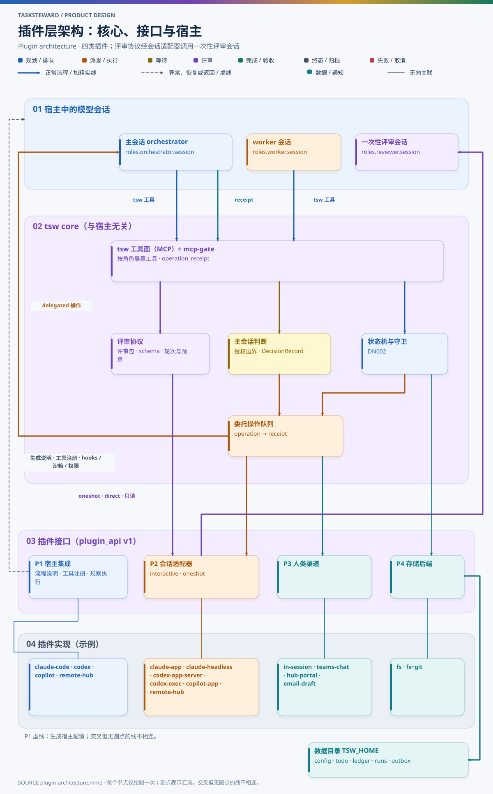
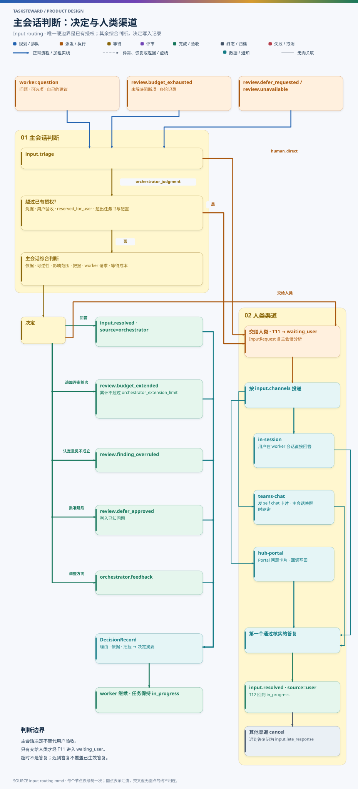

# DN006 插件层：宿主集成、会话、人类渠道与数据存储

- 状态：设计草案（T233 r5，已按 PoC 结果修订）
- 日期：2026-11-05
- 相关：[DN001 总体架构](DN001-architecture.md) · [DN002 任务状态机](DN002-task-state-machine.md) · [DN003 统一配置](DN003-unified-config.md) · [DN004 worker 自评审](DN004-worker-self-review.md) · [DN005 历史导入与 resume](DN005-history-import-and-resume.md)

## 1. 目标

用户 2026-11-05 提出的要求：

1. **不与 Claude 强绑定**：调度层插件化。没有 Claude Code 的用户可以用 Codex 或 GitHub Copilot 执行，没有 Codex 的用户可以换评审器；不同用户配置由不同的插件组合支持。
2. **主会话帮助响应 worker 的问题**：主会话自主判断能否自己处理，确需人类时，通过插件式渠道请求人类响应，例如发 Teams chat 后轮询回复，将来经 remote-hub web portal 响应。判断不按硬分类，由主会话在一定范围内自主决定。
3. **评审达到轮次上限后由主会话介入**：与 worker 提问走同一套判断流程，由主会话决定是否继续。
4. **评审器复用会话适配器**：评审单独配置用哪个会话适配器，可以与主会话、worker 不同。
5. **运行数据与产品 repo 分立**：用户 enlist 产品 repo，但不 check in ledger 和任务运行信息；运行数据放在指定的数据目录，备份该目录即可保证持久性。

本文确定插件类型、职责、接口和组合示例。核心逻辑（账本、状态机、守卫、评审协议、主会话判断规则、导入、渲染、经 tsw 工具的权限检查）不进入插件，所有宿主共用。

## 2. 插件类型一览

| 编号 | 插件类型 | 一句话作用 | 什么时候起作用 |
| --- | --- | --- | --- |
| P1 | 宿主集成（host integration） | 让某个宿主里的模型“知道流程、拿得到工具、越不过规则” | 安装与配置变更时生成文件；运行时由宿主自己执行 |
| P2 | 会话适配器（session） | 创建、续用、停止、观察会话；承载 worker，也承载一次性评审 | 派发、续用、评审时 |
| P3 | 人类渠道（human channel） | 把需要人类的请求送到人面前，并把核实过的答复取回 | 主会话决定交给人类时 |
| P4 | 存储后端（storage） | 数据目录的读写、加锁、备份 | 每次写账本或产物时 |

与 Claude 耦合的设计元素与归属：

| 设计元素 | Claude 实现 | 归属 |
| --- | --- | --- |
| 主会话与 worker 的指令、skill、工具注册 | `CLAUDE.md`、`.claude-plugin`、skills、`.mcp.json` | P1 |
| 写入范围、危险命令拦截、结束前检查 | Claude Code hooks | P1 |
| 创建、续用、停止、观察 worker 会话 | `start_session`、`SendMessage`、`list_sessions`、`get_session`、`stop_session` | P2 |
| 唤醒主会话 | worker→父会话 `send_message(session_id="parent")`、side-sessions-event | P2（唤醒能力） |
| 派发窗口与预启动（G-WINDOW、attempt `standby`） | 只有用户本人的 turn 能在任务目录创建会话；任何 turn 都能给已有会话发消息 | P2（能力声明） |
| 权限模式名称 | `default` / `acceptEdits` / `auto` / `bypassPermissions` | P2（映射表） |
| 评审器 | Codex App Server 一次性线程 | P2 的 oneshot 能力 + `roles.reviewer.session` |
| 待答问题的投递与回收 | 用户在子会话直接答复 | P3 |
| 控制根 = 私有 Git 仓库 | ledger、runs 随仓库提交 | P4 + 数据目录 |

不变的部分：状态集合与迁移（DN002）、守卫语义、评审必经与提交周期（DN004）、导入规则（DN005）、事件格式。DN002 中只有 G-WINDOW 与预启动（attempt `standby`）依赖宿主能力：会话适配器声明 `dispatch_window=false` 时 G-WINDOW 永远满足，声明 `prestart=false` 时不做预启动。

## 3. 分层



图源：[diagrams/plugin-architecture.mmd](diagrams/plugin-architecture.mmd)

| 层 | 内容 | 是否随宿主变化 |
| --- | --- | --- |
| 核心 tsw core | 账本、状态机与守卫、评审协议、主会话判断规则、委托操作队列、导入、渲染、配置校验、经 tsw 工具的权限检查（`mcp-gate`）、插件加载 | 否 |
| 插件接口 | §6–§9 定义的 Protocol、能力声明、操作与回执格式 | 否（带版本号） |
| 插件实现 | Claude、Codex、Copilot、remote-hub、Teams 等具体实现 | 是 |
| 宿主中的模型会话 | 主会话、worker 会话、一次性评审会话 | 是 |

## 4. 两种执行方式：直接调用与委托操作

有些宿主的会话工具**只有该宿主中的模型能调用**（例如 Claude app 的 `start_session`、Copilot app 的 `create_session`、只在会话里可用的 Teams MCP 工具），tsw 进程无法直接调用。因此插件动作分两类：

| 方式 | 适用 | 流程 |
| --- | --- | --- |
| **direct** | 有可编程接口的宿主或渠道：Codex App Server（JSON-RPC）、`codex exec`、`claude -p`、远程会话中枢的 REST API、带独立凭据的 Graph 调用 | tsw 直接调用，结果写入账本 |
| **delegated** | 只有模型能调用的工具 | tsw 先落账一条待执行操作并交给主会话；主会话用宿主工具执行，再调用 `operation_receipt` 回填结果；tsw 校验后推进状态 |

这一模式沿用 orchestrator-agent 通知队列已验证的“claim → 主会话执行工具 → receipt”做法：产品只生成中性操作，主会话按当前宿主调用对应工具。

委托操作示例：派发 T241 的 worker（Claude app 宿主）。

```json
{
  "operation_id": "op-T241-a1-g1-start",
  "kind": "session.start",
  "task_id": "T241",
  "attempt": "a1",
  "generation": 1,
  "action": {
    "neutral": "start_worker_session",
    "tool": "mcp__ccd_session__start_session",
    "params": {
      "initiation": "user_asked",
      "context": "fresh",
      "cwd": "~/tsw-worktrees/example-app/T241-a1",
      "use_worktree": false,
      "name": "t241-a1-g1",
      "model": "claude-opus-5-5",
      "effort": "high",
      "permission_mode": "auto",
      "prompt": "按 runs/T241/a1/brief.md 执行。工具、评审与回传协议见 brief 第 1 节。",
      "background": "为 example-app 的报表页增加 CSV 导出：在任务 worktree 中实现服务端流式导出接口与界面上的导出按钮，支持十万行分页与导出链接过期，补齐单元测试与端到端测试，完成后用配置的评审器自评审，再按 brief 提交报告。"
    }
  },
  "expects_receipt": {"fields": ["session_id"], "on_unknown": "reconcile_by_name"},
  "expires_at": "2026-11-05T12:00:00Z"
}
```

回执：

```json
{"operation_id": "op-T241-a1-g1-start", "outcome": "ok", "result": {"session_id": "local_6c1f…"}, "evidence": "tool result"}
```

约定：

- 操作先落账再交给模型执行；同一 `operation_id` 只执行一次，重复回执幂等。
- 结果未知时回执 `outcome: unknown`，tsw 按 `on_unknown` 对账（例如按会话名查找），绝不让模型盲目重试。
- 回执只记录工具真实返回的内容。主会话不能编造回执；tsw 能校验的字段（如会话名、消息 ID 格式）都会校验。

### 4.1 会话启动的两个阶段

多数宿主的“启动 worker”由两步组成：创建会话，再投递首条指令（brief）。两步分别落账、分别回执：

| 阶段 | 事件 | 完成证据 | 结果未知时 |
| --- | --- | --- | --- |
| 创建 | `attempt.session_created` | 会话引用（session / thread ID），且会话名或关联标记等于 `txxx-aN-gK` | 按会话名（或插件声明的关联标记）对账；找到则补记创建；确认没有则把本代次标为失效（DN002 §5.4），下一次派发用新代次 |
| 投递 brief | `attempt.brief_delivered` | 首条消息或首个 turn 被宿主接受的回执 | 重新投递同一 brief；brief 带 `operation_id`，worker 指令规定重复 brief 只确认不重做 |

T08（`attempt.bound`）要求两个阶段都有完成证据：**会话存在不等于启动完成**。

关联标记：承载 worker 的会话适配器**必须**声明一种“只凭代次就能找回会话”的方式（能力 `find_by_name` 或 `correlation_tag`），这是 `interactive` 能力的准入条件。Claude app 与 Copilot app 用会话名。Codex App Server 的线程名可以写入，但 PoC 发现未归档线程不能及时按名称或目录列出（B7），所以 `codex-app-server` 暂不承载 worker。因此创建结果未知时总能对账，并按 DN002 的 T09 / attempt 阶段规则收口。

预启动（DN002 §5.6）是同一个两阶段流程的提前执行：在用户 turn 中只完成“创建”（以待命说明启动会话），“投递 brief”推迟到派发时，可以在任何 turn 中进行。

## 5. 公共约定

### 5.1 插件清单

```json
{
  "name": "tsw-claude",
  "plugin_api": 1,
  "provides": ["host_integration:claude-code", "session:claude-app", "session:claude-headless"],
  "requires": {"executables": ["claude"]},
  "config_schema": "schema/claude.schema.json",
  "entry": "tsw_plugins.claude:register"
}
```

一个插件包可以提供多种插件类型的实现。

### 5.2 通用规则

- **版本**：`plugin_api` 为整数，不兼容变更加 1；核心拒绝加载版本不匹配的插件。
- **能力声明**：每个实现都返回能力声明，核心据此选择流程，**不按宿主名分支**。
- **幂等**：所有写操作带 `operation_id` 或 `command_id`，重复调用不产生重复副作用。
- **错误码**：统一为 `UNAVAILABLE`（可重试）、`REJECTED`（明确拒绝）、`UNKNOWN`（结果不明，需对账）、`UNSUPPORTED`（能力不支持）、`AUTH`（凭据问题）、`QUIESCED`（数据目录静止中）。接口伪代码中的 `Result[...]` 在 Python 实现中表示为：成功直接返回值，失败抛出携带以上错误码的 `TswError`。
- **秘密**：插件只按名称引用凭据（系统凭据库或数据目录外的认证目录），不把秘密写入配置、账本或操作记录。
- **一致性测试**：每类插件都有一套基于假实现（fake）的一致性测试，覆盖幂等、结果未知对账和错误码；新插件必须通过对应的测试套件。

## 6. P1 宿主集成（host integration）

### 6.1 它解决什么问题

主会话和 worker 都是某个宿主（Claude Code、Codex、Copilot）里的模型会话。要让它们按这套流程工作，宿主里必须先有三样东西，而每个宿主放这三样东西的方式都不同：

1. **流程说明**：主会话该怎么规划、派发、验收；worker 该怎么执行、自评审、提交。Claude 读 skill 与 `CLAUDE.md`，Codex 读 `AGENTS.md` 与 agent 定义，Copilot 读 `.github/agents`。
2. **工具注册**：把 tsw 的 MCP 工具面挂进宿主。三个宿主都支持 MCP，但注册方式不同（`.mcp.json`、`codex mcp add`、Copilot 的 MCP 配置）。
3. **规则执行**：把“只能写自己的执行目录”“未授权不能 push”“不能直接改账本”等规则交给宿主自己的强制机制。Claude 用 hooks，Codex 用沙箱可写根和命令审批，Copilot 用权限模式和工具白名单。这样规则不靠模型自觉。

P1 就是负责为某个宿主**生成**这三样东西的插件。它在安装和配置变更时运行，生成文件后，运行时由宿主自己读取和执行；P1 自己不参与每一步调度。

没有 P1：模型不知道流程，也调不到 tsw 工具。没有 P1 的规则执行部分：越界写入只能事后在 G-ACCEPT 中发现。

`mcp-gate`（tsw 工具自身检查调用者角色、写入范围与授权）对所有宿主都一样，属于核心，不是插件。

### 6.2 接口

```python
class HostIntegration(Protocol):
    name: str
    def capabilities(self) -> HostCaps: ...          # enforcement: enforced | advisory，覆盖的动作类型
    def render_instructions(self, roles: RoleSources, config: EffectiveConfig) -> list[GeneratedFile]: ...
    def render_tools(self, mcp: McpServerSpec) -> list[GeneratedFile]: ...
    def render_guards(self, policy: Policy, role: Role, scope: WritableScope) -> list[GeneratedFile]: ...
    def install_hint(self, data_dir: Path) -> str: ...   # 给用户的一次性安装说明，不自动修改全局配置
```

所有宿主的流程说明由同一份来源（`plugins/common/roles/*.md`）生成，避免几份平台说明各自漂移。

### 6.3 实现

| 实现 | 流程说明与工具注册 | 规则执行 | 规则强度 |
| --- | --- | --- | --- |
| `claude-code` | 插件：`.claude-plugin/plugin.json`、`.mcp.json`；数据目录：`CLAUDE.md` 与主会话入口 skill `.claude/skills/orchestrate/SKILL.md`（`tsw host render` 生成） | PreToolUse / Stop / SessionStart hooks 调用 `tsw guard` | enforced |
| `codex` | `AGENTS.md` 片段、`.codex/agents/task-worker.toml`、`codex mcp add tsw` 命令 | `workspace-write` 沙箱的可写根限定为执行目录与草稿目录；命令审批规则 | 写入范围 enforced，其余 advisory |
| `copilot` | `.github/agents/task-worker.agent.md`、skill、Copilot MCP 配置 | 会话权限模式与允许的工具集 | advisory（待验证） |
| `remote-hub` | 远程会话中枢的 controller 意图与 worker 指派模板 | 依所选会话宿主 | 依宿主 |

宿主声明为 `advisory` 时，STATUS 页和任务报告标注“规则为提示级”，并要求主会话在 G-ACCEPT 中额外核对写入范围（`git status` 与 diff 范围检查）。

`claude-code` 的 enforced 有边界：编辑类工具（Write、Edit 等）的目标路径可以精确检查；Bash 命令只能尽力解析——识别重定向、`tee`、`cp`/`mv`/`rm`/`mkdir`、`sed -i`、PowerShell 的 `Set-Content`/`Out-File`/`New-Item` 等常见写法，跟踪 `cd`，并递归读取 `bash -c`、`powershell -Command`、`cmd /c`；变量、脚本内部的写入看不到。因此 G-ACCEPT 对 `claude-code` 同样核对 diff 是否落在可写根内。git/gh 的推送、建 PR、合并按程序名识别（忽略路径与 `.exe` 后缀）。

`claude-code` 的插件按用户级启用，任何目录的会话（主会话、`~/tsw-worktrees` 或 `work/<任务>/<attempt>` 中的 worker、无关会话）都会加载它，所以插件只携带每个会话都需要的 MCP 注册与 hooks。主会话的流程说明不放进插件：`render_instructions` 把 `CLAUDE.md` 和 `orchestrate` skill 写进数据目录，后者是 Claude Code 的项目 skill（`<cwd>/.claude/skills/`），只有以数据目录为工作目录的会话会发现它。Claude Code 也从上级目录加载 `CLAUDE.md` 与项目 skill，执行目录在数据目录之下（`work/<任务>/<attempt>`）的 worker 同样会看到二者，所以二者都写明：`whoami` 的角色不是 orchestrator 时忽略。skill 的来源在产品代码中（`tsw/host/orchestrate_skill.md`），产品更新后重新运行 `tsw host render`。

插件由 Claude Code 复制到插件缓存运行，缓存里没有 `tsw` 运行时。启动器按顺序查找：`TSW_REPO` 环境变量、插件所在的产品仓库（源码树或原地使用的本地市场）、`tsw init` 写入数据目录标记文件的 `product_repo`；都找不到时 MCP server 报错退出，hooks 静默放行。

## 7. P2 会话适配器（session）

### 7.1 职责与能力

会话适配器负责某个宿主里会话的创建、续用、停止和观察。同一个适配器可以承载两种用途：

- **interactive**：长期存在、可续用、用户可能直接对话的会话，用于 worker（以及主会话所在的宿主）。
- **oneshot**：一次性、可被 tsw 同步调用并拿回结果的会话，用于评审。

```python
@dataclass(frozen=True)
class SessionCaps:
    execution: Literal["direct", "delegated"]
    interactive: bool               # 能否承载 worker（需同时满足 §4.1 的关联标记）
    oneshot: bool                   # 能否被同步调用并返回最终消息
    read_only_enforced: bool        # 能否由宿主强制只读（评审器必需）
    incremental: bool               # oneshot 能否续用同一线程做增量评审
    user_direct_chat: bool          # 用户能否在会话里直接对话
    wake: Literal["push", "poll", "none"]
    dispatch_window: bool           # 是否存在“当前 turn 不能启动会话”的限制（G-WINDOW）
    prestart: bool                  # 能否先创建会话、之后再投递任务书（两阶段启动）
    reuse_session: bool             # 停止后能否续用同一会话
    open_existing_dir: bool         # 能否在已有目录（tsw 创建的 worktree）启动会话
```

### 7.2 接口

```python
class SessionAdapter(Protocol):
    def capabilities(self) -> SessionCaps: ...
    # interactive
    def create(self, req: StartRequest) -> Result[SessionRef] | Operation: ...        # 阶段 1：创建（带 generation 与关联标记）
    def deliver_brief(self, ref: SessionRef, brief: str, *, op_id: str) -> Result[None] | Operation: ...  # 阶段 2
    def send(self, ref: SessionRef, message: str, *, op_id: str) -> Result[None] | Operation: ...
    def stop(self, ref: SessionRef) -> Result[None] | Operation: ...
    def observe(self, ref: SessionRef) -> Result[SessionFact] | Operation: ...      # live / stopped / missing / archived
    def find(self, name: str) -> Result[SessionRef | None] | Operation: ...         # 结果未知时按会话名对账
    def close(self, ref: SessionRef, *, keep_dir: bool = True) -> Result[None] | Operation: ...
    def map_permission(self, mode: NeutralPermission) -> str: ...                   # 中性权限 → 宿主名称
    # oneshot（只要求 direct 实现）
    def run_oneshot(self, req: OneshotRequest) -> Result[OneshotResult]: ...        # 返回最终消息与线程引用
    def resume_oneshot(self, thread: str, req: OneshotRequest) -> Result[OneshotResult]: ...
    def close_oneshot(self, thread: str) -> Result[None]: ...
```

`StartRequest` 只含中性字段：`name`（`txxx-aN-gK`）、`cwd`、额外可写根、`model`、`effort`、`permission`（中性：`ask` / `edits` / `auto` / `full`，与 DN003 `roles.*.permission_mode` 同一套取值）、`prompt`、`background`。`map_permission` 把中性值映射为宿主名称，例如 `claude-app`：ask→default、edits→acceptEdits、auto→auto、full→bypassPermissions。

`OneshotRequest` 含 `cwd`、`model`、`effort`、`read_only=true`、提示正文、超时；只读由适配器用宿主机制强制，不用中性权限取值。

### 7.3 实现

| 实现 | 方式 | interactive | oneshot（只读方式） | 增量续用 | 用户直接对话 | dispatch_window |
| --- | --- | --- | --- | --- | --- | --- |
| `claude-app` | delegated | 是：`start_session` / `SendMessage` / `get_session` / `stop_session`，按会话名对账；支持预启动 | 否（只能由模型调用，tsw 无法同步等结果） | — | 是（侧栏子会话） | 是 |
| `claude-headless` | direct | 待验证（Agent SDK 会话） | 是：`claude -p`，严格只读工具白名单（调用约定见 DN004 §3.3） | 是（`--resume`） | 否 | 否 |
| `codex-app-server` | direct | 暂不承载 worker（B7：不能按名称或目录及时找回线程） | 是：一次性线程，`sandbox=read-only` | 是（keep / resume thread） | 是（受管独立线程） | 否 |
| `codex-exec` | direct | 否 | 是：`codex exec`，`--sandbox read-only` | 否（每轮全量 + 上轮意见） | 否 | 否 |
| `copilot-app` | delegated | 是：`create_session` / `send_session_message`（interactive），按会话名对账 | 否 | — | 是（app 独立会话） | 待验证 |
| `copilot-cli` | direct | 否 | 待验证（B2） | 待验证 | 否 | 否 |
| `remote-hub` | direct | 是：`POST /api/sessions`（intentId 关联） | 否 | — | 是（Portal 会话页） | 否 |

interactive 动作映射（承载 worker 的实现）：

| 动作 | `claude-app` | `codex-app-server`（暂不承载 worker，B7 解决后启用） | `copilot-app` | `remote-hub` |
| --- | --- | --- | --- | --- |
| create | `start_session`（fresh、cwd、use_worktree=false；预启动时 prompt 为待命说明） | `thread/start`（写入关联标记） | `create_session`（name = 会话名） | 创建 native session（intentId） |
| deliver_brief | `SendMessage`（任何 turn 都可以；直接启动时任务书可放在 prompt 中，两阶段合一） | `turn/start` | `send_session_message` | 会话消息 API |
| send | `SendMessage` | `turn/start` | `send_session_message` | 会话消息 API |
| stop | `stop_session` | 中断当前 turn（interrupt） | 会话停止 | 会话中断 |
| observe | `get_session` | `thread/read` | `get_session` / `get_sessions_status` | 会话状态 / 事件 |
| find | `list_sessions {linked:true}` 按名称 | 按关联标记检索（B7） | 按会话名列出 | 按 intentId 读取 |
| 唤醒主会话 | push：worker `mcp__ccd_session_mgmt__send_message(session_id="parent")`；兜底 side-sessions-event | push：turn completed 事件（tsw 监听进程） | push：跨会话消息、idle 通知 | push：会话停止事件 |

### 7.4 三个角色各自选用会话适配器

主会话、worker、评审器分别在配置中指定会话适配器，三者可以不同：

| 角色 | 配置 | 要求的能力 |
| --- | --- | --- |
| 主会话 | `roles.orchestrator.session` | 主会话所在宿主；用户在该宿主中打开主会话 |
| worker | `roles.worker.session` | `interactive`；若 `execution=delegated`，必须与主会话是同一宿主（委托操作只能由同宿主的主会话执行） |
| 评审器 | `roles.reviewer.session`（可选 `fallback_session`） | `oneshot`、`direct`、`read_only_enforced`；`incremental` 可选，没有时每轮全量评审并附上轮意见 |

评审为什么必须 `direct`：worker 调用 `review_run` 后需要同步拿到结构化意见再决定迭代，而 delegated 实现只能由主会话模型执行，既无法同步返回，也会把评审拉进主会话的上下文。因此 `claude-app`、`copilot-app` 不能做评审器，同一宿主的 direct 形态（`claude-headless`）可以。

评审协议（评审包渲染、输出 schema 校验、轮次与周期计数、增量范围）属于核心，与选用哪个会话适配器无关（DN004）。配置校验在评审器与 worker 使用同一模型时给出警告（不阻止），提醒评审视角的独立性下降。

**为什么 Codex 原生子代理（`spawn_agent`）不作为默认实现**：它只受创建它的主会话控制，用户不能直接对话，也不能交接。只有在主会话就是 Codex 线程、并且用户接受这些限制时才启用 `codex-native`，能力声明中 `user_direct_chat=false`、`reuse_session` 仅限同一主会话。

## 8. 用户输入、主会话判断与 P3 人类渠道

### 8.1 两类事项：先问用户，跨任务的交主会话

用户 2026-11-06 决定：每个任务的工作尽量在 worker 自己的会话里完成，主会话只协调并保持上下文干净。worker 遇到自己不能独自决定的事，按事项分两类处理：

| 类别 | 例子 | 去向 |
| --- | --- | --- |
| 任务内的事 | 验收条款含义不清、两种实现取舍、需要某个外部事实；评审预算用完（`review.budget_exhausted`）、阻断项需要延后（`review.defer_requested`）、评审器不可用（`review.unavailable`） | worker 在**自己的会话里直接问用户**（§8.1a）；超时无人回复才转交主会话（§8.1b） |
| 跨任务的事 | 独占资源冲突、依赖需要调整、需要改动其他任务的范围或产出 | `worker.question` 交主会话判断（§8.2–§8.4） |

主会话的判断（§8.2–§8.4）因此只用于两种来源：转交来的任务内问题，以及跨任务的事。任务状态的变化见 DN002 T11、T12 与 §3.3a。



图源：[diagrams/input-routing.mmd](diagrams/input-routing.mmd)

### 8.1a 在 worker 会话中直接问用户

1. worker 调用 `ask_user`（问题全文；可带上评审升级等待处理事项的编号；只有用户本人能决定的事——凭据、验收、`reserved_for_user` 中的决定——标 `reserved`）。tsw 记录 `input.escalated`（`kind: in_session`，渠道 `in-session`，记下 worker 会话与转交时间），任务经 T11 进入 `waiting_user`，名额保持。
2. worker 在本会话的回复中把问题原样写给用户，结束这一轮。这个问题**不进入主会话 inbox**：主会话的 `attention` 只显示“某任务有一个会话内问题、何时转交”，不显示问题内容；STATUS 页是给用户看的，显示问题与转交时间。
3. 用户在 worker 会话中发消息时，`UserPromptSubmit` hook 把消息原文记为观察事件 `input.session_message`（消息编号 `M-…`），并把编号告诉 worker。其他会话或 app 注入的消息（`<cross-session-message>`、`<side-sessions-event>`、定时任务等）不记录。只有该会话最新的一个问题接收消息：它已由用户在本会话答复、被更新的问题取代，或任务 revision 已变时，不再记录。hook 入口只由宿主调用：任何会话在命令行运行 `tsw guard` 都被 hooks 拒绝，否则会话可以自己编造“用户消息”。
4. 消息回答了问题时，worker 调用 `user_answer`，必须引用 hook 记录的消息编号，且该消息来自同一 worker 会话。tsw 用记录中的原文构造 `VerifiedSource`（渠道 `in-session`），记录 `input.resolved`，经 T12 回到离开时的子状态。同一次答复可以带上用户批准的追加评审轮次（`source = user`，没有累计上限）、批准延后或认定不成立的阻断项。用户原话来自 hook，不来自 worker 的转述，所以 worker 不能伪造答复。

用户回复了但还没有回答问题（例如“让我想想”）时，worker 在会话中继续与用户交流；问题不会因超时转交。

### 8.1b 超时转交主会话

| 项目 | 规则 |
| --- | --- |
| 超时 | `input.in_session_timeout_minutes`（DN003 §3.1a，默认 10 分钟），从 `ask_user` 起算 |
| 转交条件 | 问题仍未答复、尚未转交，且在这段时间内用户没有在 worker 会话中发过任何消息 |
| 谁来触发 | (1) worker：问完后用宿主的定时唤醒（Claude Code 的会话内定时任务）在超时后检查，仍无回复就调用 `input_handoff`，再用 `send_message(session_id="parent")` 唤醒主会话；(2) 系统规则：`sync` 把已到期的问题一并转交（`by: system`）。主会话结束一轮前，Stop hook 发现有到期未转交的问题时提示运行 `sync`；`attention` 的 `handoff_due` 也列出它们 |
| 事件 | `input.handed_off`（问题编号、触发者、转交时间），默认在 `scheduling.wake.reportable_events` 中，进入主会话 inbox。任务状态不变，仍为 `waiting_user` |

转交之后，主会话可以：

- **在授权边界内代为决定**（`handoff_resolve`）：回答、追加评审轮次（受 `review.orchestrator_extension_limit` 限制）、认定意见不成立或批准延后。记录 `orchestrator.decision`（`DecisionRecord`，理由与依据按 §8.2）与 `input.resolved`（`source_kind = orchestrator`，没有用户来源），经 T12 让 worker 继续，并用消息告诉 worker 决定内容。主会话代答不是用户批准，不满足 G-USER。§8.2 的硬边界照旧：凭据与 MFA、用户验收与退回、`policies.reserved_for_user`、超出任务书与配置授权的事，主会话都不能代答；worker 标为 `reserved` 的问题，`handoff_resolve` 一律拒绝。
- **转达给用户**（`input_relay`）：渠道为主会话本身（`main-session`，例如在主会话中向用户提问）或已加载、支持 `request_response` 的其他人类渠道（如 Teams，§8.6）。记录 `input.relayed`。用户经该渠道的答复由主会话用 `input_resolve` 记录，来源是该渠道核实过的 `VerifiedSource`（主会话消息、Teams 回复等），满足 G-USER，经 T12 让 worker 继续。worker 会话中的原话只能由 worker 经 `user_answer` 登记，主会话不能用 `input_resolve` 代为记录 `in-session` 来源。
- **继续等待**：什么都不做，问题保持待答。

### 8.1c 迟到的答复

第一个生效的答复决定 T12，之后的答复都不改变任务状态，但都记账：

| 情形 | 处理 |
| --- | --- |
| 已转交、主会话尚未决定时，用户在 worker 会话中回答 | 仍是有效答复：worker 经 `user_answer` 记录，T12 生效。主会话之后的 `handoff_resolve` 与经其他渠道收到的答复以 `request_not_pending` 拒绝或记为 `input.late_response`；已转达的渠道按 §8.6 撤回 |
| 主会话已代答或其他渠道已答复之后，用户才在 worker 会话中回答 | hook 照常记录这条消息（该问题还没有来自 worker 会话的用户答复）；worker 经 `user_answer` 记为 `input.late_response`，标明它取代的答复（`supersedes`）。用户本人的话优先于主会话代答：worker 以用户的话为准继续，必要的返工是任务内的正常工作；超出任务范围时按需求变更经主会话处理（`[report]`，DN001 §6.5）。之前的答复也来自用户、两者冲突时，worker 再次 `ask_user` 确认 |
| 其他渠道的答复晚于已生效的答复 | 记为 `input.late_response`（§8.6 多渠道规则） |

超时本身不是答复；转交只改变谁来处理，不替用户作出决定。

### 8.2 判断方式：授权边界 + 综合判断

不按问题类别硬性划分。规则分两层：

适用于转交来的任务内问题（§8.1b）与跨任务的事（§8.1）。

**唯一的硬边界：不越过已有授权。** 下列情形主会话不能自行决定，必须交给人类：

- 只有用户本人能完成的事：输入凭据、MFA、登录确认；
- 用户验收与退回（G-USER）；
- 用户在配置 `policies.reserved_for_user` 中保留的决定（例如对外发送邮件、合并到受保护分支、生产部署）；
- 超出任务书与配置已有授权的事：扩大任务范围、新增远端交付动作、删除或覆盖用户数据。

**其余情况由主会话综合判断**，参考以下因素并写下理由：

| 因素 | 倾向于主会话自行处理 | 倾向于交给人类 |
| --- | --- | --- |
| 依据 | 任务书、用户既有决定、配置策略、其他任务产出中有明确依据 | 找不到依据，只能猜用户意图 |
| 可逆性 | 结果容易回退（本地改动、可重做的实现选择） | 难以回退（对外可见、数据变化、长期接口） |
| 影响范围 | 只影响本任务内部 | 影响验收标准、其他任务或用户承诺 |
| 把握 | 主会话对答案有较高把握 | 多种合理答案、取舍依赖用户偏好 |
| worker 的请求 | worker 只是需要信息 | worker 明确要求人类决定：主会话默认交给人类，不这样做时须写明理由 |
| 等待成本 | — | 用户可以很快回答，等待成本低 |

### 8.3 主会话可以做出的决定

| 决定 | 事件 | 说明 |
| --- | --- | --- |
| 回答 | `input.resolved`（source = orchestrator） | 附依据引用；worker 继续 |
| 追加评审轮次 | `review.budget_extended`（source = orchestrator） | 只用于预算用完；写明追加轮数与理由；同一周期主会话累计追加不超过 `review.orchestrator_extension_limit`（默认 3），超过只能交给人类，由用户批准追加（source = user，DN002 §3.3） |
| 认定意见不成立 | `review.finding_overruled` | 主会话核实评审意见的前提与证据后，认定该阻断项不成立；理由写入报告 |
| 批准延后 | `review.defer_approved` | 阻断项作为已知问题延后；必须写入报告“已知问题”一节，用户验收时可见 |
| 调整方向 | `orchestrator.feedback` | 给 worker 新的修复思路或范围收窄（在授权内） |
| 交给人类 | `input.escalated` → T11 | 按 §8.5 投递人类渠道 |

主会话的决定都不是用户批准，不满足 G-USER。

### 8.4 决定记录与事后核对

每个主会话决定都写入 `DecisionRecord`：

```python
@dataclass(frozen=True)
class DecisionRecord:
    decision_id: str
    task: tuple[str, int, str]     # 任务 ID、revision、attempt
    trigger: str                   # worker.question / review.budget_exhausted / review.defer_requested
    decision: str                  # answer / extend / overrule / defer / feedback / escalate
    rationale: str                 # 理由：引用 §8.2 的因素
    basis: list[str]               # 依据引用：任务书段落、用户决定消息、配置策略、产出链接
    confidence: Literal["high", "medium", "low"]
```

- `input.decision_digest` 配置把主会话的自主决定按日或在任务完成时汇总，经支持 notify 的人类渠道通知用户，便于事后核对；`channel` 为 `"local"` 时只写入 STATUS 页与主控验收报告。
- 用户不同意某个决定时，直接在主会话或该 worker 会话中给出新指示；它按需求变更或用户答复处理（DN002 §5.1、T12），已执行的部分按正常流程返工。
- 任务的主控验收报告（`review.md`）列出本任务的全部主会话决定，用户验收时一并可见。

### 8.5 渠道接口

```python
class HumanChannel(Protocol):
    def capabilities(self) -> ChannelCaps: ...   # request_response / notify_only、collect: push | poll、execution
    def notify(self, msg: Notice, *, op_id: str) -> Result[Delivery] | Operation: ...
    def request(self, req: InputRequest) -> Result[ChannelHandle] | Operation: ...
    def collect(self, handle: ChannelHandle, since: Cursor) -> Result[list[Response]] | Operation: ...  # poll 渠道
    def cancel(self, handle: ChannelHandle, reason: str) -> Result[None] | Operation: ...
    def verify(self, resp: Response) -> Result[VerifiedSource]: ...   # 核实答复确实来自用户本人


@dataclass(frozen=True)
class VerifiedSource:              # DN002 G-USER 的统一证据
    channel: str                   # in-session / main-session / teams-chat / hub-portal
    principal: str                 # 已核实的用户身份（会话所有者、Teams 发送者 UPN、Portal owner）
    message_ref: str               # 会话消息引用 / Teams 消息 ID / Portal 提交 ID
    text: str                      # 用户原话
    request_id: str | None         # 回答的 InputRequest（验收 / 退回等主动决定可为空）
    target: tuple[str, int, str]   # (任务 ID, revision, 决定类别：answer / accept / reject / approve)
```

`InputRequest` 含请求 ID（如 `Q-T241-3`）、触发场合、问题正文、可选项、主会话已作的分析（`DecisionRecord` 摘要）、过期时间、worker 会话的直达链接（如果宿主支持用户直接对话），以及**上下文绑定**：任务 ID、revision、attempt、创建代次、提交周期。

请求生命周期：

| 状态 | 含义 | 进入方式 |
| --- | --- | --- |
| `pending` | 已投递，等待答复 | T11 |
| `resolved` | 第一个通过核实的答复已生效 | T12 |
| `cancelled` | 任务不再需要这个答复 | 任务取消（T25）、依赖失效离开 `waiting_user`（T16）、attempt 被替换、请求过期后用户撤回 |
| `superseded` | 问题因需求变更（revision+1）而过时 | `task.requirement_changed`；如仍需答复，由主会话按新 revision 重新判断，必要时以新请求 ID 再问 |

T12 在同一事件中原子检查：请求为 `pending`，且上下文绑定与任务当前的 revision、attempt、代次一致。对 `cancelled` / `superseded` / `resolved` 请求的任何答复都只记录为 `input.late_response`，不恢复 worker。

### 8.6 渠道实现

| 实现 | 能力 | 发送 | 回收 | 核实 |
| --- | --- | --- | --- | --- |
| `in-session` | request_response，push（不支持 notify） | 无需发送：worker 用 `ask_user` 记录后在自己的会话里提问（§8.1a） | `UserPromptSubmit` hook 记录用户消息原文（`input.session_message`），worker 用 `user_answer` 引用消息编号登记 | 宿主会话消息归属：消息由 hook 在该 worker 会话中取得，注入的其他会话消息不记录 |
| `teams-chat` | request_response，notify，poll，delegated | 主会话经 Teams MCP 工具 向本人 self chat 发送带请求 ID 的卡片 | 主会话被唤醒时（或按 `teams_poll` 间隔）读取 self chat 中发送后的新消息，取 Teams 回复（replyTo 该消息）或含请求 ID 的消息 | 按消息 ID 精确 GET 读回，发送者为本人 |
| `hub-portal` | request_response，notify（Portal 通知卡片），push，direct | tsw 把请求发布到 Hub 门户（问题卡片） | Portal 用户提交答复，经认证回调写回 tsw | Portal 的 owner 认证 + 请求 ID |
| `email-draft` | notify_only | 在邮箱生成草稿（默认不发送，沿用邮件约定） | — | — |

多渠道规则：

- 交给人类时按配置 `input.channels` 同时投递到多个渠道；**第一个通过核实的答复生效**，记录后对其他渠道发 `cancel`（Teams 中补发“已在其他渠道答复”）。
- 迟到的第二份答复只记录为 `input.late_response`，不覆盖已生效的答复；内容冲突时由主会话判断是否需要再次确认。
- 超时不是答复；请求过期后只能再次提醒或保持等待。

### 8.7 Teams 轮询的运行方式

Teams MCP 工具 只在主会话里可用，所以 Teams 回收是 delegated + poll：tsw 生成 `collect` 操作，由主会话执行。轮询只在主会话运行时进行：

- 主会话每次被唤醒（任何 reportable 事件或用户消息）时，先执行所有到期的 `collect` 操作；
- 宿主支持定时唤醒时（例如 Claude Code 会话内的定时任务），按 `teams_poll` 间隔（默认 5 分钟，指数退避到 30 分钟）唤醒主会话执行 `collect`；
- 主会话不运行时不轮询，请求保持待答；不承诺离线回收。

如果用户为 Graph 配置了独立的后台凭据，`teams-graph` 实现可以改为 direct，由 tsw 后台进程轮询；它与 `teams-chat` 共用请求 ID 与核实规则。

### 8.8 Hub Portal

使用自建的远程会话中枢（`remote-hub`）时，它的网页门户可以承载问题卡片（门户经身份认证、按 owner 隔离）：

1. `request`：调用门户的接口发布问题卡片，卡片显示任务、问题、主会话的分析、可选项和 worker 会话链接；
2. 用户在 Portal 回答，插件端点校验 owner 与请求 ID 后，写入 tsw 的 `input_response` 接口（direct，push）；
3. tsw 核实后记录答复并唤醒主会话；
4. `cancel`：把卡片标为已在其他渠道答复。

## 9. P4 存储后端与数据目录

存储后端只负责数据目录的读写、锁与备份；账本、投影与检索索引的分层及读取方式见 [DN007](DN007-ledger-and-context.md)。

### 9.1 产品 repo 与数据目录分离

| 位置 | 内容 | 是否提交到产品 repo |
| --- | --- | --- |
| 产品 repo（`task-steward`） | tsw 代码、插件、schema、默认配置模板、角色指令来源、文档 | 是 |
| 数据目录（`TSW_HOME`） | 用户配置、TODO 与任务书、事件账本、runs（brief、报告、评审证据、验收记录）、通知 outbox、生成视图、投影缓存 | 否 |
| 执行目录根（`worktrees.root`） | 设计 / 开发任务的 worktree | 否（属于各业务仓库） |
| 凭据 | 系统凭据库或用户指定的认证目录 | 否；也不放进数据目录 |

数据目录的定位顺序：环境变量 `TSW_HOME` → 产品 repo 下 `.local/tsw-home` 中记录的路径 → 默认 `~/.tsw`。主会话在数据目录中打开（它就是 DN001 所说的“控制根”）。

### 9.2 数据目录布局

```text
<TSW_HOME>/
  tsw-home.json                数据目录版本、创建时间、产品兼容版本
  config/task-steward.json      统一配置（DN003）
  config/prompts/              用户覆盖的角色指令与评审模板（可选）
  todo/TODO.md, todo/Txxx.md   任务索引与任务书
  ledger/events/*.jsonl(.gz)   事件账本（唯一事实）
  ledger/imported/             导入的历史原始卷与 manifest（DN005）
  runs/Txxx/aN/                brief、报告（md + html）、评审证据、决定记录、验收记录
  outbox/                      通知与人类渠道请求的持久队列
  views/STATUS.html, ARCHIVE.html  生成视图
  legacy/                      导入的旧系统只读成果（DN005）
  work/                        worker 草稿与研究缓存（尽力备份）
  cache/                       投影 state.sqlite 等可重建缓存（备份时可排除）
  locks/                       调度租约与写锁（备份时排除）
```

### 9.3 接口

```python
class StorageBackend(Protocol):
    def append(self, events: list[Event], *, expected_sequence: int) -> Result[int]: ...   # 原子追加，乐观并发
    def read(self, since: int = 0) -> Iterator[Event]: ...
    def put_artifact(self, rel: str, data: bytes) -> Result[str]: ...                     # runs/ 下的文件
    def lock(self, name: str, ttl: int) -> ContextManager[Lease]: ...
    def snapshot(self, dest: Path) -> Result[BackupManifest]: ...                         # 一致性备份
```

| 实现 | 说明 |
| --- | --- |
| `fs`（默认） | 本地文件系统数据目录；追加采用临时文件 + 原子替换；锁用文件锁加租约 |
| `fs+git`（可选） | 在 `fs` 之上，把数据目录本身作为用户的私有 Git 仓库，按配置在阶段节点提交并推送；与产品 repo 无关 |

### 9.4 写入边界

- `ledger/`、`runs/`、`todo/`、`config/`、`outbox/`、`legacy/` 只由 tsw 写入：MCP 工具、`review_run`、`submit`（把 worker 草稿导入 `runs/`）、人类渠道回调、后台轮询器都经 tsw 的写入口。`config/task-steward.json` 由主会话经 `config_change` / `config_revert` 修改（DN003 §7）；用户在会话外手工编辑仍然允许。
- worker 的草稿（报告、证据）统一放在 `work/Txxx/aN/`，不直接写 `runs/`；`submit` 时由 tsw 复制定稿并记录内容摘要。研究任务的执行目录就是 `work/Txxx/aN/`；设计 / 开发任务的执行目录是 worktree，`work/Txxx/aN/` 作为额外可写根随 brief 和会话启动参数一起下发，P1 生成的规则执行配置把两者都列为可写范围。
- tsw 的所有写入口按固定顺序准入：**先取得数据目录的共享写闸，再检查静止标记**；有标记则立即释放共享写闸并返回 `QUIESCED`，没有才执行写入，写完释放。`tsw backup` 取**排他写闸**；排他期间新的写入等待，不丢失。

### 9.5 备份与恢复

- `tsw backup <dest>`（在线）：取排他写闸 → 复制 `ledger/`、`runs/`、`todo/`、`config/`、`outbox/`、`legacy/`、`tsw-home.json` → 写备份 manifest（文件清单、字节数、账本末端序号、账本文本摘要；不含任何可执行文件哈希）→ 释放写闸。`work/` 尽力复制，不保证一致；`cache/`、`locks/` 不备份。
- 冷复制：先运行 `tsw quiesce`。它先在 `locks/` 中原子写入静止标记，再取得排他写闸：排他写闸要等此前已获准、正在写入的共享持有者全部释放后才能取得，而之后新到的写入者取得共享写闸时一定能看到标记并放弃（MCP 工具、`review_run`、`submit`、渠道回调、后台轮询器都遵守同一准入顺序）。取得排他写闸后写入 manifest 并释放排他写闸；静止标记一直保持到 `tsw resume-writes`，期间没有任何写入，直接复制整个目录即为有效备份。没有 manifest 的普通复制在恢复时标为“未核实备份”，需通过 `tsw ledger audit` 全审计后才能使用。
- `tsw restore <src>`：校验 manifest 与账本链，恢复到空目录，再用 `tsw ledger rebuild` 重建投影。

### 9.6 单写者与跨机器

- 同一数据目录同一时间只允许一个主会话持有调度租约；`fs` 的锁与租约只在本机有效。
- **不支持**在多台机器上同时使用同步中的数据目录副本。换机器只支持冷迁移：在原机器 `tsw quiesce` 并释放租约 → 复制或同步数据目录 → 在新机器领取租约。
- 租约记录机器标识。新机器发现租约属于另一台机器且未释放时拒绝写入，只有用户确认原机器已停止后才能 `controller_takeover --from-machine`。
- `fs+git` 只在 `quiesce` 状态下提交与推送；新机器拉取后若发现远端有未释放的租约记录，同样拒绝写入。

### 9.7 主会话可运行的维护

宿主会话中的 `tsw` 命令行只开放只读入口（DN001 §7.1）。用户 2026-11-06 决定把以下维护经 MCP 工具开放给主会话，都要求持有调度租约：

| 工具 | 对应命令 | 约束 | 记账 |
| --- | --- | --- | --- |
| `home_backup` | `tsw backup <dest>` | 目标为数据目录之外的绝对路径，不存在或为空 | `maintenance.performed`（`kind: backup`，目标、账本末端、文件数） |
| `ledger_audit` | `tsw ledger audit` | 只读，不需要租约 | 不记 |
| `ledger_rebuild` | `tsw ledger rebuild` | 先全量审计，有问题时拒绝 | `maintenance.performed`（`kind: ledger_rebuild`） |
| `import_orchestrator_agent`（`dry_run: true`） | `tsw import orchestrator-agent --dry-run` | 只读演练 | `maintenance.performed`（`kind: import_dry_run`，参数与参数摘要） |
| `import_orchestrator_agent` | `tsw import orchestrator-agent` | 附用户原话（决定对象 `["import", "orchestrator-agent", "authorize"]`）；在上一次完成的导入之后有同参数的演练；一条原话只授权一次完成的导入 | `maintenance.performed`（`kind: import_authorized`，参数、用户来源），然后是导入事件（DN005） |

正式导入的授权检查（演练、原话是否用过）在导入锁内、任何导入写入之前进行，并以 `import_authorized` 记账；导入的每一次提交都在提交锁内重新检查调用者的租约；导入在提交之外直接写的文件（事件卷、legacy 文件、导入报告）也在持有提交锁、检查租约之后才写，写入期间其他主会话无法领取租约。租约在导入途中被他人领取时，之后的写入一律拒绝。备份与重建不改变账本事实，只在开始前检查租约。

`restore`、`quiesce` / `resume-writes` 与 `host render` 不开放：恢复要求先停止会话，静止会挡住主会话自己的写入，`host render` 改写数据目录的 `CLAUDE.md` 与 skill。它们仍由用户在终端运行。

## 10. 组合示例

以下都是 `config/task-steward.json` 的**覆盖片段**，只列出与默认配置（DN003 §2）不同的部分，按 DN003 §5a 的规则合并：对象逐字段合并，数组整体替换，值为 `null` 表示删除该字段（例如不使用回退评审器）。

### 10.1 Claude Code + Codex（默认组合）

worker 在 Claude app，评审用 Codex：

```json
{
  "plugins": {"host_integration": "claude-code", "sessions": ["claude-app", "codex-app-server", "codex-exec"]},
  "roles": {
    "orchestrator": {"session": "claude-app"},
    "worker": {"session": "claude-app"},
    "reviewer": {"session": "codex-app-server", "fallback_session": "codex-exec", "model": "gpt-6-astra", "effort": "medium"}
  }
}
```

### 10.2 只有 Claude Code（没有 Codex）

评审改用同一宿主的 direct 形态，并选与 worker 不同的模型：

```json
{
  "plugins": {"host_integration": "claude-code", "sessions": ["claude-app", "claude-headless"]},
  "roles": {
    "orchestrator": {"session": "claude-app"},
    "worker": {"session": "claude-app", "model": "claude-opus-5-5"},
    "reviewer": {"session": "claude-headless", "fallback_session": null, "model": "claude-sonnet-5-5", "effort": "high"}
  }
}
```

### 10.3 只有 Codex（当前不支持）

`codex-app-server` 暂不承载 worker（B7），所以这个组合目前不能通过配置校验。它展示的是 B7 解决（例如 Codex App Server 提供可及时检索的线程标识）之后的形态：

```json
{
  "plugins": {"host_integration": "codex", "sessions": ["codex-app-server", "codex-exec"], "human_channels": ["in-session"]},
  "input": {"channels": ["in-session"], "decision_digest": {"channel": "local"}},
  "roles": {
    "orchestrator": {"session": "codex-app-server", "model": "gpt-6-astra", "effort": "medium"},
    "worker": {"session": "codex-app-server", "model": "gpt-6-astra", "effort": "high", "permission_mode": "edits"},
    "reviewer": {"session": "codex-app-server", "fallback_session": "codex-exec", "model": "gpt-6-astra", "effort": "medium"}
  }
}
```

恢复支持的前提：`codex-app-server` 能凭创建代次及时找回线程，满足 §4.1 的关联标记要求。届时它是 direct 方式，没有派发窗口限制，唤醒来自 tsw 监听 turn 完成事件。

### 10.4 GitHub Copilot app + remote-hub Portal

```json
{
  "plugins": {"host_integration": "copilot", "sessions": ["copilot-app", "codex-exec"], "human_channels": ["in-session", "hub-portal"]},
  "input": {"channels": ["in-session", "hub-portal"], "decision_digest": {"channel": "hub-portal"}},
  "roles": {
    "orchestrator": {"session": "copilot-app"},
    "worker": {"session": "copilot-app", "permission_mode": "edits"},
    "reviewer": {"session": "codex-exec", "fallback_session": null, "model": "gpt-6-astra", "effort": "medium"}
  }
}
```

### 10.5 Claude 主会话 + remote-hub worker

worker 用 direct 的 remote-hub 会话，主会话可以在任何宿主：

```json
{
  "plugins": {"host_integration": "claude-code", "sessions": ["claude-app", "remote-hub", "codex-app-server"], "human_channels": ["in-session", "hub-portal"]},
  "input": {"channels": ["in-session", "hub-portal"], "decision_digest": {"channel": "hub-portal"}},
  "roles": {
    "orchestrator": {"session": "claude-app"},
    "worker": {"session": "remote-hub"},
    "reviewer": {"session": "codex-app-server", "fallback_session": null, "model": "gpt-6-astra", "effort": "medium"}
  }
}
```

## 11. 能力缺失的影响

| 能力缺失 | 影响 | 设计中的处理 |
| --- | --- | --- |
| worker 会话无 `user_direct_chat` | 用户不能在 worker 会话直接回答 | `in-session` 渠道不可用；改由其他渠道投递，答复由主会话转达 |
| `wake=poll` 或 `none` | worker 提交后主会话不能被即时唤醒 | 主会话在每个用户 turn 和定时唤醒时读取 inbox；STATUS 页显示“待主会话处理” |
| `dispatch_window=true` | 自动 turn 中不能在任务目录创建会话 | DN002 G-WINDOW 与预启动（§5.6）生效：在用户 turn 中预启动，之后任何 turn 都可投递任务书 |
| P1 规则为 `advisory` | 写入范围等规则只是提示 | G-ACCEPT 增加范围核对；报告标注提示级 |
| 没有满足 oneshot + direct + 只读的会话适配器 | 无法评审，不能满足 G-SUBMIT | 配置校验失败，不能派发 |

## 12. 对其他文档的影响

- DN001：控制根改称数据目录（§9），产品 repo 与数据分离；工具表增加 `operation_receipt`、`input_triage`、`input_response`。
- DN002：T11 / T12 的触发与主会话判断（§8）；评审预算用完与阻断项延后由主会话决定（E04、G-SUBMIT）；G-WINDOW 与预启动依赖会话适配器能力（PoC 后修订：取消 worker 的提案卡片路径）。
- DN003：`plugins`（`host_integration`、`sessions`、`human_channels`、`storage`）、`roles.*.session`、`input`、`review.orchestrator_extension_limit`、`policies.reserved_for_user`。
- DN004：评审器经 `roles.reviewer.session` 选用会话适配器；预算用完与延后请求交主会话判断。
- DN005：导入目标为数据目录；旧控制仓库中的只读 runs 复制到数据目录 `legacy/` 下。

## 13. 待验证假设

| 编号 | 假设 | 不成立时 |
| --- | --- | --- |
| B1 | Copilot app 的 `create_session` 能在已有目录启动，并支持 interactive 模式与跨会话消息唤醒 | 由 app 创建 worktree，再由 tsw 接管登记 |
| B2 | Copilot CLI 可以只读、非交互地运行并返回最终消息 | `copilot-cli` 不提供 oneshot，Copilot 用户的评审器选 `codex-exec` 或 `claude-headless` |
| B3 | Teams MCP 工具 能读取 self chat 中某条消息的回复（replyTo）或其后的新消息 | 要求答复消息包含请求 ID，按 ID 匹配 |
| B4 | Hub 门户能调用 tsw 的本机端点，或由 tsw 主动拉取答复 | tsw 定时拉取 Portal 答复（poll） |
| B5 | Codex App Server 的 `workspace-write` 可写根足以作为 worker 写入边界 | 降级为 advisory，并在 G-ACCEPT 核对 |
| B6 | Claude Code 会话内的定时唤醒可用于 Teams 轮询 | 只在主会话被事件或用户唤醒时轮询 |
| B7 | Codex App Server 创建线程时可写入可检索的标题或元数据 | **PoC 部分成立**：`thread/name/set` 可写可读，但未归档线程在 30 秒以上都不能按名称或目录列出（线程来源记为 `vscode`）。`codex-app-server` 暂只做评审，tsw 以 `thread/start` 的同步返回值登记线程 ID |
| B8 | `claude -p` 能只读、非交互地运行，并可用 `--resume` 续用 | **PoC 成立，需特定参数**：清除宿主环境变量、严格工具白名单、显式模型（DN004 §3.3） |
