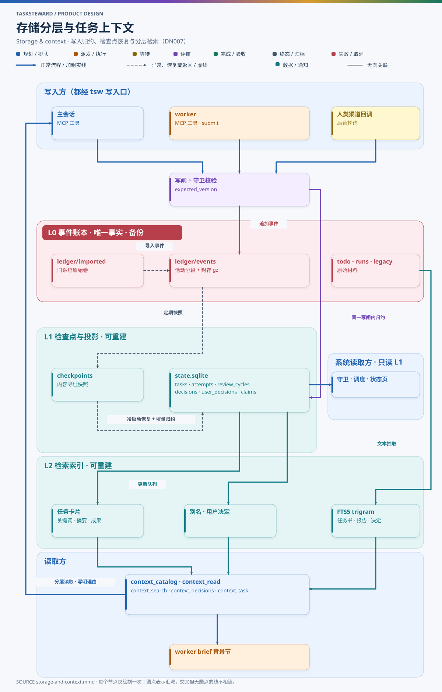

# DN007 账本存储、投影与任务上下文检索

- 状态：设计草案（T233 r4）；L2 第一阶段按 §12 实现（T275）；§6.1 受理与派发时使用长期偏好、§6.2 偏好的管理（T287）；§6.3 任务结束时搜集偏好候选（T288）
- 日期：2026-11-05；2026-11-12 补充 §12
- 相关：[DN001 总体架构](DN001-architecture.md) · [DN002 任务状态机](DN002-task-state-machine.md) · [DN003 统一配置](DN003-unified-config.md) · [DN005 历史导入与 resume](DN005-history-import-and-resume.md) · [DN006 插件层](DN006-plugin-layer.md)

## 1. 要解决的问题

TaskSteward 对历史信息有两类读取需求，性质完全不同：

| 需求 | 读者 | 要求 |
| --- | --- | --- |
| **系统读状态**：守卫判定、调度、名额与资源、状态页、通知 | tsw 核心（程序） | 精确、一致、快；不能每次重放全部历史 |
| **主会话读历史上下文**：规划新任务时找相关任务与依赖、派发时给 worker 准备背景、验收时核对本任务过程、判断时引用依据（DN006 §8） | 主会话与 worker（模型） | 找得准、读得少；在模型的上下文预算内拿到足够依据 |

DN001 §8 只定义了事件格式和“JSONL 账本为唯一事实、SQLite 投影可重建”，DN006 §9 定义了数据目录与存储接口。本文补齐：存储分层、投影结构、读写路径、恢复，以及主会话与 worker 如何检索历史任务信息。

## 2. 三层存储



图源：[diagrams/storage-and-context.mmd](diagrams/storage-and-context.mmd)

| 层 | 位置（`TSW_HOME` 下） | 内容 | 性质 | 是否备份 |
| --- | --- | --- | --- | --- |
| L0 事件账本 | `ledger/events/`、`ledger/imported/` | 全部事件（DN001 §8.2 格式），活动分段 + 封存的 `.jsonl.gz`；导入的旧系统原始卷 | **唯一事实**，只追加，原字节不改 | 是 |
| 原始材料 | `todo/`、`runs/`、`legacy/` | 任务书、brief、报告、评审证据、决定记录、验收记录、导入的旧成果 | 由事件引用（路径 + 内容摘要），只经 tsw 写入 | 是 |
| L1 检查点与投影 | `cache/checkpoints/`、`cache/state.sqlite` | 当前状态的结构化表（§3），供守卫与状态页使用 | 由 L0 归约得到，**可丢弃、可重建** | 否 |
| L2 检索索引 | `cache/context.sqlite` | 任务卡片、关键词与别名、全文索引（§5） | 由 L0 与原始材料生成，**可丢弃、可重建** | 否 |

原则：

- 任何决定只依据 L0（经 L1 的归约结果）；L2 只用于“找”，不能作为守卫或验收的依据。
- L1、L2 丢失或损坏时，用 `tsw ledger rebuild` / `tsw context rebuild` 从 L0 和原始材料完整重建；备份恢复后同样重建（DN006 §9.5）。
- 摘要只覆盖账本 JSON 文本和报告等文本材料，不对可执行文件求哈希。

## 3. L1 投影

### 3.1 表结构

每张表的每一行都记录 `source_seq`（最后一次改变它的事件序号），便于核对新鲜度与审计。

| 表 | 主键 | 主要列 | 供谁使用 |
| --- | --- | --- | --- |
| `tasks` | task_id | title、repo、project_ids、kind、status、revision、definition_hash、lifecycle、last_activity、stale、archived | 守卫、状态页、目录 |
| `dependencies` | (task_id, dep_id) | bound_revision、kind（显式 / 推断）、reason | G-DEP、依赖失效传播 |
| `attempts` | (task_id, attempt) | phase、session_ref、session_adapter、generation、generation_valid、workdir、branch、controller | R-ATTEMPT、对账、G-ONE-ATTEMPT |
| `review_cycles` | (task_id, attempt, cycle) | rounds、base_budget、orchestrator_extension、user_extension、last_reviewed_head、thread_ref | E01 / E04 / E05、G-SUBMIT |
| `findings` | (task_id, attempt, round, finding_id) | cycle、severity、disposition、decision_ref | G-SUBMIT 只读取当前 attempt、当前提交周期的意见 |
| `decisions` | decision_id | task_id、trigger、decision、rationale、basis_refs、confidence | 验收报告、决定摘要、主会话判断 |
| `input_requests` | request_id | task_id、status、context_binding、channels、resolved_by | T11 / T12 |
| `user_decisions` | ref | task_id（可空）、kind、text、scope、verified_source | G-USER、偏好检索（§6）；第一阶段只由 `user.preference_recorded` 写入，其他用户决定由 L2 从事件中抽取（§12.2） |
| `preference_revocations` | ref | reason、verified_source、revoked_at | 偏好的撤销（§6.2），只由 `user.preference_revoked` 写入 |
| `task_summaries` | task_id | keywords、summary、stage、bound_revision、bound_outputs | 卡片的关键词与摘要（§5.1、§12.2） |
| `outputs` / `pull_requests` | (task_id, output_id) | type、form、delivery、ref、verified_at、evidence | G-ACCEPT、目录 |
| `resource_claims` | (resource, owner_task) | status、released_by | G-RES |
| `slots` / `leases` | — | 占用名额的任务、调度租约持有者与机器 | G-SLOT、G-LEASE |
| `lease_stood_down` | session_id | 让出租约的方式（release / takeover）与时间；同一会话再次领取时删除，持有比让出更晚的租约也视为已领回 | 会话开始时不自动领回（DN001 §6.4） |

### 3.2 写路径

写命令（MCP 工具、CLI、渠道回调、后台轮询器）共用两把锁：

- **共享写闸**（DN006 §9.4）：只用于和备份、静止互斥，多个写命令可同时持有；
- **提交锁**：同一数据目录同一时间只有一个写命令进入下面的第 2–6 步。写命令都很短，串行化的代价可以接受，换来 L0 与 L1 的顺序一致。

一次写命令的顺序：

1. 取共享写闸，检查静止标记；
2. 取提交锁；
3. 调用统一归约入口 `reduce_to(ledger_tail)`：在 SQLite 事务（`BEGIN IMMEDIATE`）内读取 `projected_seq`，按序归约 `(projected_seq, ledger_tail]` 的事件，已应用的序号一律跳过，保证每个事件恰好归约一次、且按顺序；
4. 读取 L1 当前行与 `expected_version`，按 DN002 守卫校验；
5. 追加事件到 L0 活动分段（原子写，带前序摘要，`expected_sequence = ledger_tail`）；
6. 再次调用 `reduce_to`，在**同一个 SQLite 事务**中：归约新事件、更新 `projected_seq`，并把需要更新卡片或全文索引的任务写入 `index_queue` 表；
7. 释放提交锁与共享写闸。

故障窗口：第 5 步成功、第 6 步之前中断时，事件已提交、L1 落后。任何后续读写都会先经第 3 步的 `reduce_to` 补齐，`index_queue` 也在同一事务中补齐，不会丢失待索引项。

### 3.3 读路径与新鲜度

- 守卫、调度与状态页只读 L1，不读 L0。
- 每次读之前比较 L1 的 `projected_seq` 与 L0 活动分段末端序号；落后时经提交锁调用同一个 `reduce_to` 补齐（读者不自行归约），超前或链摘要不匹配时拒绝写命令并提示 `tsw ledger audit`。
- 账本中出现当前 tsw 不认识的事件类型（例如数据目录曾被更新版本写入）时，归约在该事件前停止并回滚本次事务，报告 `UNSUPPORTED` 并提示升级：写命令和依赖投影的读取都拒绝，不会跳过未知事件得出错误的状态；`tsw ledger tail` / `audit` 等不依赖投影的命令照常可用。
- 状态页由 L1 渲染；渲染不改变任何业务时间。

### 3.4 检查点与重建

- 每 `ledger.checkpoint_every` 个事件（默认 64）或分段封存时，把 L1 的完整快照写为内容寻址的检查点文件，记录 `projected_seq`、各表行数与快照摘要。
- `cache/state.sqlite` 丢失时，从最近的检查点恢复，再归约其后的事件，不读更早的封存分段。
- 检查点也丢失或校验失败时，`tsw ledger rebuild` 流式读取全部分段（含导入卷的归约结果），重建 L1 并重新生成检查点。
- 归约规则或表结构的版本号写入检查点；版本变化后旧检查点作废，需显式 rebuild。

## 4. 主会话在什么时候需要哪些历史

| 场合 | 需要的历史 | 主要来源 |
| --- | --- | --- |
| 受理新任务（T01–T04） | 是否与已有任务重复；同仓库 / 项目的相关任务与成果；可能的依赖；用户在类似问题上的既有决定 | 目录检索（§5）、用户决定（§6） |
| 派发（T07） | 依赖任务的当前交付与结论；相关历史任务中可复用的成果；适用的用户偏好 | 依赖的卡片与产出、主会话选定的相关任务 |
| 主会话判断（DN006 §8） | 判断依据：任务书原文、用户既有决定、配置策略、其他任务产出 | 用户决定、目录与读取工具 |
| 核验与验收（T17–T18） | 本任务各轮评审、决定记录、此前的主控反馈、PR 与产出 | 本任务历史（`context_task`） |
| resume 导入任务（DN005） | 原任务书、最后 brief、已有报告、PR、待答问题 | 导入事件与 `legacy/` 成果 |

## 5. L2 检索索引

### 5.1 任务卡片

每个任务有一张紧凑的**任务卡片**，是检索返回的基本单位，一般 300–600 字：

```json
{
  "task_id": "T241",
  "title": "[example-app] CSV 导出功能",
  "repo": "example-app",
  "project_ids": ["example-app"],
  "kind": "code",
  "status": "done",
  "lifecycle": "完成·待用户验收",
  "revision": 1,
  "keywords": ["CSV 导出", "流式写出", "大数据量分页", "导出权限", "下载链接过期"],
  "summary": "为报表页增加 CSV 导出：服务端流式写出，支持 10 万行分页，导出链接 24 小时过期；PR 已合并并部署到测试环境。",
  "outcomes": [{"type": "pr", "ref": "https://github.com/example-org/example-app/pull/42", "label": "PR42 · merged"}],
  "dependencies": ["T238"],
  "last_activity": "2026-11-04T13:32:47Z",
  "card_revision": {"task_revision": 1, "output_generation": 2, "stale": false}
}
```

卡片的来源：

- 结构化字段（标题、仓库、状态、依赖、产出）由 tsw 从 L1 直接生成；
- `keywords`（通常 4–8 个具体短语）与 `summary`（一两句话的实际成果）由**主会话在 T18 验收时**写入（`task_summary` 工具，`task.summary_recorded` 事件），依据已读的任务书与交付；任务受理时先写一版基于任务书的关键词，验收时补全成果；
- 没有主会话写入的关键词时：导入任务取 §8 的旧关键词记录，其余任务由 tsw 从标题与任务书生成初版（`keyword_source: generated`，标为 `stale`）；摘要缺失时以任务目标的开头代替并标出（`summary_source: goal`）；
- 卡片绑定任务 revision 与产出 generation（已登记产出的摘要），任一变化都把卡片标为 `stale`，在下次验收或主会话补写时更新。

### 5.2 全文与关键词索引

`cache/context.sqlite` 包含：

| 索引 | 内容 | 用途 |
| --- | --- | --- |
| `cards` | 全部任务卡片（含已归档、已取消、导入的只读任务） | 目录检索 |
| `aliases` | 仓库缩写、项目别名、术语同义词（如 “FE” ↔ `frontend-web`） | 查询扩展 |
| `fts_docs` | FTS5 全文：任务书、报告 md 文本、决定记录、评审摘要、用户决定 | 关键词在卡片里没出现时的补充召回 |

中文分词：FTS5 默认的 `unicode61` 分词器不切分中文。tsw 使用 `trigram` 分词器（本机 Python 自带 SQLite 3.49.1 已验证可用）；trigram 只能匹配不少于 3 个字符的片段，因此少于 3 个字符的查询词（如“评审”）改用 `LIKE` 子串匹配，并只在卡片与别名表上执行以控制开销。

### 5.3 检索工具

| 工具 | 输入 | 输出 | 说明 |
| --- | --- | --- | --- |
| `context_catalog` | 范围（repo / project / global）、查询词、`limit`（默认 8）、`offset` | 卡片列表与 `next_offset` | 排序：点名任务与硬依赖（总在结果中，不受分页影响）> 关键词与别名命中 > 全文命中 > 最近活动；返回结果不足一页不代表没有更多，需看 `next_offset` |
| `context_read` | 任务 ID 列表、部分（spec / report / decisions / reviews / outputs）、`reason` | 指定部分的全文，按 `context.max_chars` 分页 | 必须写理由（审计，也避免过度读取）；只读 L0 引用的原始材料 |
| `context_search` | 查询词、范围 | 全文片段（含出处任务与位置） | 卡片召回不到时使用 |
| `context_decisions` | 主题词（可选）、类型（`kind`：`standing` / `task` / `one_time`）、范围（全局 / 仓库 / 任务；仓库范围可加 `project`）、`limit`、`offset` | 相关用户决定与偏好（§6）与 `next_offset` | 主会话判断时引用依据；不写主题词时列出范围内全部，受理时据此列全长期偏好（§6.1） |
| `context_task` | 任务 ID | 本任务的完整过程：各 attempt、评审轮次、决定、反馈、输入请求 | 核验与验收 |

所有工具只读，不改变任务状态；返回内容都带出处（任务 ID、文件路径、事件序号），主会话据此写决定依据。`context_read`、`context_search` 与全局范围的 `context_catalog` 记 `context.read` 审计事件（§7.1），它不属于任何任务、不改变投影。

写入卡片与偏好的是两个主会话工具（需要调度租约）：`task_summary`（关键词、摘要与阶段 `intake` / `acceptance` / `update`，记 `task.summary_recorded`）与 `preference_record`（§6）。维护：`tsw context rebuild`（终端）与主会话的 `context_rebuild` 工具（DN006 §9.7 的同类维护，记 `maintenance.performed`）。

### 5.4 索引更新与新鲜度

- 写路径第 6 步在归约 L1 的同一事务中把受影响的任务写入 `index_queue`（带触发事件序号）；tsw 在提交锁之外增量处理队列，更新卡片结构字段与全文索引，处理完一项才删除该项。
- L2 记录 `indexed_seq`，只有当所有序号 ≤ 该值的队列项都已处理完时才推进。`index_queue` 丢失或 L2 被删除时，从 `indexed_seq` 之后的事件重新生成队列；L2 整体丢失时 `tsw context rebuild` 全量重建。
- 检索时若 `indexed_seq < projected_seq`，先处理队列；处理不完时结果带“索引落后”标记，并对落后任务退回 L1 的结构化过滤（按仓库、依赖、标题匹配），不会因为索引未更新而漏掉点名任务和硬依赖；落后任务的全文片段在补齐前不可检索，结果中明确标出。
- 关键词与摘要缺失或 `stale` 的卡片照常参与检索并标注，不能因为零命中而被排除。

## 6. 用户决定与偏好

主会话自主判断（DN006 §8.2）最重要的依据是用户既有的决定。tsw 把它们单独积累在 `user_decisions` 表中，每条都带 `VerifiedSource`（用户原话、消息引用、核实的身份），并区分三种类型：

| 类型 | 例子 | 适用范围 | 能否被引用为后续判断依据 |
| --- | --- | --- | --- |
| 一次性授权 `one_time` | “这次可以直接发送这封邮件” | 绑定具体对象（任务、revision、动作对象），用过或对象变化即失效 | 只用于该对象，不能推广到其他任务 |
| 任务决定 `task` | 对某个任务的答复、验收、退回、对主会话决定的推翻 | 该任务（及其当前 revision） | 只在该任务内引用；其他任务需要时作为“类似先例”参考，不能直接当授权 |
| 长期偏好 `standing` | “以后邮件一律只存草稿”“PR 默认 ready-for-review”“画 workflow 等图时用 diagram skill” | 用户本人，默认全局；只有用户的习惯本身只限于某个仓库 / 项目时才是该仓库 / 项目 | 可以在范围内引用 |

**什么是长期偏好**（用户 2026-11-16 澄清，T288）：偏好属于用户本人（per user），不属于某个项目（per project）：它是用户个人希望 agent 以后怎样替自己做事的方式，例如怎样写邮件、画图用什么、PR 用什么状态。以下都不是偏好，不记录为偏好：

| 不是偏好的 | 应当记在哪里 | 例子 |
| --- | --- | --- |
| 某个项目的设计、技术、环境决定 | 由任务写进该仓库的决定记录（如 `docs/decisions/`）或设计文档 | 另一个项目仓库中的两项决定记录（部署与环境方面，曾误记为 P-2、P-3，2026-11-16 撤销） |
| 产品（包括 tsw 自己）的行为与流程 | 产品自身的 skill、说明或代码 | “主会话可以自我更新”已由 `orchestrate` 与 `tsw-update` skill 规定（曾误记为 P-1，2026-11-16 撤销） |
| 对某个具体任务的要求 | 该任务的目标与验收（`task_update` / 需求变更） | “这个任务的报告用英文写” |

范围（`scope`）描述的是用户习惯本身的适用面：默认 `global`；只有用户的话表明这个习惯只在某个仓库或项目中才这样做（例如“在某某仓库里我习惯先发 draft PR”）时，才用 `repo:<仓库>` / `project:<项目>`。不能因为话是在某个仓库的任务里说的，就把它记为该仓库的偏好。

规则：

- **覆盖必须同类型、同范围且显式**：新的长期偏好只有在类型相同、范围相同或更窄，并由用户明确表示替代旧偏好时，才记录 `supersedes` 关系覆盖旧的；一次性授权与任务决定永远不覆盖长期偏好。更窄范围的偏好只在该范围内优先。
- 同一主题、同一范围存在没有替代关系的冲突偏好时，主会话不能自行取舍，交给人类（DN006 §8）。
- 长期偏好只能来自用户明确说出的、关于自己做事方式的长期意图，由主会话用 `preference_record` 记录 `user.preference_recorded`，附用户原话的 `VerifiedSource`（决定对象 `["preference", <范围>, "standing"]`）；主会话不能凭推测或归纳写入偏好。任务中用户说过的长期意图，在任务结束时由子代理搜集为候选、经用户确认后记录（§6.3）。
- `context_decisions` 按主题词、类型与范围检索，返回时标出类型、范围、是否已被替代。

**导入的旧约定**：orchestrator-agent 的 `AGENTS.md` 中带日期的用户约定在导入时记为**候选约定**（`user.preference_candidate`），保存原文件的 Git 提交 SHA、原文与原文中写明的适用范围，不推断为全局。候选约定可以被检索，但在被核实前**不能作为主会话自主判断的依据**；主会话遇到依赖候选约定的判断时交给人类。导入完成后，tsw 把全部候选约定整理成一份清单交用户核对，用户逐条或批量确认（带 `VerifiedSource`，经 `preference_record` 的 `candidate` 记录，§6.3）后才转为长期偏好；已经由统一配置 `policies` 表达的约定（如邮件只存草稿、不做可执行文件哈希）以配置为准，不再重复登记。

### 6.1 受理与派发时使用长期偏好（T287）

用户 2026-11-15 的要求：个人的做事规则记成长期偏好，受理时检查并把相关的写进任务书；偏好的更新不需要更新 tsw，下一个任务即可用，与 tsw 的更新分开。只按主题词检索会漏：主会话事先不知道该搜什么词，偏好的措辞也不一定与任务的用词重合（T285 的画图规则即是一例）。

- **偏好是数据**：长期偏好只存在账本中（`user.preference_recorded`，投影为 `user_decisions`）。检索工具与任务书生成每次都从投影读取；skill、worker 说明与 tsw 代码只写怎样取得和使用偏好，不写具体的偏好。记录或替代一条偏好后，下一次受理、派发或重新生成任务书立即使用新的状态，不需要更新 tsw、`tsw host render` 或重启会话；tsw 的更新（代码与 skill）只改变取得与使用偏好的方式。
- **列全，而不是搜索**：`context_decisions` 支持按类型过滤（`kind`，即上面规则中的“类型”）。受理时主会话不写主题词，用 `kind: standing`、`scope: repo`、`repo: <仓库>`（属于项目的任务再给 `project`）列出所有能到达本任务的长期偏好（全局、该仓库、该项目），按 `next_offset` 翻完。偏好变多以后仍以分页列全为准；主题词只用于列全之后查看某个主题的其他用户决定。
- **主会话逐条判断**：只有 `usable_as_basis` 为 `in_scope` 的偏好参与判断。对每一条，看任务要做的事是否落在偏好的主题内（例如任务会产出面向用户的图、会发邮件、会开 PR）。适用的写进目标“背景”一节的“适用的用户偏好”：每条写编号、范围与原文（如“P-4（global）：……”）；没有适用的写“无”，表明已经检查过。不适用的不写；只有可能被误以为适用的（同主题、但本任务不涉及该动作或被更窄范围的偏好覆盖）才附一句理由。
- **派发前再列一次，补充进读取集合**：受理到派发之间可能新记录、替代或撤销了偏好。派发（与 `attempt_continue` 续用）前主会话按同样的方式再列一次；有目标中没写的适用偏好时，把它的编号放进 `task_dispatch` / `attempt_continue` 的 `read_set`（推荐读取集合本来就包括用户决定条目，§7.2）。tsw 校验编号存在、现行且能到达本任务的仓库（项目范围的视为能到达），否则拒绝；任务书开头写一行“派发时补充的适用偏好”，列出编号、范围与原文（原文照录；偏好行放在带长度的标记之间，供续用时比较）。同一 attempt 再次派发时保留此前补充的编号，只校验新增的，已撤销的由核对行写明。续用时，补充了偏好或已引用的偏好状态有变化（被替代、覆盖或撤销）就立即重写该会话的任务书（revision 不变，只在偏好相关的行变化时重写；所有可能拒绝的检查都在写文件之前），主会话告诉会话重读。目标不改写：`task_update` 需要用户对修改这个任务的原话，偏好记录时的原话不是这种来源（T287 自评审 r1 F1，用户 2026-11-15 选定此做法）。
- **tsw 核对引用的编号**：tsw 每次生成任务书（派发、需求变更、续用时补充偏好）时，从投影读取目标中出现的与读取集合中补充的 `P-<n>` 的当前状态。有编号已被替代、在本任务的仓库内被更窄范围的偏好覆盖、范围到不了本任务、已撤销（§6.2）或不存在时，在任务书开头的列表中加一行“偏好核对”，写明问题与现在有效的偏好（编号、范围与原文）。worker 以现在有效的偏好为准，有疑问时用 `context_decisions` 查或问用户。核对只读投影，不写事件，不改写目标。项目范围的偏好在 L1 中无法核对任务属于哪个项目，目标引用了它即视为适用，只核对替代与覆盖。
- **取舍**：
  - tsw 不自动把范围内的全部偏好写进任务书：是否适用要理解任务内容，tsw 无法判断；全局偏好会出现在每一份任务书中，数量增长后成为噪声，worker 分不清哪些真正约束本任务。适用的判断留给主会话，结果（包括“无”）留在目标中以便核对与验收。
  - 受理时选定的偏好写在目标正文中（`task.registered` / `task.requirement_changed` 事件已记下编号与原文），不另记；只有受理之后才出现的适用偏好经 `read_set` 补充（记在 `task.dispatch_started` / `attempt.continued` 的 `read_set` 中），不另加字段。最初的设计不在派发时记录任何编号，自评审发现那样新偏好无法合法写回目标后改为现在的做法（用户确认）。
  - 不由 tsw 改写目标中过时的偏好：目标是主会话按用户来源写下的记录；目标引用的偏好被替代或撤销时，任务书的核对行写出现在有效的偏好，主会话把现在有效的编号补充进 `read_set`，用户下次修改该任务时再一并写回目标。
  - 任务结束时搜集与记录新的偏好是另一件事，见 §6.3（T288）。

### 6.2 偏好的管理（T287）

用户 2026-11-15 确认 §6.1 时追加：偏好要能被管理，增删改查都要有接口；将来在 Dashboard 中管理（另登记任务，F-T287-1）。账本只追加，修改与删除都以新的事件表达，历史保留。

| 操作 | MCP（主会话，需要调度租约） | CLI（用户本人，在会话外的终端） | Dashboard 应用（用户本人，T290） | 事件 |
| --- | --- | --- | --- | --- |
| 查询 | `context_decisions`（`kind: standing`；worker 也可用） | `tsw preference list [--repo <仓库>] [--project <项目>] [--all]` | 「长期偏好」页（`preferences`） | 无（只读投影） |
| 创建 | `preference_record` | `tsw preference record --scope <范围> --topic <主题> --text <原文>` | 「记录新偏好」 | `user.preference_recorded` |
| 修改 | `preference_record` 带 `supersedes`（同范围或更窄） | `tsw preference record … --supersedes <P-n>` | 条目的「替代」 | `user.preference_recorded` |
| 删除 | `preference_revoke` | `tsw preference revoke <P-n> --reason <理由>` | 条目的「撤销」 | `user.preference_revoked` |

- **修改就是替代**：新偏好得到新编号，旧的标 `superseded_by`（更窄范围的标 `overridden_by`，§12.2），两条都可查；不提供原地改写，任务书与报告中引用的旧编号仍能查到当时的原文。
- **删除就是撤销**：`user.preference_revoked` 记录编号、理由与用户来源（MCP 的 `user_source` 决定对象为 `["preference", <编号>, "revoke"]`）。只能撤销现行的偏好（未被同范围替代、未撤销）。撤销后它仍可查询，`usable_as_basis` 为 false 并带 `revoked`（时间与理由）；它对更宽范围偏好的覆盖随之解除（更宽的在该范围内重新有效）；不能再被替代；任务书核对（§6.1）把目标中引用它的写成“已撤销”。被它替代的旧偏好不会恢复，需要时由用户重新记录。
- **CLI 是用户本人的操作**：`record` 与 `revoke` 和 `tsw task accept` 一样只在会话外的终端运行，以 `user` 调用者执行同一个工具，来源由 tsw 记录（渠道 `user-cli`，`text` 为偏好原文或撤销理由，DN006 §8.10），先显示内容并要求确认（`--yes` 跳过）；会话不能借它代用户说话。`list` 只读，默认列出现行的偏好（`--all` 包括已替代、被覆盖与已撤销的），给了 `--repo` / `--project` 时只列能到达该范围的；会话中不在命令行运行它（会话只能运行 DN001 §7.1 列出的命令），用 `context_decisions`。
- **Dashboard 也是用户本人的操作**（用户 2026-11-15 要求，T290）：Dashboard 应用的「长期偏好」页按范围与主题列出全部长期偏好（原文、来源、替代关系与撤销状态），页面上的记录、替代、撤销以 `user` 调用者运行同一组工具，来源渠道为 `status-app`（`text` 为用户在页面上填写的原文或撤销理由），先弹出确认框；页面与接口见 DN006 §8.10“长期偏好页”。
- **用户来源**：主会话的 `preference_record` / `preference_revoke` 只按用户在会话中明确说出的长期意图或撤销要求调用（附原话）；不能凭推测撤销或改写偏好。用户说的是项目决定、产品行为或任务要求时（§6 的表），不记为偏好，告诉用户应当记在哪里。
- **范围**：记录时默认 `global`；`repo:` / `project:` 只用于用户的习惯本身只限于该仓库或项目的情况（§6）。
- 投影：撤销写入新表 `preference_revocations`（编号、理由、来源、时间、事件序号），不改变 `user_decisions` 的结构，已有投影仍然有效，不需要 `tsw ledger rebuild`。

### 6.3 任务结束时搜集偏好候选（T288）

用户 2026-11-15 的要求：“每个task结束的时候跑一个subagent尝试搜集记录偏好”。此前用户在任务中说过的长期意图只靠 worker 写进报告的“决定与约定”、主会话验收时记得转记：主会话没有记、或 worker 没写到报告里，偏好就丢了（T285 漏掉的画图规则即是一例，用户是在主会话中说的，只出现在 T287 / T288 目标的“用户原话”中）。§6 的规则不变：偏好只能来自用户明确说出的长期意图，未经用户确认不记为偏好。本节只补上“找出来、交给用户确认”的环节。

**时机与执行者**：

| 时机 | 谁启动子代理 | 说明 |
| --- | --- | --- |
| worker 提交前（自评审定稿、报告草稿写好之后，`submit` 之前） | worker | 主要的一次：此时本任务从受理到交付的用户原话都已在账本中；worker 并行执行，不占主会话的时间与上下文 |
| 主会话技术验收时，本 revision 没有搜集或搜集之后又有新的用户原话（`preference_scan` 为 `missing` / `stale`） | 主会话 | 补做：worker 漏做、提交后用户又在 worker 会话中说了话、或任务没有经过 worker 提交就要验收 |

子代理是宿主提供的、独立上下文的只读代理（Claude Code 的做法见 [CC007](claude-code/CC007-context.md)）：它只读材料、返回候选，不调用任何写工具；记录候选的是启动它的会话。用子代理而不是会话自己判断：读完全部原话不占用 worker 或主会话的上下文，结论也不受会话自己对任务的理解影响。

**材料**（`preference_sources`，只读，按本任务从账本取，事件序号升序）：

| 编号 | 来源 | 是否核实 |
| --- | --- | --- |
| `M-<n>` | hook 记录的、用户在 worker 会话中输入的消息（`input.session_message`） | 是（宿主记录的原话） |
| `E<序号>` | 本任务事件中带 `VerifiedSource` 的用户原话：答复、需求变更、用户验收与退回、follow-up 的用户处置、保留 stale 成果等 | 是 |
| `goal@r<revision>` | 当前 revision 的目标（主会话写的，开头是主会话转录的“用户原话”） | 否（主会话的转录） |

宿主注入的消息（其他会话、子代理交回的结果等）即使在 hook 认识它之前被记了下来，也不是材料；任务改号之前旧编号的事件归改号后的任务（与 L2 索引相同）。worker 只能取本任务的材料。同时附上：能到达本任务仓库与项目（任务卡片的 `project_ids`）的现行长期偏好（编号、范围、主题、原文）、本任务已有的候选与能到达本仓库的未决候选，以及报告草稿的路径（只作线索：报告是 worker 的转述，不能作为原话来源）。材料总长有上限，超出时保留最新的部分并标明截断。

**子代理的判断**（说明文字只有一份来源，随 `preference_sources` 的结果给出）：

- 候选必须同时满足两条：(1) 是用户本人的话，明确表达以后也适用的意图（“以后……”“一律……”“每次……都……”“长期偏好：……”“记住……”），或用户明确要求记住的做法；(2) 内容是用户个人希望 agent 怎样替自己做事的方式（§6“什么是长期偏好”）。只对本任务的决定、一次性授权、验收与退回、worker 或主会话的话、从用户行为归纳出的习惯都不是候选；项目的设计、技术、环境决定，产品（包括 tsw）自身的行为与流程，对某个具体任务的要求，即使用户说了“以后”“长期”，也不是候选。判断时自问：换一个仓库、换一个项目，用户还希望 agent 这样做吗？答案是“这只是这个项目 / 产品 / 任务的事”就不提。反例写在说明中：“主会话可以自我更新”（tsw 自身的流程，已由 skill 规定）、另一个项目仓库中的两项决定记录（项目决定）。
- 每个候选给出：`quote`（从一条材料中原样摘取的连续一段，不拼接、不改写）、`source_ref`（材料编号）、建议的 `scope`（默认 global；只有原话表明这个习惯只在某个仓库或项目中才这样做时，才用 `repo:<仓库>` / `project:<项目>`，不因为话是在该仓库的任务中说的就限定范围）与 `topic`（几个字的主题），一句 `reason`（为什么是以后都适用的）。
- 与现行偏好意思相同的不提（写进 `skipped` 并给出编号）；与现行偏好冲突或改变它的，提出候选并在 `supersedes` 中建议被替代的编号（须同范围或更窄，§6），`reason` 写明冲突之处；同一原话已是候选的不再提。
- 看过但不提的写进 `skipped`，每项写来源编号、类别（`same_as`：与现行偏好相同；`project_decision`：项目决定；`product_behavior`：产品行为；`task_requirement`：任务要求；`not_standing`：只对本任务或不是用户的话）与一句理由。启动它的会话看到 `project_decision` 时，核对该决定已经写进仓库的决定记录或设计文档；没有时按仓库规则在本任务内补上，或记 follow-up。
- 不确定时宁可不提；每次至多 5 条。没有候选时返回空列表。

**记录候选**（`preference_candidates_record`，worker 只对自己持有的任务；主会话对未归档的任务）：一次调用记录一次搜集，`candidates` 可以为空。tsw 校验：每条的 `source_ref` 是本任务的材料、`quote` 在忽略空白（空格与换行）后原样出现在该材料中；`scope` 合法；`supersedes` 中的编号存在、现行且范围相容；与未决候选（按建议的范围）或现行偏好（按用户记录的原文与范围；已确认的候选以它成为的偏好为准）原话相同（同样忽略空白）且范围相同或已有的是全局的，跳过并在结果中列出（同样的话在另一个仓库的范围里、或要从仓库扩大到全局，仍是新的候选）；读取材料之后任务改了目标或 revision 的（`scanned_through` 早于当前目标），拒绝（`stale_scan`），重新取材料再搜集。事件：每条候选一个 `user.preference_candidate`（编号 `PC-<n>`、任务、revision、原话、来源编号与是否核实、建议的范围、主题、理由与替代建议），以及一条 `task.preference_scanned`（attempt、搜集到的材料序号 `scanned_through`、本次的候选与跳过）。候选不是偏好：不进入 `user_decisions`，`usable_as_basis` 为 false，任务书核对与受理时的偏好列表都不包括它。

**搜集状态与查询**：候选可以用 `context_decisions` 的 `kind: candidate` 查询（按仓库查询时按候选建议的范围匹配，按任务查询时列出该任务提出的；`usable_as_basis` 为 false，带状态：未决、已记录为哪条偏好、已拒绝）。`task_read` 的 `preference_scan` 给出 `done`（本 revision 搜集过，之后没有新的材料）、`stale`（之后又有新的用户原话：hook 记录的消息，或任何事件中带核实来源的原话）或 `missing`（本 revision 没有搜集），以及本任务的候选。worker 的报告在“决定与约定”中引用候选编号（`PC-…`），不再自己判断哪些要记为偏好。

**交给用户确认**：只有用户本人能把候选变成偏好。

- 主会话技术验收时（需要补做的搜集在 `task_accept` 之前完成；`task_accept` 之后与 follow-up 一起），把本任务未决的候选逐条交给用户：编号、原话、来源编号、建议的范围与主题，有替代建议的写明被替代偏好的原文。`attention` 的 `preference_candidates` 列出所有未决的候选，用户没有答复的留在那里，下次再问；不设期限，不自动过期。
- 用户确认：`preference_record` 带 `candidate`。`text` 缺省为候选原话；用户确认时改了说法的，`text` 必须原样出现在用户这次确认的原话（`user_source.text`）中。范围与主题可以按用户的意思改；替代按用户的确认在 `supersedes` 中给出（候选的替代建议不自动生效）。事件仍是 `user.preference_recorded`，多一个 `candidate` 字段，候选随之标为已记录并指向新的偏好编号。用户来源照旧是用户在主会话中的原话，决定对象 `["preference", <范围>, "standing"]`。
- 用户拒绝：`preference_candidate_dismiss`，附用户原话（决定对象 `["preference", <候选编号>, "dismiss"]`）与理由，事件 `user.preference_candidate_dismissed`。
- 用户也可以在终端自己处理：`tsw preference list --candidates`、`tsw preference record --candidate <PC-n>`、`tsw preference dismiss <PC-n> --reason <理由>`（与 §6.2 的命令同样只在会话外运行，渠道 `user-cli`）。
- 重复与冲突：确认时候选原话与某条现行偏好相同，或用户说“已经有了”，就拒绝该候选（理由写明已有的编号）；与现行偏好冲突而用户没有说替代哪一条时，按 §6 交给用户取舍：问清楚是替代、只在更窄范围生效还是不记。

**取舍**：

- 不在 tsw 中自动判断“以后都适用”：这需要理解措辞与上下文，由子代理判断，tsw 只核对原话确实来自本任务的材料、不重复。
- 不让 worker 直接问用户确认：确认集中在主会话的验收环节，与 follow-up 的处置放在一起，用户一次看到一个任务的全部后续事项；worker 在提交后可能已经结束。
- 搜集不是提交的门槛：没有搜集也能 `submit`，主会话验收时按 `preference_scan` 补做。这样不改变 `submit` 已有的契约，也覆盖了提交之后才出现的原话。
- 主会话中用户直接说出的长期偏好仍按 §6.2 当场记录，不经候选。
- 原计划导入旧约定时用的 `user.preference_confirmed` 不再单独定义：导入的候选约定（§12.3）也记为 `user.preference_candidate`（来源为旧文件），确认同样经 `preference_record` 的 `candidate`。
- 投影：候选与搜集写入新表 `preference_candidates`、`preference_scans`，不改变已有表，已有投影仍然有效，不需要 `tsw ledger rebuild`。

## 7. 主会话与 worker 的读取方式

### 7.1 主会话：分层读取

主会话的 skill 规定以下顺序，避免一次读入大量历史：

1. 先完整理解当前请求与任务书；
2. 用 `context_catalog` 在同仓库 / 项目范围检索（点名任务与硬依赖自动包含），浏览卡片；
3. 只对入围任务用 `context_read` 展开需要的部分，写明理由；
4. 有具体缺口时再扩大范围（`global` 或 `context_search`），而不是一开始就全量读取；
5. 判断与验收时，决定的依据引用卡片或原文出处。

每次 `context_read` 与扩大检索都记入事件（`context.read`，含理由与读取量），便于事后看到主会话依据了哪些历史。

### 7.2 worker：由 brief 提供，可读全部

- 派发时，tsw 在 brief 中生成“背景”一节：依赖任务的卡片与产出链接、主会话选定的相关历史任务（附选择理由）、适用的用户决定与偏好。适用的长期偏好由主会话判断后写进目标，tsw 只核对目标中引用的偏好编号（§6.1）。
- brief 同时列出该 attempt 的**推荐读取集合**：本任务、其依赖、brief 中列出的相关任务与用户决定条目。集合随 brief revision 变化，记入 `task.dispatch_started` / `attempt.continued` 事件。它是 worker 读取的起点，不是限制：读取其他任务不会写错状态（用户 2026-11-08 决定放宽，DN008 §12）。
- 各检索工具对两种角色的范围：

| 工具 | 主会话 | worker |
| --- | --- | --- |
| `context_catalog` | 任意范围 | 任意范围；推荐读取集合内的卡片排在前面 |
| `context_read` | 任意任务 | 任意任务（只读） |
| `context_search` | 任意范围 | 任意范围 |
| `context_decisions` | 任意范围 | 任意范围；brief 列出的条目与本任务的决定排在前面 |
| `context_task` | 任意任务 | 任意任务（只读） |

- worker 只能读取其他任务，不能操作它们：写工具仍只限本任务（DN008、CC008 §5.3）。

## 8. 导入的历史如何进入索引

- 每个导入任务生成卡片：标题、仓库、状态等来自导入事件；关键词优先取 orchestrator-agent 的 `metadata/task-keywords/records`（当前 387 条记录，含关键词、项目与已核对的产出引用）。导入时把这些记录原样复制到 `legacy/orchestrator-agent/metadata/`，并在 `import.task_imported` 事件中写入实际采用的关键词、项目映射、记录文件路径与旧仓库提交 SHA；之后重建 L2 只读 `TSW_HOME` 内的数据，不再访问旧仓库。没有记录的任务用标题与任务书生成初版并标为 `stale`。
- `legacy/` 下的报告抽取文本（HTML 去标签）进入全文索引；引用在数据目录内解析（DN005）。
- 只读任务的卡片与原文可以被检索和引用，但不能 resume（DN002 §3.4）。

## 9. 配置

```json
{
  "ledger": {"segment_max_mb": 16, "checkpoint_every": 64},
  "context": {
    "catalog_page_size": 8,
    "max_chars": 20000,
    "fts_tokenizer": "trigram",
    "short_query_fallback": "like_cards_only",
    "require_read_reason": true
  }
}
```

## 10. 与 orchestrator-agent 的对应

| 方面 | orchestrator-agent | TaskSteward |
| --- | --- | --- |
| 事实来源 | `runtime/events.jsonl` + 压缩卷 | L0 事件分段（相同思路，新格式），旧卷原字节导入 |
| 当前状态 | `runtime/state.json` 与 `.local/current/` 投影、检查点 | L1 SQLite 投影 + 内容寻址检查点 |
| 相关性检索 | `context catalog` → `context read --reason`，关键词 metadata 独立维护 | 相同的分层读取，卡片与关键词由验收时写入，增加 FTS 与用户决定检索 |
| 用户约定 | 写在 `AGENTS.md` 的长文本中，每次会话常驻 | 结构化的用户决定与偏好，按需检索、带来源、可覆盖 |

## 11. 待验证假设

| 编号 | 假设 | 不成立时 |
| --- | --- | --- |
| C1 | 运行环境的 Python 自带 SQLite 支持 FTS5 与 `trigram` 分词器（本机 3.49.1 已验证） | 退化为卡片与别名上的子串匹配，全文检索不可用 |
| C2 | 卡片 + 分层读取足以让主会话在上下文预算内找到相关任务（以当前约 230 个历史任务做 A/B：给定已知相关任务，检查召回率与读取量） | 增加关键词覆盖或引入向量检索插件（后续设计） |
| C3 | 在目标规模（数千任务、数十万事件）下，冷启动从检查点恢复与增量归约在秒级完成 | 调整检查点间隔与分段大小 |

## 12. 实现差距与分阶段交付（T275，2026-11-12）

### 12.1 核对结果

T275 开始时 §4–§8 的检索部分都没有实现：

| 设计 | 当时的实现 |
| --- | --- |
| L1 `index_queue`（§3.2 第 6 步） | 表存在，归约时每个带任务的事件都写入一行，但没有消费者，只增不减 |
| L1 `user_decisions`、`project_ids` | 没有；用户决定分散在 `input_requests`、`follow_ups` 的 resolution 与各事件的 `source` 中 |
| 事件 `task.summary_recorded` `context.read` `user.preference_*`（DN002 §7） | 没有定义，也没有归约规则 |
| L2 `cache/context.sqlite`、`tsw context rebuild` | 没有 |
| `context_*` 工具（DN001 §7.2） | 没有；配置 `context.*` 已有校验但无人使用 |
| 导入任务的关键词（§8） | 旧记录已复制到 `legacy/orchestrator-agent/metadata/task-keywords/`（`index.json` 指向 230 个任务的当前记录，`records/` 共 387 个文件含历史版本），但 `import.task_imported` 事件没有写入采用的关键词 |
| brief 的“背景”一节（§7.2） | 没有；推荐读取集合只有本任务与依赖 |
| 导入的候选约定（§6） | 没有；旧系统的 `AGENTS.md` 不在数据目录中，现有数据无法生成候选 |

### 12.2 第一阶段（T275）

- **事件**：新增 `task.summary_recorded`（主会话，绑定当时的 revision 与产出摘要）、`context.read`（审计：读者、任务、部分、理由、读取字符数，不属于任何任务）、`user.preference_recorded`。三者只写入新表 `task_summaries`、`user_decisions`（或不写表），已有投影仍然有效，不提升 `REDUCER_VERSION`、不需要 `tsw ledger rebuild`。
- **L2 的数据来源**：索引器按序读取 L0 中 `indexed_seq` 之后的事件，得到受影响的任务与用户决定，再从 L1 与原始材料重新生成这些任务的卡片和全文条目，最后推进 `indexed_seq`（同时记下该序号的事件摘要），并删除 L1 `index_queue` 中不超过它的行。L2 的版本、所记摘要与账本不一致或文件损坏时自动全量重建（L2 只是缓存，不需要像 L1 一样显式 rebuild）。索引更新在提交锁之外进行（只在读取 L1 快照时短暂持有），多个读者用独立的 `context` 锁串行化。
- **历史上的用户决定**：任务答复（`input.resolved`）、用户验收与退回、需求变更、follow-up 的用户处置、配置授权等事件中带 `VerifiedSource` 的部分，由 L2 抽取为可检索的用户决定（`task` 或 `one_time` 类型，绑定任务与 revision），不写入 L1。只有 `user.preference_recorded` 是长期偏好。同范围的新偏好替代旧偏好（`superseded_by`）；更窄范围的只在其范围内优先：按仓库或任务查询时旧偏好标 `overridden_by` 且不可作为依据，范围外照常有效，全局查询时标出 `overridden_in`。项目范围的偏好只在任务的 `project_ids`（或仓库名）包含该项目时适用。改号（`task.renumbered`）之前的时间线与用户决定归入新编号，之后占用旧编号的任务不继承它们。
- **卡片关键词**：主会话写入 > 导入任务的旧记录（按 `legacy/.../task-keywords/index.json`）> 生成初版（标签、反引号中的标识符、英文标识符与标题短语，标为 `stale`）。生成初版和读取旧记录都在重建时完成，不写事件：现有任务的“回填”就是一次 `tsw context rebuild`；主会话之后对需要的任务用 `task_summary` 补写。
- **别名**：配置 `repositories.<名>.aliases`、标题中方括号标签与仓库的对应（如 `[tsw]` ↔ `task-steward`，同一标签多数任务指向同一仓库时采用）。旧记录的 `project_ids` 不作别名（项目与仓库并非一一对应，扩展会把整个仓库带进结果），项目范围按卡片的 `project_ids`（没有时取仓库名）匹配。
- **检索**：查询词按空白与标点切分并经别名扩展；不少于 3 个字符的词查 FTS5 trigram 全文，少于 3 个字符的词只在卡片与别名上做子串匹配。卡片按点名任务与硬依赖（单列在 `pinned`）> 主会话写入或旧记录的关键词命中 > 标题、仓库与标签命中 > 摘要与生成关键词命中 > 全文命中 > 最近活动排序（生成的关键词大多重复标题，只与摘要同权）；查询中的任务 ID 视为点名。索引落后且当场补不齐时，落后任务按 L1 的标题与仓库过滤参与结果并标注 `index_lag`。
- **工具与角色**：§5.3 的五个只读工具对主会话与 worker 都开放（§7.2 的表）；worker 的推荐读取集合与本任务排在前面，不给范围时 worker 缺省在本任务的仓库内检索、主会话缺省为 global。`task_summary`、`preference_record`、`context_rebuild` 只给主会话。`task_read` 对 worker 的读取集合限制不在本阶段改变。
- **skill**：主会话受理新任务时先用 `context_catalog` 在同仓库 / 项目范围查重复、相关任务、可能的依赖，用 `context_decisions` 查用户既有决定，需要时 `context_read`，有缺口再扩大范围；受理时写初版关键词，技术验收时 `task_summary` 补全。worker 说明增加检索工具的用法。

### 12.3 第二阶段（后续任务）

- 导入候选约定：重新从旧系统取得 `AGENTS.md`，生成 `user.preference_candidate`，交用户核对后经 `preference_record` 的 `candidate` 记录（§6.3，不再另设 `user.preference_confirmed`）；第一阶段的 `context_decisions` 已为每条结果给出 `usable_as_basis`，候选约定接入后为 `false`。
- brief 的“背景”一节：派发时由卡片、主会话选定的相关任务与适用的用户决定生成，并扩充推荐读取集合（§7.2）。其中长期偏好按 §6.1 由主会话写进目标（T287），这里不再由 tsw 生成。
- `task_read` 的 worker 读取范围与 DN001 §7.2 对齐。
- 术语同义词表（配置或主会话维护）、按 C2 的结果决定是否引入向量检索插件（§11）。

