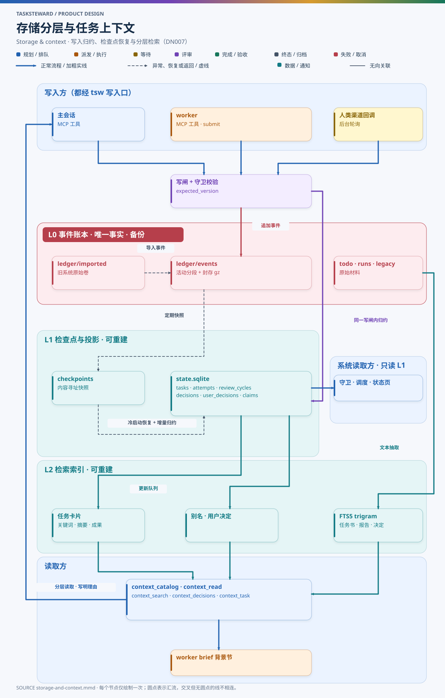

# DN007 账本存储、投影与任务上下文检索

- 状态：设计草案（T233 r4）
- 日期：2026-11-05
- 相关：[DN001 总体架构](DN001-architecture.md) · [DN002 任务状态机](DN002-task-state-machine.md) · [DN003 统一配置](DN003-unified-config.md) · [DN005 历史导入与 resume](DN005-history-import-and-resume.md) · [DN006 插件层](DN006-plugin-layer.md)

## 1. 要解决的问题

TaskSteward 对历史信息有两类读取需求，性质完全不同：

| 需求 | 读者 | 要求 |
| --- | --- | --- |
| **系统读状态**：守卫判定、调度、名额与资源、状态页、通知 | tsw 核心（程序） | 精确、一致、快；不能每次重放全部历史 |
| **主会话读历史上下文**：规划新任务时找相关任务与依赖、派发时给 worker 准备背景、验收时核对本任务过程、判断时引用依据（DN006 §8） | 主会话与 worker（模型） | 找得准、读得少；在模型的上下文预算内拿到足够依据 |

DN001 §8 只定义了事件格式和“JSONL 账本为唯一事实、SQLite 投影可重建”，DN006 §9 定义了数据目录与存储接口。本文补齐：存储分层、投影结构、读写路径、恢复，以及主会话与 worker 如何检索历史任务信息。

## 2. 三层存储



图源：[diagrams/storage-and-context.mmd](diagrams/storage-and-context.mmd)

| 层 | 位置（`TSW_HOME` 下） | 内容 | 性质 | 是否备份 |
| --- | --- | --- | --- | --- |
| L0 事件账本 | `ledger/events/`、`ledger/imported/` | 全部事件（DN001 §8.2 格式），活动分段 + 封存的 `.jsonl.gz`；导入的旧系统原始卷 | **唯一事实**，只追加，原字节不改 | 是 |
| 原始材料 | `todo/`、`runs/`、`legacy/` | 任务书、brief、报告、评审证据、决定记录、验收记录、导入的旧成果 | 由事件引用（路径 + 内容摘要），只经 tsw 写入 | 是 |
| L1 检查点与投影 | `cache/checkpoints/`、`cache/state.sqlite` | 当前状态的结构化表（§3），供守卫与状态页使用 | 由 L0 归约得到，**可丢弃、可重建** | 否 |
| L2 检索索引 | `cache/context.sqlite` | 任务卡片、关键词与别名、全文索引（§5） | 由 L0 与原始材料生成，**可丢弃、可重建** | 否 |

原则：

- 任何决定只依据 L0（经 L1 的归约结果）；L2 只用于“找”，不能作为守卫或验收的依据。
- L1、L2 丢失或损坏时，用 `tsw ledger rebuild` / `tsw context rebuild` 从 L0 和原始材料完整重建；备份恢复后同样重建（DN006 §9.5）。
- 摘要只覆盖账本 JSON 文本和报告等文本材料，不对可执行文件求哈希。

## 3. L1 投影

### 3.1 表结构

每张表的每一行都记录 `source_seq`（最后一次改变它的事件序号），便于核对新鲜度与审计。

| 表 | 主键 | 主要列 | 供谁使用 |
| --- | --- | --- | --- |
| `tasks` | task_id | title、repo、project_ids、kind、status、revision、definition_hash、lifecycle、last_activity、stale、archived | 守卫、状态页、目录 |
| `dependencies` | (task_id, dep_id) | bound_revision、kind（显式 / 推断）、reason | G-DEP、依赖失效传播 |
| `attempts` | (task_id, attempt) | phase、session_ref、session_adapter、generation、generation_valid、workdir、branch、controller | R-ATTEMPT、对账、G-ONE-ATTEMPT |
| `review_cycles` | (task_id, attempt, cycle) | rounds、base_budget、orchestrator_extension、user_extension、last_reviewed_head、thread_ref | E01 / E04 / E05、G-SUBMIT |
| `findings` | (task_id, attempt, round, finding_id) | cycle、severity、disposition、decision_ref | G-SUBMIT 只读取当前 attempt、当前提交周期的意见 |
| `decisions` | decision_id | task_id、trigger、decision、rationale、basis_refs、confidence | 验收报告、决定摘要、主会话判断 |
| `input_requests` | request_id | task_id、status、context_binding、channels、resolved_by | T11 / T12 |
| `user_decisions` | ref | task_id（可空）、kind、text、scope、verified_source | G-USER、偏好检索（§6） |
| `outputs` / `pull_requests` | (task_id, output_id) | type、form、delivery、ref、verified_at、evidence | G-ACCEPT、目录 |
| `resource_claims` | (resource, owner_task) | status、released_by | G-RES |
| `slots` / `leases` | — | 占用名额的任务、调度租约持有者与机器 | G-SLOT、G-LEASE |

### 3.2 写路径

写命令（MCP 工具、CLI、渠道回调、后台轮询器）共用两把锁：

- **共享写闸**（DN006 §9.4）：只用于和备份、静止互斥，多个写命令可同时持有；
- **提交锁**：同一数据目录同一时间只有一个写命令进入下面的第 2–6 步。写命令都很短，串行化的代价可以接受，换来 L0 与 L1 的顺序一致。

一次写命令的顺序：

1. 取共享写闸，检查静止标记；
2. 取提交锁；
3. 调用统一归约入口 `reduce_to(ledger_tail)`：在 SQLite 事务（`BEGIN IMMEDIATE`）内读取 `projected_seq`，按序归约 `(projected_seq, ledger_tail]` 的事件，已应用的序号一律跳过，保证每个事件恰好归约一次、且按顺序；
4. 读取 L1 当前行与 `expected_version`，按 DN002 守卫校验；
5. 追加事件到 L0 活动分段（原子写，带前序摘要，`expected_sequence = ledger_tail`）；
6. 再次调用 `reduce_to`，在**同一个 SQLite 事务**中：归约新事件、更新 `projected_seq`，并把需要更新卡片或全文索引的任务写入 `index_queue` 表；
7. 释放提交锁与共享写闸。

故障窗口：第 5 步成功、第 6 步之前中断时，事件已提交、L1 落后。任何后续读写都会先经第 3 步的 `reduce_to` 补齐，`index_queue` 也在同一事务中补齐，不会丢失待索引项。

### 3.3 读路径与新鲜度

- 守卫、调度与状态页只读 L1，不读 L0。
- 每次读之前比较 L1 的 `projected_seq` 与 L0 活动分段末端序号；落后时经提交锁调用同一个 `reduce_to` 补齐（读者不自行归约），超前或链摘要不匹配时拒绝写命令并提示 `tsw ledger audit`。
- 状态页由 L1 渲染；渲染不改变任何业务时间。

### 3.4 检查点与重建

- 每 `ledger.checkpoint_every` 个事件（默认 64）或分段封存时，把 L1 的完整快照写为内容寻址的检查点文件，记录 `projected_seq`、各表行数与快照摘要。
- `cache/state.sqlite` 丢失时，从最近的检查点恢复，再归约其后的事件，不读更早的封存分段。
- 检查点也丢失或校验失败时，`tsw ledger rebuild` 流式读取全部分段（含导入卷的归约结果），重建 L1 并重新生成检查点。
- 归约规则或表结构的版本号写入检查点；版本变化后旧检查点作废，需显式 rebuild。

## 4. 主会话在什么时候需要哪些历史

| 场合 | 需要的历史 | 主要来源 |
| --- | --- | --- |
| 受理新任务（T01–T04） | 是否与已有任务重复；同仓库 / 项目的相关任务与成果；可能的依赖；用户在类似问题上的既有决定 | 目录检索（§5）、用户决定（§6） |
| 派发（T07） | 依赖任务的当前交付与结论；相关历史任务中可复用的成果；适用的用户偏好 | 依赖的卡片与产出、主会话选定的相关任务 |
| 主会话判断（DN006 §8） | 判断依据：任务书原文、用户既有决定、配置策略、其他任务产出 | 用户决定、目录与读取工具 |
| 核验与验收（T17–T18） | 本任务各轮评审、决定记录、此前的主控反馈、PR 与产出 | 本任务历史（`context_task`） |
| resume 导入任务（DN005） | 原任务书、最后 brief、已有报告、PR、待答问题 | 导入事件与 `legacy/` 成果 |

## 5. L2 检索索引

### 5.1 任务卡片

每个任务有一张紧凑的**任务卡片**，是检索返回的基本单位，一般 300–600 字：

```json
{
  "task_id": "T241",
  "title": "[example-app] CSV 导出功能",
  "repo": "example-app",
  "project_ids": ["example-app"],
  "kind": "code",
  "status": "done",
  "lifecycle": "完成·待用户验收",
  "revision": 1,
  "keywords": ["CSV 导出", "流式写出", "大数据量分页", "导出权限", "下载链接过期"],
  "summary": "为报表页增加 CSV 导出：服务端流式写出，支持 10 万行分页，导出链接 24 小时过期；PR 已合并并部署到测试环境。",
  "outcomes": [{"type": "pr", "ref": "https://github.com/example-org/example-app/pull/42", "label": "PR42 · merged"}],
  "dependencies": ["T238"],
  "last_activity": "2026-11-04T13:32:47Z",
  "card_revision": {"task_revision": 1, "output_generation": 2, "stale": false}
}
```

卡片的来源：

- 结构化字段（标题、仓库、状态、依赖、产出）由 tsw 从 L1 直接生成；
- `keywords`（通常 4–8 个具体短语）与 `summary`（一两句话的实际成果）由**主会话在 T18 验收时**写入（`task.summary_recorded` 事件），依据已读的任务书与交付；任务受理时先写一版基于任务书的关键词，验收时补全成果；
- 卡片绑定任务 revision 与产出 generation，任一变化都把卡片标为 `stale`，在下次验收或主会话补写时更新。

### 5.2 全文与关键词索引

`cache/context.sqlite` 包含：

| 索引 | 内容 | 用途 |
| --- | --- | --- |
| `cards` | 全部任务卡片（含已归档、已取消、导入的只读任务） | 目录检索 |
| `aliases` | 仓库缩写、项目别名、术语同义词（如 “FE” ↔ `frontend-web`） | 查询扩展 |
| `fts_docs` | FTS5 全文：任务书、报告 md 文本、决定记录、评审摘要、用户决定 | 关键词在卡片里没出现时的补充召回 |

中文分词：FTS5 默认的 `unicode61` 分词器不切分中文。tsw 使用 `trigram` 分词器（本机 Python 自带 SQLite 3.49.1 已验证可用）；trigram 只能匹配不少于 3 个字符的片段，因此少于 3 个字符的查询词（如“评审”）改用 `LIKE` 子串匹配，并只在卡片与别名表上执行以控制开销。

### 5.3 检索工具

| 工具 | 输入 | 输出 | 说明 |
| --- | --- | --- | --- |
| `context_catalog` | 范围（repo / project / global）、查询词、`limit`（默认 8）、`offset` | 卡片列表与 `next_offset` | 排序：点名任务与硬依赖（总在结果中，不受分页影响）> 关键词与别名命中 > 全文命中 > 最近活动；返回结果不足一页不代表没有更多，需看 `next_offset` |
| `context_read` | 任务 ID 列表、部分（spec / report / decisions / reviews / outputs）、`reason` | 指定部分的全文，按 `context.max_chars` 分页 | 必须写理由（审计，也避免过度读取）；只读 L0 引用的原始材料 |
| `context_search` | 查询词、范围 | 全文片段（含出处任务与位置） | 卡片召回不到时使用 |
| `context_decisions` | 主题词、范围（全局 / 仓库 / 任务） | 相关用户决定与偏好（§6） | 主会话判断时引用依据 |
| `context_task` | 任务 ID | 本任务的完整过程：各 attempt、评审轮次、决定、反馈、输入请求 | 核验与验收 |

所有工具只读，不改变任务状态；返回内容都带出处（任务 ID、文件路径、事件序号），主会话据此写决定依据。

### 5.4 索引更新与新鲜度

- 写路径第 6 步在归约 L1 的同一事务中把受影响的任务写入 `index_queue`（带触发事件序号）；tsw 在提交锁之外增量处理队列，更新卡片结构字段与全文索引，处理完一项才删除该项。
- L2 记录 `indexed_seq`，只有当所有序号 ≤ 该值的队列项都已处理完时才推进。`index_queue` 丢失或 L2 被删除时，从 `indexed_seq` 之后的事件重新生成队列；L2 整体丢失时 `tsw context rebuild` 全量重建。
- 检索时若 `indexed_seq < projected_seq`，先处理队列；处理不完时结果带“索引落后”标记，并对落后任务退回 L1 的结构化过滤（按仓库、依赖、标题匹配），不会因为索引未更新而漏掉点名任务和硬依赖；落后任务的全文片段在补齐前不可检索，结果中明确标出。
- 关键词与摘要缺失或 `stale` 的卡片照常参与检索并标注，不能因为零命中而被排除。

## 6. 用户决定与偏好

主会话自主判断（DN006 §8.2）最重要的依据是用户既有的决定。tsw 把它们单独积累在 `user_decisions` 表中，每条都带 `VerifiedSource`（用户原话、消息引用、核实的身份），并区分三种类型：

| 类型 | 例子 | 适用范围 | 能否被引用为后续判断依据 |
| --- | --- | --- | --- |
| 一次性授权 `one_time` | “这次可以直接发送这封邮件” | 绑定具体对象（任务、revision、动作对象），用过或对象变化即失效 | 只用于该对象，不能推广到其他任务 |
| 任务决定 `task` | 对某个任务的答复、验收、退回、对主会话决定的推翻 | 该任务（及其当前 revision） | 只在该任务内引用；其他任务需要时作为“类似先例”参考，不能直接当授权 |
| 长期偏好 `standing` | “以后邮件一律只存草稿”“PR 默认 ready-for-review” | 全局，或指定仓库 / 项目 | 可以在范围内引用 |

规则：

- **覆盖必须同类型、同范围且显式**：新的长期偏好只有在类型相同、范围相同或更窄，并由用户明确表示替代旧偏好时，才记录 `supersedes` 关系覆盖旧的；一次性授权与任务决定永远不覆盖长期偏好。更窄范围的偏好只在该范围内优先。
- 同一主题、同一范围存在没有替代关系的冲突偏好时，主会话不能自行取舍，交给人类（DN006 §8）。
- 长期偏好只能来自用户明确说出的长期意图，由主会话记录 `user.preference_recorded`，附用户原话的 `VerifiedSource`；主会话不能凭推测或归纳写入偏好。
- `context_decisions` 按主题词、类型与范围检索，返回时标出类型、范围、是否已被替代。

**导入的旧约定**：orchestrator-agent 的 `AGENTS.md` 中带日期的用户约定在导入时记为**候选约定**（`user.preference_candidate`），保存原文件的 Git 提交 SHA、原文与原文中写明的适用范围，不推断为全局。候选约定可以被检索，但在被核实前**不能作为主会话自主判断的依据**；主会话遇到依赖候选约定的判断时交给人类。导入完成后，tsw 把全部候选约定整理成一份清单交用户核对，用户逐条或批量确认（带 `VerifiedSource`，记录 `user.preference_confirmed`）后才转为长期偏好；已经由统一配置 `policies` 表达的约定（如邮件只存草稿、不做可执行文件哈希）以配置为准，不再重复登记。

## 7. 主会话与 worker 的读取方式

### 7.1 主会话：分层读取

主会话的 skill 规定以下顺序，避免一次读入大量历史：

1. 先完整理解当前请求与任务书；
2. 用 `context_catalog` 在同仓库 / 项目范围检索（点名任务与硬依赖自动包含），浏览卡片；
3. 只对入围任务用 `context_read` 展开需要的部分，写明理由；
4. 有具体缺口时再扩大范围（`global` 或 `context_search`），而不是一开始就全量读取；
5. 判断与验收时，决定的依据引用卡片或原文出处。

每次 `context_read` 与扩大检索都记入事件（`context.read`，含理由与读取量），便于事后看到主会话依据了哪些历史。

### 7.2 worker：由 brief 提供，范围受限

- 派发时，tsw 在 brief 中生成“背景”一节：依赖任务的卡片与产出链接、主会话选定的相关历史任务（附选择理由）、适用的用户决定与偏好。
- brief 同时登记该 attempt 的**授权读取集合**：本任务、其依赖、brief 中列出的相关任务与用户决定条目。集合随 brief revision 变化，记入 `task.dispatch_started` / `attempt.continued` 事件。
- 各检索工具对两种角色的范围（mcp-gate 执行检查）：

| 工具 | 主会话 | worker |
| --- | --- | --- |
| `context_catalog` | 任意范围 | 只返回授权读取集合内的卡片 |
| `context_read` | 任意任务 | 只限授权读取集合 |
| `context_search` | 任意范围 | 只返回授权读取集合内文档的片段 |
| `context_decisions` | 任意范围 | 只返回 brief 列出的条目与本任务的决定 |
| `context_task` | 任意任务 | 只限本任务 |

- worker 需要集合外的历史时，以 `worker.question` 请主会话判断；主会话同意后通过 `attempt.continued` 扩大集合。

## 8. 导入的历史如何进入索引

- 每个导入任务生成卡片：标题、仓库、状态等来自导入事件；关键词优先取 orchestrator-agent 的 `metadata/task-keywords/records`（当前 387 条记录，含关键词、项目与已核对的产出引用）。导入时把这些记录原样复制到 `legacy/orchestrator-agent/metadata/`，并在 `import.task_imported` 事件中写入实际采用的关键词、项目映射、记录文件路径与旧仓库提交 SHA；之后重建 L2 只读 `TSW_HOME` 内的数据，不再访问旧仓库。没有记录的任务用标题与任务书生成初版并标为 `stale`。
- `legacy/` 下的报告抽取文本（HTML 去标签）进入全文索引；引用在数据目录内解析（DN005）。
- 只读任务的卡片与原文可以被检索和引用，但不能 resume（DN002 §3.4）。

## 9. 配置

```json
{
  "ledger": {"segment_max_mb": 16, "checkpoint_every": 64},
  "context": {
    "catalog_page_size": 8,
    "max_chars": 20000,
    "fts_tokenizer": "trigram",
    "short_query_fallback": "like_cards_only",
    "require_read_reason": true
  }
}
```

## 10. 与 orchestrator-agent 的对应

| 方面 | orchestrator-agent | TaskSteward |
| --- | --- | --- |
| 事实来源 | `runtime/events.jsonl` + 压缩卷 | L0 事件分段（相同思路，新格式），旧卷原字节导入 |
| 当前状态 | `runtime/state.json` 与 `.local/current/` 投影、检查点 | L1 SQLite 投影 + 内容寻址检查点 |
| 相关性检索 | `context catalog` → `context read --reason`，关键词 metadata 独立维护 | 相同的分层读取，卡片与关键词由验收时写入，增加 FTS 与用户决定检索 |
| 用户约定 | 写在 `AGENTS.md` 的长文本中，每次会话常驻 | 结构化的用户决定与偏好，按需检索、带来源、可覆盖 |

## 11. 待验证假设

| 编号 | 假设 | 不成立时 |
| --- | --- | --- |
| C1 | 运行环境的 Python 自带 SQLite 支持 FTS5 与 `trigram` 分词器（本机 3.49.1 已验证） | 退化为卡片与别名上的子串匹配，全文检索不可用 |
| C2 | 卡片 + 分层读取足以让主会话在上下文预算内找到相关任务（以当前约 230 个历史任务做 A/B：给定已知相关任务，检查召回率与读取量） | 增加关键词覆盖或引入向量检索插件（后续设计） |
| C3 | 在目标规模（数千任务、数十万事件）下，冷启动从检查点恢复与增量归约在秒级完成 | 调整检查点间隔与分段大小 |
