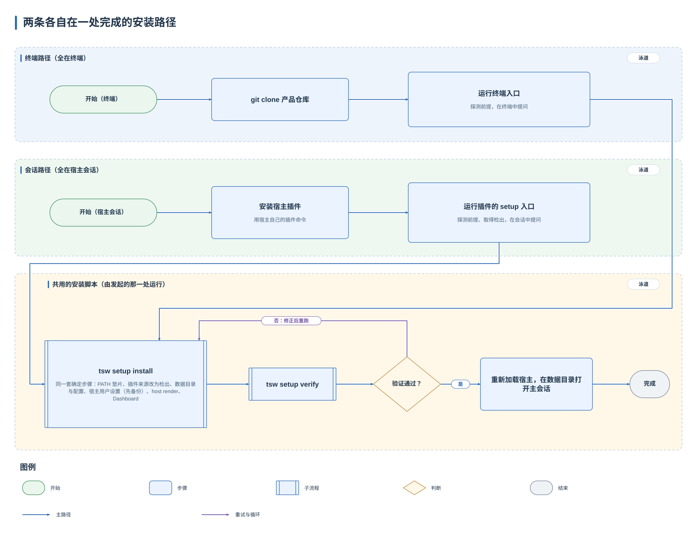

# DN009 分发与安装

- 状态：已确认（T305；用户 2026-11-19 确认两条安装路径与本文的 D1–D3，插件名不改；同日决定数据目录必填、setup 不配置仓库，§6）；§15 安装后的引导与示例任务（T308，用户 2026-11-20 确认）；§5 第 7 步接入 workdeck（T309，用户 2026-11-20 确认）；§16 终端入口的交互（T326，用户 2026-11-21 确认，M-T326-1）
- 日期：2026-11-19
- 相关：[DN001 总体架构](DN001-architecture.md) · [DN003 统一配置](DN003-unified-config.md) · [DN006 插件层](DN006-plugin-layer.md) · [DN008 校验原则](DN008-guardrails.md) · 实现：[CC009 Claude Code 上的安装](claude-code/CC009-install.md)

## 1. 目标与范围

让没有产品检出的用户从零用上 TaskSteward：拿到运行时、在宿主中挂上 tsw、建好自己的数据目录与基础配置，最后在数据目录中打开主会话。要管理的仓库不在安装中配置，安装后由用户在主会话中逐个加入（§6.1）。

- **两条路径，各自在一处完成**：用户可以全在终端里装，也可以全在宿主会话里装，中途不需要换到另一处。
- **确定的步骤只有一份**：两条路径调用同一个安装脚本 `tsw setup`，入口只负责提问并把答案交给它。
- **安装之后只有一个来源**：宿主运行的插件副本与 tsw 运行时都来自同一个本机产品检出，之后的更新走现有的自我更新流程（DN006 §9.8）。
- 不发布到任何包仓库，不需要令牌。
- 本文与宿主无关；各宿主的命令、插件形式与限制写在各自的实现文档中（见开头的“实现”）。

## 2. 原则

1. **运行时来自产品的 git 检出**。数据目录、宿主插件、自我更新、运行版本的记录与 Dashboard 计划任务都以检出为前提：`tsw host update-plan` 按两个提交之间改动的文件决定步骤，`rendered.commit` 与运行时提交来自检出（DN006 §9.8、§9.9）。运行时只用标准库，检出即可运行，不需要包管理器。宿主插件的缓存副本里没有运行时，插件中的启动器从数据目录记录的 `product_repo` 加载它（DN006 §9.1）。
2. **宿主插件仍然需要**。它是把 tsw 的工具注册与规则执行挂到每个宿主会话上的打包形式（DN006 §6），可以整体启用、停用与更新，也是会话路径中 setup 入口所在的地方。
3. **安装后插件来源指向本机检出**。不论从哪条路径开始，安装结束时宿主的插件来源都是本机检出，插件副本的版本就是检出的 HEAD；检出前进后由 `host render` 更新副本（DN006 §6.2 的 `update_plugin`）。所以检出与插件副本不会落在不同提交，不需要另设发布分支。
4. **确定的执行序列由脚本完成**。探测前提、克隆、写垫片与 PATH、注册插件来源、初始化数据目录、写用户设置、render、登记 Dashboard、验证都在 `tsw setup` 与两个不依赖 Python 的探测脚本中；宿主的模型只解释、提问与调用，不拼路径、不判断某一步该不该做。
5. **问题清单只有一份**。问哪些问题、哪些必填、默认值与写到哪里定义在 `tsw setup` 中；终端入口逐项问，会话入口按同一份清单在对话中问。
6. **幂等**。每一步先比较现状与目标，已满足就跳过；中途失败修正后重跑；已有安装时只做缺少或不一致的部分。
7. **不替用户登录**。不问、不保存任何令牌或密码；宿主、gh、评审器等的登录由用户在各自工具中完成，`check` 只检查结果。

## 3. 组成

| 部分 | 位置 | 职责 |
| --- | --- | --- |
| 安装脚本 `tsw setup` | tsw 运行时中的子命令 | `check`（只读：前提、已有安装与数据目录、宿主侧状态；`--questions` 输出问题清单）、`plan`（只读：将要执行的动作与用户设置的差异）、`install`（`--interactive` 在终端提问，或 `--answers <文件>`）、`verify`（只读；安装阶段与 `--after-reload` 两个阶段，§9）、`uninstall` |
| 终端入口 | 仓库根 `setup.ps1`（Windows）、`setup.sh`（macOS / Linux） | 不依赖 Python：探测前提，缺少时经用户同意用系统包管理器安装，然后用找到的解释器运行 `tsw setup install --interactive` |
| 会话入口 | 宿主插件中的 setup 说明（宿主的 skill 或等价物）、探测脚本与取检出脚本 | 在宿主会话中探测前提、取得检出、按问题清单提问，再运行 `tsw setup plan` 与 `install` |
| 安装记录 | 用户级状态目录中的 `install.json`（Windows 为 `%LOCALAPPDATA%\TaskSteward\`） | 每一步改了什么：检出路径、解释器与宿主命令行的完整路径、垫片目录、是否由它加入 PATH、加入的用户设置键与规则名、计划任务名、备份文件；供重跑、升级与卸载使用 |
| 答案文件 | 同一目录的 `setup-answers.json` | 用户的回答，不含凭据；重跑时不必再问 |

宿主集成（DN006 §6.2）为此增加三个操作，由各宿主实现：

| 操作 | 作用 |
| --- | --- |
| `install_plugin(checkout)` | 把检出注册为插件来源并安装插件；插件已从别的来源安装时，改指检出而不卸载；幂等 |
| `apply_user_settings(home, rules, backup)` | 在宿主的用户设置中写入数据目录位置与宿主侧放行规则（DN006 §9.8 的 `host_rules`）；先备份，只改自己加入的键，按规则名替换旧文本 |
| `remove(install_record)` | 卸载插件、移除插件来源与自己加入的用户设置 |

## 4. 两条路径



### 4.1 终端路径

1. 用户克隆产品仓库到固定目录（已有检出时跳过）。
2. 运行终端入口：探测解释器（版本不低于 3.10，不是系统占位程序）、git 与宿主的命令行；缺少的逐项问用户是否用系统包管理器安装，否则给出安装方法并停止。
3. 入口用找到的解释器运行 `tsw setup install --interactive`：先 `check`，再在终端逐项提问（§6），显示 `plan` 并请用户确认，然后执行 §5 的全部步骤，最后 `verify`。
4. 告诉用户重新加载宿主，在数据目录中打开主会话；之后在新的终端或主会话中做重新加载之后的 `verify`（§9）。

### 4.2 会话路径

1. 用户在宿主会话中用宿主自己的命令安装 task-steward 插件（来源是产品仓库），按宿主的要求重新加载插件，使 setup 入口可用。此时 tsw 的工具服务因为还没有数据目录而报错退出，规则执行对无关会话不生效，不影响会话。
2. 用户运行插件的 setup 入口：
   1. 运行探测脚本（与终端入口共用同一段探测）；缺少的项经用户同意用系统包管理器安装，之后用解释器的完整路径继续；
   2. 运行取检出脚本：把产品仓库克隆到固定目录，检出插件当前安装的那个提交；已有检出时校验是同一仓库、工作区干净；
   3. 运行 `tsw setup check --questions`，按清单在对话中逐项提问；
   4. 写答案文件，运行 `tsw setup plan --answers <文件>`，把计划与用户设置的差异给用户看，请用户确认；
   5. 运行 `tsw setup install --answers <文件>`（§5，含安装阶段的 `verify`），把结果告诉用户；
   6. 请用户重新加载宿主，在数据目录打开主会话；之后可在主会话或新的终端中做重新加载之后的 `verify`（§9）。
3. 用户要做的只是回答问题、批准宿主提示的命令，最后重新加载宿主。

### 4.3 不可避免的重新加载

tsw 的工具服务在会话启动时载入（DN006 §9.8），用户级 PATH 的改动只对新进程生效，所以两条路径的最后一步都是重新加载宿主；会话路径在安装插件之后还要按宿主的要求重新加载一次插件。这是宿主的限制，安装脚本不能替用户做。

## 5. `tsw setup install` 的步骤

两条路径相同，每步先判断已满足就跳过。`install.json` 逐步写入（评审 T305 r7）：每个会改动用户环境的步骤，**在改动之前**先记下原状态、备份位置与将要加入的内容（归属），改动完成后再记下结果；重跑时保留第一次记下的归属，不把上次中途失败时自己加入的内容误认为用户原有的。中途失败时，已执行的步骤都有记录：重跑 `install` 从未完成的步骤继续，`uninstall` 按记录只移除自己加入的内容；都不回滚或删除用户数据。

1. **机器级安装项**：记下解释器与宿主命令行的完整路径；写 `tsw` 垫片（内容与当前目标不同时重写）；把垫片目录加入用户级 PATH。
2. **插件**：`install_plugin(检出)`（§3）：终端路径中是第一次注册与安装；会话路径中把已安装插件的来源改指检出。
3. **数据目录**：`tsw init --home <数据目录> --remember`（数据目录是用户给出的必填项，§6）；新数据目录写初始配置（语言、评审器、人类渠道、Dashboard 端口；不含仓库与账号，§6.1）并 `tsw config validate`；已有数据目录不改配置，只报告与答案的差异。
4. **用户设置**（D2，用户同意时）：`apply_user_settings`；不同意时输出要手工加入的文本。
5. **`tsw host render`**：生成数据目录中的主会话说明、skill、设置与 worker 说明，并更新插件副本（DN006 §6.2）。
6. **Dashboard**（用户选择且操作系统已支持时）：`tsw dashboard install`，然后 `tsw dashboard open`（DN006 §8.10；令牌不出现在任何输出中）。
7. **接入 workdeck**（本机有 `workdeck` 命令且用户同意时，T309）：按安装记录中的解释器、检出与数据目录生成 workdeck 插件 manifest（DN006 §8.10“workdeck 插件 manifest”），运行 `workdeck plugin add <manifest> --replace`。`install.json` 记下 manifest 的摘要与“由安装脚本加入”；摘要不变时跳过。`plan` 列出 workdeck 中是否已有同 `id` 的插件，有时写明将替换它（workdeck 先备份自己的配置）。workdeck 拒绝或失败时，这一步报告原因与可以手工运行的命令，不影响其他步骤；workdeck 先写配置、再重启它的 daemon，所以失败后 `workdeck plugin list` 中已是这份 manifest 时仍记为“由安装脚本加入”（卸载时要移除）；之后重跑时 workdeck 对未变的配置不重启 daemon，这一步要等 `workdeck plugin list` 显示 daemon 在运行这个插件才算完成。旧的答案文件（保存的或用 `--answers` 给出的）中没有这一项时按“否”处理，重跑不替用户接入。
8. 记下安装完成，运行安装阶段的 `verify`（§9）。

## 6. 要问用户的配置

用户 2026-11-19 决定：数据目录必须由用户提供，setup 不给默认值；仓库不在 setup 中配置（§6.1）。

| 问题 | 必填 / 默认 | 写到哪里 |
| --- | --- | --- |
| 数据目录位置 | **必填，没有默认值**：终端入口与会话入口都要求用户给出一个路径，空回答时再问；`install --answers` 的答案文件中缺少时拒绝运行，`check` 报告缺少这一项。用户给出已有的数据目录时复用它（§5 第 3 步） | `tsw init`、宿主用户设置中的数据目录位置 |
| 产品检出位置；已有检出时是否复用 | 用户级程序目录下的固定位置（Windows：`%LOCALAPPDATA%\TaskSteward\task-steward`） | `install.json`、`product_repo` |
| 交流语言 | `zh-CN` | `control.language` |
| 评审器 | 只提供本版本已实现的评审器（目前只有 Codex，`codex-app-server`）；找不到它的命令行时 `check` 给出警告（安装照常完成，但任务完成不了自评审，请用户安装并登录）。用户 2026-11-20 决定（T308，M-T308-9）；宿主自己的只读形态（DN006 §10.2）、Copilot CLI 评审与不做自评审的选项见 follow-up F-T308-1 | `roles.reviewer` |
| 人类渠道：只在会话中，或另加外部渠道 | 只在会话中 | `plugins.human_channels`、`input.channels` |
| 宿主（session provider） | 列出已实现宿主集成的宿主，只有一个时直接选定 | `plugins.host_integration`、`plugins.sessions` |
| 是否把 Dashboard 装成登录时启动的服务；端口 | 操作系统支持时是，`47800` | `tsw dashboard install`、`dashboard.port` |
| 是否把 Dashboard 接入本机的 workdeck 门户（T309） | 找到 `workdeck` 命令时是，否则否 | `workdeck plugin add`、`install.json` |
| 是否允许安装脚本维护宿主用户设置 | 是（备份后合并） | `install.json` |

### 6.1 仓库在安装之后配置

要管理的仓库（本机检出路径、托管位置、交付授权）与每个仓库使用的代码托管账号不在 setup 中问，也不写入初始配置；安装完成时配置中没有仓库，这是合法的配置。安装后用户在主会话中按需要逐个加入：主会话经 tsw 的配置工具修改 `repositories.*` 与 `accounts.*`（DN003 §7），其中交付授权、托管目标与账号是权限类键，须用户确认（DN003 §7.2）。`tsw setup` 的升级、修复与重跑不读取、不改动这些键。

## 7. 用户设置与 PATH（D2）

用户 2026-11-19 决定：`tsw setup install` 可以修改宿主的用户设置与用户级 PATH。此前 install hint 写明“tsw 不修改任何全局设置”（DN006 §6.2），由用户手工合并；改为由安装脚本做，约束是：

- 先在 `plan` 中展示改动前后的差异，用户确认后才写；
- 写之前备份原文件，备份路径记在 `install.json`；
- 只改自己加入的键：数据目录位置与宿主侧放行规则（按规则名识别，旧文本替换为新文本），不动其他内容；
- PATH 只追加垫片目录一项，只改用户级、不改系统级；
- 卸载时按 `install.json` 移除自己加入的内容。

`tsw host install-hint` 保留给手工安装的人，内容与 `tsw setup plan` 同源。

## 8. 会话中的例外（D3）

会话路径要在宿主会话中完成全部步骤，而现有规则在会话中拒绝两类命令：`tsw dashboard install` / `open` / `uninstall` 是用户本人的操作，在任何会话中拒绝（DN006 §8.10）；`tsw host render` 只有主会话可以运行（DN006 §9.7）。用户 2026-11-19 决定为安装脚本开例外：

| 调用者 | `tsw setup install` / `uninstall`（含其中的 `dashboard install` / `open` / `uninstall` 与 `host render`） |
| --- | --- |
| 会话外的终端 | 允许 |
| 没有绑定任何数据目录的会话（第一次安装时，tsw 把它解析为无关会话） | 允许 |
| 主会话（升级、修复、卸载） | 允许 |
| worker、例行会话、已撤销、待绑定的会话 | 拒绝 |

- 直接运行的 `tsw dashboard install` / `open` / `uninstall` 与 `tsw host render` 的规则不变。
- 理由：原来防的是会话替用户做“用户本人的决定”，并拿到能登录 Dashboard 的令牌。安装是用户在自己的那一轮中运行 setup 入口发起的；`open` 不输出令牌，只保存摘要（DN006 §8.10），会话仍拿不到能登录的东西；Dashboard 上的验收、退回、取消仍要用户在浏览器中操作。
- worker 与例行会话仍拒绝：它们不应安装或更新宿主（防误认，DN008）。
- 宿主可能为写用户设置、登记计划任务等命令请用户批准，这正是用户本人的授权，安装脚本不绕过。

## 9. 验证

`tsw setup verify`（只读）分两个阶段（评审 T305 r7）。有些结果只有重新加载宿主之后才可见：用户级 PATH 只对新进程生效，已在运行的会话的工具服务仍是旧运行时（`update-plan` 的 `reload` 在重新加载之前是 `pending`，DN006 §9.8）。

**安装阶段**（`install` 最后自动运行，也可单独运行）只核对已持久化的状态：

- 垫片存在，其中的解释器与检出路径等于 `install.json` 的当前目标；用户级 PATH 的持久值中含垫片目录；
- 插件来源指向检出，插件副本等于检出 HEAD；
- `tsw home` 找到数据目录，`tsw config validate` 通过；宿主侧放行规则没有缺失；
- `tsw dashboard status`（已安装时）；
- workdeck（安装脚本接入过时）：记下的 manifest 摘要等于按当前目标重新生成的摘要（解释器、检出或数据目录变化后不等，修正为重跑 `install`）；workdeck 侧的插件状态由 `workdeck plugin list` 查看，`verify` 不读 workdeck 的配置；
- 不加载用户 site-packages 时运行时仍能加载，工具服务能完成一次握手。

只能在重新加载后确认的项列为“待生效”（`pending_reload`），不算失败；其余项失败时说明原因，修正后重跑 `install`。

**重新加载之后**（`tsw setup verify --after-reload`，在新的终端或主会话中运行）：PATH 中的 `tsw` 解析到垫片；`tsw host update-plan` 的 `pending` 为空（主会话的运行时已是检出 HEAD）。

## 10. 幂等、升级、修复与卸载

- **升级**：在主会话中要求更新，主会话按现有的自我更新流程做（DN006 §9.8）：拉取并快进检出、`update-plan`、`host render`（含插件副本）、重启 Dashboard、按配置重新加载。`update-plan` 的 `install` 类别改为：垫片模板或安装步骤改变时，重新运行 `tsw setup install`（主会话中按 §8 可以直接运行，或在终端运行）；`host_rules` 在用户同意由安装脚本维护时同样重跑安装。
- **修复**：重跑任一路径；已有安装时先 `check`，只做缺少或不一致的部分。
- **卸载**：`tsw setup uninstall`（终端，或主会话中的 setup 入口）：`tsw dashboard uninstall`；安装脚本接入过 workdeck 时，`workdeck plugin list` 中该 `id` 仍是安装加入的那一项才 `workdeck plugin remove <id>`（用户之后改过的保留；读不到列表时不移除，报告手工命令；被替换掉的旧插件项不恢复，在 workdeck 的配置备份中）；`remove(install_record)`；删除垫片与它加入的 PATH 项。**数据目录永远不删**（账本是用户的数据），只告诉用户位置与 `tsw backup` 的用法；检出由用户自己删除（会话路径中 setup 克隆的检出，经用户确认后可删）。

## 11. 产品仓库的位置（D1）

用户 2026-11-19 决定：产品仓库留在现在的公开仓库。

- 两条路径都只需要从公开仓库克隆：不需要账号、令牌或单点登录。
- 不发布到任何包仓库（PyPI、npm 等）；release.md 的发布规则在第一次正式发布时再定版本号与标签。
- 若以后迁到组织的内部仓库，每个用户都要先在 git 凭据助手中存好有权读取该仓库的账号凭据，宿主克隆插件来源时不会提示输入凭据；这会成为两条路径的新前提，届时更新本节。

## 12. 操作系统

| 项 | Windows | macOS / Linux |
| --- | --- | --- |
| 终端入口与探测 | `setup.ps1`（Windows PowerShell 5.1 自带）；winget | `setup.sh`（POSIX sh）；Homebrew / 发行版包管理器 |
| 解释器命令名 | `python` | 常见只有 `python3`：插件中写死的解释器命令要改为可配置 |
| 垫片与 PATH | `tsw.cmd` 与无扩展名的 sh 脚本（Git Bash 用）；用户级 `Path` | `~/.local/bin/tsw` 一个 sh 脚本；不在 PATH 时提示用户改 shell 配置，不自动改 |
| Dashboard 常驻 | 已实现（DN006 §8.10） | 未实现 |
| 安装记录与令牌目录 | `%LOCALAPPDATA%\TaskSteward\` | 待定（如 `~/Library/Application Support/TaskSteward`、`$XDG_STATE_HOME/TaskSteward`） |

先实现 Windows。

## 13. 对其他文档的影响

- DN006 §6.2：宿主集成增加 §3 的三个操作；install hint 与 `tsw setup plan` 同源，不再写“不修改全局设置”。
- DN006 §8.10、§9.7：会话中的例外见 §8。
- DN006 §9.1：运行时的定位写明安装脚本管理的检出与垫片，可编辑安装只对开发者保留。
- DN006 §9.8：`install` 与 `host_rules` 动作改为重跑 `tsw setup install`。
- release.md：分发方式的 `TODO(decision)` 由本文决定。

## 14. 待验证

- 两条路径在干净环境中各从零走到主会话可用（live）；
- 一位没有产品检出的用户真实试装；
- 没有解释器或 git 的机器上的探测与安装；
- macOS / Linux 全部。

## 15. 安装之后：第一个主会话与示例任务（提议，T308）

用户 2026-11-20 在另一台机器上试装后提出（T308，M-T308-4）：安装完毕后应提示用户用一个新会话在数据目录中开始工作，并引导用户执行一个示例任务，由它直观展示 tsw 的主要功能；安装会话本身不应成为主会话。用户 2026-11-20 确认本节（M-T308-5、M-T308-6、M-T308-7）。

### 15.1 安装会话不领租约

在数据目录（就是那个文件夹本身）中打开的会话是主会话（DN001、CC008 §5.2），主会话在会话开始时租约空闲就自动领取（DN001 §6.4）。试装中用户在一个新建的空文件夹里打开会话，又把这个文件夹答成数据目录：安装完成、宿主重新加载后，这个安装会话按规则被认作主会话，领取了调度租约，而用户并没有让它编排。

用户 2026-11-20 决定（M-T308-5）：不拒绝这样的安装，照常安装，只是安装会话不领租约。做法沿用“让出过租约的会话”（DN001 §6.4）：

- `tsw setup install` 在一个会话中运行、且这个会话当时没有绑定任何数据目录（第一次安装，角色为 none）时，数据目录建好后立即在它的账本中把这个会话记为让出（之后的步骤失败也已记下；会话 ID 先写进 `install.json`，同一会话重跑时仍认作安装会话）（`controller.lease_stood_down`，`via: setup`）。之后它在会话开始时不自动领取租约，只读运行；用户在这个会话中明确要求它担任主会话时，它显式 `lease_acquire`，与交接后的旧主会话相同。
- 主会话中重跑安装（修复、升级）不记让出：它本来就是主会话。终端中运行没有会话，不记。
- 会话入口在提问数据目录时说明：在数据目录中打开的会话是主会话，建议在数据目录之外的会话中安装、之后在数据目录中开新会话工作（§15.2）；不强制。

### 15.2 安装后的引导

用户 2026-11-20 确认（M-T308-6）：安装之后必须重新加载宿主，新会话才用上新的用户设置与插件（试装实测），所以安装会话不替用户创建主会话。`tsw setup install` 结束时（安装阶段的 `verify` 之后）的 `next` 与两个入口都告诉用户三件事：

1. 重新加载宿主（Claude Code：完全退出并重新打开 Claude app）；
2. 在数据目录中新建一个会话，它是主会话；
3. 在这个会话中输入开始主会话的命令（Claude Code 为 `/orchestrate`，以后每次开主会话都这样，用户 2026-11-20 决定，M-T308-8；换主会话时旧主会话还持有调度租约，新会话先只读，按 DN001 §6.4 交接）。主会话发现账本中还没有任何任务（新环境）时，先给用户导览（§15.3），并提议登记一个示例任务；不想现在看可以跳过，之后随时说“开始示例任务”。要管理的仓库同样在主会话中告诉它（§6.1）。

### 15.3 示例任务

用户 2026-11-20 决定（M-T308-6）：示例任务不需要命令，也不建示例仓库，完全在会话中完成。主会话有一个导览与示例 skill（`tsw-demo`，与 orchestrate、task-intake 一样由 `tsw host render` 生成到数据目录）。新环境（账本中没有任务）时主会话按它先导览：主会话、worker 与账本是什么，当前配置（语言、评审器、人类渠道与超时、Dashboard），怎样打开 Dashboard，怎样加入仓库开始真实工作，最后提议示例任务。用户同意（或说“开始示例任务”）时主会话按它执行：用**一个真实的任务**走一遍 tsw 本身的功能，任务的报告记录它自己的执行过程，最后引导用户在会话与 Dashboard 中看报告、用 Dashboard 的功能并验收。运行需要模型调用（一个 worker 会话与评审），开始前告诉用户并请用户确认。

**任务**：研究类任务，不关联真实仓库。规划要求任务的仓库在配置中（G-PLAN），所以开始前主会话以用户确认开始的原话，经 `config_change` 在配置中加入 `repositories.tsw-demo`：不写 `path`、交付授权全部为 false；没有路径时 tsw 不建 worktree，执行目录是数据目录的 `work/<任务>/<attempt>/`，不推送、不开 PR（第二轮试装发现 skill 漏了这一步，M-T308-8）。已有同名条目只在没有 `path`、交付全关、且不与别的仓库的别名冲突时复用，否则停下请用户处理；清理时默认保留它。开始前核对配置的评审器是本版本已实现的（目前只有 `codex-app-server`），否则示例完成不了自评审，先请用户处理。目标是写一份“TaskSteward 示例任务报告”，内容就是这个任务自己的执行过程。目标、验收与提问点写在 skill 中，主会话原样登记，不自己发挥。验收要求报告包含：

| 报告中的一节 | 展示什么 | 来源 |
| --- | --- | --- |
| 任务的一生 | 简要解释任务状态机（受理、计划、派发、执行、自评审、待验收、验收，以及退回、暂停、取消），并列出本任务实际经过的状态与时间 | DN002；本任务的账本（`context_task`） |
| 向用户提问 | worker 在自己的会话中向用户提一个问题（例如报告的侧重：给新用户看的入门，还是内部机制），按答复写报告；说明按配置 `input.in_session_timeout_minutes`（默认 10 分钟）无人回答时，问题由例行会话转交主会话、主会话代答或经人类渠道转达，用户之后的答复记为迟到答复、以用户的话为准 | worker 说明、DN006 §8.1；本任务的问题记录 |
| 与评审器的互动 | 写这一节之前各轮自评审的意见与处置（修复、拒绝及理由）；补写后的补审不再写回报告，报告指向 Dashboard 中的评审轮次（否则每次补写都引出新一轮）；说明评审器由配置 `roles.reviewer` 决定、阻断意见与预算（`review.max_rounds`） | DN004；本任务的评审记录 |
| 记录 follow-up 与偏好候选 | worker 记一条 follow-up（例如“把示例报告做成网页导览”），说明 follow-up 与偏好候选是什么、在 Dashboard 中哪里看到 | DN002 §5.7、DN007 §6.3 |
| 你接下来可以做什么 | 在 Dashboard 中验收或退回、在主会话中加入仓库开始真实任务 | — |

**用户看到什么**：开始时主会话说明会发生什么、请用户打开 Dashboard：已安装常驻服务时主会话直接给出可点击的链接（看板与这个任务的单任务视图，用户 2026-11-20 要求，M-T308-10），页面要求登录时请用户在终端运行一次 `tsw dashboard open`；没有安装时请用户运行 `tsw dashboard`；worker 提问时提醒用户去侧栏的 worker 会话回答，也可以故意不答，看超时转交；任务提交后主会话做技术验收，在会话中简述报告并给出报告路径，然后引导用户在 Dashboard 中看看板与任务流、打开单任务视图（任务书、attempt 与会话链接、评审轮次、问题、follow-up、时间线、报告），最后在 Dashboard 中验收（或退回一次，看任务回到执行）。

**之后**：示例任务与普通任务一样留在账本中，用户可以归档它；不删除账本（§10）。

## 16. 终端入口的交互（T326）

用户试装后提出（T308，M-T308-10）：终端入口太粗糙，要更现代的终端体验，有颜色，能真的选择，而不是要求用户输入字符串。现在 `tsw setup install --interactive` 每一问都是一行文字：选择题要照着提示打出 `teams-chat`、是否题要打“是”，计划与结果是单色的列表，最后的确认也要打字。

### 16.1 目标与边界

- **选择而不是输入**：选择题与是否题用方向键移动、回车确认；只有本来就要用户给出的值（数据目录路径、语言标签、端口）才输入文字，回车采用默认值。
- **有颜色、有层次**：标题、问题、默认值、成功、警告与错误用颜色与符号区分；回答过的问题收成一行。
- **问题清单仍只有一份**（§2 原则 5）：交互层只读 `tsw setup` 问题清单中的类型、选项、默认值与说明，不自己定义问题；校验仍是清单的 `normalize`。会话入口（宿主中的 setup 说明）与 `install --answers` 不变。
- **不支持时自动回退**：不在交互终端中（管道、重定向、宿主的工具调用）、终端不支持颜色控制、或用户要求纯文本时，回到现在的逐行文字问答，行为与输入格式不变。
- **运行时只用标准库**（AGENTS.md 第 7 节，§2 原则 1）：不引入第三方包。
- 不做全屏界面、鼠标操作与窗口大小改变后的重绘；不改其他命令的 `[y/N]` 确认。

### 16.2 做法（推荐）

在 tsw 运行时中用标准库实现一个小的终端交互层，只供 `tsw setup install --interactive` 使用：

- **输出**：ANSI 转义序列（16 色、粗体、暗色、光标上移与清行）；各宿主操作系统怎样打开终端的转义序列处理写在实现文档中。
- **按键**：在原始模式下逐键读取（方向键、回车、Esc、数字、`y` / `n`、Ctrl+C）；文字输入仍用终端自己的行编辑（保留输入法、粘贴与系统的编辑键），只在提示上加颜色。
- **终端入口自己的提问**（运行 Python 之前，例如“现在用系统包管理器安装 Python 吗”）用入口脚本语言实现同样的方向键选择，外观与 Python 部分一致；不能逐键读取时回退到逐行输入。
- 先实现 Windows（§12）；其他操作系统在有终端入口（`setup.sh`）时补上逐键读取，在此之前自动回退到纯文本问答。

方案比较见附录 A 的“终端交互”一项。

### 16.3 交互规范

整个流程按顺序显示五段，每段有标题：

| 段 | 显示 | 操作 |
| --- | --- | --- |
| 环境 | 产品检出、Python、宿主命令行各一行，满足的标 `√`（绿），缺少的标 `×`（红）；警告（如找不到评审器命令行）标 `!`（黄） | 无 |
| 问题 | 标题带进度（`问题 3/8`）；问题文字为粗体，说明（`note`）为暗色，在问题下方 | 见下表 |
| 计划 | 每一步一行：要做 `►`（青）、已满足 `√`（暗色）、不做 `–`（暗色）、手工 `!`（黄）、受阻 `×`（红）；动作与用户设置的差异缩进为暗色；问题为红色，注意为黄色 | 方向键选择：**按计划安装** / **修改某个答案** / **取消** |
| 安装 | 每一步开始时显示 `► 正在…`，结束后在原处改为 `√` / `–` / `!` 与结果 | 无（一步失败时显示红色的原因，停止） |
| 结果 | 核对逐项 `√` / `×`；“下一步”（§15.2 的三件事）单独成段、加粗，`/orchestrate` 高亮 | 无 |

各类问题的操作：

| 类型 | 显示与操作 |
| --- | --- |
| 选择（`choice`） | 竖排列出选项，每项是说明加选项值（例如 `只在会话中  in-session`），默认值后标“（默认）”；光标 `►` 起始于上次的答案或默认值。`↑` / `↓` 移动（首尾循环），数字键直接跳到第 n 项，回车确认 |
| 是否（`bool`） | 同上，两项“是 / 否”；另外 `y` / `n` 直接选中，`←` / `→` 也可移动 |
| 文字（`path`、`text`、`int`） | 一行输入，暗色提示“回车采用 <默认值>”；必填项没有默认值时提示“必须由你给出”；校验失败时在下方显示红色原因并重新输入同一问 |
| 入口已决定的（`asked_by: entry`） | 只显示一行，不提问 |

- **回答后收起**：一个问题答完后，它占的几行清除，改为一行 `√ 评审器：codex-app-server`（勾为绿色，答案为粗体），屏幕上留下已回答的清单。
- **修改与回退**：在选择题中按 `Esc` 回到上一问；计划段的“修改某个答案”先用方向键选出要改的问题，重新回答后再生成一次计划。答案在显示计划前保存（与现在相同），修改后再次保存。
- **取消**：任何时候按 Ctrl+C 结束，显示“已取消”，不执行任何步骤；已经保存的答案留着，下次作为默认值。计划段选“取消”同样不执行、答案保留。
- **选项的说明**：问题清单为选择题增加选项说明（`labels`，选项值到中文说明的映射；没有说明的选项只显示值）。`tsw setup check --questions` 的输出同样带上它（只增字段），会话入口可以用来展示。
- **输出不混入机器格式**：交互界面下最后不再打印结果的键值列表（只有 `--json` 时输出 JSON）；纯文本回退时与现在相同。

示意（选择题，光标在第二项）：

```text
 TaskSteward 安装                                             问题 5/8
 √ 数据目录：D:\tsw-home
 √ 交流语言：zh-CN
 √ 评审器：codex-app-server

 需要你决定的事怎样找到你
   teams-chat 表示会话中之外另加 Teams 自聊（需要 WorkIQ）
     只在会话中            in-session（默认）
   ► 另加 Teams 自聊       teams-chat

 ↑↓ 选择  回车 确认  Esc 上一问  Ctrl+C 取消
```

### 16.4 何时启用，何时回退

| 条件 | 方向键界面 | 颜色 |
| --- | --- | --- |
| 标准输入与标准输出都是交互终端，且终端能打开转义序列处理 | 启用 | 启用 |
| 标准输入不是交互终端（管道、重定向、测试） | 回退到逐行文字问答 | 标准输出是交互终端时启用 |
| 标准输出不是交互终端，或 `TERM=dumb` | 回退 | 不启用 |
| 设置了非空的 `NO_COLOR`（[no-color.org](https://no-color.org/) 约定） | 启用（反显代替颜色标出光标） | 不启用 |
| 命令行加 `--plain` | 回退 | 不启用 |
| 操作系统还没有实现逐键读取（§16.2） | 回退 | 按上面各行 |

符号只用常见终端字体都有的字形（`►` `√` `×` `!` `–`）；标准输出的编码不能表示它们时改用 ASCII（`>` `+` `x` `!` `-`）。

### 16.5 安装进度

`tsw setup install` 的步骤函数增加一个可选的进度回调：每一步开始与结束时调用（步骤名、状态、结果）。交互界面用它逐步显示；`--answers` 与 `--json` 的运行不传回调，输出不变。

### 16.6 测试

- unit：按键解码（各操作系统原始按键序列到“上、下、回车、Esc、数字、y/n、Ctrl+C”）、选择的状态（移动、循环、数字、默认值、回退）、启用与回退的判断（§16.4 每一行）、显示宽度（中文按两列计）、有无颜色时的输出。
- component：交互层的按键来源与输出替换为脚本给定的按键序列与内存中的屏幕（只替换控制台这个平台），完整跑一遍 `install --interactive`：提问、收起、修改答案、取消、安装进度与结果，核对写出的答案与安装结果。
- surface：管道输入的 `setup.ps1` 与 `install --interactive`（现有测试）照常通过且输出中没有转义序列；`--plain` 与 `NO_COLOR` 时没有转义序列。
- 本机实测：在真实控制台中运行 `setup.ps1`（隔离的 `LOCALAPPDATA`、`HOME` 与宿主配置目录），走完提问、计划、安装与结果，并截图。

## 附录 A：备选方案存档

- **终端与会话交替**：克隆 → 终端引导（垫片、PATH、插件）→ 会话中提问并生成计划 → 回到终端应用 → 验证。动机是现有规则不让会话运行 Dashboard 登记与 render。用户认为在两处来回切换太绕，改为本文的两条路径，并为安装脚本开 §8 的例外。
- **只经远端插件来源分发**：插件来自远端插件来源，检出另行快进，二者可能落在不同提交，需要发布分支、固定单次目标与更新后的收敛规则。本文的会话路径同样从远端来源开始，但安装时改指检出，之后只有一个来源。
- **不用插件，直接把检出注册到宿主的用户级配置**：升级要逐条改写用户的配置，失去插件的整体启用 / 停用 / 更新与副本一致性检查，setup 入口也没有地方放。
- **运行时随插件进缓存**：缓存没有 git 历史、目录随版本变化，`update-plan`、运行版本记录与 Dashboard 工作目录都要改为基于版本文件；收益是不需要 git，而 git 本来就是 worktree 与评审的前提。
- **用包管理器从 git 安装运行时**：插件与 skill 的来源不在包里，没有 git 历史，仍需要包索引。
- **发布到包仓库（PyPI、GitHub Packages 等）**：需要令牌或包权限，用户不采用。
- **插件改名为 `tsw`**：命令更短，但要改插件 ID、工具前缀与生成的规则；用户决定不改（`tsw` 只是命令行名）。
- **终端交互（§16）**：采用的做法是标准库自己实现的交互层（§16.2）。比较过的其他做法：

  | 做法 | 好处 | 不采用的原因 |
  | --- | --- | --- |
  | 第三方交互库（questionary、InquirerPy、prompt_toolkit、rich 等），装在安装入口自己的虚拟环境里，不进入运行时 | 外观与按键处理成熟，跨平台 | 安装时要从包索引下载，违背“检出即可运行、不需要包管理器”（§2 原则 1），代理与离线环境会失败；还要管理、升级与卸载这个环境；只为一次安装引入依赖 |
  | 交互全部写在入口脚本里（PowerShell 读 `check --questions` 的清单，逐项问，写答案文件后运行 `install --answers`） | Python 部分不用改 | 提问、校验提示、计划与结果的显示要在 PowerShell 与以后的 `setup.sh` 各写一遍，与 `install --interactive` 分成两套；校验要往返调用或重复实现 |
  | 标准库 `curses` | 完整的终端界面库 | Windows 的 Python 没有 `curses`（要另装 `windows-curses`） |
  | 保留逐行问答，选项改为编号（输入 1、2） | 改动最小 | 仍要输入，不是用户要的“真的选择”，也没有颜色与层次 |
