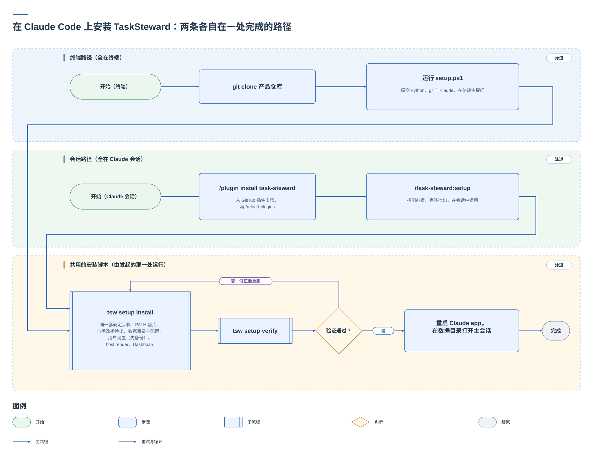

# CC009 Claude Code 上的安装

- 状态：已确认（T305；用户 2026-11-19 确认；同日决定数据目录必填、setup 不配置仓库，DN009 §6）；T308 实现，§5 增加插件使用的解释器 `env.TSW_PYTHON`，§9 记录 live 结论
- 日期：2026-11-19
- 实现：[DN009 分发与安装](../DN009-distribution-and-install.md)
- 相关：[CC006 Claude Code 插件](CC006-plugins.md) · [CC008 Claude Code 上的护栏](CC008-guardrails.md)

## 1. 范围

DN009 的两条安装路径在 Claude Code（Windows 上的 Claude 桌面 app 与 `claude` CLI）中的做法：插件与市场、一步安装、把市场改指本机检出、setup skill、用户设置与 auto 模式规则、会话中的例外、重新加载，以及 Windows 上的入口与垫片。依据是 T305 的实测（Claude Code 2.1.302，独立的 `CLAUDE_CONFIG_DIR`）与官方文档（[Create a marketplace](https://code.claude.com/docs/en/plugin-marketplaces)、[Host and maintain a marketplace](https://code.claude.com/docs/en/plugins/host-marketplace.md)、[Plugin manifest reference](https://code.claude.com/docs/en/plugins/manifest-reference)）。

插件名、市场名与插件 ID 保持 `task-steward` / `task-steward@task-steward`（用户 2026-11-19 决定不改名）。

## 2. 给用户的安装说明



**在终端安装**（PowerShell）：

```powershell
git clone https://github.com/flyrobin620/task-steward.git "$env:LOCALAPPDATA\TaskSteward\task-steward"
& "$env:LOCALAPPDATA\TaskSteward\task-steward\setup.ps1"
```

脚本会问几个问题（数据目录位置必须由用户给出，没有默认值），做完后请用户重启 Claude app，在这个数据目录中打开一个会话。

**在 Claude 中安装**（在任意一个会话中逐条输入）：

```text
/plugin install task-steward --marketplace https://github.com/flyrobin620/task-steward.git
/reload-plugins
/task-steward:setup
```

setup 在会话中提问（同样要求用户给出数据目录位置）并做完，最后请用户重启 Claude app。过程中 Claude 会请用户批准几条命令（克隆仓库、写用户设置与 PATH、登记 Dashboard 计划任务等）。

两条路径的前提相同：Python 3.10+、git、Claude Code（桌面 app 与 `claude` CLI）。安装不配置要管理的仓库；重启后在主会话中告诉它要管理哪些仓库，由主会话逐个加入配置（DN009 §6.1）。

## 3. 插件与市场

| 项 | 做法 | 依据 |
| --- | --- | --- |
| 一步安装 | `claude plugin install task-steward --marketplace https://github.com/flyrobin620/task-steward.git` 先添加市场再安装（会话中为 `/plugin install … --marketplace …`）；公开仓库不需要凭据 | 实测（CLI）：添加市场并安装成功，安装记录的 `gitCommitSha` 为来源提交 |
| HTTPS 写法 | 用 `https://…git`，不用 `owner/repo`：`owner/repo` 先探测 SSH，会话中的 `/plugin` 与插件更新不会回退到 HTTPS，没有 SSH key 的用户会失败 | 文档 |
| 缓存中没有运行时 | 市场条目的来源是 `./plugin`，缓存副本只有 `plugin/` 的内容；启动器 `bin/tsw_launch.py` 经数据目录的 `product_repo` 加载检出中的运行时（CC006 §2） | 实测：只装插件、没有检出时 `tsw_launch.py` 报告找不到运行时 |
| 改指检出（`install_plugin`） | `claude plugin marketplace add <检出>`：同名市场已存在时 Claude Code 把它改指新来源，已安装的插件不卸载，之后从新来源更新 | 实测：输出 “Marketplace 'task-steward' was already added from git:… and now points at dir:<检出>. Plugins already installed from it now update from the new source.”；`enabledPlugins` 不变；检出提交后 `claude plugin update` 换上新副本 |
| 第一次注册（终端路径） | `claude plugin marketplace add <检出>`，再 `claude plugin install task-steward@task-steward`（用户范围） | 实测：副本版本等于检出 HEAD |
| 更新 | 不变：`tsw host render` 运行 `claude plugin update task-steward@task-steward`（CC006 §2），副本跟随检出 | 实测 |
| 后台自动更新 | 不打开：本地目录市场没有远端可查，更新只经主会话的自我更新 | 文档：第三方市场默认关闭 |
| 宿主命令行的路径 | `claude` 不一定在 PATH 中（桌面 app 的安装位置为 `%LOCALAPPDATA%\Programs\ClaudeCode\claude.exe`）；入口探测时先查 PATH 再查这个位置，路径记进 `install.json`，tsw 之后（含 `host render` 的插件更新）用它 | 本机核对；`tsw/host/plugin_copy.py` 现在找不到 `claude` 时只报告、不更新 |

## 4. setup skill 与会话入口

- `plugin/skills/setup/SKILL.md`，会话中为 `/task-steward:setup`。插件 skill 在每个会话中都可见（CC006 §8.2），描述写明“只在用户要求安装、修复、升级或卸载 TaskSteward 时使用”。
- skill 正文用 `${CLAUDE_PLUGIN_ROOT}` 引用插件中的脚本（Claude Code 在载入 skill 时代入路径，文档）：
  - `${CLAUDE_PLUGIN_ROOT}/setup/prereq.ps1`：探测 Python、git、`claude`，与仓库根 `setup.ps1` 共用同一段代码；
  - `${CLAUDE_PLUGIN_ROOT}/setup/fetch_checkout.py`（标准库）：克隆产品仓库到固定目录，检出 `installed_plugins.json` 中本插件安装记录的 `gitCommitSha`。
- 之后 skill 运行检出中的 `tsw setup check --questions`、`plan`、`install`（DN009 §4.2）。skill 只解释、提问与调用。
- `/plugin install` 之后要 `/reload-plugins` 或新会话，skill 才出现（文档：插件在新会话或重新加载后生效）；桌面 app 中能否省掉这一步待 live 验证。
- `plugin/` 顶层有 `bin/`：claude.ai 组织同步会拒绝这样的插件（文档）。本设计不经组织同步分发，不改。

## 5. 用户设置与 auto 模式规则（`apply_user_settings`）

- 文件：用户设置 `~/.claude/settings.json`（设置了 `CLAUDE_CONFIG_DIR` 时用其中的 `settings.json`）。
- 写入：`env.TSW_HOME`（会话从这里得到数据目录，DN006 §9.1）、`env.TSW_PYTHON`（插件的 MCP server 与 hooks 使用的解释器，见下）与 `autoMode.allow` 中 install hint 的三条规则（TaskSteward Worker Dispatch、Worker Merge、Routine；CC008 §6），按规则开头的名称识别并替换旧文本；先备份为带时间的副本（`%LOCALAPPDATA%\TaskSteward\backups\`，路径记进 `install.json`）。写之前在 `install.json` 记下这两个键原来的值与原来已有的规则名。
- 移除（`remove`）：仍等于安装时写入的值的 env 键恢复为原来的值（原来没有就删除），之后被用户改过的不动；删除安装时加入的规则，安装前就有的同名规则保留（文本已是新的）；先备份。
- 解释器可配置（DN009 §12）：插件的 `.mcp.json` 与 hooks 用 `${TSW_PYTHON:-python}` 运行启动器，没有设置时仍是 PATH 中的 `python`。Claude Code 在 `.mcp.json` 中展开 `${VAR:-default}`，hooks 的命令在 Windows 上由 Git Bash 运行（文档）；T308 实测两处都按 `TSW_PYTHON` 运行指定的解释器、未设置时回落到 `python`（Claude Code 2.1.302，`--plugin-dir` 加载的探针插件）。安装脚本把它设为找到的解释器的完整路径：新装的 Python 不在桌面 app 进程的 PATH 中时插件也能启动。
- Claude Code 自动重新载入设置文件（CC006 §11.1）。

## 6. 会话中的例外（DN009 §8）

- 会话的判断与现有命令相同（CC008 §5.2、§5.7）：Claude Code 给会话中的进程设置 `CLAUDE_CODE_HOST_SESSION_ID` 与 `CLAUDECODE`；`tsw` 按账本解析会话 ID。还没有数据目录时，或会话不在任何数据目录中、也没有绑定 attempt 时，角色为 none（无关会话）。
- `tsw setup install` / `uninstall`：会话外的终端、角色为 none 的会话与主会话允许；worker、例行会话、已撤销与待绑定的会话以 `host_session_cli` 拒绝。它们内部运行的 `dashboard install` / `open` / `uninstall` 与 `host render` 随之放行；直接运行这些命令的规则不变（CC008 §5.7）。
- 无关会话不经 tsw hooks（CC008 §3），所以第一次安装时没有 hook 拦截；CLI 的判断是唯一的门。worker 与例行会话另由 PreToolUse 按命令分词拦下 `tsw setup`（与 `host render` 相同的做法，CC008 §5.7）。
- auto 模式下，写用户设置（改 agent 自己的权限规则）与登记计划任务可能被分类器拦下或要求确认；`default` 模式下宿主会逐条请用户批准。这是用户本人的授权，tsw 不为 `tsw setup` 生成允许规则，也不在 install hint 中加规则。

## 7. 重新加载

- tsw MCP server 只在会话启动时载入，`/reload-plugins` 不换 MCP（CC006 §11.1）：两条路径最后都请用户重启 Claude app。
- 会话路径在 `/plugin install` 之后先 `/reload-plugins`（§4）。
- 安装过程中插件的 tsw MCP server 因为还没有数据目录而报错退出；hooks 对无关会话不生效。重启 app 后在数据目录打开的会话是主会话。
- 重启 app 之后的验证（DN009 §9 的 `tsw setup verify --after-reload`）：在主会话中运行，核对 `whoami` 的 `runtime.commit` 等于检出 HEAD、`update-plan` 的 `pending` 为空，并在主会话的 Bash 工具中核对 `tsw` 解析到垫片（重启后的 app 进程已继承新的用户级 PATH）。终端路径在新开的终端中运行同一命令即可；两条路径都不需要换到另一处。

## 8. Windows 上的入口与垫片

- `setup.ps1`（Windows PowerShell 5.1 自带）：
  - Python：`Get-Command python`，版本不低于 3.10，路径不在 `WindowsApps` 下（Microsoft Store 占位程序）；缺少时问用户是否 `winget install Python.Python.3.12`，装好后用完整路径继续（新装的解释器不在当前进程的 PATH 中），并提示在“应用执行别名”中关闭 `python.exe` / `python3.exe`；
  - git：`git --version`；缺少时问是否 `winget install Git.Git`；
  - `claude`：先查 PATH，再查 `%LOCALAPPDATA%\Programs\ClaudeCode\claude.exe`；缺少时给出 Claude Code 的安装方法并停止；
  - 然后运行 `python -X utf8 -m tsw setup install --interactive --python <路径> --claude <路径>`。
- 垫片写在 `%LOCALAPPDATA%\TaskSteward\bin`，并加入 `HKCU\Environment` 的 `Path`：
  - `tsw.cmd`：`@"<python>" -X utf8 "<检出>\plugin\bin\tsw_launch.py" %*`（cmd、PowerShell）；
  - `tsw`（无扩展名的 sh 脚本）：`exec "<python>" -X utf8 "<检出>/plugin/bin/tsw_launch.py" "$@"`（Git Bash，即 Claude 的 Bash 工具）。
  - 实测：只有 `.cmd` 时 Git Bash 找不到命令；两个都有时 Git Bash、cmd、PowerShell 都能找到。
- Dashboard 常驻服务：复用 `tsw dashboard install`（CC006 §12）。
- 实测环境注意：在数据目录之下用独立的 `CLAUDE_CONFIG_DIR` 添加 GitHub 市场，Claude Code 最后一步的目录重命名会以 `EPERM` 失败（同一操作在 `%TEMP%` 下成功）；live 场景的临时配置放在 `%TEMP%` 下。

## 9. 待验证（live）

- 桌面 app 会话中 `/plugin install task-steward --marketplace …` 的写法，以及是否必须 `/reload-plugins`；
- auto 模式下 `tsw setup install` 写用户设置、登记计划任务时的批准提示；
- Claude app 的 Terminal 面板中运行的命令是否带 `CLAUDECODE`（若不带，setup skill 也可以把 `install` 交给 Terminal 面板，由用户批准运行）；
- 两条路径在干净的 `CLAUDE_CONFIG_DIR` 与临时 HOME 中各从零走到主会话可用。
